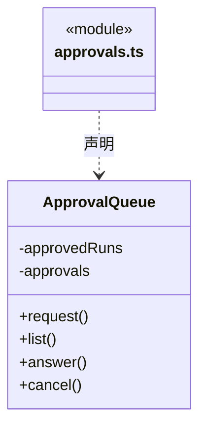
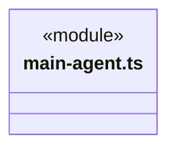
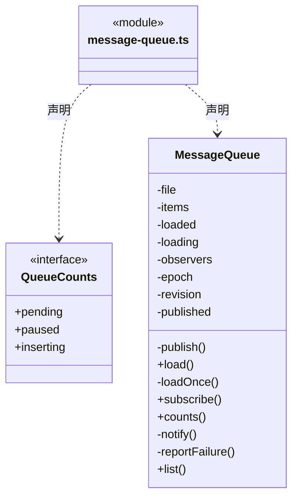
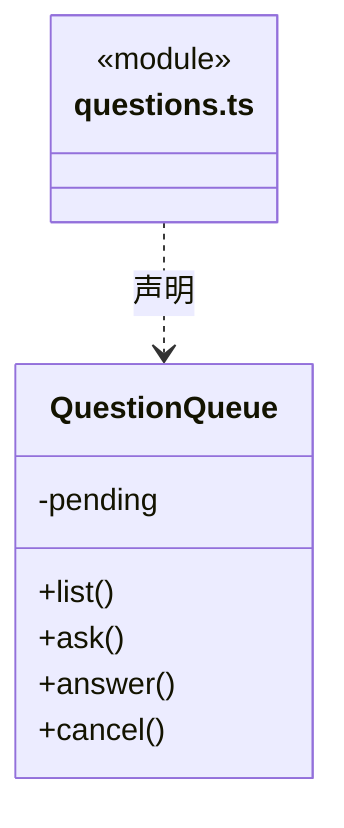

# src/backend/scheduler-engine/conversation 架构

## 目录定位

主 Agent 指引、用户问题、运行内审批及队列。普通问答保持轻量，实现任务记录目标、步骤和证据；停止与结束清理临时授权。

本文描述当前实现。通过分析目录边界后维护的 [源码架构脚本](../../../../scripts/source-architecture.mjs) 同步清单和声明；代码变更时仍须核对职责、关键成员与关系。

## 代码清单

| 文件 | 当前职责 |
| --- | --- |
| [approvals.ts](approvals.ts) | 任务内操作确认及本次运行全部放行的生命周期。 |
| [main-agent.ts](main-agent.ts) | 内置主 Agent 的普通对话身份与系统指引。 |
| [message-queue.ts](message-queue.ts) | 保存工作区各对话的待执行消息与发送时的模型/权限快照。 |
| [questions.ts](questions.ts) | 管理工作区内等待用户回答的结构化问题，供 Loop 工具与对话界面共享。 |

## 架构类图

### approvals.ts

直接依赖：[../../core/foundation/errors.ts](../../core/foundation/errors.ts)、[../../core/policy/types.ts](../../core/policy/types.ts)、[../../core/tools/types.ts](../../core/tools/types.ts)。

### main-agent.ts

### message-queue.ts

直接依赖：[../../core/tasks/queue.ts](../../core/tasks/queue.ts)。

### questions.ts

直接依赖：[../../core/tools/questions.ts](../../core/tools/questions.ts)。

## 子目录导航

无子目录。

[返回上层](../ARCHITECTURE.md)。

每次修改本目录代码，同步维护文件头、关键契约说明及本图。未实现的治理、证据验收和自动编排能力不列入当前类图。
