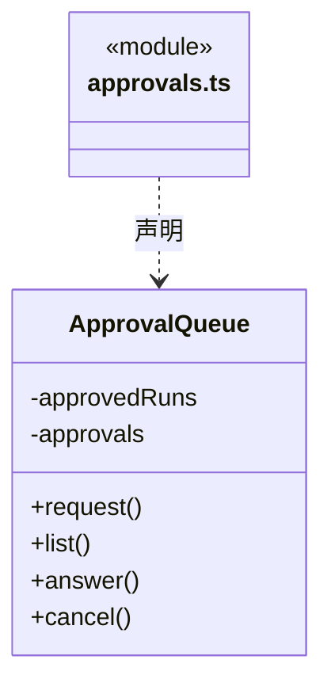
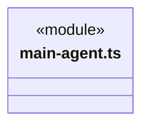
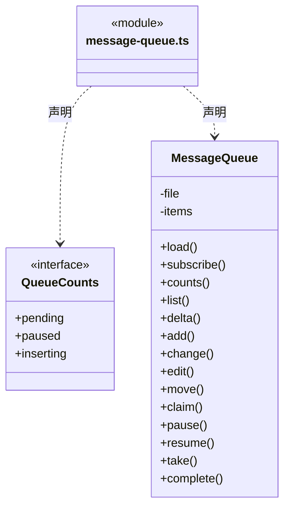
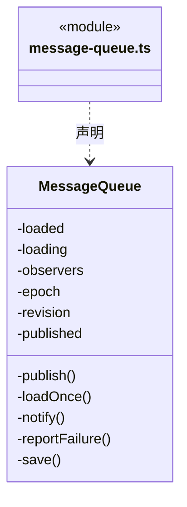
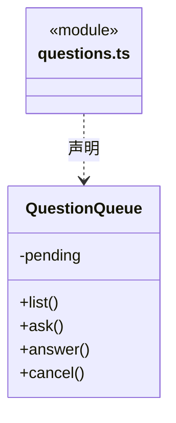

# src/backend/scheduler-engine/conversation 架构

## 目录定位

主 Agent 的规划、审阅与团队管理指引，以及提问、审批和队列。原题与选项独立保存，公开待答列表返回副本，答案与取消只有一次消费；坏回包不重弹。主调度可安排求助补做、替换未启动前置或撤销待办；旧失败不改写，问答不替代人工决定或恢复。

本文描述当前实现。通过分析目录边界后维护的 [源码架构脚本](../../../../scripts/source-architecture.mjs) 同步清单和声明；代码变更时仍须核对职责、关键成员与关系。

## 代码清单

| 文件 | 当前职责 |
| --- | --- |
| [approvals.ts](approvals.ts) | 任务内操作确认及本次运行全部放行的生命周期。 |
| [main-agent.ts](main-agent.ts) | 定义内置主 Agent 的固定身份、业务调度与团队/业务知识管理指引，区分原始目标、已接收补充及未核实插入。 |
| [message-queue.ts](message-queue.ts) | 保存工作区各对话的待执行消息与发送时的模型/权限快照。 |
| [questions.ts](questions.ts) | 管理工作区内等待用户回答的结构化问题，供 Loop 工具与对话界面共享。 |

## 架构类图

### approvals.ts

直接依赖：[../../core/foundation/errors.ts](../../core/foundation/errors.ts)、[../../core/policy/types.ts](../../core/policy/types.ts)、[../../core/tools/types.ts](../../core/tools/types.ts)。

### main-agent.ts

### message-queue.ts

成员 1/2（同名节点为同一声明，跨图合并阅读）。

成员 2/2（同名节点为同一声明，跨图合并阅读）。

直接依赖：[../../core/tasks/queue.ts](../../core/tasks/queue.ts)。

### questions.ts

直接依赖：[../../core/tools/questions.ts](../../core/tools/questions.ts)。

## 子目录导航

无子目录。

[返回上层](../ARCHITECTURE.md)。

每次修改本目录代码，同步维护文件头、关键契约说明及本图。未实现的治理、证据验收和自动编排能力不列入当前类图。

## 设计契约 v1 与落地范围

以下内容区分已接通能力与后续设计；以各节的实现状态为准，不将目标图当作现状图。维护源：[CONTRACT.md](CONTRACT.md)；生成类图时同步附加，勿直接修改本附录。

### 先创建待办再追加前置

主提示区分未领取任务的追加与失败前置的替换。可以先创建 B/C，再创建 A，通过真实 `cbim_dispatch_add_dependency` 明确加 A→B；两端和各自全部启用后继都须未领取，且符合当前目标、知识和 Workflow。不能删除其他边或改变原任务/成员/权限，不用规划文字冒称已经建边。成功后结束主轮，等待真实 A 结果和原预算准入；未知时核对原审计，不换调用重加。该维护回执不替代业务证据或人工验收。

### 运行中补充与原目标

主提示要求插入消息到达后查询原 input、accepted activeInputs 和 continuations，以最新 inputRevision 重规划并保留必需人工条件；accepted 正文称为“已接收的输入快照”，可能包含附件展开资料，不还原成原始用户措辞。pending/unknown 只允许核实与说明，不能盲目重发、继续派工或沿旧 review 宣告完成、安全等待。普通无业务计划对话仍保持轻量，输入记录不新增权限或替代人工接受。

### 结构化问题的一次回答与取消

`QuestionQueue` 在等待前严格解析并独立保存原题和选项，列表返回克隆。用户按原索引选择或明确填写其它答案；题数不完整、跨任务、重复提交或非法字段均不能消费等待。回答与取消只接受先到的终态，完成后移除停止监听并清除待答记录；已经回答的请求不能被迟到取消改写，已经取消的问题不接受迟到答案。

主会话和成员继续复用既有问题卡与明确提交入口；选择本身不发送、回答不批准工具，也不形成持久人工验收。停止、关闭或调用取消只结束尚未完成的等待。后续输出失败不能重新插入已消费的问题，重开不恢复旧等待，真实历史由 canonical 工具事件保留。

### 主会话业务调度与知识管理职责

主提示要求先查询模块实际挂载的 Workflow，在计划分工和派发中使用相同的可选 `workflowSelections`。未选择的模块保留原缺省规则，显式 ID 失效则报告并重新规划，不自动回退；已派任务不能改选。旧候选、人工接受与停泊续执行不能因模块相同而跨流程沿用，选择也不签发新权限。

流程选择仅属于执行角色分工；主角色仍可用 moduleIds 治理受控知识，但不能填流程选择，也不能以知识提交回执声称业务 Workflow 已执行。

`main-agent.ts` 只声明内置调度角色 `cbim:main`，不再存在主角色的业务执行模式：

- `mainAgentInstructions` 仅用于主会话。主 Agent 对业务只调度，先定位真实业务模块、维护责任和 Team 能力，再派发给独立执行 Agent，最后核实实际返回；不实现、修改或运行验证业务产物。其他主会话的实例和图保持独立。
- 主 Agent 同时是具备工程、架构和结构化思维的团队与技术管理者：核实现状、目标与约束，维护模块职责、依赖及维护责任；按执行者、模块列表、目标与验收证据组织任务，区分依赖、风险和未知；审阅候选、安排返工或后续。架构演进按证据渐进，重大治理决策交人，不能靠自称管理者绕过权限或人工审核。
- 团队与业务知识治理可由主 Agent 直接通过 `cbim_` 知识服务完成，不必先派业务执行任务；包括 Agent、Module、Skill、Workflow 与维护关系的查询及授权增删改。`read` 仅查询/预览，`ask` 写入经过当前审批，`execute` 仍须通过版本、Schema 和事务检查；不允许原生工具直接读写 `.cbim/`，知识提交成功不代表业务产物已经实现。
- 没有合适的自定义角色时使用应用静态提供的 `cbim:executor`。其配置、Team 根 Skill 和注册表发现由 [context](../context/CONTRACT.md) 与内部知识工具提供，不写入 `.cbim/`，动态实例与主 Agent 分离。
- 执行 Agent 具有自身会话、状态和模型思考能力，可在权限和目标模块范围内自主探索、实现与验证。需要范围外协作时向主调度报告事实、所需能力与限制，由主调度安排后续。
- 调度工具成功表示可靠入队，不是开始执行或业务完成；主会话结束当前轮次，调度引擎再执行和返回实际结果。返回候选不构成用户授权或业务验收。
- 正式业务目标先使用 `cbim_goal_inspect/plan` 保存整体目标、条件和图谱匹配依据，再按计划派发；成员结果返回后通过 `cbim_goal_review` 逐项引用真实证据。缺口进入重新规划和后续派发；`complete` 只是待主轮结算复核的申请，无有效审阅不能凭最终回复成功关闭。
- 主知识治理计划可引用本轮真实知识提交回执；派发、撤销、预览、审阅工具本身不能证明产物完成。必需人工项不能由模型自签。`awaiting_user` 经主轮安全结算后保存等待检查点，用户显式文本补充可沿原周期重规划；普通“同意”仍留在队列，不代表恢复、验收或提权。
- 成员 `help` 来自已安全结算的独立请求，主调度核实问题后新派任务，不恢复旧成员。需要等待且仍有无从继续的未启动依赖时，明确列出待撤销节点及必要后继、版本、原因，调用实际提供的 `cbim_dispatch_cancel`；遗漏后继整体拒绝，不自动扩大。撤销后按新图重新审阅；完成目标仍须新候选替代旧失败/取消任务，不以取消凑成功。
- 前置安全求助或明确失败后，主调度可先派新的替代任务；其真实候选到达后，通过 `cbim_dispatch_replace_dependency` 显式替换一条尚未启动的依赖。原下游及启用依赖后继必须都未领取，保持原目标、模块、验收、计划和实例身份。换边保留审计，等待当前主轮结算后才继续；不恢复失败来源，最终目标审阅仍需明确成功替代关系。
- 空闲、工作、等待和沟通状态由可靠运行、工具与调度事件维护。模型不能靠正文修改状态、伪造通信或完成回执；尚未提供的执行成员间等待/通信能力不能描述为已实现。

普通问答保持轻量，不要求用户预先选择模块或填写验收表单。缺少模块或维护关系时，主 Agent 可在事实和授权充分的前提下经知识服务补齐；缺依据、权限或工具则报告缺口，不制造占位责任或假派工。任务内目标、步骤、证据和候选按实际工具记录。指引是认知流程，不能扩大工具权限、改变执行身份或代替入口门禁。

### 模块岗位责任与业务执行分开

主提示通过真实 `cbim_module_owner_inspect({members:true})` 发现长期岗位摘要，再读取模块责任、预览和明确提交。只读、审批与执行权限逐次生效；任务的静态 agentId 和动态实例不能冒充 memberId。关系变更不安装模型、不改变旧派发、不证明业务完成，暂停或来源变化须按查询事实说明。

提交成功只表示责任登记；坏回包或停止后结果不明时按原 commandId 查询，不换调用重复提交。仅责任控制面交互保持轻量，但已有业务目标仍须真实审阅；负责人回执不能补齐业务验收或人工条件。

### 来源连续性与负责人指引

主 Agent 区分内容差异与受控来源状态；pending/invalid/unverifiable 不表示可用，retired/needs_adoption 不自动承接旧责任。保持同负责人采纳用明确 adopt_source 预览/提交，不重建成员、不改变派发，未知仍查原回执。离线同字节重建没有受控事件时不能宣称已识别。
