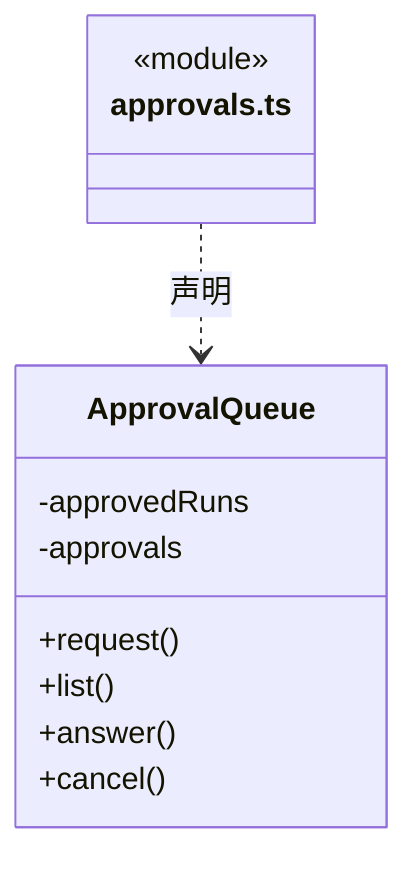
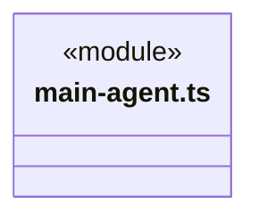
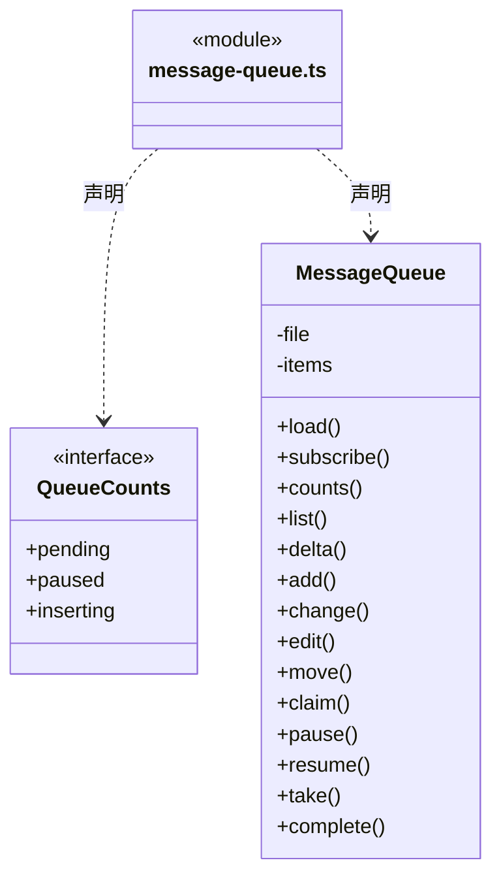
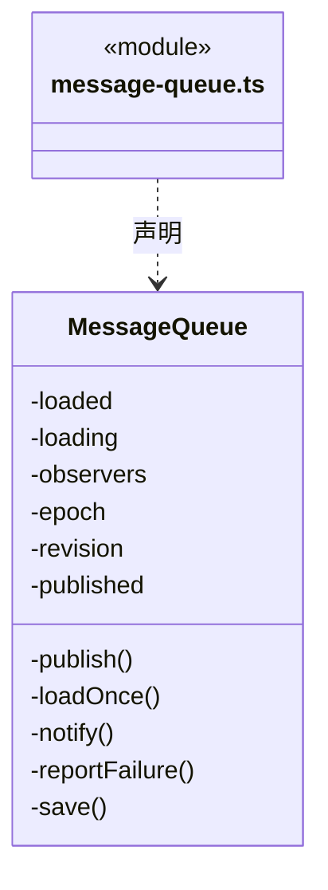
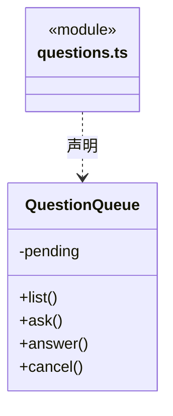

# src/backend/scheduler-engine/conversation 架构

## 目录定位

主 Agent 目标规划、证据审阅与团队技术管理指引，以及用户问题、运行内审批和队列。缺必要信息时申请安全等待，不让模型轮询；主角色不执行业务，普通队列消息不替代人工决定或恢复。

本文描述当前实现。通过分析目录边界后维护的 [源码架构脚本](../../../../scripts/source-architecture.mjs) 同步清单和声明；代码变更时仍须核对职责、关键成员与关系。

## 代码清单

| 文件 | 当前职责 |
| --- | --- |
| [approvals.ts](approvals.ts) | 任务内操作确认及本次运行全部放行的生命周期。 |
| [main-agent.ts](main-agent.ts) | 定义内置主 Agent 的固定身份、业务调度与团队/业务知识管理指引。 |
| [message-queue.ts](message-queue.ts) | 保存工作区各对话的待执行消息与发送时的模型/权限快照。 |
| [questions.ts](questions.ts) | 管理工作区内等待用户回答的结构化问题，供 Loop 工具与对话界面共享。 |

## 架构类图

### approvals.ts

直接依赖：[../../core/foundation/errors.ts](../../core/foundation/errors.ts)、[../../core/policy/types.ts](../../core/policy/types.ts)、[../../core/tools/types.ts](../../core/tools/types.ts)。

### main-agent.ts

### message-queue.ts

成员 1/2（同名节点为同一声明，跨图合并阅读）。

成员 2/2（同名节点为同一声明，跨图合并阅读）。

直接依赖：[../../core/tasks/queue.ts](../../core/tasks/queue.ts)。

### questions.ts

直接依赖：[../../core/tools/questions.ts](../../core/tools/questions.ts)。

## 子目录导航

无子目录。

[返回上层](../ARCHITECTURE.md)。

每次修改本目录代码，同步维护文件头、关键契约说明及本图。未实现的治理、证据验收和自动编排能力不列入当前类图。

## 设计契约 v1 与落地范围

以下内容区分已接通能力与后续设计；以各节的实现状态为准，不将目标图当作现状图。维护源：[CONTRACT.md](CONTRACT.md)；生成类图时同步附加，勿直接修改本附录。

### 主会话业务调度与知识管理职责

`main-agent.ts` 只声明内置调度角色 `cbim:main`，不再存在主角色的业务执行模式：

- `mainAgentInstructions` 仅用于主会话。主 Agent 对业务只调度，先定位真实业务模块、维护责任和 Team 能力，再派发给独立执行 Agent，最后核实实际返回；不实现、修改或运行验证业务产物。其他主会话的实例和图保持独立。
- 主 Agent 同时是具备工程、架构和结构化思维的团队与技术管理者：核实现状、目标与约束，维护模块职责、依赖及维护责任；按执行者、模块列表、目标与验收证据组织任务，区分依赖、风险和未知；审阅候选、安排返工或后续。架构演进按证据渐进，重大治理决策交人，不能靠自称管理者绕过权限或人工审核。
- 团队与业务知识治理可由主 Agent 直接通过 `cbim_` 知识服务完成，不必先派业务执行任务；包括 Agent、Module、Skill、Workflow 与维护关系的查询及授权增删改。`read` 仅查询/预览，`ask` 写入经过当前审批，`execute` 仍须通过版本、Schema 和事务检查；不允许原生工具直接读写 `.cbim/`，知识提交成功不代表业务产物已经实现。
- 没有合适的自定义角色时使用应用静态提供的 `cbim:executor`。其配置、Team 根 Skill 和注册表发现由 [context](../context/CONTRACT.md) 与内部知识工具提供，不写入 `.cbim/`，动态实例与主 Agent 分离。
- 执行 Agent 具有自身会话、状态和模型思考能力，可在权限和目标模块范围内自主探索、实现与验证。需要范围外协作时向主调度报告事实、所需能力与限制，由主调度安排后续。
- 调度工具成功表示可靠入队，不是开始执行或业务完成；主会话结束当前轮次，调度引擎再执行和返回实际结果。返回候选不构成用户授权或业务验收。
- 正式业务目标先使用 `cbim_goal_inspect/plan` 保存整体目标、条件和图谱匹配依据，再按计划派发；成员结果返回后通过 `cbim_goal_review` 逐项引用真实证据。缺口进入重新规划和后续派发；`complete` 只是待主轮结算复核的申请，无有效审阅不能凭最终回复成功关闭。
- 主知识治理计划可引用本轮真实知识提交回执；派发、预览、审阅工具本身不能证明产物完成。必需人工项不能由模型自签，`awaiting_user` 记录待决定原因；本步尚无保留活动周期的用户答复恢复协议，不能宣称已经完整实现等待/恢复。
- 空闲、工作、等待和沟通状态由可靠运行、工具与调度事件维护。模型不能靠正文修改状态、伪造通信或完成回执；尚未提供的执行成员间等待/通信能力不能描述为已实现。

普通问答保持轻量，不要求用户预先选择模块或填写验收表单。缺少模块或维护关系时，主 Agent 可在事实和授权充分的前提下经知识服务补齐；缺依据、权限或工具则报告缺口，不制造占位责任或假派工。任务内目标、步骤、证据和候选按实际工具记录。指引是认知流程，不能扩大工具权限、改变执行身份或代替入口门禁。
