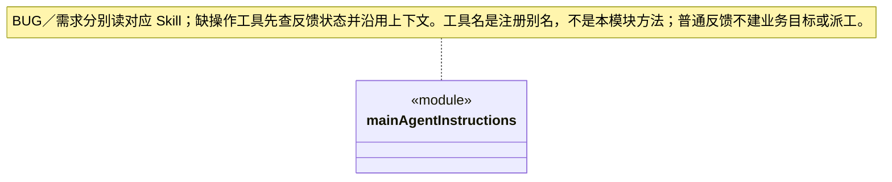

### 主会话直接执行与独立成员边界

Auto/Team 最终组装指引都允许主 Agent 在当前会话实现未配置自定义负责岗位的模块，权限仍由 read/ask/execute 和实际工具门禁决定。`cbim:main` 可以出现在主目标 assignments，通过 `main-execution` 引用本轮真实业务工具证据；不能作为独立成员 assignee，也不接受成员的 workflowSelections。显式自定义岗位仍按有效绑定派发，配置无效不绕过。知识提交、业务工具执行、成员候选和人工验收分别核实，任何一种回执都不自动替代其他证明。

### 产品反馈与需求许愿

主 Agent 将两项菜单请求分别路由到 `cbim_skill_bug_feedback` 与 `cbim_skill_feature_wish`：先读流程，只有菜单而没有正文时提示一句描述即可。有用户愿意提交的简述就调用已装配的 `cbim_feedback_submit`，不追问复现/结果/环境/场景/例子，也不增草稿确认；缺项省略或标“用户未提供”，不自动采集资料。submitted 后结束，不追加成功消息、链接、编号或进度。缺连接、只读拒绝或明确错误时简短说明；未知只核实原提交，不能重发。GitHub 连接须由桌面设置明确建立，不把 BUG 报告解释成修复授权，不把愿望解释成已采纳开发任务。

缺少 submit／receipt 任一项时，先用实际提供的 `cbim_feedback_status` 区分原因；knowledge catalog 只覆盖知识族，不能证明反馈工具缺失。尚待本机接收授权时回到设置页等待，已连接但本轮未装配时发送新消息，不反复登录。诊断入口也缺失时说明工具不可用、连接状态未核实，保留用户上下文。状态查询不证明原提交结果；未知只在实际核实入口可用时查询一次，不能换正文或会话重发。

### 先创建待办再追加前置

主提示区分未领取任务的追加与可靠失败/求助或已放弃检查点来源的替换。可以先创建 B/C，再创建 A，通过真实 `cbim_dispatch_add_dependency` 明确加 A→B；两端和各自全部启用后继都须未领取，且符合当前目标、知识和 Workflow。不能删除其他边或改变原任务/成员/权限，不用规划文字冒称已经建边。成功后结束主轮，等待真实 A 结果和原预算准入；未知时核对原审计，不换调用重加。该维护回执不替代业务证据或人工验收。

### 运行中补充与原目标

主提示要求插入消息到达后查询原 input、accepted activeInputs 和 continuations，以最新 inputRevision 重规划并保留必需人工条件；accepted 正文称为“已接收的输入快照”，可能包含附件展开资料，不还原成原始用户措辞。pending/unknown 只允许核实与说明，不能盲目重发、继续派工或沿旧 review 宣告完成、安全等待。普通无业务计划对话仍保持轻量，输入记录不新增权限或替代人工接受。

### 结构化问题的一次回答与取消

`QuestionQueue` 在等待前严格解析并独立保存原题和选项，列表返回克隆。用户按原索引选择或明确填写其它答案；题数不完整、跨任务、重复提交或非法字段均不能消费等待。回答与取消只接受先到的终态，完成后移除停止监听并清除待答记录；已经回答的请求不能被迟到取消改写，已经取消的问题不接受迟到答案。

主会话和成员继续复用既有问题卡与明确提交入口；选择本身不发送、回答不批准工具，也不形成持久人工验收。停止、关闭或调用取消只结束尚未完成的等待。后续输出失败不能重新插入已消费的问题，重开不恢复旧等待，真实历史由 canonical 工具事件保留。

### 主会话业务调度与知识管理职责

主提示要求先查询模块实际挂载的 Workflow，在计划分工和派发中使用相同的可选 `workflowSelections`。未选择的模块保留原缺省规则，显式 ID 失效则报告并重新规划，不自动回退；已派任务不能改选。旧候选、人工接受与停泊续执行不能因模块相同而跨流程沿用，选择也不签发新权限。

流程选择仅属于执行角色分工；主角色仍可用 moduleIds 治理受控知识，但不能填流程选择，也不能以知识提交回执声称业务 Workflow 已执行。

`main-agent.ts` 只声明内置调度角色 `cbim:main`，不再存在主角色的业务执行模式：

- `mainAgentInstructions` 用于 Team 与无模式的历史主会话。该模式对业务只调度，先定位真实业务模块、岗位责任和 Team 能力，再派发给独立执行 Agent，最后核实实际返回；不实现、修改或运行验证业务产物。其他主会话的实例和图保持独立。
- 主 Agent 同时是具备工程、架构和结构化思维的团队与技术管理者：核实现状、目标与约束，维护模块职责、依赖及岗位责任；按执行者、模块列表、目标与验收证据组织任务，区分依赖、风险和未知；审阅候选、安排返工或后续。架构演进按证据渐进，重大治理决策交人，不能靠自称管理者绕过权限或人工审核。
- 团队与业务知识治理可由主 Agent 直接通过 `cbim_` 知识服务完成，不必先派业务执行任务；包括 Agent、Module、Skill、Workflow 的查询及授权增删改，岗位负责人使用独立受控服务。`read` 仅查询/预览，`ask` 写入经过当前审批，`execute` 仍须通过版本、Schema 和事务检查；不允许原生工具直接读写 `.cbim/`，知识提交成功不代表业务产物已经实现。
- 新业务先查询模块负责岗位。`execution=main` 的模块由主 Agent 在当前会话执行，不提交 ownerSelection，也不派发给自己。`execution=member` 才把同组实际 `ownerSelection` 提交给目标计划与派发。自定义岗位的能力、模型或来源失效时说明缺口，不自动回退已退役的 `cbim:executor`，也不降级为主会话冒充该岗位。动态实例与静态 Agent、长期 memberId 分离。
- 执行 Agent 具有自身会话、状态和模型思考能力，可在权限和目标模块范围内自主探索、实现与验证。需要范围外协作时向主调度报告事实、所需能力与限制，由主调度安排后续。
- 调度工具成功表示可靠入队，不是开始执行或业务完成；主会话结束当前轮次，调度引擎再执行和返回实际结果。返回候选不构成用户授权或业务验收。
- 正式业务目标先使用 `cbim_goal_inspect/plan` 保存整体目标、条件和图谱匹配依据，再按计划派发；成员结果返回后通过 `cbim_goal_review` 逐项引用真实证据。缺口进入重新规划和后续派发；`complete` 只是待主轮结算复核的申请，无有效审阅不能凭最终回复成功关闭。
- 主知识治理计划可引用本轮真实知识提交回执；派发、撤销、预览、审阅工具本身不能证明产物完成。必需人工项不能由模型自签。`awaiting_user` 经主轮安全结算后保存等待检查点，用户显式文本补充可沿原周期重规划；普通“同意”仍留在队列，不代表恢复、验收或提权。
- 成员 `help` 来自已安全结算的独立请求，主调度核实问题后新派任务，不恢复旧成员。需要等待且仍有无从继续的未启动依赖时，明确列出待撤销节点及必要后继、版本、原因，调用实际提供的 `cbim_dispatch_cancel`；遗漏后继整体拒绝，不自动扩大。撤销后按新图重新审阅；完成目标仍须新候选替代旧失败/取消任务，不以取消凑成功。
- 前置安全求助、明确失败或可靠检查点已显式放弃后，主调度可先派新的替代任务；其真实候选到达后，通过 `cbim_dispatch_replace_dependency` 显式替换一条尚未启动的依赖。原下游及启用依赖后继必须都未领取，保持原目标、模块、验收、计划和实例身份。换边保留审计，等待当前主轮结算后才继续；不恢复失败来源，最终目标审阅仍需明确成功替代关系。
- 空闲、工作、等待和沟通状态由可靠运行、工具与调度事件维护。模型不能靠正文修改状态、伪造通信或完成回执；尚未提供的执行成员间等待/通信能力不能描述为已实现。

普通问答保持轻量，不要求用户预先选择模块或填写验收表单。缺少模块或维护关系时，主 Agent 可在事实和授权充分的前提下经知识服务补齐；缺依据、权限或工具则报告缺口，不制造占位责任或假派工。任务内目标、步骤、证据和候选按实际工具记录。指引是认知流程，不能扩大工具权限、改变执行身份或代替入口门禁。

### 模块岗位责任与业务执行分开

主提示通过真实 `cbim_module_owner_inspect({members:true})` 发现长期岗位摘要，再读取模块责任、预览和明确提交。只读、审批与执行权限逐次生效；任务的静态 agentId 和动态实例不能冒充 memberId。关系变更不安装模型、不改变旧派发、不证明业务完成，暂停或来源变化须按查询事实说明。

提交成功只表示责任登记；坏回包或停止后结果不明时按原 commandId 查询，不换调用重复提交。仅责任控制面交互保持轻量，但已有业务目标仍须真实审阅；负责人回执不能补齐业务验收或人工条件。

### 来源连续性与负责人指引

主 Agent 区分内容差异与受控来源状态；pending/invalid/unverifiable 不表示可用，retired/needs_adoption 不自动承接旧责任。保持同负责人采纳用明确 adopt_source 预览/提交，不重建成员、不改变派发，未知仍查原回执。离线同字节重建没有受控事件时不能宣称已识别。

### 负责人变更后的原检查点

主指引明确区分 resume 的当前执行资格和 abandon_checkpoint 的历史处置。可靠原检查点未消费时可明确放弃，原任务不换人、不删除证据；当前文件或模型变化不阻止终止，损坏 canonical 仍拒绝。原依赖后继不会自动解锁，按需取消完整未启动闭包，再查询当前岗位、重规划和新建任务。旧任务必须由后来真实候选逐项 superseded，原人工要求不因负责人改变而消失，旧人工接受不得继承；未知处置先查原审计。
### 原命令结果核实

主 Agent 已收到调度坏输出时，只用 `cbim_dispatch_command_report` 明确查询原 run/toolCall，再区分原工具结果、原事务保存与当前业务状态。查询不重放，不把 committed 当业务完成，不清 unknown 或自动勾选人工核实；无法核实时说明缺项，不新建调用猜测重做。

## 未领取前置的组合调整

主提示明确使用 cbim_dispatch_revise_dependencies 原子删除/新增同一目标的多条前置，完整当前图判环并保留原节点/实例/计划。增删两端及后继均须未执行；已失败来源仍使用有可靠候选证明的 replace_dependency，不借删除消除旧事实。成功后结束主轮，坏输出只查原 run/call；文字规划、修订回执均不是交付证据。

### 检查点明确放弃后的候选替换

主调度可先显式放弃可靠检查点/未领取预约，再用同周期真实新候选替换未启动后继的单条前置。原记录保留；过期岗位后继、普通取消、未决副作用或损坏日志不能沿此继续。主轮结束后才按新候选领取，目标审阅仍明确原任务被何项真实成果替代，不用处置/换边回执完成业务。

## 主调度的持久成员等待

确有用户输入缺口时，主指引允许 awaiting_user 显式提交 memberPause 全量清单，可靠未预约检查点和未领取后继正常结算后持久保留。主/成员结果回注都区分保留与恢复：重启不启动，用户补充并通过当前基线及权限复核后，先按新输入重规划再预约原任务。失败、未知、已放弃或已关闭记录不得借等待复活；不为日常实现问题制造等待。

### 自动与团队协作模式

`mainInstructions(mode)` 按可信周期选择 Auto 或 Team 全套角色指引，反馈流程共用同一正文。Auto 默认直接实现与验证，根范围始终存在，里程碑后按事实审视业务架构、团队与共享方法，不按计时器自动造模块；显式委派仍核原岗位/兜底和正式目标。Team 及历史缺省保留调度职责。工具目录与知识目录不同，模型不能自行切模式、伪造维护人或人工批准。

主 Agent 对无显式/父级负责人的模块，读取模块正文与已启用岗位的 Agent 能力后作匹配，通过 inspect.matches 核验；无合适岗位明确 null 后直接执行。匹配不形成永久责任或跨版本缓存；坏的显式配置不能被兜底掩盖。
