# src/backend/scheduler-engine/dispatch 架构

## 目录定位

派发编排：任务状态、领取、图依赖与应用命令通过 Core 的派发端口写入；共享 Store 尚未拆分。

本文描述当前实现。通过分析目录边界后维护的 [源码架构脚本](../../../../scripts/source-architecture.mjs) 同步清单和声明；代码变更时仍须核对职责、关键成员与关系。

## 代码清单

| 文件 | 当前职责 |
| --- | --- |
| [auto-collaboration.ts](auto-collaboration.ts) | 管理用户任务周期，串接主调度、成员回传、重启后可靠成果接收及最多三轮验收返工；未知事实或额度耗尽停止，可靠关闭后释放实例。 |
| [automatic-return-service.ts](automatic-return-service.ts) | 持久保存主轮待回传批次，重启时核实可自动接收的已完成成员结果。 |
| [dispatch-service.ts](dispatch-service.ts) | 工作区的成员注册、主对话实例绑定、主会话派发及任务图查询；重启仅保留通过完整核实的待回传周期，其余中断封存。 |
| [goal-repair.ts](goal-repair.ts) | 调度层最终验收返工的分类、限次与系统反馈，复用原目标及主运行入口。 |
| [owner-execution-service.ts](owner-execution-service.ts) | 在既有知识、模型和派发存储之间核实岗位执行绑定，为计划、派发、领取和依赖维护提供同一入口。 |

## 架构类图

### auto-collaboration.ts

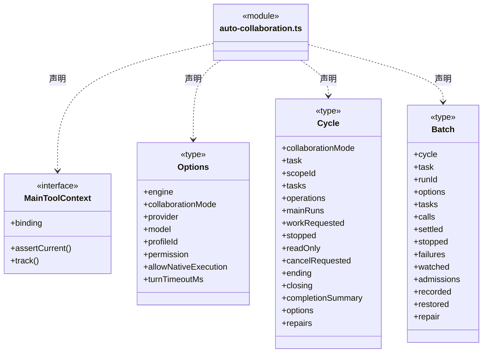

成员 1/3（同名节点为同一声明，跨图合并阅读）。

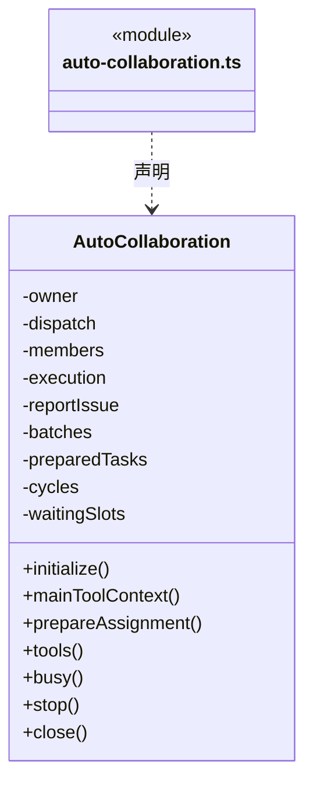

成员 2/3（同名节点为同一声明，跨图合并阅读）。

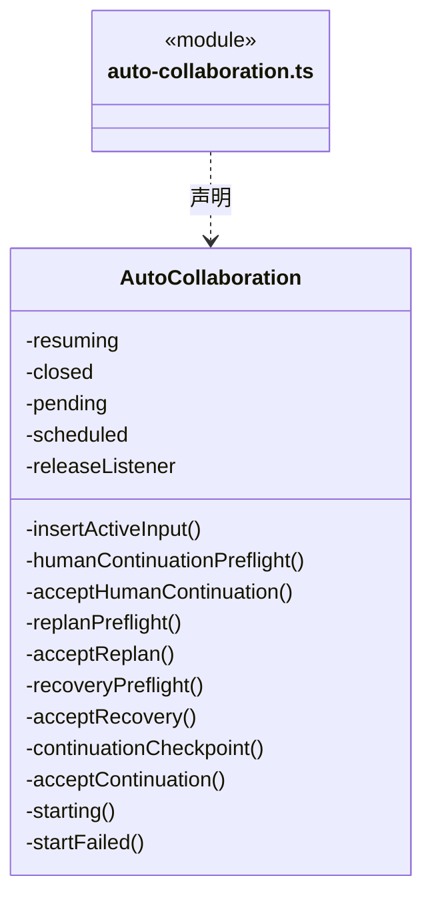

成员 3/3（同名节点为同一声明，跨图合并阅读）。

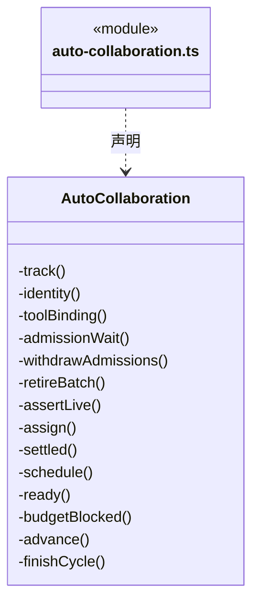

直接依赖：[../../core/tasks/scope-goal.ts](../../core/tasks/scope-goal.ts)、[../../core/foundation/serialization.ts](../../core/foundation/serialization.ts)、[../../core/tasks/member-checkpoint-chain.ts](../../core/tasks/member-checkpoint-chain.ts)、[../../core/tasks/member-checkpoint.ts](../../core/tasks/member-checkpoint.ts)、[../../core/foundation/errors.ts](../../core/foundation/errors.ts)、[../../core/execution/types.ts](../../core/execution/types.ts)、[../../core/tasks/dispatch-scope.ts](../../core/tasks/dispatch-scope.ts)、[../../core/tasks/scope-continuation.ts](../../core/tasks/scope-continuation.ts)、[../../core/tasks/scope-continuation-attachments.ts](../../core/tasks/scope-continuation-attachments.ts)、[../../core/tasks/scope-active-input.ts](../../core/tasks/scope-active-input.ts)、[../../core/tasks/human-continue.ts](../../core/tasks/human-continue.ts)、[../../core/tasks/scope-recovery.ts](../../core/tasks/scope-recovery.ts)、[../../core/tasks/scope-replan.ts](../../core/tasks/scope-replan.ts)、[../../core/knowledge/ports.ts](../../core/knowledge/ports.ts)、[../../core/tasks/dispatch-commands.ts](../../core/tasks/dispatch-commands.ts)、[../../core/tasks/graph-types.ts](../../core/tasks/graph-types.ts)、[../tools/dispatch-tools.ts](../tools/dispatch-tools.ts)、[../tools/goal-tools.ts](../tools/goal-tools.ts)、[../tools/candidate-review-tools.ts](../tools/candidate-review-tools.ts)、[../members/member-state.ts](../members/member-state.ts)、[../tools/main-tool-contracts.ts](../tools/main-tool-contracts.ts)、[../../core/tasks/main-tool-output.ts](../../core/tasks/main-tool-output.ts)、[dispatch-service.ts](dispatch-service.ts)、[../members/member-execution.ts](../members/member-execution.ts)、[../conversation/execution-manager.ts](../conversation/execution-manager.ts)、[../assembly/loop-engine.ts](../assembly/loop-engine.ts)、[../admission/workspace-lease.ts](../admission/workspace-lease.ts)、[../admission/admission-wait.ts](../admission/admission-wait.ts)、[../../core/tasks/checkpoint-handoff.ts](../../core/tasks/checkpoint-handoff.ts)、[../../core/execution/input-source.ts](../../core/execution/input-source.ts)、[goal-repair.ts](goal-repair.ts)、[../../core/models/engine.ts](../../core/models/engine.ts)。

### automatic-return-service.ts

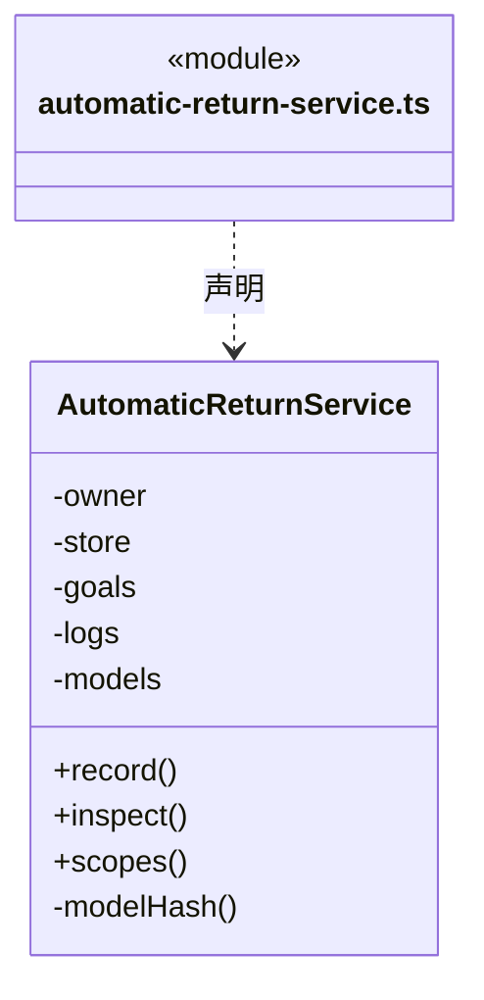

直接依赖：[../../core/foundation/errors.ts](../../core/foundation/errors.ts)、[../../core/foundation/serialization.ts](../../core/foundation/serialization.ts)、[../../core/tasks/automatic-return.ts](../../core/tasks/automatic-return.ts)、[../../core/tasks/scope-goal.ts](../../core/tasks/scope-goal.ts)、[../../core/dispatch/dispatch-storage.ts](../../core/dispatch/dispatch-storage.ts)、[../../core/tasks/graph-types.ts](../../core/tasks/graph-types.ts)、[../../core/tasks/dispatch-scope.ts](../../core/tasks/dispatch-scope.ts)、[../../core/execution/types.ts](../../core/execution/types.ts)、[../../core/knowledge/ports.ts](../../core/knowledge/ports.ts)、[../goals/scope-goal-service.ts](../goals/scope-goal-service.ts)、[../../core/team/workspace-member-rules.ts](../../core/team/workspace-member-rules.ts)、[owner-execution-service.ts](owner-execution-service.ts)。

### dispatch-service.ts

成员 1/4（同名节点为同一声明，跨图合并阅读）。

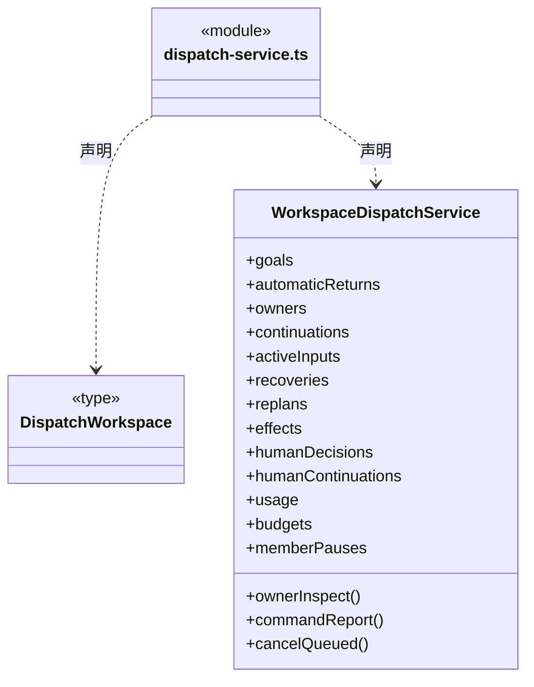

成员 2/4（同名节点为同一声明，跨图合并阅读）。

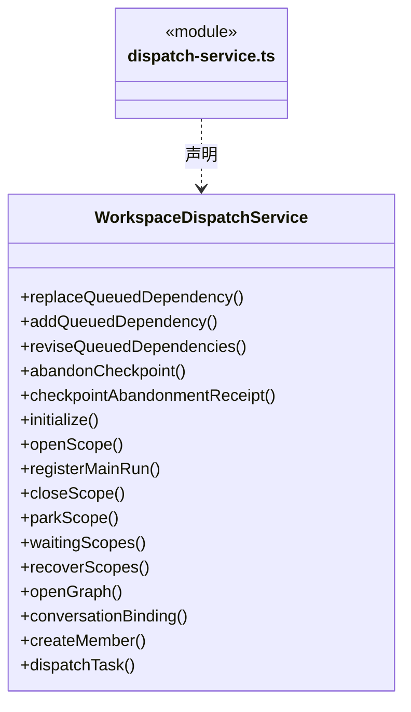

成员 3/4（同名节点为同一声明，跨图合并阅读）。

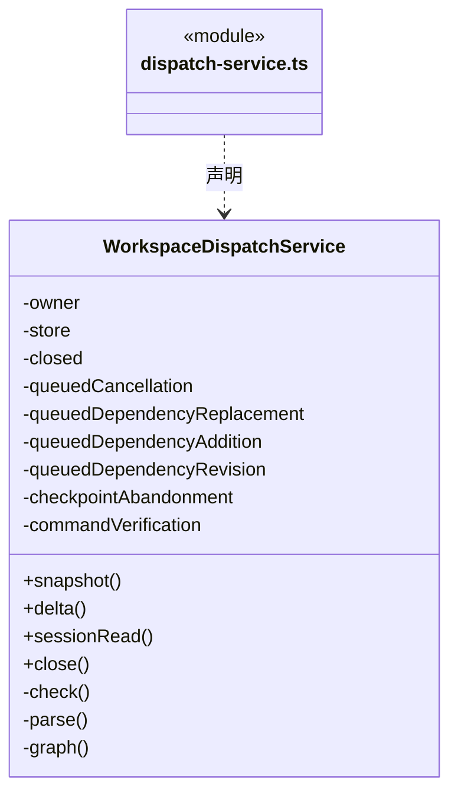

成员 4/4（同名节点为同一声明，跨图合并阅读）。

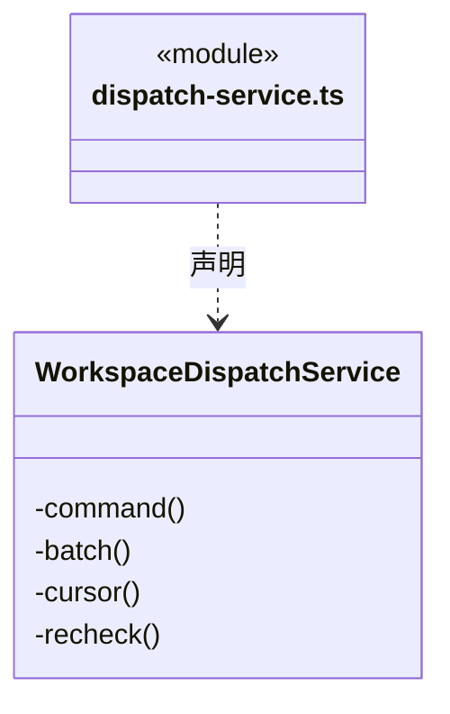

直接依赖：[../context/automatic-context.ts](../context/automatic-context.ts)、[../../core/tasks/candidate-review.ts](../../core/tasks/candidate-review.ts)、[../../core/foundation/errors.ts](../../core/foundation/errors.ts)、[../../core/foundation/serialization.ts](../../core/foundation/serialization.ts)、[../goals/main-command-request.ts](../goals/main-command-request.ts)、[../evidence/command-verification-service.ts](../evidence/command-verification-service.ts)、[../evidence/effect-observation-service.ts](../evidence/effect-observation-service.ts)、[../../core/knowledge/ports.ts](../../core/knowledge/ports.ts)、[../../core/knowledge/types.ts](../../core/knowledge/types.ts)、[../../core/execution/conversation-binding.ts](../../core/execution/conversation-binding.ts)、[../../core/dispatch/dispatch-storage.ts](../../core/dispatch/dispatch-storage.ts)、[../../core/tasks/dispatch-scope.ts](../../core/tasks/dispatch-scope.ts)、[../../core/team/agent-types.ts](../../core/team/agent-types.ts)、[../../core/tasks/types.ts](../../core/tasks/types.ts)、[../../core/execution/types.ts](../../core/execution/types.ts)、[../goals/scope-goal-service.ts](../goals/scope-goal-service.ts)、[../goals/scope-continuation-service.ts](../goals/scope-continuation-service.ts)、[../goals/scope-active-input-service.ts](../goals/scope-active-input-service.ts)、[../goals/scope-recovery-service.ts](../goals/scope-recovery-service.ts)、[../goals/scope-replan-service.ts](../goals/scope-replan-service.ts)、[../goals/scope-human-decision-service.ts](../goals/scope-human-decision-service.ts)、[../goals/scope-human-continuation-service.ts](../goals/scope-human-continuation-service.ts)、[../goals/queued-task-cancel-service.ts](../goals/queued-task-cancel-service.ts)、[../goals/queued-dependency-replacement-service.ts](../goals/queued-dependency-replacement-service.ts)、[../goals/queued-dependency-addition-service.ts](../goals/queued-dependency-addition-service.ts)、[../goals/queued-dependency-revision-service.ts](../goals/queued-dependency-revision-service.ts)、[../../core/tasks/queued-dependency-revision.ts](../../core/tasks/queued-dependency-revision.ts)、[../members/checkpoint-abandonment-service.ts](../members/checkpoint-abandonment-service.ts)、[../members/member-checkpoint-verifier.ts](../members/member-checkpoint-verifier.ts)、[../members/member-pause-service.ts](../members/member-pause-service.ts)、[../../core/tasks/checkpoint-handoff.ts](../../core/tasks/checkpoint-handoff.ts)、[../../core/tasks/queued-dependency-addition.ts](../../core/tasks/queued-dependency-addition.ts)、[../../core/tasks/queued-dependency-replacement.ts](../../core/tasks/queued-dependency-replacement.ts)、[../../core/tasks/member-checkpoint.ts](../../core/tasks/member-checkpoint.ts)、[../budget/scope-usage-service.ts](../budget/scope-usage-service.ts)、[../budget/scope-budget-service.ts](../budget/scope-budget-service.ts)、[../../core/budget/scope-budget.ts](../../core/budget/scope-budget.ts)、[../../core/tasks/queued-task-cancel.ts](../../core/tasks/queued-task-cancel.ts)、[../../core/tasks/dispatch-commands.ts](../../core/tasks/dispatch-commands.ts)、[../../core/tasks/graph-types.ts](../../core/tasks/graph-types.ts)、[../context/dispatch-context.ts](../context/dispatch-context.ts)、[../members/agent-manager.ts](../members/agent-manager.ts)、[../../core/tasks/scope-view.ts](../../core/tasks/scope-view.ts)、[../../core/tasks/scope-run-tracking.ts](../../core/tasks/scope-run-tracking.ts)、[owner-execution-service.ts](owner-execution-service.ts)、[automatic-return-service.ts](automatic-return-service.ts)。

### goal-repair.ts

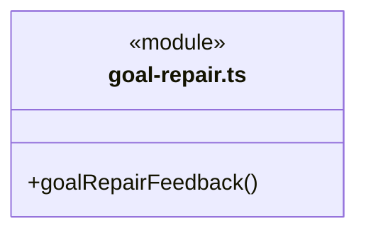

直接依赖：[../../core/foundation/serialization.ts](../../core/foundation/serialization.ts)、[../../core/execution/input-source.ts](../../core/execution/input-source.ts)、[../../core/tasks/dispatch-scope.ts](../../core/tasks/dispatch-scope.ts)、[../../core/tasks/graph-types.ts](../../core/tasks/graph-types.ts)。

### owner-execution-service.ts

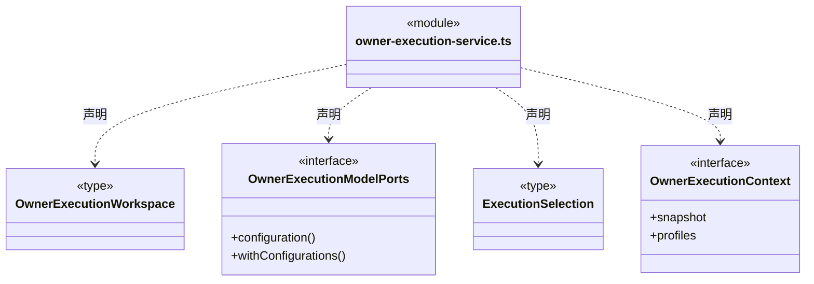

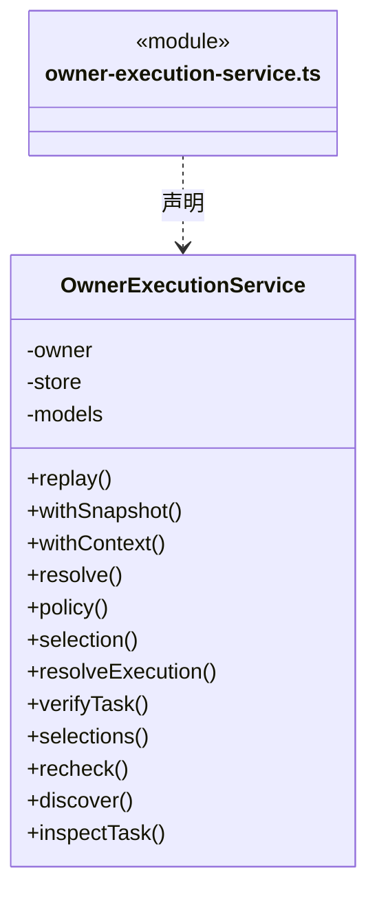

直接依赖：[../../core/team/automatic-execution.ts](../../core/team/automatic-execution.ts)、[../../core/foundation/errors.ts](../../core/foundation/errors.ts)、[../../core/knowledge/ports.ts](../../core/knowledge/ports.ts)、[../../core/knowledge/types.ts](../../core/knowledge/types.ts)、[../../core/dispatch/dispatch-storage.ts](../../core/dispatch/dispatch-storage.ts)、[../../core/tasks/graph-types.ts](../../core/tasks/graph-types.ts)、[../../core/team/workspace-member.ts](../../core/team/workspace-member.ts)、[../../core/team/workspace-member-rules.ts](../../core/team/workspace-member-rules.ts)、[../../core/team/member-execution-binding.ts](../../core/team/member-execution-binding.ts)、[../../core/team/member-execution-rules.ts](../../core/team/member-execution-rules.ts)、[../../core/team/owner-execution-discovery.ts](../../core/team/owner-execution-discovery.ts)、[../../core/team/implicit-module-owner.ts](../../core/team/implicit-module-owner.ts)、[../../core/workspace/knowledge-source-rules.ts](../../core/workspace/knowledge-source-rules.ts)、[../context/dispatch-context.ts](../context/dispatch-context.ts)。

### 本目录调用边界

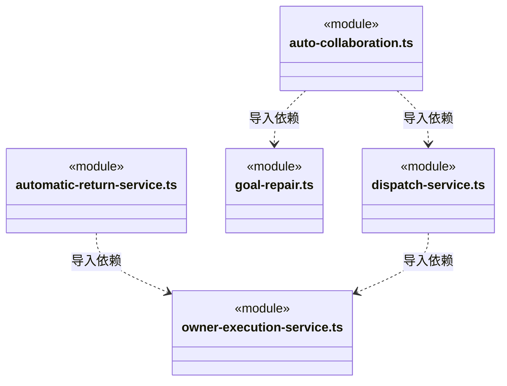

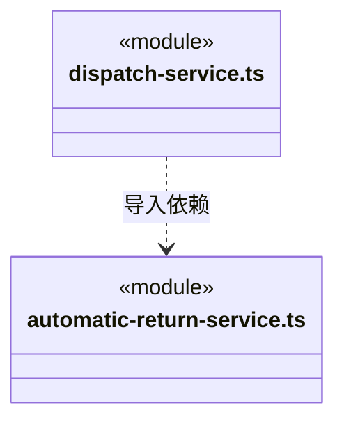

## 子目录导航

无子目录。

[返回上层](../ARCHITECTURE.md)。

每次修改本目录代码，同步维护文件头、关键契约说明及本图。未实现的治理、证据验收和自动编排能力不列入当前类图。

## 设计契约 v1 与落地范围

以下内容区分已接通能力与后续设计；以各节的实现状态为准，不将目标图当作现状图。维护源：[CONTRACT.md](CONTRACT.md)；生成类图时同步附加，勿直接修改本附录。

## 分阶段候选审阅

新派发依赖要求主 Agent 显式接受前置候选；未批准时不启动后继。AutoCollaboration 与成员领取共享 dependenciesReady，当前可执行成员结束后即回注主运行，不等尚被审阅关口阻塞的后继。member-results 主轮从同周期任务图保留尚未启动的 queued/waiting 任务，批准并结束该主轮后继续原待办，不创建替代任务或重放原派发。回注包含 candidateReview 以及显式审阅指引。

候选接受本身是可靠持久事实；主轮失败不会触发后继自动执行。停止、容量、权限、知识和文件门禁保持。重启自动回传仍只支持既有的全部成员可靠交付条件，含未启动后继的周期不因新审阅字段获得自动重启许可；旧日志和活动用户数据不迁移。
