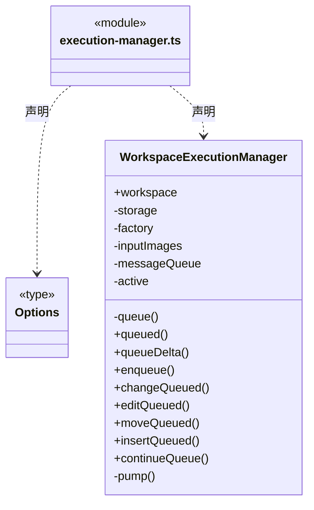
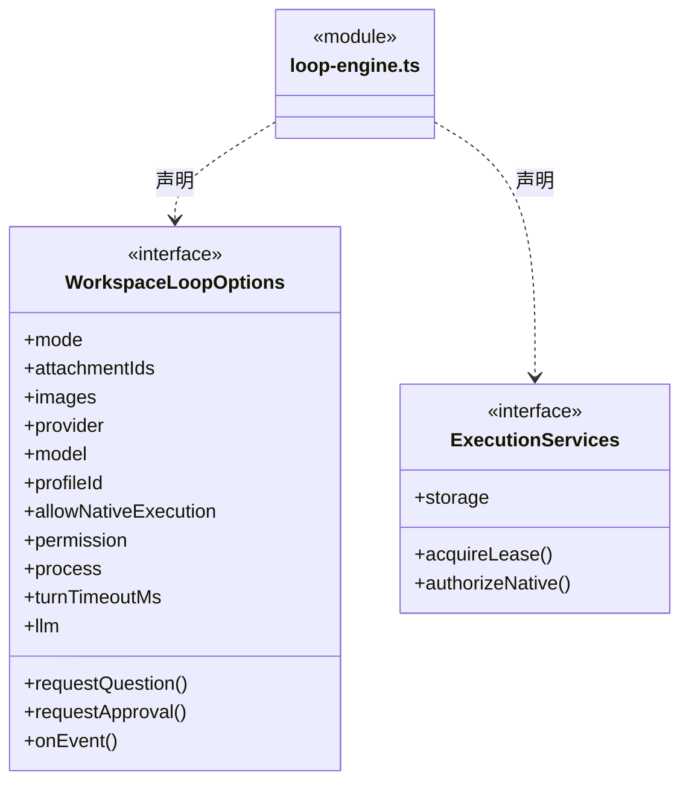
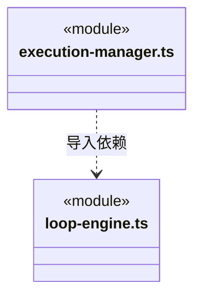

# src/backend/scheduler-engine/execution 架构

## 目录定位

执行工厂与工作区运行管理器。存储、租约和平台访问策略由应用注入；管理历史、队列续接、启动与恢复。

本文描述当前实现。通过分析目录边界后维护的 [源码架构脚本](../../../../scripts/source-architecture.mjs) 同步清单和声明；代码变更时仍须核对职责、关键成员与关系。

## 代码清单

| 文件 | 当前职责 |
| --- | --- |
| [execution-manager.ts](execution-manager.ts) | 调度引擎：工作区执行管理，负责主 Agent 普通对话、团队任务执行与多轮历史读取，拒绝旧轮次分叉，挂起并处理逐次工具审批与结构化用户问题，持久化消息队列并在成功结束后串行续接；本次全部通过仅在当前执行期间有效。 |
| [loop-engine.ts](loop-engine.ts) | 调度引擎：将工作区内部知识服务、内核锁与前置策略注入独立 LoopRuntime。 |

## 架构类图

### execution-manager.ts

直接依赖：[../conversation/message-queue.ts](../conversation/message-queue.ts)、[../conversation/approvals.ts](../conversation/approvals.ts)、[../conversation/questions.ts](../conversation/questions.ts)、[../conversation/main-agent.ts](../conversation/main-agent.ts)、[../../core/knowledge/ports.ts](../../core/knowledge/ports.ts)、[../../core/foundation/errors.ts](../../core/foundation/errors.ts)、[../../core/foundation/identity.ts](../../core/foundation/identity.ts)、[../../core/brain/storage.ts](../../core/brain/storage.ts)、[../../core/brain/index.ts](../../core/brain/index.ts)、[loop-engine.ts](loop-engine.ts)、[../context/team-workflow.ts](../context/team-workflow.ts)、[../../core/team/model.ts](../../core/team/model.ts)、[../../core/workspace/model.ts](../../core/workspace/model.ts)、[../../core/brain/types.ts](../../core/brain/types.ts)。

### loop-engine.ts

直接依赖：[../conversation/questions.ts](../conversation/questions.ts)、[../../core/foundation/paths.ts](../../core/foundation/paths.ts)、[../../core/knowledge/ports.ts](../../core/knowledge/ports.ts)、[../tools/knowledge-tools.ts](../tools/knowledge-tools.ts)、[../context/team-workflow.ts](../context/team-workflow.ts)、[../conversation/main-agent.ts](../conversation/main-agent.ts)、[../../core/brain/types.ts](../../core/brain/types.ts)、[../../core/brain/index.ts](../../core/brain/index.ts)、[../../core/brain/pi/rpc.ts](../../core/brain/pi/rpc.ts)、[../../core/brain/llm/ports.ts](../../core/brain/llm/ports.ts)、[../../core/brain/storage.ts](../../core/brain/storage.ts)。

### 本目录调用边界

## 子目录导航

无子目录。

[返回上层](../ARCHITECTURE.md)。

每次修改本目录代码，同步维护文件头、关键契约说明及本图。未实现的治理、证据验收和自动编排能力不列入当前类图。
