# src/backend/scheduler-engine/execution 架构

## 目录定位

主实例与图根共享身份；依赖追加在同事务重验两端及后继的知识/流程/停止状态，成功后重纳当前周期跟踪，仍待主轮结束并按原领取链执行。补充发送前预留、ACK后登记新输入，与cycle在途操作一起结算；停止先作用引擎，旧计划不再领取，最终门禁核对接收日志。目标分工、派发及人工来源核对原流程选择；交付/审阅从canonical复核真实证据与当前文件。检查点与前置调整不改选；额度/准入等待不消费，停止和重启封存不重放。 OwnerExecutionService 按知识→模型→任务事务核新派发及实际领取；原命令先查，锁释放后才启动。人工证据外部观察与最终知识快照/CAS 分离，避免反向串行等待。 CheckpointAbandonmentService 先读原命令，再核历史 canonical 与冻结证明，最后短事务裁决；不重读当前 native 或恢复旧模型，Auto 同步撤销旧恢复准入并等待处置收口。 原命令核实从固定主运行的 canonical 复原历史解析与指纹，比较读取前后依据；只返回严格公共摘要，不重发原命令或签发恢复资格。 EffectObservationService 复用原 canonical、控制面证据及平台单文件观察；恢复和重规划先在事务外取证，最终版本 CAS 后才建立独立周期，不自动重放原调用。 真实主调用原知识授权与请求先核实，再两次读取原事务阶段；变化使处置依据失效，未知不重放。 实际成员执行注入固定运行的受控文件端口，主调度不获得业务写入口，运行租约保持到物理操作排空。 桌面捕获固定 GitHub 端口和授权交统一策略；成员不继承，公开投影无正文或凭据。

本文描述当前实现。通过分析目录边界后维护的 [源码架构脚本](../../../../scripts/source-architecture.mjs) 同步清单和声明；代码变更时仍须核对职责、关键成员与关系。

## 代码清单

| 文件 | 当前职责 |
| --- | --- |
| [admission-wait.ts](admission-wait.ts) | 定义已受理协作批次交给运行入口的进程内等待通知，不进入模型或公开 IPC 参数。 |
| [agent-manager.ts](agent-manager.ts) | 根据已核实角色配置注册持久化成员，按主会话分配独立逻辑 Session。 |
| [artifact-report-service.ts](artifact-report-service.ts) | 按指定成员运行列出可信文件基线，并在明确选定后对实际文件作独立只读复核。 |
| [auto-collaboration.ts](auto-collaboration.ts) | 管理一次用户任务的调度周期，串接主 Agent 调度、执行成员和结果回传，周期结束后释放执行实例。 |
| [checkpoint-abandonment-service.ts](checkpoint-abandonment-service.ts) | 主调度明确放弃本周期尚未消费的检查点及可选恢复预约，保留旧执行与证明。 |
| [command-verification-service.ts](command-verification-service.ts) | 把原主运行的 canonical 调用与同一 Store 已提交命令只读关联，供桌面和主工具共用。 |
| [dispatch-service.ts](dispatch-service.ts) | 工作区的成员注册、主对话实例绑定、主会话派发及任务图增量查询服务。 |
| [effect-controlled-file.ts](effect-controlled-file.ts) | 在影响观察中核对已有受控文件报告与原成员完整绑定、参数和字节摘要。 |
| [effect-observation-service.ts](effect-observation-service.ts) | 组合原调用授权、已提交控制面、原知识事务、原治理/责任记录、受控文件阶段与当前选定文件，保存本机明确处置并派生新周期关联。 |
| [effect-source.ts](effect-source.ts) | 从唯一任务存储与 canonical 日志核实原成员/主运行，供影响观察和新核实来源共用。 |
| [execution-manager.ts](execution-manager.ts) | 工作区主对话管理，负责普通 chat、目标周期接续、多轮历史和消息队列；旧直接团队业务入口拒绝新执行，业务成员统一经岗位派发领取。 |
| [execution-report-facts.ts](execution-report-facts.ts) | 从已核对身份的成员运行日志提取工具授权与回执事实。 |
| [execution-report-service.ts](execution-report-service.ts) | 以持久派发状态和指定成员运行日志生成异常核实报告。 |
| [human-decision-evidence.ts](human-decision-evidence.ts) | 复核已消费人工接受的精确候选和选定文件，供显式接续、目标审阅及最终完成共用。 |
| [human-evidence-state.ts](human-evidence-state.ts) | 为人工验收和按意见继续提供同一主周期的证据状态指纹。 |
| [loop-engine.ts](loop-engine.ts) | 调度引擎：将工作区内部知识服务、内核锁与前置策略注入独立 LoopRuntime。 |
| [main-command-request.ts](main-command-request.ts) | 共享主调度原命令的指纹构造，从已核实 canonical 参数复原历史请求，包含原子前置增删。 |
| [member-checkpoint-verifier.ts](member-checkpoint-verifier.ts) | 核实逐段检查点的完整 canonical、累计文件与最新私有原生历史，分别支持续执行许可与明确放弃旧待办的历史真实性检查。 |
| [member-events.ts](member-events.ts) | 将成员运行日志投影为可公开的连续事件流，并按 run 缓存首次恢复及后续已落盘增量。 |
| [member-execution.ts](member-execution.ts) | 让已派发任务在独立成员会话中执行，提交领取、启动、结果、中断及一次安全停泊/续执行事实。 |
| [member-help-state.ts](member-help-state.ts) | 从成员 canonical 运行日志核实一次结构化求助的安全交接候选。 |
| [member-pause-service.ts](member-pause-service.ts) | 核实持久等待的成员原记录，并在用户明确继续时重新检查岗位、知识、native 与文件。 |
| [member-resume-service.ts](member-resume-service.ts) | 当前主调度为本周期最新安全检查点预约一次原任务续执行，逐段保留原预约和独立待领取信封。 |
| [member-state.ts](member-state.ts) | 成员执行事务的图增量、占用和交付候选投影，并提供独立求助验证入口。 |
| [member-workflow.ts](member-workflow.ts) | 在成员交付结算与主目标审阅时重算冻结 Workflow，并复核被验证文件的当前字节。 |
| [model-request-budget-service.ts](model-request-budget-service.ts) | 把每个真实主/成员请求的预留、发送意图和终态写入工作区唯一串行 Store。 |
| [output-manifest-report-service.ts](output-manifest-report-service.ts) | 对指定成员运行列出原完整清单，并在用户明确选定后重新观察全部冻结范围。 |
| [owner-execution-service.ts](owner-execution-service.ts) | 在既有知识、模型和派发存储之间核实岗位执行绑定，为计划、派发、领取和依赖维护提供同一入口。 |
| [public-run-events.ts](public-run-events.ts) | 把主会话和成员运行事件转换为可展示的公开消息、工具状态、计划与证据摘要。 |
| [queued-dependency-addition-service.ts](queued-dependency-addition-service.ts) | 在同一派发事务核实未领取任务及两端后继，为原目标追加一条结果前置。 |
| [queued-dependency-replacement-service.ts](queued-dependency-replacement-service.ts) | 主调度在同一事务核实旧前置、安全替代候选与未启动后继，并原子提交单条依赖替换。 |
| [queued-dependency-revision-service.ts](queued-dependency-revision-service.ts) | 在同一可靠事务中退役和新增未领取目标的多条前置，保存原请求与完整闭包审计。 |
| [queued-task-cancel-service.ts](queued-task-cancel-service.ts) | 主调度在单个派发事务中撤销明确的一组尚未启动任务。 |
| [scope-active-input-evidence.ts](scope-active-input-evidence.ts) | 把目标补充的持久接收记录与原主运行的可信插入日志逐项核对。 |
| [scope-active-input-service.ts](scope-active-input-service.ts) | 在派发事务中登记运行中插入的准备、真实接收和不确定事实。 |
| [scope-budget-service.ts](scope-budget-service.ts) | 在调度事务内核实周期额度，并将许可证明或拒绝事实交给同一事务保存；逐请求模式读取独立请求账本。 |
| [scope-continuation-service.ts](scope-continuation-service.ts) | 原子消费安全等待，保存用户原始补充、可选附件快照清单和一次性主运行意图。 |
| [scope-goal-service.ts](scope-goal-service.ts) | 保存本轮目标计划与审阅，为门禁、依赖修订和人工决定核验真实候选；已放弃检查点换边仍核原冻结日志，不复活旧任务。 |
| [scope-human-continuation-service.ts](scope-human-continuation-service.ts) | 将当前等待中的最新人工决定全集转换成一次可信主运行接续意图。 |
| [scope-human-decision-service.ts](scope-human-decision-service.ts) | 核实安全等待中的人工验收项和明确选定文件，保存本机显式决定及不可变依据。 |
| [scope-recovery-service.ts](scope-recovery-service.ts) | 为已关闭周期的异常执行创建独立只读核实周期，持久化用户观察和一次性全新上下文意图。 |
| [scope-replan-service.ts](scope-replan-service.ts) | 在完成的只读核实基础上创建独立业务周期，冻结真实证据、原人工约束和用户明确的新目标。 |
| [scope-usage-service.ts](scope-usage-service.ts) | 按指定目标周期的持久主运行清单与成员绑定，读取 canonical 日志并生成只读消耗报告。 |
| [workspace-lease.ts](workspace-lease.ts) | 同一已打开工作区内，主会话与独立成员共享的执行占用协调器。 |

## 架构类图

### admission-wait.ts

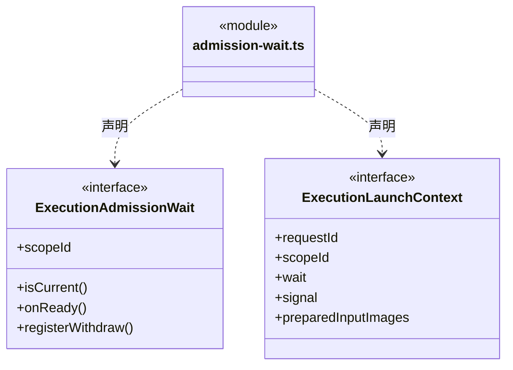

直接依赖：[../../core/brain/types.ts](../../core/brain/types.ts)。

### agent-manager.ts

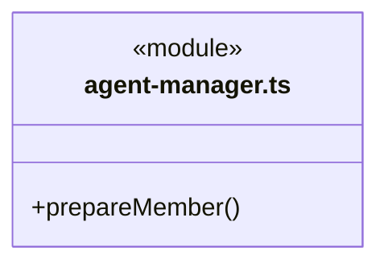

直接依赖：[../../core/foundation/errors.ts](../../core/foundation/errors.ts)、[../../core/team/agent-types.ts](../../core/team/agent-types.ts)、[../../core/tasks/dispatch-storage.ts](../../core/tasks/dispatch-storage.ts)、[../../core/tasks/graph-types.ts](../../core/tasks/graph-types.ts)。

### artifact-report-service.ts

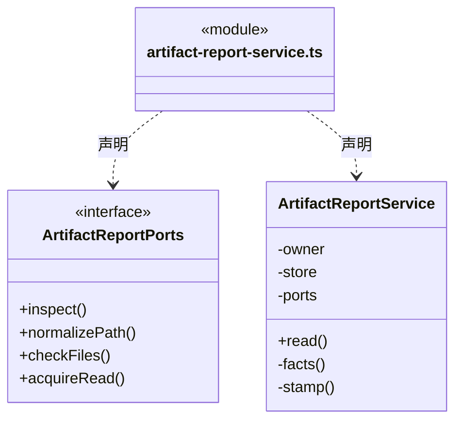

直接依赖：[../../core/foundation/errors.ts](../../core/foundation/errors.ts)、[../../core/foundation/serialization.ts](../../core/foundation/serialization.ts)、[../../core/tasks/artifact-baseline.ts](../../core/tasks/artifact-baseline.ts)、[../../core/tasks/artifact-evidence.ts](../../core/tasks/artifact-evidence.ts)、[../../core/tasks/dispatch-storage.ts](../../core/tasks/dispatch-storage.ts)、[../../core/tasks/dispatch-execution.ts](../../core/tasks/dispatch-execution.ts)、[../../core/knowledge/ports.ts](../../core/knowledge/ports.ts)、[../../core/brain/types.ts](../../core/brain/types.ts)、[member-events.ts](member-events.ts)。

### auto-collaboration.ts

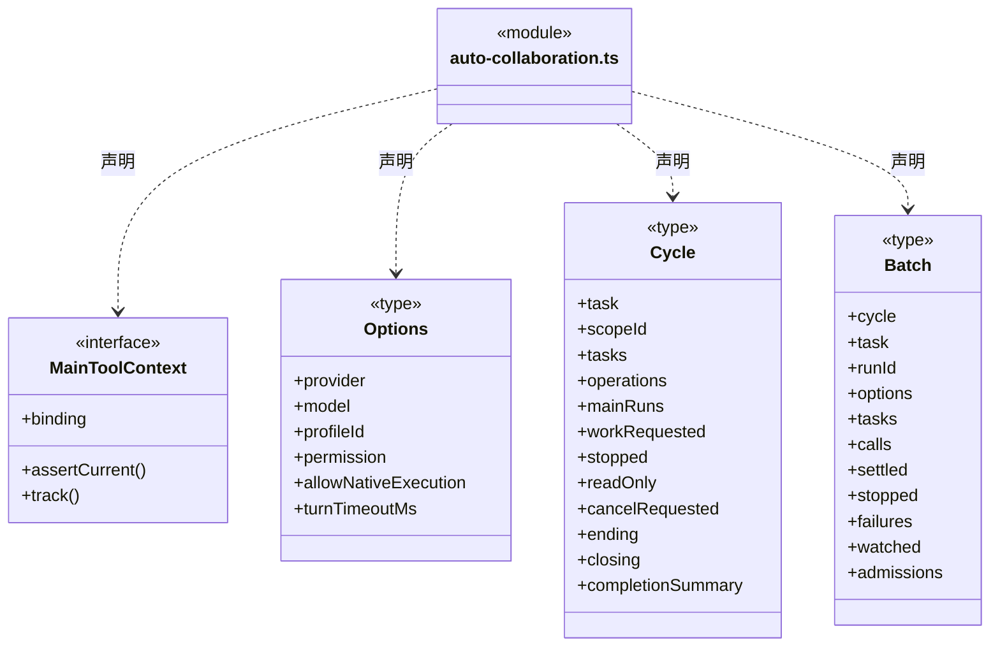

成员 1/3（同名节点为同一声明，跨图合并阅读）。

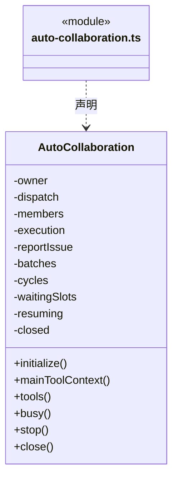

成员 2/3（同名节点为同一声明，跨图合并阅读）。

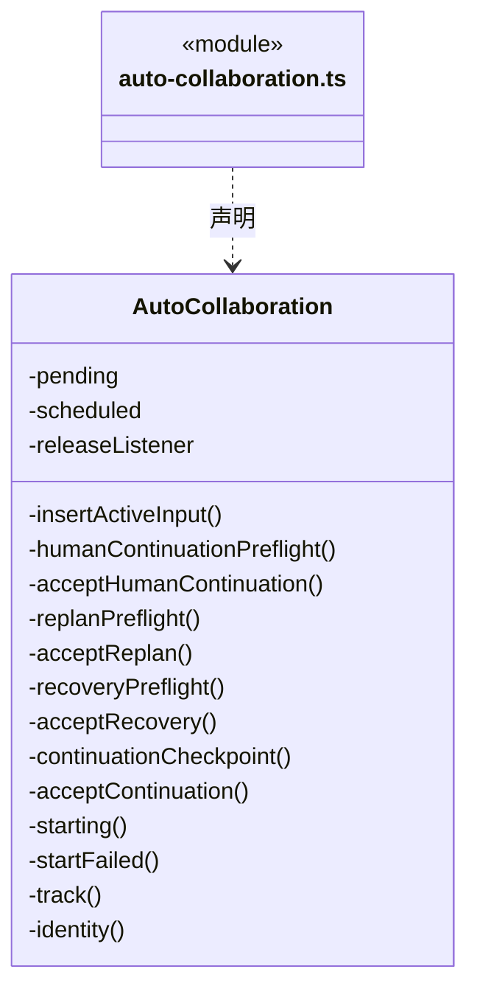

成员 3/3（同名节点为同一声明，跨图合并阅读）。

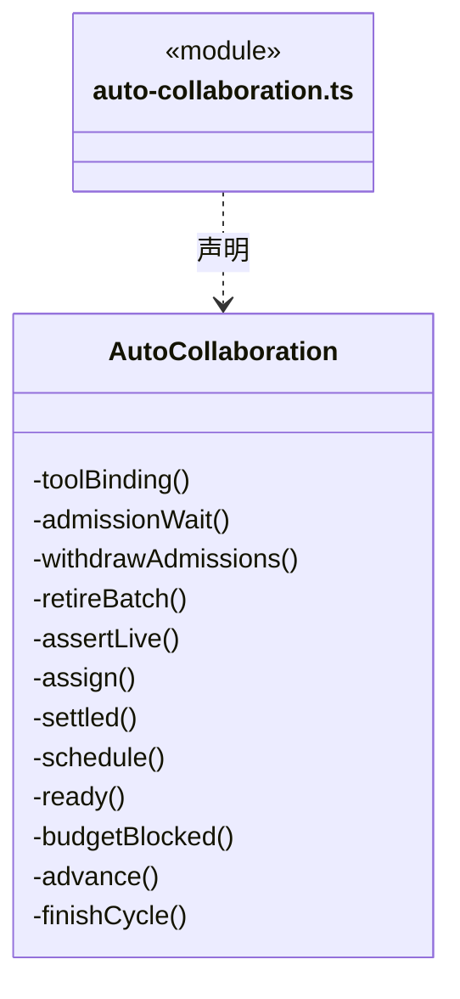

直接依赖：[../../core/foundation/serialization.ts](../../core/foundation/serialization.ts)、[../../core/tasks/member-checkpoint-chain.ts](../../core/tasks/member-checkpoint-chain.ts)、[../../core/tasks/member-checkpoint.ts](../../core/tasks/member-checkpoint.ts)、[../../core/foundation/errors.ts](../../core/foundation/errors.ts)、[../../core/brain/types.ts](../../core/brain/types.ts)、[../../core/tasks/dispatch-scope.ts](../../core/tasks/dispatch-scope.ts)、[../../core/tasks/scope-continuation.ts](../../core/tasks/scope-continuation.ts)、[../../core/tasks/scope-continuation-attachments.ts](../../core/tasks/scope-continuation-attachments.ts)、[../../core/tasks/scope-active-input.ts](../../core/tasks/scope-active-input.ts)、[../../core/tasks/human-continue.ts](../../core/tasks/human-continue.ts)、[../../core/tasks/scope-recovery.ts](../../core/tasks/scope-recovery.ts)、[../../core/tasks/scope-replan.ts](../../core/tasks/scope-replan.ts)、[../../core/knowledge/ports.ts](../../core/knowledge/ports.ts)、[../../core/tasks/dispatch-commands.ts](../../core/tasks/dispatch-commands.ts)、[../../core/tasks/graph-types.ts](../../core/tasks/graph-types.ts)、[../tools/dispatch-tools.ts](../tools/dispatch-tools.ts)、[../tools/goal-tools.ts](../tools/goal-tools.ts)、[../tools/main-tool-contracts.ts](../tools/main-tool-contracts.ts)、[../../core/tasks/main-tool-output.ts](../../core/tasks/main-tool-output.ts)、[dispatch-service.ts](dispatch-service.ts)、[member-execution.ts](member-execution.ts)、[execution-manager.ts](execution-manager.ts)、[loop-engine.ts](loop-engine.ts)、[workspace-lease.ts](workspace-lease.ts)、[admission-wait.ts](admission-wait.ts)、[../../core/workspace/module-ownership-tool-policy.ts](../../core/workspace/module-ownership-tool-policy.ts)、[../../core/tasks/checkpoint-handoff.ts](../../core/tasks/checkpoint-handoff.ts)。

### checkpoint-abandonment-service.ts

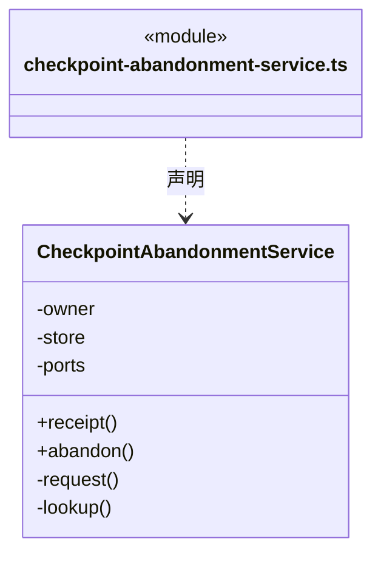

直接依赖：[../../core/foundation/errors.ts](../../core/foundation/errors.ts)、[../../core/foundation/serialization.ts](../../core/foundation/serialization.ts)、[main-command-request.ts](main-command-request.ts)、[../../core/knowledge/ports.ts](../../core/knowledge/ports.ts)、[../../core/tasks/dispatch-storage.ts](../../core/tasks/dispatch-storage.ts)、[../../core/tasks/graph-types.ts](../../core/tasks/graph-types.ts)、[../../core/tasks/checkpoint-handoff.ts](../../core/tasks/checkpoint-handoff.ts)、[../../core/tasks/checkpoint-handoff-rules.ts](../../core/tasks/checkpoint-handoff-rules.ts)、[member-checkpoint-verifier.ts](member-checkpoint-verifier.ts)。

### command-verification-service.ts

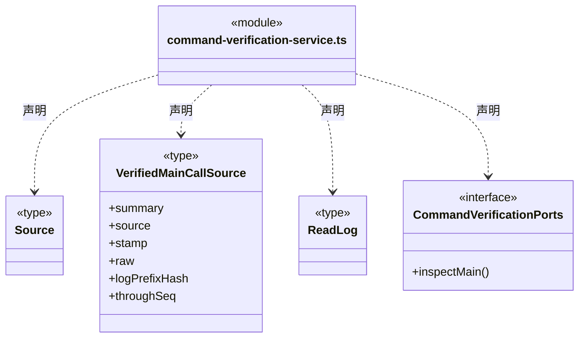

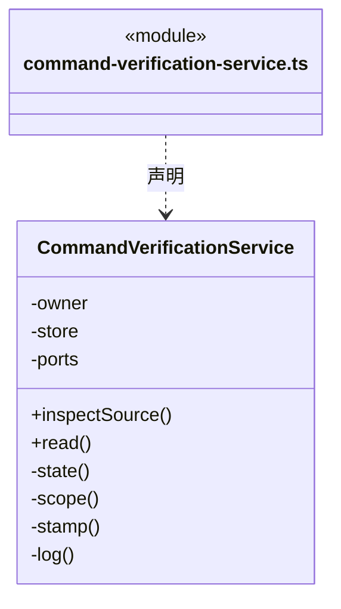

直接依赖：[../../core/foundation/errors.ts](../../core/foundation/errors.ts)、[../../core/foundation/serialization.ts](../../core/foundation/serialization.ts)、[../../core/knowledge/ports.ts](../../core/knowledge/ports.ts)、[../../core/brain/types.ts](../../core/brain/types.ts)、[../../core/brain/conversation-binding.ts](../../core/brain/conversation-binding.ts)、[../../core/tasks/dispatch-storage.ts](../../core/tasks/dispatch-storage.ts)、[../../core/tasks/dispatch-scope.ts](../../core/tasks/dispatch-scope.ts)、[../../core/tasks/scope-goal.ts](../../core/tasks/scope-goal.ts)、[../../core/tasks/command-verification.ts](../../core/tasks/command-verification.ts)、[../../core/tasks/command-verification-output.ts](../../core/tasks/command-verification-output.ts)、[execution-report-facts.ts](execution-report-facts.ts)、[main-command-request.ts](main-command-request.ts)。

### dispatch-service.ts

成员 1/4（同名节点为同一声明，跨图合并阅读）。

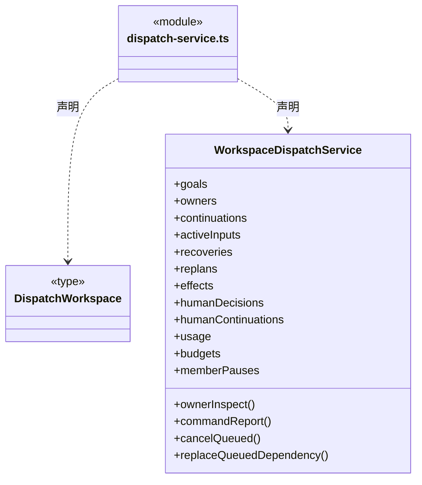

成员 2/4（同名节点为同一声明，跨图合并阅读）。

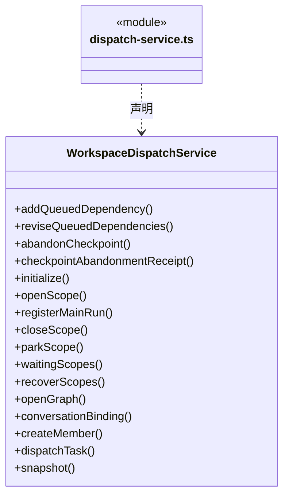

成员 3/4（同名节点为同一声明，跨图合并阅读）。

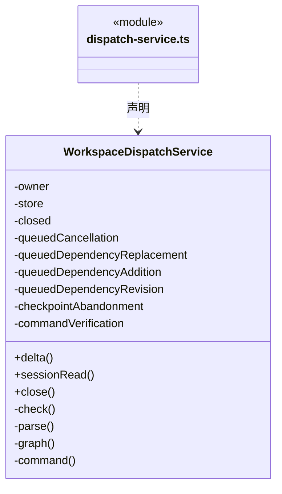

成员 4/4（同名节点为同一声明，跨图合并阅读）。

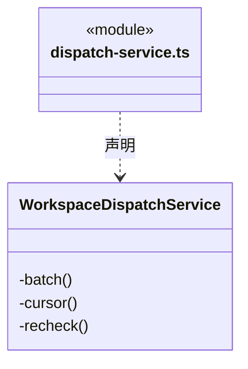

直接依赖：[../../core/foundation/errors.ts](../../core/foundation/errors.ts)、[../../core/foundation/serialization.ts](../../core/foundation/serialization.ts)、[main-command-request.ts](main-command-request.ts)、[command-verification-service.ts](command-verification-service.ts)、[effect-observation-service.ts](effect-observation-service.ts)、[../../core/knowledge/ports.ts](../../core/knowledge/ports.ts)、[../../core/knowledge/types.ts](../../core/knowledge/types.ts)、[../../core/brain/conversation-binding.ts](../../core/brain/conversation-binding.ts)、[../../core/tasks/dispatch-storage.ts](../../core/tasks/dispatch-storage.ts)、[../../core/tasks/dispatch-scope.ts](../../core/tasks/dispatch-scope.ts)、[../../core/team/agent-types.ts](../../core/team/agent-types.ts)、[../../core/tasks/types.ts](../../core/tasks/types.ts)、[../../core/brain/types.ts](../../core/brain/types.ts)、[scope-goal-service.ts](scope-goal-service.ts)、[scope-continuation-service.ts](scope-continuation-service.ts)、[scope-active-input-service.ts](scope-active-input-service.ts)、[scope-recovery-service.ts](scope-recovery-service.ts)、[scope-replan-service.ts](scope-replan-service.ts)、[scope-human-decision-service.ts](scope-human-decision-service.ts)、[scope-human-continuation-service.ts](scope-human-continuation-service.ts)、[queued-task-cancel-service.ts](queued-task-cancel-service.ts)、[queued-dependency-replacement-service.ts](queued-dependency-replacement-service.ts)、[queued-dependency-addition-service.ts](queued-dependency-addition-service.ts)、[queued-dependency-revision-service.ts](queued-dependency-revision-service.ts)、[../../core/tasks/queued-dependency-revision.ts](../../core/tasks/queued-dependency-revision.ts)、[checkpoint-abandonment-service.ts](checkpoint-abandonment-service.ts)、[member-checkpoint-verifier.ts](member-checkpoint-verifier.ts)、[member-pause-service.ts](member-pause-service.ts)、[../../core/tasks/checkpoint-handoff.ts](../../core/tasks/checkpoint-handoff.ts)、[../../core/tasks/queued-dependency-addition.ts](../../core/tasks/queued-dependency-addition.ts)、[../../core/tasks/queued-dependency-replacement.ts](../../core/tasks/queued-dependency-replacement.ts)、[../../core/tasks/member-checkpoint.ts](../../core/tasks/member-checkpoint.ts)、[scope-usage-service.ts](scope-usage-service.ts)、[scope-budget-service.ts](scope-budget-service.ts)、[../../core/tasks/scope-budget.ts](../../core/tasks/scope-budget.ts)、[../../core/tasks/queued-task-cancel.ts](../../core/tasks/queued-task-cancel.ts)、[../../core/tasks/dispatch-commands.ts](../../core/tasks/dispatch-commands.ts)、[../../core/tasks/graph-types.ts](../../core/tasks/graph-types.ts)、[../context/dispatch-context.ts](../context/dispatch-context.ts)、[agent-manager.ts](agent-manager.ts)、[../../core/tasks/scope-view.ts](../../core/tasks/scope-view.ts)、[../../core/tasks/scope-run-tracking.ts](../../core/tasks/scope-run-tracking.ts)、[../../core/workspace/module-ownership-tool-policy.ts](../../core/workspace/module-ownership-tool-policy.ts)、[owner-execution-service.ts](owner-execution-service.ts)。

### effect-controlled-file.ts

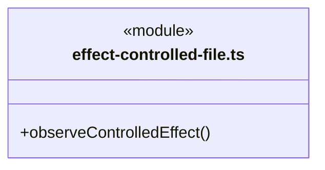

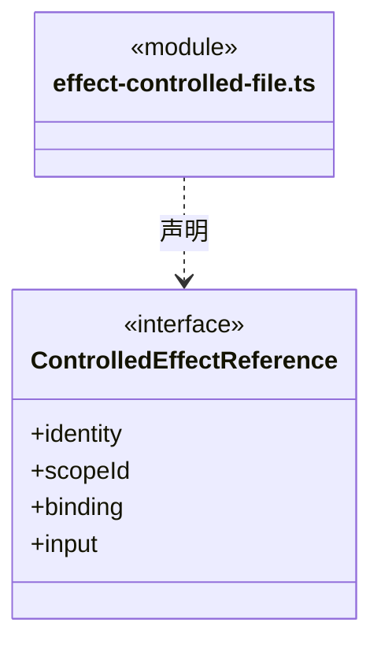

直接依赖：[../../core/foundation/serialization.ts](../../core/foundation/serialization.ts)、[../../core/foundation/errors.ts](../../core/foundation/errors.ts)、[../../core/tasks/controlled-file-operation.ts](../../core/tasks/controlled-file-operation.ts)、[../../core/tasks/controlled-file-rules.ts](../../core/tasks/controlled-file-rules.ts)。

### effect-observation-service.ts

成员 1/2（同名节点为同一声明，跨图合并阅读）。

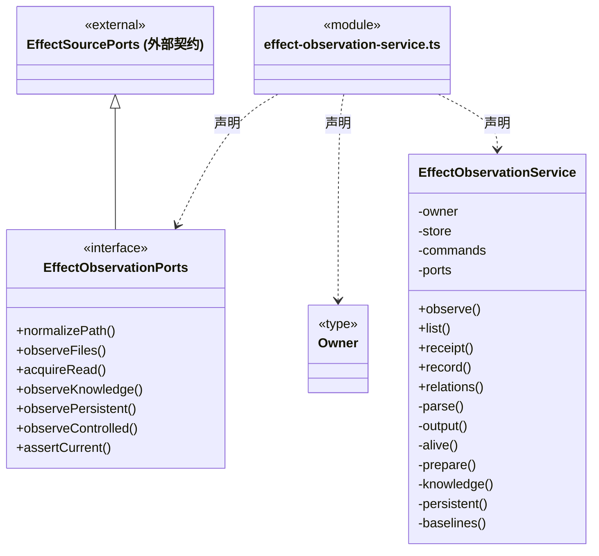

成员 2/2（同名节点为同一声明，跨图合并阅读）。

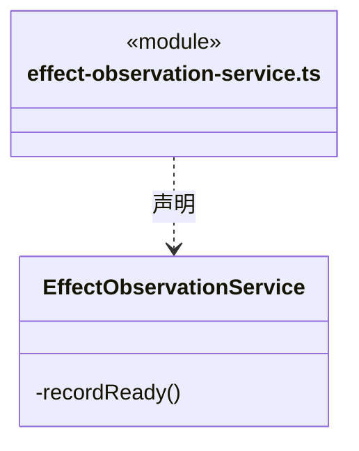

直接依赖：[../../core/foundation/errors.ts](../../core/foundation/errors.ts)、[../../core/foundation/serialization.ts](../../core/foundation/serialization.ts)、[../../core/knowledge/ports.ts](../../core/knowledge/ports.ts)、[../../core/tasks/dispatch-storage.ts](../../core/tasks/dispatch-storage.ts)、[../../core/tasks/effect-observation.ts](../../core/tasks/effect-observation.ts)、[../../core/tasks/effect-observation-rules.ts](../../core/tasks/effect-observation-rules.ts)、[../../core/tasks/command-verification.ts](../../core/tasks/command-verification.ts)、[../../core/tasks/artifact-evidence.ts](../../core/tasks/artifact-evidence.ts)、[../../core/tasks/artifact-baseline.ts](../../core/tasks/artifact-baseline.ts)、[command-verification-service.ts](command-verification-service.ts)、[effect-source.ts](effect-source.ts)、[../../core/knowledge/knowledge-write-observation.ts](../../core/knowledge/knowledge-write-observation.ts)、[../../core/knowledge/knowledge-write-input.ts](../../core/knowledge/knowledge-write-input.ts)、[../../core/tasks/persistent-write-observation.ts](../../core/tasks/persistent-write-observation.ts)、[../../core/tasks/persistent-write-input.ts](../../core/tasks/persistent-write-input.ts)、[../../core/tasks/controlled-file-operation.ts](../../core/tasks/controlled-file-operation.ts)、[effect-controlled-file.ts](effect-controlled-file.ts)。

### effect-source.ts

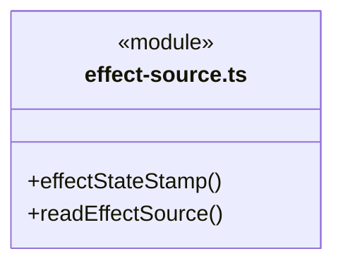

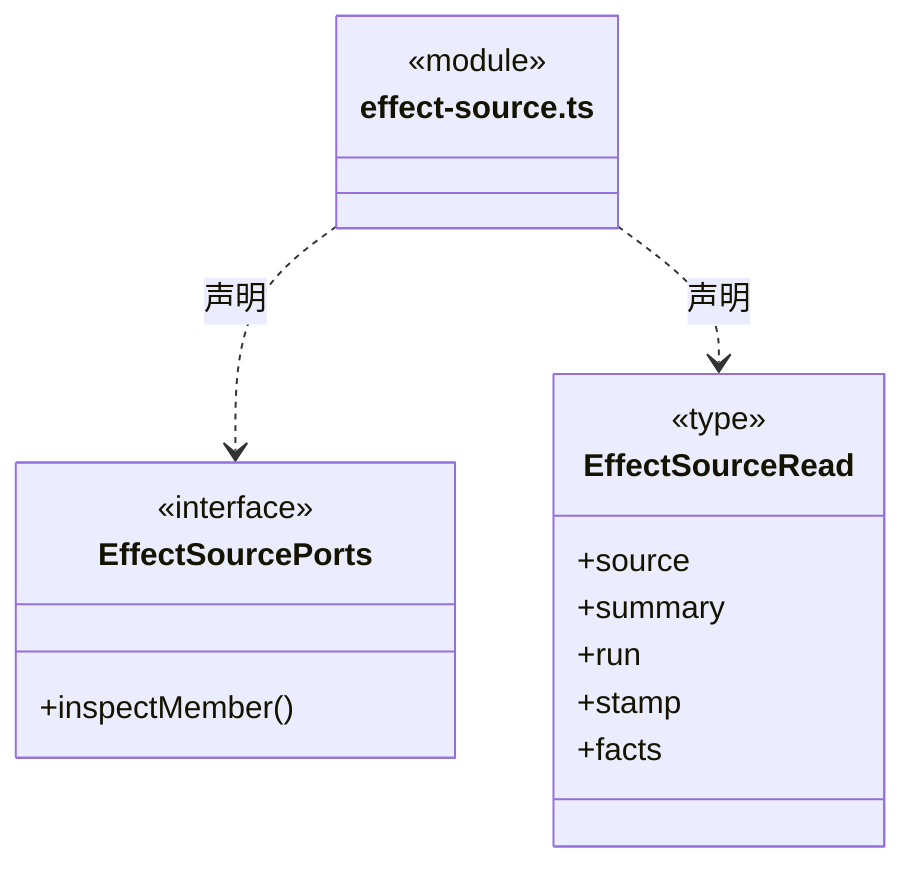

直接依赖：[../../core/foundation/serialization.ts](../../core/foundation/serialization.ts)、[../../core/brain/types.ts](../../core/brain/types.ts)、[../../core/tasks/dispatch-storage.ts](../../core/tasks/dispatch-storage.ts)、[../../core/tasks/dispatch-execution.ts](../../core/tasks/dispatch-execution.ts)、[../../core/tasks/effect-observation.ts](../../core/tasks/effect-observation.ts)、[../../core/tasks/scope-goal.ts](../../core/tasks/scope-goal.ts)、[member-events.ts](member-events.ts)、[execution-report-facts.ts](execution-report-facts.ts)、[command-verification-service.ts](command-verification-service.ts)。

### execution-manager.ts

成员 1/4（同名节点为同一声明，跨图合并阅读）。

```mermaid
classDiagram
class N_src_backend_scheduler_engine_execution_execution_manager_ts["execution-manager.ts"] {
  <<module>>
}
class N_src_backend_scheduler_engine_execution_execution_manager_ts_Options["Options"] {
  <<type>>

}
N_src_backend_scheduler_engine_execution_execution_manager_ts ..> N_src_backend_scheduler_engine_execution_execution_manager_ts_Options : 声明
class N_src_backend_scheduler_engine_execution_execution_manager_ts_ExecutionCollaboration["ExecutionCollaboration"] {
  <<interface>>
  +activeInputReceipt()
  +insertActiveInput()
  +humanContinuationReceipt()
  +humanContinuationPreflight()
  +acceptHumanContinuation()
  +replanReceipt()
  +replanPreflight()
  +acceptReplan()
  +recoveryReceipt()
  +recoveryPreflight()
  +acceptRecovery()
  +recoveryContext()
  +recoveryRunIds()
  +continuationReceipt()
  +continuationCheckpoint()
  +acceptContinuation()
}
N_src_backend_scheduler_engine_execution_execution_manager_ts ..> N_src_backend_scheduler_engine_execution_execution_manager_ts_ExecutionCollaboration : 声明
class N_src_backend_scheduler_engine_execution_execution_manager_ts_WorkspaceExecutionManager["WorkspaceExecutionManager"] {
  +workspace
  +cancelPendingLaunches()
  +attachCollaboration()
  +observeQueue()
  +initializeQueueMonitoring()
  +queued()
  +queueDelta()
  +enqueue()
  +changeQueued()
  +editQueued()
  +moveQueued()
  +insertQueued()
  +continueQueue()
  +pendingQuestions()
  +answerQuestion()
  +pendingApprovals()
}
N_src_backend_scheduler_engine_execution_execution_manager_ts ..> N_src_backend_scheduler_engine_execution_execution_manager_ts_WorkspaceExecutionManager : 声明
```

成员 2/4（同名节点为同一声明，跨图合并阅读）。

```mermaid
classDiagram
class N_src_backend_scheduler_engine_execution_execution_manager_ts["execution-manager.ts"] {
  <<module>>
}
class N_src_backend_scheduler_engine_execution_execution_manager_ts_ExecutionCollaboration["ExecutionCollaboration"] {
  <<interface>>
  +starting()
  +holdMain()
  +startFailed()
  +busy()
  +waiting()
  +settled()
  +stop()
}
N_src_backend_scheduler_engine_execution_execution_manager_ts ..> N_src_backend_scheduler_engine_execution_execution_manager_ts_ExecutionCollaboration : 声明
class N_src_backend_scheduler_engine_execution_execution_manager_ts_WorkspaceExecutionManager["WorkspaceExecutionManager"] {
  +answerApproval()
  +subscribe()
  +prepare()
  +choices()
  +thread()
  +threadView()
  +start()
  +chat()
  +recoverExecution()
  +replanExecution()
  +continueGoal()
  +continueFromHumanDecisions()
  +resume()
  +continueFromResults()
  +collaborationReady()
  +pauseCollaboration()
}
N_src_backend_scheduler_engine_execution_execution_manager_ts ..> N_src_backend_scheduler_engine_execution_execution_manager_ts_WorkspaceExecutionManager : 声明
```

成员 3/4（同名节点为同一声明，跨图合并阅读）。

```mermaid
classDiagram
class N_src_backend_scheduler_engine_execution_execution_manager_ts["execution-manager.ts"] {
  <<module>>
}
class N_src_backend_scheduler_engine_execution_execution_manager_ts_WorkspaceExecutionManager["WorkspaceExecutionManager"] {
  +stop()
  +inspect()
  +list()
  +close()
  -storage
  -factory
  -inputImages
  -prepareContinuationInput
  -collaboration
  -resultContinuationStopped
  -queueAdvanceStopped
  -stopVersions
  -pendingLaunches
  -pendingInsertions
  -insertionsClosed
  -cancelInsertions()
}
N_src_backend_scheduler_engine_execution_execution_manager_ts ..> N_src_backend_scheduler_engine_execution_execution_manager_ts_WorkspaceExecutionManager : 声明
```

成员 4/4（同名节点为同一声明，跨图合并阅读）。

```mermaid
classDiagram
class N_src_backend_scheduler_engine_execution_execution_manager_ts["execution-manager.ts"] {
  <<module>>
}
class N_src_backend_scheduler_engine_execution_execution_manager_ts_WorkspaceExecutionManager["WorkspaceExecutionManager"] {
  -messageQueue
  -queueSubscriptions
  -queueSource()
  -queue()
  -pump()
  -active
  -pending
  -closing
  -listeners
  -questions
  -approvalQueue
  -cancelApprovals()
  -serial()
  -checkedCurrentHistory()
  -launch()
  -directory()
}
N_src_backend_scheduler_engine_execution_execution_manager_ts ..> N_src_backend_scheduler_engine_execution_execution_manager_ts_WorkspaceExecutionManager : 声明
```

直接依赖：[../conversation/message-queue.ts](../conversation/message-queue.ts)、[../conversation/approvals.ts](../conversation/approvals.ts)、[../conversation/questions.ts](../conversation/questions.ts)、[../conversation/main-agent.ts](../conversation/main-agent.ts)、[../../core/knowledge/ports.ts](../../core/knowledge/ports.ts)、[../../core/foundation/errors.ts](../../core/foundation/errors.ts)、[../../core/foundation/identity.ts](../../core/foundation/identity.ts)、[../../core/brain/storage.ts](../../core/brain/storage.ts)、[../../core/brain/index.ts](../../core/brain/index.ts)、[../../core/brain/types.ts](../../core/brain/types.ts)、[../../core/brain/input-source.ts](../../core/brain/input-source.ts)、[loop-engine.ts](loop-engine.ts)、[../context/team-workflow.ts](../context/team-workflow.ts)、[../../core/team/model.ts](../../core/team/model.ts)、[../../core/workspace/model.ts](../../core/workspace/model.ts)、[../../core/tasks/scope-continuation.ts](../../core/tasks/scope-continuation.ts)、[../../core/tasks/dispatch-scope.ts](../../core/tasks/dispatch-scope.ts)、[../../core/tasks/scope-active-input.ts](../../core/tasks/scope-active-input.ts)、[../../core/tasks/scope-active-input-rules.ts](../../core/tasks/scope-active-input-rules.ts)、[../../core/tasks/scope-goal.ts](../../core/tasks/scope-goal.ts)、[../../core/foundation/serialization.ts](../../core/foundation/serialization.ts)、[../../core/tasks/scope-continuation-attachments.ts](../../core/tasks/scope-continuation-attachments.ts)、[../../core/tasks/scope-recovery.ts](../../core/tasks/scope-recovery.ts)、[../../core/tasks/fresh-context.ts](../../core/tasks/fresh-context.ts)、[admission-wait.ts](admission-wait.ts)、[../../core/tasks/scope-replan.ts](../../core/tasks/scope-replan.ts)、[../../core/tasks/human-continue.ts](../../core/tasks/human-continue.ts)。

### execution-report-facts.ts

```mermaid
classDiagram
class N_src_backend_scheduler_engine_execution_execution_report_facts_ts["execution-report-facts.ts"] {
  <<module>>
  +executionToolFacts()
}
```

```mermaid
classDiagram
class N_src_backend_scheduler_engine_execution_execution_report_facts_ts["execution-report-facts.ts"] {
  <<module>>
}
class N_src_backend_scheduler_engine_execution_execution_report_facts_ts_Item["Item"] {
  <<type>>

}
N_src_backend_scheduler_engine_execution_execution_report_facts_ts ..> N_src_backend_scheduler_engine_execution_execution_report_facts_ts_Item : 声明
```

直接依赖：[../../core/tasks/execution-report.ts](../../core/tasks/execution-report.ts)、[../../core/brain/types.ts](../../core/brain/types.ts)、[../../core/tasks/dispatch-execution.ts](../../core/tasks/dispatch-execution.ts)、[../../core/foundation/serialization.ts](../../core/foundation/serialization.ts)。

### execution-report-service.ts

```mermaid
classDiagram
class N_src_backend_scheduler_engine_execution_execution_report_service_ts["execution-report-service.ts"] {
  <<module>>
}
class N_src_backend_scheduler_engine_execution_execution_report_service_ts_ExecutionReportService["ExecutionReportService"] {
  +read()
  -owner
  -store
  -inspect
  -facts()
  -cancelledWithoutRun()
  -stamp()
  -bound()
  -matches()
}
N_src_backend_scheduler_engine_execution_execution_report_service_ts ..> N_src_backend_scheduler_engine_execution_execution_report_service_ts_ExecutionReportService : 声明
```

直接依赖：[../../core/foundation/errors.ts](../../core/foundation/errors.ts)、[../../core/foundation/serialization.ts](../../core/foundation/serialization.ts)、[../../core/tasks/execution-report.ts](../../core/tasks/execution-report.ts)、[../../core/tasks/dispatch-storage.ts](../../core/tasks/dispatch-storage.ts)、[../../core/tasks/dispatch-execution.ts](../../core/tasks/dispatch-execution.ts)、[../../core/knowledge/ports.ts](../../core/knowledge/ports.ts)、[../../core/brain/types.ts](../../core/brain/types.ts)、[execution-report-facts.ts](execution-report-facts.ts)、[../../core/tasks/queued-task-cancel.ts](../../core/tasks/queued-task-cancel.ts)。

### human-decision-evidence.ts

```mermaid
classDiagram
class N_src_backend_scheduler_engine_execution_human_decision_evidence_ts["human-decision-evidence.ts"] {
  <<module>>
  +consumedHumanDecision()
  +assertHumanSubject()
  +validateHumanAcceptances()
}
```

```mermaid
classDiagram
class N_src_backend_scheduler_engine_execution_human_decision_evidence_ts["human-decision-evidence.ts"] {
  <<module>>
}
class N_src_backend_scheduler_engine_execution_human_decision_evidence_ts_HumanDecisionPorts["HumanDecisionPorts"] {
  <<interface>>
  +normalizePath()
  +checkFiles()
  +checkManifest()
  +acquireRead()
  +assertCurrent()
}
N_src_backend_scheduler_engine_execution_human_decision_evidence_ts ..> N_src_backend_scheduler_engine_execution_human_decision_evidence_ts_HumanDecisionPorts : 声明
class N_src_backend_scheduler_engine_execution_human_decision_evidence_ts_HumanEvidenceLogs["HumanEvidenceLogs"] {
  <<interface>>
  +inspectMember()
  +inspectMain()
}
N_src_backend_scheduler_engine_execution_human_decision_evidence_ts ..> N_src_backend_scheduler_engine_execution_human_decision_evidence_ts_HumanEvidenceLogs : 声明
class N_src_backend_scheduler_engine_execution_human_decision_evidence_ts_HumanCandidateValidator["HumanCandidateValidator"] {
  <<type>>

}
N_src_backend_scheduler_engine_execution_human_decision_evidence_ts ..> N_src_backend_scheduler_engine_execution_human_decision_evidence_ts_HumanCandidateValidator : 声明
```

直接依赖：[../../core/foundation/errors.ts](../../core/foundation/errors.ts)、[../../core/foundation/serialization.ts](../../core/foundation/serialization.ts)、[../../core/knowledge/ports.ts](../../core/knowledge/ports.ts)、[../../core/brain/types.ts](../../core/brain/types.ts)、[../../core/tasks/dispatch-storage.ts](../../core/tasks/dispatch-storage.ts)、[../../core/tasks/dispatch-scope.ts](../../core/tasks/dispatch-scope.ts)、[../../core/tasks/dispatch-execution.ts](../../core/tasks/dispatch-execution.ts)、[../../core/tasks/graph-types.ts](../../core/tasks/graph-types.ts)、[../../core/tasks/human-decisions.ts](../../core/tasks/human-decisions.ts)、[../../core/tasks/human-continue.ts](../../core/tasks/human-continue.ts)、[../../core/tasks/human-continuation-rules.ts](../../core/tasks/human-continuation-rules.ts)、[../../core/tasks/scope-goal.ts](../../core/tasks/scope-goal.ts)、[../../core/tasks/artifact-baseline.ts](../../core/tasks/artifact-baseline.ts)、[../../core/tasks/artifact-evidence.ts](../../core/tasks/artifact-evidence.ts)、[member-workflow.ts](member-workflow.ts)、[../../core/tasks/output-manifest.ts](../../core/tasks/output-manifest.ts)、[../../core/tasks/complete-output-evidence.ts](../../core/tasks/complete-output-evidence.ts)。

### human-evidence-state.ts

```mermaid
classDiagram
class N_src_backend_scheduler_engine_execution_human_evidence_state_ts["human-evidence-state.ts"] {
  <<module>>
  +humanEvidenceStateStamp()
}
```

直接依赖：[../../core/foundation/serialization.ts](../../core/foundation/serialization.ts)、[../../core/tasks/dispatch-storage.ts](../../core/tasks/dispatch-storage.ts)。

### loop-engine.ts

```mermaid
classDiagram
class N_src_backend_scheduler_engine_execution_loop_engine_ts["loop-engine.ts"] {
  <<module>>
  +createWorkspaceLoop()
}
```

成员 1/2（同名节点为同一声明，跨图合并阅读）。

```mermaid
classDiagram
class N_src_backend_scheduler_engine_execution_loop_engine_ts["loop-engine.ts"] {
  <<module>>
}
class N_src_backend_scheduler_engine_execution_loop_engine_ts_WorkspaceLoopOptions["WorkspaceLoopOptions"] {
  <<interface>>
  +mode
  +attachmentIds
  +images
  +provider
  +model
  +profileId
  +allowNativeExecution
  +permission
  +requestQuestion()
  +requestApproval()
  +process
  +turnTimeoutMs
  +onEvent()
  +llm
}
N_src_backend_scheduler_engine_execution_loop_engine_ts ..> N_src_backend_scheduler_engine_execution_loop_engine_ts_WorkspaceLoopOptions : 声明
class N_src_backend_scheduler_engine_execution_loop_engine_ts_ExecutionServices["ExecutionServices"] {
  <<interface>>
  +requestBudget()
  +conversationBinding
  +repositoryTools
  +feedbackTools()
  +feedbackStatus()
  +governanceTools()
  +ownershipTools()
  +dispatchTools()
  +member
  +artifacts
  +manifests
  +validations
  +controlledFiles
  +scopedExecution
  +artifactTransitions
  +assertMemberResume()
}
N_src_backend_scheduler_engine_execution_loop_engine_ts ..> N_src_backend_scheduler_engine_execution_loop_engine_ts_ExecutionServices : 声明
```

成员 2/2（同名节点为同一声明，跨图合并阅读）。

```mermaid
classDiagram
class N_src_backend_scheduler_engine_execution_loop_engine_ts["loop-engine.ts"] {
  <<module>>
}
class N_src_backend_scheduler_engine_execution_loop_engine_ts_ExecutionServices["ExecutionServices"] {
  <<interface>>
  +memberCheckpointAllowance
  +assertMemberResumeInputs()
  +onEngineReady()
  +storage
  +acquireLease()
  +authorizeNative()
}
N_src_backend_scheduler_engine_execution_loop_engine_ts ..> N_src_backend_scheduler_engine_execution_loop_engine_ts_ExecutionServices : 声明
```

直接依赖：[../tools/question-tools.ts](../tools/question-tools.ts)、[../../core/foundation/paths.ts](../../core/foundation/paths.ts)、[../../core/knowledge/ports.ts](../../core/knowledge/ports.ts)、[../tools/knowledge-tools.ts](../tools/knowledge-tools.ts)、[../context/team-workflow.ts](../context/team-workflow.ts)、[../../core/foundation/errors.ts](../../core/foundation/errors.ts)、[../conversation/main-agent.ts](../conversation/main-agent.ts)、[../../core/brain/types.ts](../../core/brain/types.ts)、[../../core/brain/index.ts](../../core/brain/index.ts)、[../../core/brain/pi/rpc.ts](../../core/brain/pi/rpc.ts)、[../../core/brain/llm/ports.ts](../../core/brain/llm/ports.ts)、[../../core/policy/tool-policy.ts](../../core/policy/tool-policy.ts)、[../../core/tasks/progress-tools.ts](../../core/tasks/progress-tools.ts)、[../../core/tasks/member-help-tools.ts](../../core/tasks/member-help-tools.ts)、[../../core/tasks/artifact-tools.ts](../../core/tasks/artifact-tools.ts)、[../../core/brain/artifact-capture.ts](../../core/brain/artifact-capture.ts)、[../../core/brain/output-manifest-capture.ts](../../core/brain/output-manifest-capture.ts)、[../../core/tasks/output-manifest-tools.ts](../../core/tasks/output-manifest-tools.ts)、[../../core/brain/run-controlled-file.ts](../../core/brain/run-controlled-file.ts)、[../../core/tasks/controlled-file-operation.ts](../../core/tasks/controlled-file-operation.ts)、[../../core/brain/run-artifact-transition.ts](../../core/brain/run-artifact-transition.ts)、[../../core/tasks/artifact-transition.ts](../../core/tasks/artifact-transition.ts)、[../../core/brain/run-validation.ts](../../core/brain/run-validation.ts)、[../../core/tasks/validation-tools.ts](../../core/tasks/validation-tools.ts)、[../../core/tasks/member-checkpoint-tools.ts](../../core/tasks/member-checkpoint-tools.ts)、[../tools/dispatch-tools.ts](../tools/dispatch-tools.ts)、[../../core/brain/run-scoped-execution.ts](../../core/brain/run-scoped-execution.ts)、[../../core/tasks/scoped-execution.ts](../../core/tasks/scoped-execution.ts)、[../../core/workspace/execution-scope.ts](../../core/workspace/execution-scope.ts)、[../../core/tools/native-tools.ts](../../core/tools/native-tools.ts)、[../../core/tasks/execution-context.ts](../../core/tasks/execution-context.ts)、[../../core/connectors/repository-tools.ts](../../core/connectors/repository-tools.ts)、[../tools/feedback-tools.ts](../tools/feedback-tools.ts)、[../tools/feedback-status-tool.ts](../tools/feedback-status-tool.ts)、[../../core/connectors/github-feedback.ts](../../core/connectors/github-feedback.ts)、[../tools/repository-tools.ts](../tools/repository-tools.ts)、[../../core/governance/module-governance-tools.ts](../../core/governance/module-governance-tools.ts)、[../tools/governance-tools.ts](../tools/governance-tools.ts)、[../tools/module-ownership-tools.ts](../tools/module-ownership-tools.ts)、[../../core/workspace/module-ownership-tools.ts](../../core/workspace/module-ownership-tools.ts)、[../../core/brain/llm/request-budget.ts](../../core/brain/llm/request-budget.ts)、[../../core/brain/storage.ts](../../core/brain/storage.ts)。

### main-command-request.ts

```mermaid
classDiagram
class N_src_backend_scheduler_engine_execution_main_command_request_ts["main-command-request.ts"] {
  <<module>>
  +goalCommand()
  +dispatchCommand()
  +contextualMainCommand()
  +memberResumeCommand()
  +restoreMainCommand()
}
```

```mermaid
classDiagram
class N_src_backend_scheduler_engine_execution_main_command_request_ts["main-command-request.ts"] {
  <<module>>
}
class N_src_backend_scheduler_engine_execution_main_command_request_ts_RestoredMainCommand["RestoredMainCommand"] {
  <<interface>>
  +commandId
  +fingerprint
  +input
}
N_src_backend_scheduler_engine_execution_main_command_request_ts ..> N_src_backend_scheduler_engine_execution_main_command_request_ts_RestoredMainCommand : 声明
```

直接依赖：[../../core/foundation/serialization.ts](../../core/foundation/serialization.ts)、[../../core/foundation/errors.ts](../../core/foundation/errors.ts)、[../../core/tasks/graph-types.ts](../../core/tasks/graph-types.ts)、[../../core/tasks/dispatch-storage.ts](../../core/tasks/dispatch-storage.ts)、[../../core/tasks/dispatch-commands.ts](../../core/tasks/dispatch-commands.ts)、[../../core/tasks/scope-goal.ts](../../core/tasks/scope-goal.ts)、[../../core/tasks/queued-task-cancel.ts](../../core/tasks/queued-task-cancel.ts)、[../../core/tasks/queued-dependency-replacement.ts](../../core/tasks/queued-dependency-replacement.ts)、[../../core/tasks/queued-dependency-addition.ts](../../core/tasks/queued-dependency-addition.ts)、[../../core/tasks/queued-dependency-revision.ts](../../core/tasks/queued-dependency-revision.ts)、[../../core/tasks/queued-member-resume.ts](../../core/tasks/queued-member-resume.ts)、[../../core/tasks/checkpoint-handoff.ts](../../core/tasks/checkpoint-handoff.ts)、[../../core/tasks/command-verification.ts](../../core/tasks/command-verification.ts)、[../../core/tasks/main-tool-output.ts](../../core/tasks/main-tool-output.ts)、[../tools/main-tool-contracts.ts](../tools/main-tool-contracts.ts)。

### member-checkpoint-verifier.ts

```mermaid
classDiagram
class N_src_backend_scheduler_engine_execution_member_checkpoint_verifier_ts["member-checkpoint-verifier.ts"] {
  <<module>>
  +verifyMemberCheckpointHistory()
  +verifyMemberCheckpointProof()
  +verifyMemberCheckpointInputs()
}
```

```mermaid
classDiagram
class N_src_backend_scheduler_engine_execution_member_checkpoint_verifier_ts["member-checkpoint-verifier.ts"] {
  <<module>>
}
class N_src_backend_scheduler_engine_execution_member_checkpoint_verifier_ts_MemberCheckpointVerificationPorts["MemberCheckpointVerificationPorts"] {
  <<interface>>
  +inspect()
  +normalizePath()
  +checkFiles()
  +nativeFingerprint()
}
N_src_backend_scheduler_engine_execution_member_checkpoint_verifier_ts ..> N_src_backend_scheduler_engine_execution_member_checkpoint_verifier_ts_MemberCheckpointVerificationPorts : 声明
class N_src_backend_scheduler_engine_execution_member_checkpoint_verifier_ts_MemberCheckpointHistoryPorts["MemberCheckpointHistoryPorts"] {
  <<type>>

}
N_src_backend_scheduler_engine_execution_member_checkpoint_verifier_ts ..> N_src_backend_scheduler_engine_execution_member_checkpoint_verifier_ts_MemberCheckpointHistoryPorts : 声明
```

直接依赖：[../../core/foundation/errors.ts](../../core/foundation/errors.ts)、[../../core/foundation/serialization.ts](../../core/foundation/serialization.ts)、[../../core/knowledge/ports.ts](../../core/knowledge/ports.ts)、[../../core/brain/types.ts](../../core/brain/types.ts)、[../../core/tasks/dispatch-execution.ts](../../core/tasks/dispatch-execution.ts)、[../../core/tasks/graph-types.ts](../../core/tasks/graph-types.ts)、[../../core/tasks/artifact-baseline.ts](../../core/tasks/artifact-baseline.ts)、[../../core/tasks/member-checkpoint.ts](../../core/tasks/member-checkpoint.ts)、[../../core/tasks/member-checkpoint-evidence.ts](../../core/tasks/member-checkpoint-evidence.ts)、[../context/execution-context.ts](../context/execution-context.ts)、[member-events.ts](member-events.ts)。

### member-events.ts

```mermaid
classDiagram
class N_src_backend_scheduler_engine_execution_member_events_ts["member-events.ts"] {
  <<module>>
  +memberPublicTask()
}
```

```mermaid
classDiagram
class N_src_backend_scheduler_engine_execution_member_events_ts["member-events.ts"] {
  <<module>>
}
class N_src_backend_scheduler_engine_execution_member_events_ts_Stream["Stream"] {
  <<interface>>
  +run
  +task
  +live
  +load
  +failure
  +ordered
  +pending
  +unresolved
  +progress
}
N_src_backend_scheduler_engine_execution_member_events_ts ..> N_src_backend_scheduler_engine_execution_member_events_ts_Stream : 声明
class N_src_backend_scheduler_engine_execution_member_events_ts_MemberEventStreams["MemberEventStreams"] {
  +begin()
  +append()
  +read()
  +clear()
  -inspect
  -streams
  -stream()
  -accept()
  -restore()
}
N_src_backend_scheduler_engine_execution_member_events_ts ..> N_src_backend_scheduler_engine_execution_member_events_ts_MemberEventStreams : 声明
```

直接依赖：[../../core/foundation/errors.ts](../../core/foundation/errors.ts)、[../../core/brain/types.ts](../../core/brain/types.ts)、[../../core/tasks/dispatch-execution.ts](../../core/tasks/dispatch-execution.ts)、[../../core/tasks/graph-types.ts](../../core/tasks/graph-types.ts)、[../../core/tasks/progress.ts](../../core/tasks/progress.ts)、[../../core/tasks/member-events.ts](../../core/tasks/member-events.ts)、[public-run-events.ts](public-run-events.ts)。

### member-execution.ts

成员 1/3（同名节点为同一声明，跨图合并阅读）。

```mermaid
classDiagram
class N_src_backend_scheduler_engine_execution_member_execution_ts["member-execution.ts"] {
  <<module>>
}
class N_src_backend_scheduler_engine_execution_member_execution_ts_MemberExecutionPorts["MemberExecutionPorts"] {
  <<interface>>
  +owners
  +withEngineConfiguration()
  +artifacts
  +manifests
  +checkpoints
  +budgets
  +isCurrent()
  +signal
  +acquire()
  +prepare()
  +inspect()
}
N_src_backend_scheduler_engine_execution_member_execution_ts ..> N_src_backend_scheduler_engine_execution_member_execution_ts_MemberExecutionPorts : 声明
class N_src_backend_scheduler_engine_execution_member_execution_ts_PreparedEngine["PreparedEngine"] {
  <<type>>

}
N_src_backend_scheduler_engine_execution_member_execution_ts ..> N_src_backend_scheduler_engine_execution_member_execution_ts_PreparedEngine : 声明
class N_src_backend_scheduler_engine_execution_member_execution_ts_Handle["Handle"] {
  <<type>>
  +binding
  +runtime
  +stopping
  +isCurrent()
  +controller
  +done
  +finishDrain
}
N_src_backend_scheduler_engine_execution_member_execution_ts ..> N_src_backend_scheduler_engine_execution_member_execution_ts_Handle : 声明
class N_src_backend_scheduler_engine_execution_member_execution_ts_MemberExecutionManager["MemberExecutionManager"] {
  +report()
  +artifactReport()
  +manifestReport()
  +requestResume()
  +subscribe()
  +initialize()
  +start()
  +resume()
  +stop()
  +waitForSettlement()
  +inspect()
  +events()
  +messages()
  +acknowledge()
  +pendingApprovals()
  +answerApproval()
}
N_src_backend_scheduler_engine_execution_member_execution_ts ..> N_src_backend_scheduler_engine_execution_member_execution_ts_MemberExecutionManager : 声明
```

成员 2/3（同名节点为同一声明，跨图合并阅读）。

```mermaid
classDiagram
class N_src_backend_scheduler_engine_execution_member_execution_ts["member-execution.ts"] {
  <<module>>
}
class N_src_backend_scheduler_engine_execution_member_execution_ts_MemberExecutionManager["MemberExecutionManager"] {
  +pendingQuestions()
  +answerQuestion()
  +close()
  -owner
  -store
  -ports
  -closing
  -initialized
  -handles
  -pendingStarts
  -launches
  -listeners
  -approvals
  -questions
  -eventStreams
  -checkpointPorts()
}
N_src_backend_scheduler_engine_execution_member_execution_ts ..> N_src_backend_scheduler_engine_execution_member_execution_ts_MemberExecutionManager : 声明
```

成员 3/3（同名节点为同一声明，跨图合并阅读）。

```mermaid
classDiagram
class N_src_backend_scheduler_engine_execution_member_execution_ts["member-execution.ts"] {
  <<module>>
}
class N_src_backend_scheduler_engine_execution_member_execution_ts_MemberExecutionManager["MemberExecutionManager"] {
  -check()
  -parse()
  -command()
  -emit()
  -startInternal()
  -execute()
  -ready()
  -currentRun()
  -settle()
  -assertRecipient()
  -interaction()
}
N_src_backend_scheduler_engine_execution_member_execution_ts ..> N_src_backend_scheduler_engine_execution_member_execution_ts_MemberExecutionManager : 声明
```

直接依赖：[../../core/foundation/errors.ts](../../core/foundation/errors.ts)、[../../core/foundation/serialization.ts](../../core/foundation/serialization.ts)、[../../core/knowledge/ports.ts](../../core/knowledge/ports.ts)、[../../core/brain/runtime.ts](../../core/brain/runtime.ts)、[../../core/brain/llm/ports.ts](../../core/brain/llm/ports.ts)、[../../core/brain/types.ts](../../core/brain/types.ts)、[../../core/tasks/dispatch-execution.ts](../../core/tasks/dispatch-execution.ts)、[../../core/tasks/dispatch-storage.ts](../../core/tasks/dispatch-storage.ts)、[../../core/tasks/graph-types.ts](../../core/tasks/graph-types.ts)、[../../core/workspace/execution-scope.ts](../../core/workspace/execution-scope.ts)、[../../core/tasks/member-commands.ts](../../core/tasks/member-commands.ts)、[../context/execution-context.ts](../context/execution-context.ts)、[../conversation/approvals.ts](../conversation/approvals.ts)、[../conversation/questions.ts](../conversation/questions.ts)、[member-state.ts](member-state.ts)、[../../core/tasks/member-help.ts](../../core/tasks/member-help.ts)、[../../core/tasks/member-events.ts](../../core/tasks/member-events.ts)、[member-events.ts](member-events.ts)、[execution-report-service.ts](execution-report-service.ts)、[artifact-report-service.ts](artifact-report-service.ts)、[output-manifest-report-service.ts](output-manifest-report-service.ts)、[../../core/tasks/output-manifest.ts](../../core/tasks/output-manifest.ts)、[../../core/tasks/artifact-baseline.ts](../../core/tasks/artifact-baseline.ts)、[../../core/tasks/execution-report.ts](../../core/tasks/execution-report.ts)、[admission-wait.ts](admission-wait.ts)、[scope-budget-service.ts](scope-budget-service.ts)、[../../core/tasks/member-checkpoint.ts](../../core/tasks/member-checkpoint.ts)、[../../core/tasks/member-checkpoint-chain.ts](../../core/tasks/member-checkpoint-chain.ts)、[member-checkpoint-verifier.ts](member-checkpoint-verifier.ts)、[member-resume-service.ts](member-resume-service.ts)、[../../core/tasks/queued-member-resume.ts](../../core/tasks/queued-member-resume.ts)、[../../core/tasks/scope-goal.ts](../../core/tasks/scope-goal.ts)、[../../core/tasks/scope-active-input.ts](../../core/tasks/scope-active-input.ts)、[../../core/tasks/execution-context.ts](../../core/tasks/execution-context.ts)、[member-workflow.ts](member-workflow.ts)、[../../core/workspace/json-validation-schema.ts](../../core/workspace/json-validation-schema.ts)、[../../core/tasks/workflow-selection.ts](../../core/tasks/workflow-selection.ts)、[../../core/team/member-execution-binding.ts](../../core/team/member-execution-binding.ts)、[owner-execution-service.ts](owner-execution-service.ts)。

### member-help-state.ts

```mermaid
classDiagram
class N_src_backend_scheduler_engine_execution_member_help_state_ts["member-help-state.ts"] {
  <<module>>
  +hasMemberHelp()
  +memberHelpCandidate()
}
```

直接依赖：[../../core/foundation/errors.ts](../../core/foundation/errors.ts)、[../../core/foundation/serialization.ts](../../core/foundation/serialization.ts)、[../../core/brain/types.ts](../../core/brain/types.ts)、[../../core/tasks/dispatch-execution.ts](../../core/tasks/dispatch-execution.ts)、[../../core/tasks/graph-types.ts](../../core/tasks/graph-types.ts)、[../../core/tasks/member-help.ts](../../core/tasks/member-help.ts)、[execution-report-facts.ts](execution-report-facts.ts)。

### member-pause-service.ts

```mermaid
classDiagram
class N_src_backend_scheduler_engine_execution_member_pause_service_ts["member-pause-service.ts"] {
  <<module>>
}
class N_src_backend_scheduler_engine_execution_member_pause_service_ts_MemberPausePorts["MemberPausePorts"] {
  <<interface>>
  +acquireRead()
  +assertCurrent()
}
N_src_backend_scheduler_engine_execution_member_pause_service_ts ..> N_src_backend_scheduler_engine_execution_member_pause_service_ts_MemberPausePorts : 声明
class N_src_backend_scheduler_engine_execution_member_pause_service_ts_external_MemberCheckpointVerificationPorts["MemberCheckpointVerificationPorts (外部契约)"] {
  <<external>>
}
N_src_backend_scheduler_engine_execution_member_pause_service_ts_external_MemberCheckpointVerificationPorts <|-- N_src_backend_scheduler_engine_execution_member_pause_service_ts_MemberPausePorts
class N_src_backend_scheduler_engine_execution_member_pause_service_ts_MemberPauseService["MemberPauseService"] {
  +verifyWaiting()
  +withContext()
  +validateCurrent()
  +preflight()
  -owner
  -store
  -owners
  -ports
  -available()
  -scope()
}
N_src_backend_scheduler_engine_execution_member_pause_service_ts ..> N_src_backend_scheduler_engine_execution_member_pause_service_ts_MemberPauseService : 声明
```

直接依赖：[../../core/foundation/errors.ts](../../core/foundation/errors.ts)、[../context/execution-context.ts](../context/execution-context.ts)、[../../core/tasks/dispatch-storage.ts](../../core/tasks/dispatch-storage.ts)、[../../core/tasks/dispatch-scope.ts](../../core/tasks/dispatch-scope.ts)、[../../core/tasks/scope-continuation.ts](../../core/tasks/scope-continuation.ts)、[../../core/tasks/member-pause.ts](../../core/tasks/member-pause.ts)、[../../core/tasks/member-pause-rules.ts](../../core/tasks/member-pause-rules.ts)、[member-checkpoint-verifier.ts](member-checkpoint-verifier.ts)、[owner-execution-service.ts](owner-execution-service.ts)。

### member-resume-service.ts

```mermaid
classDiagram
class N_src_backend_scheduler_engine_execution_member_resume_service_ts["member-resume-service.ts"] {
  <<module>>
}
class N_src_backend_scheduler_engine_execution_member_resume_service_ts_MemberResumeService["MemberResumeService"] {
  +request()
  -owner
  -store
  -ports
  -owners
}
N_src_backend_scheduler_engine_execution_member_resume_service_ts ..> N_src_backend_scheduler_engine_execution_member_resume_service_ts_MemberResumeService : 声明
```

直接依赖：[../../core/foundation/errors.ts](../../core/foundation/errors.ts)、[../../core/foundation/serialization.ts](../../core/foundation/serialization.ts)、[main-command-request.ts](main-command-request.ts)、[../../core/knowledge/ports.ts](../../core/knowledge/ports.ts)、[../../core/tasks/dispatch-storage.ts](../../core/tasks/dispatch-storage.ts)、[../../core/tasks/graph-types.ts](../../core/tasks/graph-types.ts)、[../../core/tasks/queued-member-resume.ts](../../core/tasks/queued-member-resume.ts)、[../../core/tasks/queued-member-resume-rules.ts](../../core/tasks/queued-member-resume-rules.ts)、[../../core/tasks/scope-active-input.ts](../../core/tasks/scope-active-input.ts)、[member-state.ts](member-state.ts)、[member-checkpoint-verifier.ts](member-checkpoint-verifier.ts)、[owner-execution-service.ts](owner-execution-service.ts)、[../../core/tasks/member-checkpoint-chain.ts](../../core/tasks/member-checkpoint-chain.ts)。

### member-state.ts

```mermaid
classDiagram
class N_src_backend_scheduler_engine_execution_member_state_ts["member-state.ts"] {
  <<module>>
  +memberTask()
  +memberBatch()
  +memberView()
  +dependenciesReady()
  +memberCandidate()
}
```

直接依赖：[../../core/foundation/errors.ts](../../core/foundation/errors.ts)、[../../core/brain/types.ts](../../core/brain/types.ts)、[../../core/tasks/dispatch-storage.ts](../../core/tasks/dispatch-storage.ts)、[../../core/tasks/graph-types.ts](../../core/tasks/graph-types.ts)、[../../core/team/agent-types.ts](../../core/team/agent-types.ts)、[../../core/tasks/member-tool-output.ts](../../core/tasks/member-tool-output.ts)、[member-help-state.ts](member-help-state.ts)。

### member-workflow.ts

```mermaid
classDiagram
class N_src_backend_scheduler_engine_execution_member_workflow_ts["member-workflow.ts"] {
  <<module>>
  +memberWorkflowFiles()
  +memberWorkflowEvidence()
  +validateMemberWorkflow()
}
```

```mermaid
classDiagram
class N_src_backend_scheduler_engine_execution_member_workflow_ts["member-workflow.ts"] {
  <<module>>
}
class N_src_backend_scheduler_engine_execution_member_workflow_ts_WorkflowFileVerification["WorkflowFileVerification"] {
  <<interface>>
  +normalizePath()
  +checkFiles()
  +checkManifest()
  +signal
}
N_src_backend_scheduler_engine_execution_member_workflow_ts ..> N_src_backend_scheduler_engine_execution_member_workflow_ts_WorkflowFileVerification : 声明
```

直接依赖：[../../core/foundation/errors.ts](../../core/foundation/errors.ts)、[../../core/tasks/scope-goal.ts](../../core/tasks/scope-goal.ts)、[../../core/tasks/execution-context.ts](../../core/tasks/execution-context.ts)、[../../core/tasks/workflow-evidence.ts](../../core/tasks/workflow-evidence.ts)、[../../core/tasks/validation-evidence.ts](../../core/tasks/validation-evidence.ts)、[../../core/tasks/complete-output-evidence.ts](../../core/tasks/complete-output-evidence.ts)、[../../core/tasks/output-manifest-evidence.ts](../../core/tasks/output-manifest-evidence.ts)、[../../core/workspace/artifact-scope.ts](../../core/workspace/artifact-scope.ts)、[../../core/tasks/output-manifest.ts](../../core/tasks/output-manifest.ts)、[../../core/tasks/artifact-baseline.ts](../../core/tasks/artifact-baseline.ts)、[../../core/brain/types.ts](../../core/brain/types.ts)、[../../core/tasks/graph-types.ts](../../core/tasks/graph-types.ts)、[../../core/tasks/dispatch-execution.ts](../../core/tasks/dispatch-execution.ts)、[member-events.ts](member-events.ts)。

### model-request-budget-service.ts

```mermaid
classDiagram
class N_src_backend_scheduler_engine_execution_model_request_budget_service_ts["model-request-budget-service.ts"] {
  <<module>>
}
class N_src_backend_scheduler_engine_execution_model_request_budget_service_ts_Owner["Owner"] {
  <<type>>
  +entry
  +instanceId
  +assert()
}
N_src_backend_scheduler_engine_execution_model_request_budget_service_ts ..> N_src_backend_scheduler_engine_execution_model_request_budget_service_ts_Owner : 声明
class N_src_backend_scheduler_engine_execution_model_request_budget_service_ts_ModelRequestBudgetService["ModelRequestBudgetService"] {
  +preflight()
  +forRun()
  +report()
  -owner
  -store
  -budgets
  -stoppedScopes
  -summary()
  -assertLive()
  -ticket()
}
N_src_backend_scheduler_engine_execution_model_request_budget_service_ts ..> N_src_backend_scheduler_engine_execution_model_request_budget_service_ts_ModelRequestBudgetService : 声明
```

直接依赖：[../../core/foundation/errors.ts](../../core/foundation/errors.ts)、[../../core/tasks/dispatch-storage.ts](../../core/tasks/dispatch-storage.ts)、[../../core/tasks/model-request-budget.ts](../../core/tasks/model-request-budget.ts)、[../../core/tasks/model-request-budget-rules.ts](../../core/tasks/model-request-budget-rules.ts)、[../../core/brain/llm/ports.ts](../../core/brain/llm/ports.ts)、[../../core/brain/llm/request-budget.ts](../../core/brain/llm/request-budget.ts)、[../../core/team/workspace-member-rules.ts](../../core/team/workspace-member-rules.ts)、[scope-budget-service.ts](scope-budget-service.ts)。

### output-manifest-report-service.ts

```mermaid
classDiagram
class N_src_backend_scheduler_engine_execution_output_manifest_report_service_ts["output-manifest-report-service.ts"] {
  <<module>>
}
class N_src_backend_scheduler_engine_execution_output_manifest_report_service_ts_OutputManifestReportPorts["OutputManifestReportPorts"] {
  <<interface>>
  +inspect()
  +check()
  +acquireRead()
}
N_src_backend_scheduler_engine_execution_output_manifest_report_service_ts ..> N_src_backend_scheduler_engine_execution_output_manifest_report_service_ts_OutputManifestReportPorts : 声明
class N_src_backend_scheduler_engine_execution_output_manifest_report_service_ts_OutputManifestReportService["OutputManifestReportService"] {
  +read()
  -owner
  -store
  -ports
  -facts()
  -stamp()
}
N_src_backend_scheduler_engine_execution_output_manifest_report_service_ts ..> N_src_backend_scheduler_engine_execution_output_manifest_report_service_ts_OutputManifestReportService : 声明
```

直接依赖：[../../core/foundation/errors.ts](../../core/foundation/errors.ts)、[../../core/foundation/serialization.ts](../../core/foundation/serialization.ts)、[../../core/tasks/output-manifest.ts](../../core/tasks/output-manifest.ts)、[../../core/tasks/output-manifest-evidence.ts](../../core/tasks/output-manifest-evidence.ts)、[../../core/tasks/execution-context.ts](../../core/tasks/execution-context.ts)、[../../core/workspace/artifact-scope.ts](../../core/workspace/artifact-scope.ts)、[../../core/tasks/dispatch-storage.ts](../../core/tasks/dispatch-storage.ts)、[../../core/tasks/dispatch-execution.ts](../../core/tasks/dispatch-execution.ts)、[../../core/knowledge/ports.ts](../../core/knowledge/ports.ts)、[../../core/brain/types.ts](../../core/brain/types.ts)、[member-events.ts](member-events.ts)。

### owner-execution-service.ts

```mermaid
classDiagram
class N_src_backend_scheduler_engine_execution_owner_execution_service_ts["owner-execution-service.ts"] {
  <<module>>
}
class N_src_backend_scheduler_engine_execution_owner_execution_service_ts_OwnerExecutionWorkspace["OwnerExecutionWorkspace"] {
  <<type>>

}
N_src_backend_scheduler_engine_execution_owner_execution_service_ts ..> N_src_backend_scheduler_engine_execution_owner_execution_service_ts_OwnerExecutionWorkspace : 声明
class N_src_backend_scheduler_engine_execution_owner_execution_service_ts_OwnerExecutionModelPorts["OwnerExecutionModelPorts"] {
  <<interface>>
  +configuration()
  +withConfigurations()
}
N_src_backend_scheduler_engine_execution_owner_execution_service_ts ..> N_src_backend_scheduler_engine_execution_owner_execution_service_ts_OwnerExecutionModelPorts : 声明
class N_src_backend_scheduler_engine_execution_owner_execution_service_ts_OwnerExecutionContext["OwnerExecutionContext"] {
  <<interface>>
  +snapshot
  +profiles
}
N_src_backend_scheduler_engine_execution_owner_execution_service_ts ..> N_src_backend_scheduler_engine_execution_owner_execution_service_ts_OwnerExecutionContext : 声明
class N_src_backend_scheduler_engine_execution_owner_execution_service_ts_OwnerExecutionService["OwnerExecutionService"] {
  +replay()
  +withSnapshot()
  +withContext()
  +resolve()
  +verifyTask()
  +selections()
  +recheck()
  +discover()
  +inspectTask()
  -owner
  -store
  -models
}
N_src_backend_scheduler_engine_execution_owner_execution_service_ts ..> N_src_backend_scheduler_engine_execution_owner_execution_service_ts_OwnerExecutionService : 声明
```

直接依赖：[../../core/foundation/errors.ts](../../core/foundation/errors.ts)、[../../core/knowledge/ports.ts](../../core/knowledge/ports.ts)、[../../core/knowledge/types.ts](../../core/knowledge/types.ts)、[../../core/tasks/dispatch-storage.ts](../../core/tasks/dispatch-storage.ts)、[../../core/tasks/graph-types.ts](../../core/tasks/graph-types.ts)、[../../core/team/workspace-member.ts](../../core/team/workspace-member.ts)、[../../core/team/workspace-member-rules.ts](../../core/team/workspace-member-rules.ts)、[../../core/team/member-execution-binding.ts](../../core/team/member-execution-binding.ts)、[../../core/team/member-execution-rules.ts](../../core/team/member-execution-rules.ts)、[../../core/team/owner-execution-discovery.ts](../../core/team/owner-execution-discovery.ts)、[../context/dispatch-context.ts](../context/dispatch-context.ts)。

### public-run-events.ts

```mermaid
classDiagram
class N_src_backend_scheduler_engine_execution_public_run_events_ts["public-run-events.ts"] {
  <<module>>
  +projectRunEvent()
}
```

```mermaid
classDiagram
class N_src_backend_scheduler_engine_execution_public_run_events_ts["public-run-events.ts"] {
  <<module>>
}
class N_src_backend_scheduler_engine_execution_public_run_events_ts_PublicRunIdentity["PublicRunIdentity"] {
  <<interface>>
  +workspaceId
  +taskId
  +runId
}
N_src_backend_scheduler_engine_execution_public_run_events_ts ..> N_src_backend_scheduler_engine_execution_public_run_events_ts_PublicRunIdentity : 声明
```

直接依赖：[../../core/brain/types.ts](../../core/brain/types.ts)、[../../core/tasks/progress.ts](../../core/tasks/progress.ts)、[../../core/tools/types.ts](../../core/tools/types.ts)、[../../core/tools/scope-schema.ts](../../core/tools/scope-schema.ts)、[../../core/tasks/validation.ts](../../core/tasks/validation.ts)。

### queued-dependency-addition-service.ts

```mermaid
classDiagram
class N_src_backend_scheduler_engine_execution_queued_dependency_addition_service_ts["queued-dependency-addition-service.ts"] {
  <<module>>
}
class N_src_backend_scheduler_engine_execution_queued_dependency_addition_service_ts_QueuedDependencyAdditionService["QueuedDependencyAdditionService"] {
  +add()
  -owner
  -store
  -goals
  -owners
}
N_src_backend_scheduler_engine_execution_queued_dependency_addition_service_ts ..> N_src_backend_scheduler_engine_execution_queued_dependency_addition_service_ts_QueuedDependencyAdditionService : 声明
```

直接依赖：[../../core/foundation/errors.ts](../../core/foundation/errors.ts)、[../../core/foundation/serialization.ts](../../core/foundation/serialization.ts)、[main-command-request.ts](main-command-request.ts)、[../../core/tasks/dispatch-storage.ts](../../core/tasks/dispatch-storage.ts)、[../../core/tasks/graph-types.ts](../../core/tasks/graph-types.ts)、[../../core/tasks/queued-dependency-addition.ts](../../core/tasks/queued-dependency-addition.ts)、[../../core/tasks/queued-dependency-addition-rules.ts](../../core/tasks/queued-dependency-addition-rules.ts)、[../context/execution-context.ts](../context/execution-context.ts)、[member-state.ts](member-state.ts)、[scope-goal-service.ts](scope-goal-service.ts)、[owner-execution-service.ts](owner-execution-service.ts)、[../../core/team/member-execution-binding.ts](../../core/team/member-execution-binding.ts)。

### queued-dependency-replacement-service.ts

```mermaid
classDiagram
class N_src_backend_scheduler_engine_execution_queued_dependency_replacement_service_ts["queued-dependency-replacement-service.ts"] {
  <<module>>
}
class N_src_backend_scheduler_engine_execution_queued_dependency_replacement_service_ts_QueuedDependencyReplacementService["QueuedDependencyReplacementService"] {
  +replace()
  -owner
  -store
  -goals
  -owners
}
N_src_backend_scheduler_engine_execution_queued_dependency_replacement_service_ts ..> N_src_backend_scheduler_engine_execution_queued_dependency_replacement_service_ts_QueuedDependencyReplacementService : 声明
```

直接依赖：[../../core/foundation/errors.ts](../../core/foundation/errors.ts)、[../../core/foundation/serialization.ts](../../core/foundation/serialization.ts)、[main-command-request.ts](main-command-request.ts)、[../../core/tasks/dispatch-storage.ts](../../core/tasks/dispatch-storage.ts)、[../../core/tasks/graph-types.ts](../../core/tasks/graph-types.ts)、[../../core/tasks/queued-dependency-replacement.ts](../../core/tasks/queued-dependency-replacement.ts)、[../../core/tasks/queued-dependency-replacement-rules.ts](../../core/tasks/queued-dependency-replacement-rules.ts)、[../context/execution-context.ts](../context/execution-context.ts)、[member-state.ts](member-state.ts)、[scope-goal-service.ts](scope-goal-service.ts)、[owner-execution-service.ts](owner-execution-service.ts)、[../../core/team/member-execution-binding.ts](../../core/team/member-execution-binding.ts)。

### queued-dependency-revision-service.ts

```mermaid
classDiagram
class N_src_backend_scheduler_engine_execution_queued_dependency_revision_service_ts["queued-dependency-revision-service.ts"] {
  <<module>>
}
class N_src_backend_scheduler_engine_execution_queued_dependency_revision_service_ts_QueuedDependencyRevisionService["QueuedDependencyRevisionService"] {
  +revise()
  -owner
  -store
  -goals
  -owners
}
N_src_backend_scheduler_engine_execution_queued_dependency_revision_service_ts ..> N_src_backend_scheduler_engine_execution_queued_dependency_revision_service_ts_QueuedDependencyRevisionService : 声明
```

直接依赖：[../../core/foundation/errors.ts](../../core/foundation/errors.ts)、[main-command-request.ts](main-command-request.ts)、[../../core/tasks/dispatch-storage.ts](../../core/tasks/dispatch-storage.ts)、[../../core/tasks/graph-types.ts](../../core/tasks/graph-types.ts)、[../../core/tasks/queued-dependency-revision.ts](../../core/tasks/queued-dependency-revision.ts)、[../../core/tasks/queued-dependency-revision-rules.ts](../../core/tasks/queued-dependency-revision-rules.ts)、[../context/execution-context.ts](../context/execution-context.ts)、[member-state.ts](member-state.ts)、[scope-goal-service.ts](scope-goal-service.ts)、[owner-execution-service.ts](owner-execution-service.ts)、[../../core/team/member-execution-binding.ts](../../core/team/member-execution-binding.ts)。

### queued-task-cancel-service.ts

```mermaid
classDiagram
class N_src_backend_scheduler_engine_execution_queued_task_cancel_service_ts["queued-task-cancel-service.ts"] {
  <<module>>
}
class N_src_backend_scheduler_engine_execution_queued_task_cancel_service_ts_QueuedTaskCancelService["QueuedTaskCancelService"] {
  +cancel()
  -owner
  -store
}
N_src_backend_scheduler_engine_execution_queued_task_cancel_service_ts ..> N_src_backend_scheduler_engine_execution_queued_task_cancel_service_ts_QueuedTaskCancelService : 声明
```

直接依赖：[../../core/foundation/errors.ts](../../core/foundation/errors.ts)、[../../core/foundation/serialization.ts](../../core/foundation/serialization.ts)、[main-command-request.ts](main-command-request.ts)、[../../core/knowledge/ports.ts](../../core/knowledge/ports.ts)、[../../core/tasks/dispatch-storage.ts](../../core/tasks/dispatch-storage.ts)、[../../core/tasks/graph-types.ts](../../core/tasks/graph-types.ts)、[../../core/tasks/queued-task-cancel.ts](../../core/tasks/queued-task-cancel.ts)、[../../core/tasks/queued-task-cancel-rules.ts](../../core/tasks/queued-task-cancel-rules.ts)。

### scope-active-input-evidence.ts

```mermaid
classDiagram
class N_src_backend_scheduler_engine_execution_scope_active_input_evidence_ts["scope-active-input-evidence.ts"] {
  <<module>>
  +validateScopeActiveInputLog()
}
```

直接依赖：[../../core/foundation/errors.ts](../../core/foundation/errors.ts)、[../../core/brain/types.ts](../../core/brain/types.ts)、[../../core/tasks/dispatch-scope.ts](../../core/tasks/dispatch-scope.ts)、[../../core/tasks/scope-goal.ts](../../core/tasks/scope-goal.ts)、[../../core/tasks/scope-active-input.ts](../../core/tasks/scope-active-input.ts)、[../../core/tasks/scope-active-input-rules.ts](../../core/tasks/scope-active-input-rules.ts)。

### scope-active-input-service.ts

```mermaid
classDiagram
class N_src_backend_scheduler_engine_execution_scope_active_input_service_ts["scope-active-input-service.ts"] {
  <<module>>
}
class N_src_backend_scheduler_engine_execution_scope_active_input_service_ts_Owner["Owner"] {
  <<type>>

}
N_src_backend_scheduler_engine_execution_scope_active_input_service_ts ..> N_src_backend_scheduler_engine_execution_scope_active_input_service_ts_Owner : 声明
class N_src_backend_scheduler_engine_execution_scope_active_input_service_ts_PreparedActiveInput["PreparedActiveInput"] {
  <<interface>>
  +record
  +token
  +fresh
}
N_src_backend_scheduler_engine_execution_scope_active_input_service_ts ..> N_src_backend_scheduler_engine_execution_scope_active_input_service_ts_PreparedActiveInput : 声明
class N_src_backend_scheduler_engine_execution_scope_active_input_service_ts_ScopeActiveInputService["ScopeActiveInputService"] {
  +inspect()
  +prepare()
  +resolve()
  -owner
  -store
  -scope()
}
N_src_backend_scheduler_engine_execution_scope_active_input_service_ts ..> N_src_backend_scheduler_engine_execution_scope_active_input_service_ts_ScopeActiveInputService : 声明
```

直接依赖：[../../core/foundation/errors.ts](../../core/foundation/errors.ts)、[../../core/foundation/serialization.ts](../../core/foundation/serialization.ts)、[../../core/knowledge/ports.ts](../../core/knowledge/ports.ts)、[../../core/tasks/dispatch-storage.ts](../../core/tasks/dispatch-storage.ts)、[../../core/tasks/dispatch-scope.ts](../../core/tasks/dispatch-scope.ts)、[../../core/tasks/graph-types.ts](../../core/tasks/graph-types.ts)、[../../core/tasks/scope-goal.ts](../../core/tasks/scope-goal.ts)、[../../core/tasks/scope-continuation-record.ts](../../core/tasks/scope-continuation-record.ts)、[../../core/tasks/scope-active-input.ts](../../core/tasks/scope-active-input.ts)、[../../core/tasks/scope-active-input-rules.ts](../../core/tasks/scope-active-input-rules.ts)。

### scope-budget-service.ts

```mermaid
classDiagram
class N_src_backend_scheduler_engine_execution_scope_budget_service_ts["scope-budget-service.ts"] {
  <<module>>
  +rejectBudget()
}
```

```mermaid
classDiagram
class N_src_backend_scheduler_engine_execution_scope_budget_service_ts["scope-budget-service.ts"] {
  <<module>>
}
class N_src_backend_scheduler_engine_execution_scope_budget_service_ts_BudgetCandidate["BudgetCandidate"] {
  <<type>>
  +runId
  +kind
  +taskId
  +model
}
N_src_backend_scheduler_engine_execution_scope_budget_service_ts ..> N_src_backend_scheduler_engine_execution_scope_budget_service_ts_BudgetCandidate : 声明
class N_src_backend_scheduler_engine_execution_scope_budget_service_ts_ScopeBudgetRejected["ScopeBudgetRejected"] {
  <<type>>
  +budgetRejected
}
N_src_backend_scheduler_engine_execution_scope_budget_service_ts ..> N_src_backend_scheduler_engine_execution_scope_budget_service_ts_ScopeBudgetRejected : 声明
class N_src_backend_scheduler_engine_execution_scope_budget_service_ts_ScopeBudgetService["ScopeBudgetService"] {
  +holdMain()
  +isMainLive()
  +initialize()
  +admit()
  +preflightRequest()
  -usage
  -policy
  -liveMain
  -requestObservation()
  -legacyObservation()
}
N_src_backend_scheduler_engine_execution_scope_budget_service_ts ..> N_src_backend_scheduler_engine_execution_scope_budget_service_ts_ScopeBudgetService : 声明
```

直接依赖：[../../core/foundation/errors.ts](../../core/foundation/errors.ts)、[../../core/foundation/serialization.ts](../../core/foundation/serialization.ts)、[../../core/brain/scope-usage.ts](../../core/brain/scope-usage.ts)、[../../core/tasks/scope-budget.ts](../../core/tasks/scope-budget.ts)、[../../core/tasks/dispatch-scope.ts](../../core/tasks/dispatch-scope.ts)、[../../core/tasks/dispatch-storage.ts](../../core/tasks/dispatch-storage.ts)、[scope-usage-service.ts](scope-usage-service.ts)、[../../core/tasks/model-request-budget-rules.ts](../../core/tasks/model-request-budget-rules.ts)、[../../core/tasks/model-request-budget.ts](../../core/tasks/model-request-budget.ts)。

### scope-continuation-service.ts

```mermaid
classDiagram
class N_src_backend_scheduler_engine_execution_scope_continuation_service_ts["scope-continuation-service.ts"] {
  <<module>>
}
class N_src_backend_scheduler_engine_execution_scope_continuation_service_ts_Owner["Owner"] {
  <<type>>

}
N_src_backend_scheduler_engine_execution_scope_continuation_service_ts ..> N_src_backend_scheduler_engine_execution_scope_continuation_service_ts_Owner : 声明
class N_src_backend_scheduler_engine_execution_scope_continuation_service_ts_AcceptedScopeContinuation["AcceptedScopeContinuation"] {
  <<interface>>
  +scope
  +continuation
  +fresh
}
N_src_backend_scheduler_engine_execution_scope_continuation_service_ts ..> N_src_backend_scheduler_engine_execution_scope_continuation_service_ts_AcceptedScopeContinuation : 声明
class N_src_backend_scheduler_engine_execution_scope_continuation_service_ts_ScopeContinuationService["ScopeContinuationService"] {
  +inspect()
  +accept()
  -owner
  -store
  -budgets
  -memberPauses
  -parse()
  -scope()
}
N_src_backend_scheduler_engine_execution_scope_continuation_service_ts ..> N_src_backend_scheduler_engine_execution_scope_continuation_service_ts_ScopeContinuationService : 声明
```

直接依赖：[../../core/foundation/errors.ts](../../core/foundation/errors.ts)、[../../core/foundation/identity.ts](../../core/foundation/identity.ts)、[../../core/foundation/serialization.ts](../../core/foundation/serialization.ts)、[../../core/knowledge/ports.ts](../../core/knowledge/ports.ts)、[../../core/tasks/dispatch-storage.ts](../../core/tasks/dispatch-storage.ts)、[../../core/tasks/dispatch-scope.ts](../../core/tasks/dispatch-scope.ts)、[../../core/tasks/scope-run-tracking.ts](../../core/tasks/scope-run-tracking.ts)、[../../core/tasks/scope-goal.ts](../../core/tasks/scope-goal.ts)、[../../core/tasks/scope-continuation-attachments.ts](../../core/tasks/scope-continuation-attachments.ts)、[../../core/tasks/scope-continuation.ts](../../core/tasks/scope-continuation.ts)、[scope-budget-service.ts](scope-budget-service.ts)、[../../core/tasks/scope-continuation-record.ts](../../core/tasks/scope-continuation-record.ts)、[../../core/tasks/scope-active-input.ts](../../core/tasks/scope-active-input.ts)、[member-pause-service.ts](member-pause-service.ts)、[owner-execution-service.ts](owner-execution-service.ts)。

### scope-goal-service.ts

成员 1/2（同名节点为同一声明，跨图合并阅读）。

```mermaid
classDiagram
class N_src_backend_scheduler_engine_execution_scope_goal_service_ts["scope-goal-service.ts"] {
  <<module>>
}
class N_src_backend_scheduler_engine_execution_scope_goal_service_ts_ScopeGoalPorts["ScopeGoalPorts"] {
  <<interface>>
  +inspectMember()
  +inspectMain()
  +normalizeValidationPath()
  +checkValidationFiles()
  +checkManifest()
}
N_src_backend_scheduler_engine_execution_scope_goal_service_ts ..> N_src_backend_scheduler_engine_execution_scope_goal_service_ts_ScopeGoalPorts : 声明
class N_src_backend_scheduler_engine_execution_scope_goal_service_ts_Owner["Owner"] {
  <<type>>

}
N_src_backend_scheduler_engine_execution_scope_goal_service_ts ..> N_src_backend_scheduler_engine_execution_scope_goal_service_ts_Owner : 声明
class N_src_backend_scheduler_engine_execution_scope_goal_service_ts_ScopeGoalService["ScopeGoalService"] {
  +inspect()
  +inspectWithGraph()
  +plan()
  +validateDispatch()
  +validateActiveInputs()
  +validateMemberCandidate()
  +validateHistoricalMemberCandidate()
  +validateHumanCandidates()
  +validateDependencySource()
  +review()
  +validateCompletion()
  +validateCompletedInspection()
  +validateWaiting()
  +block()
  -owner
  -store
}
N_src_backend_scheduler_engine_execution_scope_goal_service_ts ..> N_src_backend_scheduler_engine_execution_scope_goal_service_ts_ScopeGoalService : 声明
```

成员 2/2（同名节点为同一声明，跨图合并阅读）。

```mermaid
classDiagram
class N_src_backend_scheduler_engine_execution_scope_goal_service_ts["scope-goal-service.ts"] {
  <<module>>
}
class N_src_backend_scheduler_engine_execution_scope_goal_service_ts_ScopeGoalService["ScopeGoalService"] {
  -ports
  -humanPorts
  -owners
  -memberPauses
  -parse()
  -scope()
  -graph()
  -editable()
  -command()
  -logs()
  -main()
  -receipt()
  -member()
  -memberTerminal()
  -evidence()
  -supersessions()
}
N_src_backend_scheduler_engine_execution_scope_goal_service_ts ..> N_src_backend_scheduler_engine_execution_scope_goal_service_ts_ScopeGoalService : 声明
```

直接依赖：[../../core/tools/questions.ts](../../core/tools/questions.ts)、[../../core/tasks/scope-active-input.ts](../../core/tasks/scope-active-input.ts)、[scope-active-input-evidence.ts](scope-active-input-evidence.ts)、[../../core/foundation/errors.ts](../../core/foundation/errors.ts)、[../../core/foundation/serialization.ts](../../core/foundation/serialization.ts)、[main-command-request.ts](main-command-request.ts)、[../../core/knowledge/ports.ts](../../core/knowledge/ports.ts)、[../../core/brain/types.ts](../../core/brain/types.ts)、[../../core/tools/types.ts](../../core/tools/types.ts)、[../../core/tasks/dispatch-storage.ts](../../core/tasks/dispatch-storage.ts)、[../../core/tasks/dispatch-execution.ts](../../core/tasks/dispatch-execution.ts)、[../../core/tasks/dispatch-commands.ts](../../core/tasks/dispatch-commands.ts)、[../../core/tasks/dispatch-scope.ts](../../core/tasks/dispatch-scope.ts)、[../../core/tasks/graph-types.ts](../../core/tasks/graph-types.ts)、[../../core/tasks/scope-goal.ts](../../core/tasks/scope-goal.ts)、[../context/dispatch-context.ts](../context/dispatch-context.ts)、[execution-report-facts.ts](execution-report-facts.ts)、[member-help-state.ts](member-help-state.ts)、[member-events.ts](member-events.ts)、[human-decision-evidence.ts](human-decision-evidence.ts)、[../../core/tasks/human-decisions.ts](../../core/tasks/human-decisions.ts)、[../../core/tasks/human-continuation-rules.ts](../../core/tasks/human-continuation-rules.ts)、[member-workflow.ts](member-workflow.ts)、[../../core/tasks/output-manifest.ts](../../core/tasks/output-manifest.ts)、[../../core/tasks/artifact-baseline.ts](../../core/tasks/artifact-baseline.ts)、[../../core/tasks/workflow-selection.ts](../../core/tasks/workflow-selection.ts)、[../../core/team/member-execution-binding.ts](../../core/team/member-execution-binding.ts)、[owner-execution-service.ts](owner-execution-service.ts)、[../../core/tasks/checkpoint-handoff-rules.ts](../../core/tasks/checkpoint-handoff-rules.ts)、[member-checkpoint-verifier.ts](member-checkpoint-verifier.ts)、[member-pause-service.ts](member-pause-service.ts)、[../../core/team/workspace-member.ts](../../core/team/workspace-member.ts)。

### scope-human-continuation-service.ts

```mermaid
classDiagram
class N_src_backend_scheduler_engine_execution_scope_human_continuation_service_ts["scope-human-continuation-service.ts"] {
  <<module>>
}
class N_src_backend_scheduler_engine_execution_scope_human_continuation_service_ts_AcceptedHumanContinuation["AcceptedHumanContinuation"] {
  <<interface>>
  +scope
  +continuation
  +fresh
}
N_src_backend_scheduler_engine_execution_scope_human_continuation_service_ts ..> N_src_backend_scheduler_engine_execution_scope_human_continuation_service_ts_AcceptedHumanContinuation : 声明
class N_src_backend_scheduler_engine_execution_scope_human_continuation_service_ts_ScopeHumanContinuationService["ScopeHumanContinuationService"] {
  +inspect()
  +preflight()
  +accept()
  -owner
  -store
  -goals
  -logs
  -artifacts
  -budgets
  -parse()
  -current()
  -scope()
  -proof()
}
N_src_backend_scheduler_engine_execution_scope_human_continuation_service_ts ..> N_src_backend_scheduler_engine_execution_scope_human_continuation_service_ts_ScopeHumanContinuationService : 声明
```

直接依赖：[../../core/foundation/errors.ts](../../core/foundation/errors.ts)、[../../core/foundation/serialization.ts](../../core/foundation/serialization.ts)、[../../core/foundation/identity.ts](../../core/foundation/identity.ts)、[../../core/knowledge/ports.ts](../../core/knowledge/ports.ts)、[../../core/tasks/dispatch-storage.ts](../../core/tasks/dispatch-storage.ts)、[../../core/tasks/dispatch-scope.ts](../../core/tasks/dispatch-scope.ts)、[../../core/tasks/scope-goal.ts](../../core/tasks/scope-goal.ts)、[../../core/tasks/scope-run-tracking.ts](../../core/tasks/scope-run-tracking.ts)、[../../core/tasks/human-continue.ts](../../core/tasks/human-continue.ts)、[../../core/tasks/scope-continuation-record.ts](../../core/tasks/scope-continuation-record.ts)、[../../core/tasks/human-continuation-rules.ts](../../core/tasks/human-continuation-rules.ts)、[scope-goal-service.ts](scope-goal-service.ts)、[human-decision-evidence.ts](human-decision-evidence.ts)、[scope-budget-service.ts](scope-budget-service.ts)、[human-evidence-state.ts](human-evidence-state.ts)。

### scope-human-decision-service.ts

成员 1/2（同名节点为同一声明，跨图合并阅读）。

```mermaid
classDiagram
class N_src_backend_scheduler_engine_execution_scope_human_decision_service_ts["scope-human-decision-service.ts"] {
  <<module>>
}
class N_src_backend_scheduler_engine_execution_scope_human_decision_service_ts_Owner["Owner"] {
  <<type>>

}
N_src_backend_scheduler_engine_execution_scope_human_decision_service_ts ..> N_src_backend_scheduler_engine_execution_scope_human_decision_service_ts_Owner : 声明
class N_src_backend_scheduler_engine_execution_scope_human_decision_service_ts_ScopeHumanDecisionService["ScopeHumanDecisionService"] {
  +inspect()
  +history()
  +preview()
  +decide()
  -owner
  -store
  -goals
  -logs
  -ports
  -assertCurrent
  -parse()
  -current()
  -scope()
  -receipt()
  -stateStamp()
  -originalVerified()
}
N_src_backend_scheduler_engine_execution_scope_human_decision_service_ts ..> N_src_backend_scheduler_engine_execution_scope_human_decision_service_ts_ScopeHumanDecisionService : 声明
```

成员 2/2（同名节点为同一声明，跨图合并阅读）。

```mermaid
classDiagram
class N_src_backend_scheduler_engine_execution_scope_human_decision_service_ts["scope-human-decision-service.ts"] {
  <<module>>
}
class N_src_backend_scheduler_engine_execution_scope_human_decision_service_ts_ScopeHumanDecisionService["ScopeHumanDecisionService"] {
  -reconsider()
  -collect()
  -reading()
  -unavailable()
}
N_src_backend_scheduler_engine_execution_scope_human_decision_service_ts ..> N_src_backend_scheduler_engine_execution_scope_human_decision_service_ts_ScopeHumanDecisionService : 声明
```

直接依赖：[../../core/foundation/errors.ts](../../core/foundation/errors.ts)、[../../core/foundation/serialization.ts](../../core/foundation/serialization.ts)、[../../core/knowledge/ports.ts](../../core/knowledge/ports.ts)、[../../core/tasks/dispatch-storage.ts](../../core/tasks/dispatch-storage.ts)、[../../core/tasks/dispatch-scope.ts](../../core/tasks/dispatch-scope.ts)、[../../core/tasks/scope-goal.ts](../../core/tasks/scope-goal.ts)、[../../core/tasks/artifact-baseline.ts](../../core/tasks/artifact-baseline.ts)、[../../core/tasks/artifact-evidence.ts](../../core/tasks/artifact-evidence.ts)、[../../core/tasks/complete-output-evidence.ts](../../core/tasks/complete-output-evidence.ts)、[../../core/tasks/output-manifest.ts](../../core/tasks/output-manifest.ts)、[../../core/tasks/human-decisions.ts](../../core/tasks/human-decisions.ts)、[../../core/tasks/human-decision-proof.ts](../../core/tasks/human-decision-proof.ts)、[../../core/tasks/human-reconsideration.ts](../../core/tasks/human-reconsideration.ts)、[scope-goal-service.ts](scope-goal-service.ts)、[human-decision-evidence.ts](human-decision-evidence.ts)、[human-evidence-state.ts](human-evidence-state.ts)。

### scope-recovery-service.ts

成员 1/2（同名节点为同一声明，跨图合并阅读）。

```mermaid
classDiagram
class N_src_backend_scheduler_engine_execution_scope_recovery_service_ts["scope-recovery-service.ts"] {
  <<module>>
}
class N_src_backend_scheduler_engine_execution_scope_recovery_service_ts_Owner["Owner"] {
  <<type>>

}
N_src_backend_scheduler_engine_execution_scope_recovery_service_ts ..> N_src_backend_scheduler_engine_execution_scope_recovery_service_ts_Owner : 声明
class N_src_backend_scheduler_engine_execution_scope_recovery_service_ts_RecoveryLaunch["RecoveryLaunch"] {
  <<type>>
  +runId
  +nativeSessionId
  +excludedRunIds
  +signal
}
N_src_backend_scheduler_engine_execution_scope_recovery_service_ts ..> N_src_backend_scheduler_engine_execution_scope_recovery_service_ts_RecoveryLaunch : 声明
class N_src_backend_scheduler_engine_execution_scope_recovery_service_ts_AcceptedRecovery["AcceptedRecovery"] {
  <<type>>
  +scope
  +recovery
  +fresh
}
N_src_backend_scheduler_engine_execution_scope_recovery_service_ts ..> N_src_backend_scheduler_engine_execution_scope_recovery_service_ts_AcceptedRecovery : 声明
class N_src_backend_scheduler_engine_execution_scope_recovery_service_ts_ScopeRecoveryService["ScopeRecoveryService"] {
  +inspect()
  +latestContext()
  +priorRunIds()
  +preflight()
  +accept()
  -owner
  -store
  -logs
  -budgets
  -effects
  -parse()
  -identity()
  -found()
  -receipt()
  -sameRequest()
  -workspace()
}
N_src_backend_scheduler_engine_execution_scope_recovery_service_ts ..> N_src_backend_scheduler_engine_execution_scope_recovery_service_ts_ScopeRecoveryService : 声明
```

成员 2/2（同名节点为同一声明，跨图合并阅读）。

```mermaid
classDiagram
class N_src_backend_scheduler_engine_execution_scope_recovery_service_ts["scope-recovery-service.ts"] {
  <<module>>
}
class N_src_backend_scheduler_engine_execution_scope_recovery_service_ts_ScopeRecoveryService["ScopeRecoveryService"] {
  -report()
}
N_src_backend_scheduler_engine_execution_scope_recovery_service_ts ..> N_src_backend_scheduler_engine_execution_scope_recovery_service_ts_ScopeRecoveryService : 声明
```

直接依赖：[../../core/foundation/errors.ts](../../core/foundation/errors.ts)、[../../core/foundation/serialization.ts](../../core/foundation/serialization.ts)、[../../core/knowledge/ports.ts](../../core/knowledge/ports.ts)、[../../core/tasks/dispatch-storage.ts](../../core/tasks/dispatch-storage.ts)、[../../core/tasks/dispatch-scope.ts](../../core/tasks/dispatch-scope.ts)、[../../core/tasks/graph-types.ts](../../core/tasks/graph-types.ts)、[../../core/tasks/dispatch-commands.ts](../../core/tasks/dispatch-commands.ts)、[../../core/tasks/scope-recovery.ts](../../core/tasks/scope-recovery.ts)、[../../core/tasks/scope-goal.ts](../../core/tasks/scope-goal.ts)、[../../core/tasks/fresh-context.ts](../../core/tasks/fresh-context.ts)、[execution-report-service.ts](execution-report-service.ts)、[scope-goal-service.ts](scope-goal-service.ts)、[../../core/tasks/scope-run-tracking.ts](../../core/tasks/scope-run-tracking.ts)、[effect-observation-service.ts](effect-observation-service.ts)、[effect-source.ts](effect-source.ts)、[../../core/tasks/effect-observation.ts](../../core/tasks/effect-observation.ts)、[scope-budget-service.ts](scope-budget-service.ts)。

### scope-replan-service.ts

```mermaid
classDiagram
class N_src_backend_scheduler_engine_execution_scope_replan_service_ts["scope-replan-service.ts"] {
  <<module>>
}
class N_src_backend_scheduler_engine_execution_scope_replan_service_ts_Owner["Owner"] {
  <<type>>

}
N_src_backend_scheduler_engine_execution_scope_replan_service_ts ..> N_src_backend_scheduler_engine_execution_scope_replan_service_ts_Owner : 声明
class N_src_backend_scheduler_engine_execution_scope_replan_service_ts_ReplanLaunch["ReplanLaunch"] {
  <<type>>
  +runId
  +nativeSessionId
  +excludedRunIds
  +signal
}
N_src_backend_scheduler_engine_execution_scope_replan_service_ts ..> N_src_backend_scheduler_engine_execution_scope_replan_service_ts_ReplanLaunch : 声明
class N_src_backend_scheduler_engine_execution_scope_replan_service_ts_AcceptedReplan["AcceptedReplan"] {
  <<type>>
  +scope
  +replan
  +fresh
}
N_src_backend_scheduler_engine_execution_scope_replan_service_ts ..> N_src_backend_scheduler_engine_execution_scope_replan_service_ts_AcceptedReplan : 声明
class N_src_backend_scheduler_engine_execution_scope_replan_service_ts_ScopeReplanService["ScopeReplanService"] {
  +inspect()
  +preview()
  +preflight()
  +accept()
  -owner
  -store
  -goals
  -logs
  -budgets
  -effects
  -parse()
  -identity()
  -found()
  -receipt()
  -sameRequest()
  -proof()
}
N_src_backend_scheduler_engine_execution_scope_replan_service_ts ..> N_src_backend_scheduler_engine_execution_scope_replan_service_ts_ScopeReplanService : 声明
```

直接依赖：[../../core/foundation/errors.ts](../../core/foundation/errors.ts)、[../../core/foundation/serialization.ts](../../core/foundation/serialization.ts)、[../../core/knowledge/ports.ts](../../core/knowledge/ports.ts)、[../../core/tasks/dispatch-storage.ts](../../core/tasks/dispatch-storage.ts)、[../../core/tasks/dispatch-scope.ts](../../core/tasks/dispatch-scope.ts)、[../../core/tasks/fresh-context.ts](../../core/tasks/fresh-context.ts)、[../../core/tasks/scope-replan.ts](../../core/tasks/scope-replan.ts)、[../../core/tasks/scope-goal.ts](../../core/tasks/scope-goal.ts)、[scope-goal-service.ts](scope-goal-service.ts)、[../../core/tasks/scope-run-tracking.ts](../../core/tasks/scope-run-tracking.ts)、[execution-report-service.ts](execution-report-service.ts)、[../context/dispatch-context.ts](../context/dispatch-context.ts)、[effect-observation-service.ts](effect-observation-service.ts)、[effect-source.ts](effect-source.ts)、[../../core/tasks/effect-observation.ts](../../core/tasks/effect-observation.ts)、[scope-budget-service.ts](scope-budget-service.ts)。

### scope-usage-service.ts

```mermaid
classDiagram
class N_src_backend_scheduler_engine_execution_scope_usage_service_ts["scope-usage-service.ts"] {
  <<module>>
}
class N_src_backend_scheduler_engine_execution_scope_usage_service_ts_Owner["Owner"] {
  <<type>>

}
N_src_backend_scheduler_engine_execution_scope_usage_service_ts ..> N_src_backend_scheduler_engine_execution_scope_usage_service_ts_Owner : 声明
class N_src_backend_scheduler_engine_execution_scope_usage_service_ts_Source["Source"] {
  <<type>>
  +kind
  +taskId
  +runId
  +task
  +run
  +invalid
}
N_src_backend_scheduler_engine_execution_scope_usage_service_ts ..> N_src_backend_scheduler_engine_execution_scope_usage_service_ts_Source : 声明
class N_src_backend_scheduler_engine_execution_scope_usage_service_ts_ScopeUsageService["ScopeUsageService"] {
  +collect()
  +read()
  -owner
  -store
  -logs
  -facts()
  -sources()
  -bound()
}
N_src_backend_scheduler_engine_execution_scope_usage_service_ts ..> N_src_backend_scheduler_engine_execution_scope_usage_service_ts_ScopeUsageService : 声明
```

直接依赖：[../../core/foundation/errors.ts](../../core/foundation/errors.ts)、[../../core/foundation/serialization.ts](../../core/foundation/serialization.ts)、[../../core/knowledge/ports.ts](../../core/knowledge/ports.ts)、[../../core/brain/types.ts](../../core/brain/types.ts)、[../../core/brain/scope-usage.ts](../../core/brain/scope-usage.ts)、[../../core/tasks/dispatch-storage.ts](../../core/tasks/dispatch-storage.ts)、[../../core/tasks/dispatch-execution.ts](../../core/tasks/dispatch-execution.ts)、[../../core/tasks/graph-types.ts](../../core/tasks/graph-types.ts)、[../../core/tasks/scope-usage.ts](../../core/tasks/scope-usage.ts)、[scope-goal-service.ts](scope-goal-service.ts)。

### workspace-lease.ts

```mermaid
classDiagram
class N_src_backend_scheduler_engine_execution_workspace_lease_ts["workspace-lease.ts"] {
  <<module>>
}
class N_src_backend_scheduler_engine_execution_workspace_lease_ts_WorkspaceExecutionLease["WorkspaceExecutionLease"] {
  +observeRelease()
  +canAcquire()
  +acquire()
  -listeners
  -leases
}
N_src_backend_scheduler_engine_execution_workspace_lease_ts ..> N_src_backend_scheduler_engine_execution_workspace_lease_ts_WorkspaceExecutionLease : 声明
```

直接依赖：[../../core/foundation/errors.ts](../../core/foundation/errors.ts)、[../../core/policy/types.ts](../../core/policy/types.ts)。

### 本目录调用边界

```mermaid
classDiagram
class N_src_backend_scheduler_engine_execution_artifact_report_service_ts["artifact-report-service.ts"] {
  <<module>>
}
class N_src_backend_scheduler_engine_execution_member_events_ts["member-events.ts"] {
  <<module>>
}
class N_src_backend_scheduler_engine_execution_auto_collaboration_ts["auto-collaboration.ts"] {
  <<module>>
}
class N_src_backend_scheduler_engine_execution_dispatch_service_ts["dispatch-service.ts"] {
  <<module>>
}
class N_src_backend_scheduler_engine_execution_member_execution_ts["member-execution.ts"] {
  <<module>>
}
class N_src_backend_scheduler_engine_execution_execution_manager_ts["execution-manager.ts"] {
  <<module>>
}
N_src_backend_scheduler_engine_execution_artifact_report_service_ts ..> N_src_backend_scheduler_engine_execution_member_events_ts : 导入依赖
N_src_backend_scheduler_engine_execution_auto_collaboration_ts ..> N_src_backend_scheduler_engine_execution_dispatch_service_ts : 导入依赖
N_src_backend_scheduler_engine_execution_auto_collaboration_ts ..> N_src_backend_scheduler_engine_execution_member_execution_ts : 导入依赖
N_src_backend_scheduler_engine_execution_auto_collaboration_ts ..> N_src_backend_scheduler_engine_execution_execution_manager_ts : 导入依赖
```

```mermaid
classDiagram
class N_src_backend_scheduler_engine_execution_auto_collaboration_ts["auto-collaboration.ts"] {
  <<module>>
}
class N_src_backend_scheduler_engine_execution_loop_engine_ts["loop-engine.ts"] {
  <<module>>
}
class N_src_backend_scheduler_engine_execution_workspace_lease_ts["workspace-lease.ts"] {
  <<module>>
}
class N_src_backend_scheduler_engine_execution_admission_wait_ts["admission-wait.ts"] {
  <<module>>
}
class N_src_backend_scheduler_engine_execution_checkpoint_abandonment_service_ts["checkpoint-abandonment-service.ts"] {
  <<module>>
}
class N_src_backend_scheduler_engine_execution_main_command_request_ts["main-command-request.ts"] {
  <<module>>
}
N_src_backend_scheduler_engine_execution_auto_collaboration_ts ..> N_src_backend_scheduler_engine_execution_loop_engine_ts : 导入依赖
N_src_backend_scheduler_engine_execution_auto_collaboration_ts ..> N_src_backend_scheduler_engine_execution_workspace_lease_ts : 导入依赖
N_src_backend_scheduler_engine_execution_auto_collaboration_ts ..> N_src_backend_scheduler_engine_execution_admission_wait_ts : 导入依赖
N_src_backend_scheduler_engine_execution_checkpoint_abandonment_service_ts ..> N_src_backend_scheduler_engine_execution_main_command_request_ts : 导入依赖
```

```mermaid
classDiagram
class N_src_backend_scheduler_engine_execution_checkpoint_abandonment_service_ts["checkpoint-abandonment-service.ts"] {
  <<module>>
}
class N_src_backend_scheduler_engine_execution_member_checkpoint_verifier_ts["member-checkpoint-verifier.ts"] {
  <<module>>
}
class N_src_backend_scheduler_engine_execution_command_verification_service_ts["command-verification-service.ts"] {
  <<module>>
}
class N_src_backend_scheduler_engine_execution_execution_report_facts_ts["execution-report-facts.ts"] {
  <<module>>
}
class N_src_backend_scheduler_engine_execution_main_command_request_ts["main-command-request.ts"] {
  <<module>>
}
class N_src_backend_scheduler_engine_execution_dispatch_service_ts["dispatch-service.ts"] {
  <<module>>
}
N_src_backend_scheduler_engine_execution_checkpoint_abandonment_service_ts ..> N_src_backend_scheduler_engine_execution_member_checkpoint_verifier_ts : 导入依赖
N_src_backend_scheduler_engine_execution_command_verification_service_ts ..> N_src_backend_scheduler_engine_execution_execution_report_facts_ts : 导入依赖
N_src_backend_scheduler_engine_execution_command_verification_service_ts ..> N_src_backend_scheduler_engine_execution_main_command_request_ts : 导入依赖
N_src_backend_scheduler_engine_execution_dispatch_service_ts ..> N_src_backend_scheduler_engine_execution_main_command_request_ts : 导入依赖
```

```mermaid
classDiagram
class N_src_backend_scheduler_engine_execution_dispatch_service_ts["dispatch-service.ts"] {
  <<module>>
}
class N_src_backend_scheduler_engine_execution_command_verification_service_ts["command-verification-service.ts"] {
  <<module>>
}
class N_src_backend_scheduler_engine_execution_effect_observation_service_ts["effect-observation-service.ts"] {
  <<module>>
}
class N_src_backend_scheduler_engine_execution_scope_goal_service_ts["scope-goal-service.ts"] {
  <<module>>
}
class N_src_backend_scheduler_engine_execution_scope_continuation_service_ts["scope-continuation-service.ts"] {
  <<module>>
}
N_src_backend_scheduler_engine_execution_dispatch_service_ts ..> N_src_backend_scheduler_engine_execution_command_verification_service_ts : 导入依赖
N_src_backend_scheduler_engine_execution_dispatch_service_ts ..> N_src_backend_scheduler_engine_execution_effect_observation_service_ts : 导入依赖
N_src_backend_scheduler_engine_execution_dispatch_service_ts ..> N_src_backend_scheduler_engine_execution_scope_goal_service_ts : 导入依赖
N_src_backend_scheduler_engine_execution_dispatch_service_ts ..> N_src_backend_scheduler_engine_execution_scope_continuation_service_ts : 导入依赖
```

```mermaid
classDiagram
class N_src_backend_scheduler_engine_execution_dispatch_service_ts["dispatch-service.ts"] {
  <<module>>
}
class N_src_backend_scheduler_engine_execution_scope_active_input_service_ts["scope-active-input-service.ts"] {
  <<module>>
}
class N_src_backend_scheduler_engine_execution_scope_recovery_service_ts["scope-recovery-service.ts"] {
  <<module>>
}
class N_src_backend_scheduler_engine_execution_scope_replan_service_ts["scope-replan-service.ts"] {
  <<module>>
}
class N_src_backend_scheduler_engine_execution_scope_human_decision_service_ts["scope-human-decision-service.ts"] {
  <<module>>
}
N_src_backend_scheduler_engine_execution_dispatch_service_ts ..> N_src_backend_scheduler_engine_execution_scope_active_input_service_ts : 导入依赖
N_src_backend_scheduler_engine_execution_dispatch_service_ts ..> N_src_backend_scheduler_engine_execution_scope_recovery_service_ts : 导入依赖
N_src_backend_scheduler_engine_execution_dispatch_service_ts ..> N_src_backend_scheduler_engine_execution_scope_replan_service_ts : 导入依赖
N_src_backend_scheduler_engine_execution_dispatch_service_ts ..> N_src_backend_scheduler_engine_execution_scope_human_decision_service_ts : 导入依赖
```

```mermaid
classDiagram
class N_src_backend_scheduler_engine_execution_dispatch_service_ts["dispatch-service.ts"] {
  <<module>>
}
class N_src_backend_scheduler_engine_execution_scope_human_continuation_service_ts["scope-human-continuation-service.ts"] {
  <<module>>
}
class N_src_backend_scheduler_engine_execution_queued_task_cancel_service_ts["queued-task-cancel-service.ts"] {
  <<module>>
}
class N_src_backend_scheduler_engine_execution_queued_dependency_replacement_service_ts["queued-dependency-replacement-service.ts"] {
  <<module>>
}
class N_src_backend_scheduler_engine_execution_queued_dependency_addition_service_ts["queued-dependency-addition-service.ts"] {
  <<module>>
}
N_src_backend_scheduler_engine_execution_dispatch_service_ts ..> N_src_backend_scheduler_engine_execution_scope_human_continuation_service_ts : 导入依赖
N_src_backend_scheduler_engine_execution_dispatch_service_ts ..> N_src_backend_scheduler_engine_execution_queued_task_cancel_service_ts : 导入依赖
N_src_backend_scheduler_engine_execution_dispatch_service_ts ..> N_src_backend_scheduler_engine_execution_queued_dependency_replacement_service_ts : 导入依赖
N_src_backend_scheduler_engine_execution_dispatch_service_ts ..> N_src_backend_scheduler_engine_execution_queued_dependency_addition_service_ts : 导入依赖
```

```mermaid
classDiagram
class N_src_backend_scheduler_engine_execution_dispatch_service_ts["dispatch-service.ts"] {
  <<module>>
}
class N_src_backend_scheduler_engine_execution_queued_dependency_revision_service_ts["queued-dependency-revision-service.ts"] {
  <<module>>
}
class N_src_backend_scheduler_engine_execution_checkpoint_abandonment_service_ts["checkpoint-abandonment-service.ts"] {
  <<module>>
}
class N_src_backend_scheduler_engine_execution_member_checkpoint_verifier_ts["member-checkpoint-verifier.ts"] {
  <<module>>
}
class N_src_backend_scheduler_engine_execution_member_pause_service_ts["member-pause-service.ts"] {
  <<module>>
}
N_src_backend_scheduler_engine_execution_dispatch_service_ts ..> N_src_backend_scheduler_engine_execution_queued_dependency_revision_service_ts : 导入依赖
N_src_backend_scheduler_engine_execution_dispatch_service_ts ..> N_src_backend_scheduler_engine_execution_checkpoint_abandonment_service_ts : 导入依赖
N_src_backend_scheduler_engine_execution_dispatch_service_ts ..> N_src_backend_scheduler_engine_execution_member_checkpoint_verifier_ts : 导入依赖
N_src_backend_scheduler_engine_execution_dispatch_service_ts ..> N_src_backend_scheduler_engine_execution_member_pause_service_ts : 导入依赖
```

```mermaid
classDiagram
class N_src_backend_scheduler_engine_execution_dispatch_service_ts["dispatch-service.ts"] {
  <<module>>
}
class N_src_backend_scheduler_engine_execution_scope_usage_service_ts["scope-usage-service.ts"] {
  <<module>>
}
class N_src_backend_scheduler_engine_execution_scope_budget_service_ts["scope-budget-service.ts"] {
  <<module>>
}
class N_src_backend_scheduler_engine_execution_agent_manager_ts["agent-manager.ts"] {
  <<module>>
}
class N_src_backend_scheduler_engine_execution_owner_execution_service_ts["owner-execution-service.ts"] {
  <<module>>
}
N_src_backend_scheduler_engine_execution_dispatch_service_ts ..> N_src_backend_scheduler_engine_execution_scope_usage_service_ts : 导入依赖
N_src_backend_scheduler_engine_execution_dispatch_service_ts ..> N_src_backend_scheduler_engine_execution_scope_budget_service_ts : 导入依赖
N_src_backend_scheduler_engine_execution_dispatch_service_ts ..> N_src_backend_scheduler_engine_execution_agent_manager_ts : 导入依赖
N_src_backend_scheduler_engine_execution_dispatch_service_ts ..> N_src_backend_scheduler_engine_execution_owner_execution_service_ts : 导入依赖
```

```mermaid
classDiagram
class N_src_backend_scheduler_engine_execution_effect_observation_service_ts["effect-observation-service.ts"] {
  <<module>>
}
class N_src_backend_scheduler_engine_execution_command_verification_service_ts["command-verification-service.ts"] {
  <<module>>
}
class N_src_backend_scheduler_engine_execution_effect_source_ts["effect-source.ts"] {
  <<module>>
}
class N_src_backend_scheduler_engine_execution_effect_controlled_file_ts["effect-controlled-file.ts"] {
  <<module>>
}
class N_src_backend_scheduler_engine_execution_member_events_ts["member-events.ts"] {
  <<module>>
}
N_src_backend_scheduler_engine_execution_effect_observation_service_ts ..> N_src_backend_scheduler_engine_execution_command_verification_service_ts : 导入依赖
N_src_backend_scheduler_engine_execution_effect_observation_service_ts ..> N_src_backend_scheduler_engine_execution_effect_source_ts : 导入依赖
N_src_backend_scheduler_engine_execution_effect_observation_service_ts ..> N_src_backend_scheduler_engine_execution_effect_controlled_file_ts : 导入依赖
N_src_backend_scheduler_engine_execution_effect_source_ts ..> N_src_backend_scheduler_engine_execution_member_events_ts : 导入依赖
```

```mermaid
classDiagram
class N_src_backend_scheduler_engine_execution_effect_source_ts["effect-source.ts"] {
  <<module>>
}
class N_src_backend_scheduler_engine_execution_execution_report_facts_ts["execution-report-facts.ts"] {
  <<module>>
}
class N_src_backend_scheduler_engine_execution_command_verification_service_ts["command-verification-service.ts"] {
  <<module>>
}
class N_src_backend_scheduler_engine_execution_execution_manager_ts["execution-manager.ts"] {
  <<module>>
}
class N_src_backend_scheduler_engine_execution_loop_engine_ts["loop-engine.ts"] {
  <<module>>
}
class N_src_backend_scheduler_engine_execution_admission_wait_ts["admission-wait.ts"] {
  <<module>>
}
N_src_backend_scheduler_engine_execution_effect_source_ts ..> N_src_backend_scheduler_engine_execution_execution_report_facts_ts : 导入依赖
N_src_backend_scheduler_engine_execution_effect_source_ts ..> N_src_backend_scheduler_engine_execution_command_verification_service_ts : 导入依赖
N_src_backend_scheduler_engine_execution_execution_manager_ts ..> N_src_backend_scheduler_engine_execution_loop_engine_ts : 导入依赖
N_src_backend_scheduler_engine_execution_execution_manager_ts ..> N_src_backend_scheduler_engine_execution_admission_wait_ts : 导入依赖
```

```mermaid
classDiagram
class N_src_backend_scheduler_engine_execution_execution_report_service_ts["execution-report-service.ts"] {
  <<module>>
}
class N_src_backend_scheduler_engine_execution_execution_report_facts_ts["execution-report-facts.ts"] {
  <<module>>
}
class N_src_backend_scheduler_engine_execution_human_decision_evidence_ts["human-decision-evidence.ts"] {
  <<module>>
}
class N_src_backend_scheduler_engine_execution_member_workflow_ts["member-workflow.ts"] {
  <<module>>
}
class N_src_backend_scheduler_engine_execution_member_checkpoint_verifier_ts["member-checkpoint-verifier.ts"] {
  <<module>>
}
class N_src_backend_scheduler_engine_execution_member_events_ts["member-events.ts"] {
  <<module>>
}
class N_src_backend_scheduler_engine_execution_public_run_events_ts["public-run-events.ts"] {
  <<module>>
}
N_src_backend_scheduler_engine_execution_execution_report_service_ts ..> N_src_backend_scheduler_engine_execution_execution_report_facts_ts : 导入依赖
N_src_backend_scheduler_engine_execution_human_decision_evidence_ts ..> N_src_backend_scheduler_engine_execution_member_workflow_ts : 导入依赖
N_src_backend_scheduler_engine_execution_member_checkpoint_verifier_ts ..> N_src_backend_scheduler_engine_execution_member_events_ts : 导入依赖
N_src_backend_scheduler_engine_execution_member_events_ts ..> N_src_backend_scheduler_engine_execution_public_run_events_ts : 导入依赖
```

```mermaid
classDiagram
class N_src_backend_scheduler_engine_execution_member_execution_ts["member-execution.ts"] {
  <<module>>
}
class N_src_backend_scheduler_engine_execution_member_state_ts["member-state.ts"] {
  <<module>>
}
class N_src_backend_scheduler_engine_execution_member_events_ts["member-events.ts"] {
  <<module>>
}
class N_src_backend_scheduler_engine_execution_execution_report_service_ts["execution-report-service.ts"] {
  <<module>>
}
class N_src_backend_scheduler_engine_execution_artifact_report_service_ts["artifact-report-service.ts"] {
  <<module>>
}
N_src_backend_scheduler_engine_execution_member_execution_ts ..> N_src_backend_scheduler_engine_execution_member_state_ts : 导入依赖
N_src_backend_scheduler_engine_execution_member_execution_ts ..> N_src_backend_scheduler_engine_execution_member_events_ts : 导入依赖
N_src_backend_scheduler_engine_execution_member_execution_ts ..> N_src_backend_scheduler_engine_execution_execution_report_service_ts : 导入依赖
N_src_backend_scheduler_engine_execution_member_execution_ts ..> N_src_backend_scheduler_engine_execution_artifact_report_service_ts : 导入依赖
```

```mermaid
classDiagram
class N_src_backend_scheduler_engine_execution_member_execution_ts["member-execution.ts"] {
  <<module>>
}
class N_src_backend_scheduler_engine_execution_output_manifest_report_service_ts["output-manifest-report-service.ts"] {
  <<module>>
}
class N_src_backend_scheduler_engine_execution_admission_wait_ts["admission-wait.ts"] {
  <<module>>
}
class N_src_backend_scheduler_engine_execution_scope_budget_service_ts["scope-budget-service.ts"] {
  <<module>>
}
class N_src_backend_scheduler_engine_execution_member_checkpoint_verifier_ts["member-checkpoint-verifier.ts"] {
  <<module>>
}
N_src_backend_scheduler_engine_execution_member_execution_ts ..> N_src_backend_scheduler_engine_execution_output_manifest_report_service_ts : 导入依赖
N_src_backend_scheduler_engine_execution_member_execution_ts ..> N_src_backend_scheduler_engine_execution_admission_wait_ts : 导入依赖
N_src_backend_scheduler_engine_execution_member_execution_ts ..> N_src_backend_scheduler_engine_execution_scope_budget_service_ts : 导入依赖
N_src_backend_scheduler_engine_execution_member_execution_ts ..> N_src_backend_scheduler_engine_execution_member_checkpoint_verifier_ts : 导入依赖
```

```mermaid
classDiagram
class N_src_backend_scheduler_engine_execution_member_execution_ts["member-execution.ts"] {
  <<module>>
}
class N_src_backend_scheduler_engine_execution_member_resume_service_ts["member-resume-service.ts"] {
  <<module>>
}
class N_src_backend_scheduler_engine_execution_member_workflow_ts["member-workflow.ts"] {
  <<module>>
}
class N_src_backend_scheduler_engine_execution_owner_execution_service_ts["owner-execution-service.ts"] {
  <<module>>
}
class N_src_backend_scheduler_engine_execution_member_help_state_ts["member-help-state.ts"] {
  <<module>>
}
class N_src_backend_scheduler_engine_execution_execution_report_facts_ts["execution-report-facts.ts"] {
  <<module>>
}
N_src_backend_scheduler_engine_execution_member_execution_ts ..> N_src_backend_scheduler_engine_execution_member_resume_service_ts : 导入依赖
N_src_backend_scheduler_engine_execution_member_execution_ts ..> N_src_backend_scheduler_engine_execution_member_workflow_ts : 导入依赖
N_src_backend_scheduler_engine_execution_member_execution_ts ..> N_src_backend_scheduler_engine_execution_owner_execution_service_ts : 导入依赖
N_src_backend_scheduler_engine_execution_member_help_state_ts ..> N_src_backend_scheduler_engine_execution_execution_report_facts_ts : 导入依赖
```

```mermaid
classDiagram
class N_src_backend_scheduler_engine_execution_member_pause_service_ts["member-pause-service.ts"] {
  <<module>>
}
class N_src_backend_scheduler_engine_execution_member_checkpoint_verifier_ts["member-checkpoint-verifier.ts"] {
  <<module>>
}
class N_src_backend_scheduler_engine_execution_owner_execution_service_ts["owner-execution-service.ts"] {
  <<module>>
}
class N_src_backend_scheduler_engine_execution_member_resume_service_ts["member-resume-service.ts"] {
  <<module>>
}
class N_src_backend_scheduler_engine_execution_main_command_request_ts["main-command-request.ts"] {
  <<module>>
}
class N_src_backend_scheduler_engine_execution_member_state_ts["member-state.ts"] {
  <<module>>
}
N_src_backend_scheduler_engine_execution_member_pause_service_ts ..> N_src_backend_scheduler_engine_execution_member_checkpoint_verifier_ts : 导入依赖
N_src_backend_scheduler_engine_execution_member_pause_service_ts ..> N_src_backend_scheduler_engine_execution_owner_execution_service_ts : 导入依赖
N_src_backend_scheduler_engine_execution_member_resume_service_ts ..> N_src_backend_scheduler_engine_execution_main_command_request_ts : 导入依赖
N_src_backend_scheduler_engine_execution_member_resume_service_ts ..> N_src_backend_scheduler_engine_execution_member_state_ts : 导入依赖
```

```mermaid
classDiagram
class N_src_backend_scheduler_engine_execution_member_resume_service_ts["member-resume-service.ts"] {
  <<module>>
}
class N_src_backend_scheduler_engine_execution_member_checkpoint_verifier_ts["member-checkpoint-verifier.ts"] {
  <<module>>
}
class N_src_backend_scheduler_engine_execution_owner_execution_service_ts["owner-execution-service.ts"] {
  <<module>>
}
class N_src_backend_scheduler_engine_execution_member_state_ts["member-state.ts"] {
  <<module>>
}
class N_src_backend_scheduler_engine_execution_member_help_state_ts["member-help-state.ts"] {
  <<module>>
}
class N_src_backend_scheduler_engine_execution_member_workflow_ts["member-workflow.ts"] {
  <<module>>
}
class N_src_backend_scheduler_engine_execution_member_events_ts["member-events.ts"] {
  <<module>>
}
N_src_backend_scheduler_engine_execution_member_resume_service_ts ..> N_src_backend_scheduler_engine_execution_member_checkpoint_verifier_ts : 导入依赖
N_src_backend_scheduler_engine_execution_member_resume_service_ts ..> N_src_backend_scheduler_engine_execution_owner_execution_service_ts : 导入依赖
N_src_backend_scheduler_engine_execution_member_state_ts ..> N_src_backend_scheduler_engine_execution_member_help_state_ts : 导入依赖
N_src_backend_scheduler_engine_execution_member_workflow_ts ..> N_src_backend_scheduler_engine_execution_member_events_ts : 导入依赖
```

```mermaid
classDiagram
class N_src_backend_scheduler_engine_execution_model_request_budget_service_ts["model-request-budget-service.ts"] {
  <<module>>
}
class N_src_backend_scheduler_engine_execution_scope_budget_service_ts["scope-budget-service.ts"] {
  <<module>>
}
class N_src_backend_scheduler_engine_execution_output_manifest_report_service_ts["output-manifest-report-service.ts"] {
  <<module>>
}
class N_src_backend_scheduler_engine_execution_member_events_ts["member-events.ts"] {
  <<module>>
}
class N_src_backend_scheduler_engine_execution_queued_dependency_addition_service_ts["queued-dependency-addition-service.ts"] {
  <<module>>
}
class N_src_backend_scheduler_engine_execution_main_command_request_ts["main-command-request.ts"] {
  <<module>>
}
class N_src_backend_scheduler_engine_execution_member_state_ts["member-state.ts"] {
  <<module>>
}
N_src_backend_scheduler_engine_execution_model_request_budget_service_ts ..> N_src_backend_scheduler_engine_execution_scope_budget_service_ts : 导入依赖
N_src_backend_scheduler_engine_execution_output_manifest_report_service_ts ..> N_src_backend_scheduler_engine_execution_member_events_ts : 导入依赖
N_src_backend_scheduler_engine_execution_queued_dependency_addition_service_ts ..> N_src_backend_scheduler_engine_execution_main_command_request_ts : 导入依赖
N_src_backend_scheduler_engine_execution_queued_dependency_addition_service_ts ..> N_src_backend_scheduler_engine_execution_member_state_ts : 导入依赖
```

```mermaid
classDiagram
class N_src_backend_scheduler_engine_execution_queued_dependency_addition_service_ts["queued-dependency-addition-service.ts"] {
  <<module>>
}
class N_src_backend_scheduler_engine_execution_scope_goal_service_ts["scope-goal-service.ts"] {
  <<module>>
}
class N_src_backend_scheduler_engine_execution_owner_execution_service_ts["owner-execution-service.ts"] {
  <<module>>
}
class N_src_backend_scheduler_engine_execution_queued_dependency_replacement_service_ts["queued-dependency-replacement-service.ts"] {
  <<module>>
}
class N_src_backend_scheduler_engine_execution_main_command_request_ts["main-command-request.ts"] {
  <<module>>
}
class N_src_backend_scheduler_engine_execution_member_state_ts["member-state.ts"] {
  <<module>>
}
N_src_backend_scheduler_engine_execution_queued_dependency_addition_service_ts ..> N_src_backend_scheduler_engine_execution_scope_goal_service_ts : 导入依赖
N_src_backend_scheduler_engine_execution_queued_dependency_addition_service_ts ..> N_src_backend_scheduler_engine_execution_owner_execution_service_ts : 导入依赖
N_src_backend_scheduler_engine_execution_queued_dependency_replacement_service_ts ..> N_src_backend_scheduler_engine_execution_main_command_request_ts : 导入依赖
N_src_backend_scheduler_engine_execution_queued_dependency_replacement_service_ts ..> N_src_backend_scheduler_engine_execution_member_state_ts : 导入依赖
```

```mermaid
classDiagram
class N_src_backend_scheduler_engine_execution_queued_dependency_replacement_service_ts["queued-dependency-replacement-service.ts"] {
  <<module>>
}
class N_src_backend_scheduler_engine_execution_scope_goal_service_ts["scope-goal-service.ts"] {
  <<module>>
}
class N_src_backend_scheduler_engine_execution_owner_execution_service_ts["owner-execution-service.ts"] {
  <<module>>
}
class N_src_backend_scheduler_engine_execution_queued_dependency_revision_service_ts["queued-dependency-revision-service.ts"] {
  <<module>>
}
class N_src_backend_scheduler_engine_execution_main_command_request_ts["main-command-request.ts"] {
  <<module>>
}
class N_src_backend_scheduler_engine_execution_member_state_ts["member-state.ts"] {
  <<module>>
}
N_src_backend_scheduler_engine_execution_queued_dependency_replacement_service_ts ..> N_src_backend_scheduler_engine_execution_scope_goal_service_ts : 导入依赖
N_src_backend_scheduler_engine_execution_queued_dependency_replacement_service_ts ..> N_src_backend_scheduler_engine_execution_owner_execution_service_ts : 导入依赖
N_src_backend_scheduler_engine_execution_queued_dependency_revision_service_ts ..> N_src_backend_scheduler_engine_execution_main_command_request_ts : 导入依赖
N_src_backend_scheduler_engine_execution_queued_dependency_revision_service_ts ..> N_src_backend_scheduler_engine_execution_member_state_ts : 导入依赖
```

```mermaid
classDiagram
class N_src_backend_scheduler_engine_execution_queued_dependency_revision_service_ts["queued-dependency-revision-service.ts"] {
  <<module>>
}
class N_src_backend_scheduler_engine_execution_scope_goal_service_ts["scope-goal-service.ts"] {
  <<module>>
}
class N_src_backend_scheduler_engine_execution_owner_execution_service_ts["owner-execution-service.ts"] {
  <<module>>
}
class N_src_backend_scheduler_engine_execution_queued_task_cancel_service_ts["queued-task-cancel-service.ts"] {
  <<module>>
}
class N_src_backend_scheduler_engine_execution_main_command_request_ts["main-command-request.ts"] {
  <<module>>
}
class N_src_backend_scheduler_engine_execution_scope_budget_service_ts["scope-budget-service.ts"] {
  <<module>>
}
class N_src_backend_scheduler_engine_execution_scope_usage_service_ts["scope-usage-service.ts"] {
  <<module>>
}
N_src_backend_scheduler_engine_execution_queued_dependency_revision_service_ts ..> N_src_backend_scheduler_engine_execution_scope_goal_service_ts : 导入依赖
N_src_backend_scheduler_engine_execution_queued_dependency_revision_service_ts ..> N_src_backend_scheduler_engine_execution_owner_execution_service_ts : 导入依赖
N_src_backend_scheduler_engine_execution_queued_task_cancel_service_ts ..> N_src_backend_scheduler_engine_execution_main_command_request_ts : 导入依赖
N_src_backend_scheduler_engine_execution_scope_budget_service_ts ..> N_src_backend_scheduler_engine_execution_scope_usage_service_ts : 导入依赖
```

```mermaid
classDiagram
class N_src_backend_scheduler_engine_execution_scope_continuation_service_ts["scope-continuation-service.ts"] {
  <<module>>
}
class N_src_backend_scheduler_engine_execution_scope_budget_service_ts["scope-budget-service.ts"] {
  <<module>>
}
class N_src_backend_scheduler_engine_execution_member_pause_service_ts["member-pause-service.ts"] {
  <<module>>
}
class N_src_backend_scheduler_engine_execution_owner_execution_service_ts["owner-execution-service.ts"] {
  <<module>>
}
class N_src_backend_scheduler_engine_execution_scope_goal_service_ts["scope-goal-service.ts"] {
  <<module>>
}
class N_src_backend_scheduler_engine_execution_scope_active_input_evidence_ts["scope-active-input-evidence.ts"] {
  <<module>>
}
N_src_backend_scheduler_engine_execution_scope_continuation_service_ts ..> N_src_backend_scheduler_engine_execution_scope_budget_service_ts : 导入依赖
N_src_backend_scheduler_engine_execution_scope_continuation_service_ts ..> N_src_backend_scheduler_engine_execution_member_pause_service_ts : 导入依赖
N_src_backend_scheduler_engine_execution_scope_continuation_service_ts ..> N_src_backend_scheduler_engine_execution_owner_execution_service_ts : 导入依赖
N_src_backend_scheduler_engine_execution_scope_goal_service_ts ..> N_src_backend_scheduler_engine_execution_scope_active_input_evidence_ts : 导入依赖
```

```mermaid
classDiagram
class N_src_backend_scheduler_engine_execution_scope_goal_service_ts["scope-goal-service.ts"] {
  <<module>>
}
class N_src_backend_scheduler_engine_execution_main_command_request_ts["main-command-request.ts"] {
  <<module>>
}
class N_src_backend_scheduler_engine_execution_execution_report_facts_ts["execution-report-facts.ts"] {
  <<module>>
}
class N_src_backend_scheduler_engine_execution_member_help_state_ts["member-help-state.ts"] {
  <<module>>
}
class N_src_backend_scheduler_engine_execution_member_events_ts["member-events.ts"] {
  <<module>>
}
N_src_backend_scheduler_engine_execution_scope_goal_service_ts ..> N_src_backend_scheduler_engine_execution_main_command_request_ts : 导入依赖
N_src_backend_scheduler_engine_execution_scope_goal_service_ts ..> N_src_backend_scheduler_engine_execution_execution_report_facts_ts : 导入依赖
N_src_backend_scheduler_engine_execution_scope_goal_service_ts ..> N_src_backend_scheduler_engine_execution_member_help_state_ts : 导入依赖
N_src_backend_scheduler_engine_execution_scope_goal_service_ts ..> N_src_backend_scheduler_engine_execution_member_events_ts : 导入依赖
```

```mermaid
classDiagram
class N_src_backend_scheduler_engine_execution_scope_goal_service_ts["scope-goal-service.ts"] {
  <<module>>
}
class N_src_backend_scheduler_engine_execution_human_decision_evidence_ts["human-decision-evidence.ts"] {
  <<module>>
}
class N_src_backend_scheduler_engine_execution_member_workflow_ts["member-workflow.ts"] {
  <<module>>
}
class N_src_backend_scheduler_engine_execution_owner_execution_service_ts["owner-execution-service.ts"] {
  <<module>>
}
class N_src_backend_scheduler_engine_execution_member_checkpoint_verifier_ts["member-checkpoint-verifier.ts"] {
  <<module>>
}
N_src_backend_scheduler_engine_execution_scope_goal_service_ts ..> N_src_backend_scheduler_engine_execution_human_decision_evidence_ts : 导入依赖
N_src_backend_scheduler_engine_execution_scope_goal_service_ts ..> N_src_backend_scheduler_engine_execution_member_workflow_ts : 导入依赖
N_src_backend_scheduler_engine_execution_scope_goal_service_ts ..> N_src_backend_scheduler_engine_execution_owner_execution_service_ts : 导入依赖
N_src_backend_scheduler_engine_execution_scope_goal_service_ts ..> N_src_backend_scheduler_engine_execution_member_checkpoint_verifier_ts : 导入依赖
```

```mermaid
classDiagram
class N_src_backend_scheduler_engine_execution_scope_goal_service_ts["scope-goal-service.ts"] {
  <<module>>
}
class N_src_backend_scheduler_engine_execution_member_pause_service_ts["member-pause-service.ts"] {
  <<module>>
}
class N_src_backend_scheduler_engine_execution_scope_human_continuation_service_ts["scope-human-continuation-service.ts"] {
  <<module>>
}
class N_src_backend_scheduler_engine_execution_human_decision_evidence_ts["human-decision-evidence.ts"] {
  <<module>>
}
class N_src_backend_scheduler_engine_execution_scope_budget_service_ts["scope-budget-service.ts"] {
  <<module>>
}
N_src_backend_scheduler_engine_execution_scope_goal_service_ts ..> N_src_backend_scheduler_engine_execution_member_pause_service_ts : 导入依赖
N_src_backend_scheduler_engine_execution_scope_human_continuation_service_ts ..> N_src_backend_scheduler_engine_execution_scope_goal_service_ts : 导入依赖
N_src_backend_scheduler_engine_execution_scope_human_continuation_service_ts ..> N_src_backend_scheduler_engine_execution_human_decision_evidence_ts : 导入依赖
N_src_backend_scheduler_engine_execution_scope_human_continuation_service_ts ..> N_src_backend_scheduler_engine_execution_scope_budget_service_ts : 导入依赖
```

```mermaid
classDiagram
class N_src_backend_scheduler_engine_execution_scope_human_continuation_service_ts["scope-human-continuation-service.ts"] {
  <<module>>
}
class N_src_backend_scheduler_engine_execution_human_evidence_state_ts["human-evidence-state.ts"] {
  <<module>>
}
class N_src_backend_scheduler_engine_execution_scope_human_decision_service_ts["scope-human-decision-service.ts"] {
  <<module>>
}
class N_src_backend_scheduler_engine_execution_scope_goal_service_ts["scope-goal-service.ts"] {
  <<module>>
}
class N_src_backend_scheduler_engine_execution_human_decision_evidence_ts["human-decision-evidence.ts"] {
  <<module>>
}
N_src_backend_scheduler_engine_execution_scope_human_continuation_service_ts ..> N_src_backend_scheduler_engine_execution_human_evidence_state_ts : 导入依赖
N_src_backend_scheduler_engine_execution_scope_human_decision_service_ts ..> N_src_backend_scheduler_engine_execution_scope_goal_service_ts : 导入依赖
N_src_backend_scheduler_engine_execution_scope_human_decision_service_ts ..> N_src_backend_scheduler_engine_execution_human_decision_evidence_ts : 导入依赖
N_src_backend_scheduler_engine_execution_scope_human_decision_service_ts ..> N_src_backend_scheduler_engine_execution_human_evidence_state_ts : 导入依赖
```

```mermaid
classDiagram
class N_src_backend_scheduler_engine_execution_scope_recovery_service_ts["scope-recovery-service.ts"] {
  <<module>>
}
class N_src_backend_scheduler_engine_execution_execution_report_service_ts["execution-report-service.ts"] {
  <<module>>
}
class N_src_backend_scheduler_engine_execution_scope_goal_service_ts["scope-goal-service.ts"] {
  <<module>>
}
class N_src_backend_scheduler_engine_execution_effect_observation_service_ts["effect-observation-service.ts"] {
  <<module>>
}
class N_src_backend_scheduler_engine_execution_effect_source_ts["effect-source.ts"] {
  <<module>>
}
N_src_backend_scheduler_engine_execution_scope_recovery_service_ts ..> N_src_backend_scheduler_engine_execution_execution_report_service_ts : 导入依赖
N_src_backend_scheduler_engine_execution_scope_recovery_service_ts ..> N_src_backend_scheduler_engine_execution_scope_goal_service_ts : 导入依赖
N_src_backend_scheduler_engine_execution_scope_recovery_service_ts ..> N_src_backend_scheduler_engine_execution_effect_observation_service_ts : 导入依赖
N_src_backend_scheduler_engine_execution_scope_recovery_service_ts ..> N_src_backend_scheduler_engine_execution_effect_source_ts : 导入依赖
```

```mermaid
classDiagram
class N_src_backend_scheduler_engine_execution_scope_recovery_service_ts["scope-recovery-service.ts"] {
  <<module>>
}
class N_src_backend_scheduler_engine_execution_scope_budget_service_ts["scope-budget-service.ts"] {
  <<module>>
}
class N_src_backend_scheduler_engine_execution_scope_replan_service_ts["scope-replan-service.ts"] {
  <<module>>
}
class N_src_backend_scheduler_engine_execution_scope_goal_service_ts["scope-goal-service.ts"] {
  <<module>>
}
class N_src_backend_scheduler_engine_execution_execution_report_service_ts["execution-report-service.ts"] {
  <<module>>
}
class N_src_backend_scheduler_engine_execution_effect_observation_service_ts["effect-observation-service.ts"] {
  <<module>>
}
N_src_backend_scheduler_engine_execution_scope_recovery_service_ts ..> N_src_backend_scheduler_engine_execution_scope_budget_service_ts : 导入依赖
N_src_backend_scheduler_engine_execution_scope_replan_service_ts ..> N_src_backend_scheduler_engine_execution_scope_goal_service_ts : 导入依赖
N_src_backend_scheduler_engine_execution_scope_replan_service_ts ..> N_src_backend_scheduler_engine_execution_execution_report_service_ts : 导入依赖
N_src_backend_scheduler_engine_execution_scope_replan_service_ts ..> N_src_backend_scheduler_engine_execution_effect_observation_service_ts : 导入依赖
```

```mermaid
classDiagram
class N_src_backend_scheduler_engine_execution_scope_replan_service_ts["scope-replan-service.ts"] {
  <<module>>
}
class N_src_backend_scheduler_engine_execution_effect_source_ts["effect-source.ts"] {
  <<module>>
}
class N_src_backend_scheduler_engine_execution_scope_budget_service_ts["scope-budget-service.ts"] {
  <<module>>
}
class N_src_backend_scheduler_engine_execution_scope_usage_service_ts["scope-usage-service.ts"] {
  <<module>>
}
class N_src_backend_scheduler_engine_execution_scope_goal_service_ts["scope-goal-service.ts"] {
  <<module>>
}
N_src_backend_scheduler_engine_execution_scope_replan_service_ts ..> N_src_backend_scheduler_engine_execution_effect_source_ts : 导入依赖
N_src_backend_scheduler_engine_execution_scope_replan_service_ts ..> N_src_backend_scheduler_engine_execution_scope_budget_service_ts : 导入依赖
N_src_backend_scheduler_engine_execution_scope_usage_service_ts ..> N_src_backend_scheduler_engine_execution_scope_goal_service_ts : 导入依赖
```


## 子目录导航

无子目录。

[返回上层](../ARCHITECTURE.md)。

每次修改本目录代码，同步维护文件头、关键契约说明及本图。未实现的治理、证据验收和自动编排能力不列入当前类图。

## 设计契约 v1 与落地范围

以下内容区分已接通能力与后续设计；以各节的实现状态为准，不将目标图当作现状图。维护源：[CONTRACT.md](CONTRACT.md)；生成类图时同步附加，勿直接修改本附录。

### 主会话反馈连接与本轮装配

`ExecutionServices.feedbackTools` 由桌面为每次主运行捕获固定连接；`feedbackStatus` 单独提供只读本机连接检查，调度只依赖 Core 纯协议，不导入桌面认证实现。`loop-engine` 根据实际端口一次性成对装配 submit／receipt；独立 `FeedbackStatusTool` 在未连接时仍存在，执行成员不继承。没有桌面端口的主会话报告组件未装配，不因此获得外部写权限。

普通对话新一轮及继续原会话都会重新创建运行并捕获当前连接；同一活动运行中途登录不替换原端口或权限，诊断明确要求新一轮。已连接只表示本机保存了连接，不承诺网络可达或提交成功；未知提交的原目标与防重屏障继续由反馈服务负责。诊断变化不进入派发、业务验收或更新子系统。

### R08 跨等待重新决定

`ScopeHumanDecisionService` 只在请求明确引用原意见时读取其原主审阅日志及全部原成员运行，核完整终态、绑定与保存时事件指纹。原候选可已被真实返工替换，但原日志不能被新候选遮盖；服务没有“信任旧来源”的客户端选项。当前候选/知识仍走现有可信核验，首次无选择不读业务文件，明确选择后才观察原文件或完整范围。

对照附于原 `preview`，八项解释与 `allowedDecisions` 分开。来源损坏、非最新或同等待使关联不可提交；当前产物变化仍可明确拒绝/补证，新可靠候选也可明确接受。提交重新读原来源与当前事实，在知识快照→短事务中核状态、最新原意见和决定版本；不依赖旧预览。读取期间新增意见会让迟到预览显示已被取代；同命令原回执优先，不因新日志或新等待重做保存。关联本身不消费等待、不启动模型，也不绕过独立人工继续和最终证据复核。

### 人工证据观察与来源提交的锁顺序

`ScopeHumanDecisionService.decide` 与 `ScopeHumanContinuationService.accept` 先查询原命令，再在 DispatchStore 事务之外核实 canonical、业务文件与知识。`humanEvidenceStateStamp` 冻结原周期、图、运行、实例和会话；人工决定版本另行 CAS。最终以 Knowledge 快照 → DispatchStore 短事务顺序核实知识版本和证据状态，避免受控知识来源提交与人工验收发生逆序等待。任何新候选、主周期变化或新的人工意见都会拒绝过期观察；保存意见不消费等待，接续仍只消费一次。

文件和 canonical 是有界观察，不承诺跨外部进程的原子快照。知识写入可以在观察期间完成，但旧依据随后失效；失败不追加人工意见或主运行，原命令回执不重新观察或重放。

### 未领取待办的单条前置追加

`QueuedDependencyAdditionService` 在同一 DispatchStore 事务读取图与目标，核 source/target 及两端启用依赖后继均未领取、未运行、原成员及信封未占用；原 Workflow 选择逐项保留。每次知识准备 await 后及最终知识重读后复核停止和实例，知识基线改变则整次拒绝。只原子新增无 resultId 的前置边、目标 waiting/revision/审计和其成员等待视图；原计划、权限、实例、信封及其他节点不变。通用 Store 也核精确审计与三项变更，不能借事件 cause 新增任意依赖。

同命令同参数直接查询原回执，不重新读取知识；异参冲突。协调器立即跟踪追加操作，按真实 trackedTaskIds 将两端及后继重新纳入当前批次，主轮 settled 前不领取。停止等待已开始提交的回执收口，不因迟到成功启动下游；原生执行仍只由既有准入、预算、知识和依赖门禁授权，首次领取在同事务固定来源候选 resultId。工具失败也被识别为业务尝试，不能按普通聊天完成。

### 活动目标的输入准备、接收与关闭

`ScopeActiveInputService` 先持久准备记录，按原 scope/run/queue 派生稳定键，预留尝试数、输入版本、目标决策及累计正文额度，再由 Runtime 发送。明确未发送记录为 rejected；真实 queued 和接受日志序号确认后，同事务保存 accepted、提升 goal/input 版本并清除旧 review，原 input 和旧 plan 保留供重规划。正文是实际发送的队列快照，可能包含附件展开资料，不追认原始用户措辞。等待文本、人工接续和活动补充共用输入次数，不能借切换入口重置限制。

管理器在领取和读取附件之前先查原接收记录；已接受只核实或清理原队列，不重新发送。`AutoCollaboration` 将准备、发送和确认立即纳入 cycle.operations：停止先撤销原引擎，再等操作收口后关闭，不等待管理器串行锁中的自身。接受后的保存错误保持 pending/unknown 并暂停普通队列，不伪装 rejected、不自动重插。取消和失败可以封存未决事实，重启不自动发送。

pending/unknown 阻止规划、派发、续执行预约、新成员领取、成功完成和安全等待；普通聊天成功例外也不能绕过。accepted 使旧计划需要重规划，但无业务计划的普通聊天不强制建计划。审阅与最终关闭通过 `scope-active-input-evidence.ts` 双向核对原令牌、正文哈希和 requested/accepted 日志序号：缺记录的接受日志或缺日志的 accepted 都不能授权完成；已在运行的成员仍可结算真实事实。

### 结构化提问的运行装配

`loop-engine` 只在实际 requestQuestion 端口存在时创建 `QuestionTools`，主对话和执行成员复用同一严格包装，未装配的运行没有提问入口。原任务队列与 canonical run/call 继续绑定真实调用，模型参数不能提供身份。授权前只描述 read，不弹题；实际调用才等待用户明确提交或取消。输出失败不再次调用端口，工具等待的取消不代表业务副作用回滚。

### 安全等待附件的运行准备与回执

`WorkspaceExecutionManager.continueGoal` 先查询原命令回执，同原始 message、附件 ID 顺序和 options 的已受理请求直接返回，快照后来缺失也不重新准备或运行。新请求先核 waiting，再在本次 pending 停止信号下准备附件，使用同一模型配置预检视觉能力，随后取得全局/本地准入；`beforeRun` 才把可信清单和 signal 交给原预算/CAS 事务消费等待。原 input 保留用户正文及 ID，运行正文使用该次展开快照，canonical source 绑定清单哈希。

`ExecutionLaunchContext.preparedInputImages` 只属于本次用户接续，不进入可复用 options 或成员回注批次。准备、工厂和受理 await 后继续核查停止；已提交后的异常只查询原回执，不回滚等待、复制意图或重放附件。`GOAL_ATTACHMENT_*` 专码仅表示受理前附件/能力拒绝；通用取消、模型和通信错误不能一概当作未受理。

### 主调度公开回包与一致读取

目标分工与派发任务可保存原始可选 `workflowSelections`，命令指纹包含选择，重复命令返回原记录。缺省模式与显式选择首项仍是不同的约定；目标匹配、普通候选和人工候选均按实际目标模块比较模式与 ID，不只比较角色和模块集合。续执行领取保留原模块子集语义并重核选择；依赖替换构造待办核验请求时同样保留原选择，不将它降为缺省。改变流程需要新计划和新任务，不修改既有任务、历史候选或人工主体。

`workflowSelections` 只用于执行角色分工。`cbim:main` 可保留 moduleIds 定位受控知识治理，但不能声明业务流程选择；严格输入、持久计划和公开输出均拒绝该组合，主知识回执不代替业务 Workflow 条件。

`AutoCollaboration.tools` 为 Goal 三工具和 Dispatch 六工具绑定本轮 workspace/root/scope/run；`mainToolCommandId` 由实际桥调用 ID 计算原有命令键，追加依赖使用独立命令域，提交与回包核验共用此算法，不改写已持久化命令。公开输出只验证事实，不产生权限或新的执行能力。

`ScopeGoalService.inspectWithGraph` 仅一次 `DispatchStore.read()`，从相同权威快照选择本 scope 与本 root 图，避免两次读取之间的变更被拼成一致事实。Auto 只投影公开 scope：保留重规划/只读核实的约束与来源证明，去除私有 native/排除集合 context；空返回仍交工具业务 Schema 拒绝，不降级到另一读取。

调用方先执行领域事务，再校验唯一序列化的公开 wire。回包损坏可以发生在可靠提交之后，因此 `TOOL_OUTPUT_INVALID` 不回滚、不重试，不抹掉已派发任务或原审阅；协调器批次关联仅读取形状可用的 taskId/任务 ID 数组，空值、缺字段和坏类型不补造或提前抛字段访问异常，原结果继续交唯一 wire 校验。关联不等于业务输出合格，主轮结束后仍须通过原启动和业务完成门禁。查询原记录与重开存储均不重放命令。

### 主运行资源仓库读取与回执

`loop-engine` 只有 coordinator 且收到可信 `repositoryTools` 端口时才组合仓库工具的 list/describe/call；成员即使错误传入端口也不会注册或调用。纯分类提供完整仓库 scope，统一授权仍逐次核对只读操作和工作区，主角色的业务写入/命令限制不改变。没有端口的 CLI 和旧测试装配维持原能力清单。

主治理端口另在每次 createEngine 工厂创建，必须同时有 coordinator 和真实 conversationBinding；四项工具不进入成员共享知识缓存。list/describe/call 使用同一包装，真实调用 ID 原样透传；提示明确观察/提案仅是私有待办，桌面批准与实施不能被模型或普通聊天代替。`ScopeGoalService` 在工具证据入口排除全部 cbim_governance_ 回执，不允许把待办保存当成业务或正式知识完成。

主提示要求读取当前真实反馈后取得新观察并准备修订提案；已替代来源不能沿用。模型只引用决定 ID，不填写本机逐项评价，不把引用、批准或工具成功当作已理解。反馈保存不会自动唤醒模型，后续运行仍由既有明确发送与调度生命周期决定。

仓库调用沿既有 gate 和 canonical 回执链保存 `repository` 范围：workspaceId、connectorId、repositoryId、connectionId 与 list/get 操作。`executionToolFacts` 比较完整范围及调用名称/connectorId/read 效果，不能将互相匹配但语义错误的伪造 receipt 当作工作区读取。`public-run-events` 在主历史和工具状态中保留安全范围身份，不透传正文、地址、凭据或私有授权版本。仓库资料不进入成员进度、文件基线和恢复资格；主提示明确它是资料而非指令。

### 安全等待中的本机人工决定

`WorkspaceDispatchService.humanDecisions` 提供 `ScopeHumanDecisionService.preview / decide / inspect / history`。只有当前 waiting 周期中含真实成员结果的 human 验收项可提交；`ScopeGoalService.validateHumanCandidates` 重读主审阅及整项成员候选，核对完整 canonical、原生通道登记、真实交付、角色/模块分工和当前知识。缺失、截断、矛盾或未决工具事实不能补签。只读文件报告的 matches 不是授权依据。

预览不默认选择基线；明确选择后才取得短期业务读占用。所有候选的文件合并为一次有界读取（最多 16 个、单文件 8 MiB、总计 32 MiB），不逐候选重置上限。接受要求整项全部候选有同轮有效采集记录、成功回执和完全匹配的文件；拒绝/补证可没有选择或保留 changed/missing 观察，但不能借坏日志伪造候选。成功命令的影响范围不可枚举时保留限制，不与真实 unknown 工具结果混淆；决定不证明整个工作区或全部副作用已核实。

带 JSON/CSV/PNG 专业条件验证的候选先核完整历史证明，不因当前文件变化抹去过去事实。可能接受时，所有冻结验证文件与明确选定基线合并到同一次读取，即使用户选择的基线没有包含该必验文件，也须重新匹配。合并超过 16 文件或 32 MiB 时仅关闭接受，保留所选范围观察与明确限制，仍可拒绝/补证；无选择始终零文件读取。负面决定和负面显式继续只核真实历史、身份及当前知识，不要求被拒文件还保持原字节。

`decide` 只接可信桌面注入的 `local_desktop / explicit_submit` 标记，不冒称认证账号。在事务外重建依据，再于知识快照下的短事务核对内容 basis 与独立决定 revision，只追加本周期 `humanDecisions`；同命令同内容返回原回执、不重读文件，相同人工项和依据的新决定只关联上条记录，历史不删。日志/知识前后复核不构成与外部文件系统的原子快照。关闭或工作区退役期间的迟到读取不能继续提交；只读占用始终释放，不领取模型名额。

保存和查询均不改 goal、wait、图、成员、信封、权限或运行清单，不继续用户队列，不调用模型。“决定已记录”不等于目标完成；只有下述独立显式继续实际消费后，接受才可能用于新审阅。

### 按已保存人工决定显式继续

`ScopeHumanContinuationService` 和 `WorkspaceExecutionManager.continueFromHumanDecisions` 使用独立 `loop.humanContinue / humanContinuation`，不接受自由正文、actor、proof 或文件哈希。请求必须列出本等待每个人工项跨 basis 的最新决定全集，并核对 goal/input/decision 版本；未记录的人工项不自动满足，旧 wait 接受不沿用。

预检不授予运行权。取得实际运行准入后，Runtime beforeRun 的同一派发事务再次核 canonical、知识、接受所选文件以及预算，保存 `kind:human_decisions` 意图、原业务主体与受理前任务全集，消费 wait、inputRevision 加一、清 review 并登记新主 run。原 input、旧 plan、人决定历史和候选不改；新 plan 必须覆盖最新输入。停止信号在核实和预算 await 后、提交前复核；事务成功后取消只封存这次意图，不还原等待或重放。

`human-decision-evidence` 是单向共享验证模块：接受的接续、审阅、最终完成都重核精确候选、真实采集与成功回执、当前知识，以及全部冻结 JSON/CSV/PNG 验证文件和选择的基线。多项共同合并后仅一次读取，保持 16 文件/单文件 8 MiB/总计 32 MiB；不能把已成功命令的不可枚举范围洗成整体已验收，也不把真实未知工具当成功。读取前后比较日志与知识，外部文件系统仍不承诺原子隔离。

human satisfied 只接受当前 input 已消费的 `human-decision` 引用，且目标、约束、验收和角色模块责任未变。同项附带 member-result 时，候选和工具证据必须属于该接受的冻结集合，不能混入新未验收产物。原接续 canonical 还须有相符的可信系统来源；回注后的旧来源须完整 completed，不能使用被截断的头。模型不能签署或从普通排队文字推断批准。拒绝/补证只在 `superseded.humanDecision` 明确引用，替代必须是受理之后新任务的真实成功结果且覆盖原模块；原 result_ready 保留，旧源日志仍须完整且与决定依据一致，不允许用替代关系隐藏未知结果。

人工继续使用系统转交，公开消息只呈现固定摘要和来源 kind。原用户队列保持暂停；重复命令只查原回执，undefined/未知结果不等于可换 ID 重发。等待中的预算或准入拒绝不消费检查点，已受理后的启动失败返回可查询的持久事实。保存、普通文本补充与人工继续三者不互相冒充。

### 成员文件基线与独立只读报告

`loop-engine` 只向可信成员注入 `ArtifactCapturePort`，并将 `cbim_task_artifact_capture` 描述为 maintenance 工具，复用真实 gate/receipt 链。主调度没有该能力。知识复核每次重新核对已冻结执行上下文，不因成员持有业务读/写占用而假定知识不变。

`ArtifactReportService` 按明确 root/task/run 读取 canonical 日志，核对完整 TaskSpec、成员及原生绑定、连续序号和明确的完整性诊断，再验证来源授权、暂存事件与成功采集回执。缺省 baselineId 只列引用；明确选定后才取得短期读占用并核实文件。文件观察使用独立 basis，不借执行回执分页基线，不默认选择最新基线。

显式复核前后核对派发事实、知识版本及 canonical 日志；任一变化将组合观察降为不可核实。未知命令、未完成工具、未覆盖写入始终保留影响范围限制，不能借另一份基线补足所选基线。历史缺失或损坏不补采、不重写、不启动模型；相同文件哈希不等于业务验收或旧成员可以恢复。

### 同周期未启动依赖的单条替换

`QueuedDependencyReplacementService` 由 `WorkspaceDispatchService.replaceQueuedDependency` 提供给当前主轮闭包。事务内先选择同 scope 的原前置、替代候选和目标节点的完整启用后继闭包，核对图/目标/节点/边版本及主运行归属清单；旧周期没有 `runTracking` 不补造身份。闭包中任一任务已领取或执行、已撤销、角色/模块不符合当前计划，整体拒绝。

来源须为安全求助或明确失败。`ScopeGoalService.validateDependencySource` 重读全部登记运行，核对完整 TaskSpec、成员绑定、连续日志、原生会话、终态及工具授权/回执；缺失、截断、未知结果不能算未执行。替代候选使用同一目标证据校验，再核对当前知识基线和来源模块覆盖。每个待办复用知识准备，提交前再次复核候选知识；读取期间停止或知识变化不提交半条边。知识与派发记录不是跨存储原子锁，也不证明外部产物没有变化。

成功事务只退役原边、新建固定候选的依赖边、更新目标节点与其成员等待视图，追加不可变 `dependencyReplacements`。目标任务 revision 增一，planRevision、实例/会话、派发信封、目标和验收不变；来源、替代任务、后继节点不被改写。审计和事件共用提交时间，同命令返回原回执而不重读证据或追加历史；冲突 payload 拒绝。

`AutoCollaboration` 将回执 `trackedTaskIds` 重新纳入当前主轮批次与周期历史；仅当前主轮 settled 后按原权限、并发准入和预算推进原待办。回执不代表全部后继立刻可运行，其他前置仍逐项核实。停止先建立屏障并等待在途提交收口，迟到成功只保留事实，不启动成员；重启不恢复旧批次。最终目标完成仍须真实候选和结构化替代审阅，换边本身不充当成功证据。

### 新业务重规划的主执行接线

`WorkspaceExecutionManager.replanExecution` 与只读核实入口分开，先按稳定命令查询原回执，未受理才预检指定核实周期的证据和显式权限。新业务目标不读取旧 TaskSpec 或复制旧工具参数。`startFreshMain.beforeRun` 经 `AutoCollaboration.acceptReplan` 在真实租约内重新核验并持久化意图，再建立新的 Cycle；同主实例和任务图根不变，新业务使用新原生上下文、执行实例和自己的目标审阅。

队列保持暂停；停止版本在串行排队前捕获，预检、工厂等待及意图提交都受停止屏障保护。已提交后的启动或返回失败保留原回执；仅本次真实 runId 的意图可被故障收束，不能因此关闭旧命令或重复启动。主角色始终只调度和受控知识治理，旧核实周期的只读约束不因新业务获得 ask/execute 而变化。

### 新只读核实周期的主执行接线

`WorkspaceExecutionManager.recoverExecution` 先查询稳定请求回执，未受理才重新核实来源并准备只读模型。`startFreshMain.beforeRun` 通过 `AutoCollaboration.acceptRecovery` 持久化新 scope，然后登记内存 Cycle；模型工具装配只能使用已登记的新周期。普通队列保持暂停，用户观察作为未核实陈述，不改写旧目标或未知工具回执。

停止/关闭先取消尚未 active 的启动信号，等待恢复意图事务结束后收束新周期；提交后的异常只核对并关闭本次真实 runId，不误处理旧重复回执。新周期的主运行与成员启动均受 read 限制，成员回注和 waiting 补充不得提升权限。主 Agent 继续负责模块/团队匹配和目标审阅，实际只读核实由新执行实例承担。

执行前的 `thread` 使用最近可靠新上下文边界，只排除冻结旧运行，要求初始运行存在、初始声明与意图一致，后续按 `resumeFrom` 单链连接，原生身份和任务/主实例绑定一致；不按时钟或最新可读文件回退。`threadView` 一次读取全部可读历史并返回问题占位，仅完整当前链提供续聊头。历史损坏不阻塞独立新周期，当前链损坏仍明确阻断执行。

### 成员派发与执行调度契约

已实现可信桌面入口和主会话模型工具的成员执行闭环：`prepareMember` 注册稳定成员/独立逻辑通道，`WorkspaceDispatchService` 核实成员、多模块关系并原子派发，`MemberExecutionManager` 领取信封后使用同一 `LoopRuntime + PiEngine` 执行、提交候选和返回结果信封。`AutoCollaboration` 在主轮结束并释放占用后推进本轮派发，再把可靠结果回注原主会话。支持 Snapshot/Delta、命令幂等与持久化记录恢复；执行者可恢复求助/等待和重启自动续跑仍未开放。节点规则见 [core/tasks](../../core/tasks/CONTRACT.md)，成员身份见 [core/team](../../core/team/CONTRACT.md)。

### 当前成员执行边界

主 session 默认通过 `conversationBinding(task)` 可靠登记图根和主实例，`mainRootSessionId` 将新主实例固定到所属根；主实例负责调度与团队/业务知识管理，不执行业务任务。`conversation` 承载普通聊天，图根原通道承载结果邮箱；正式业务任务使用独立执行实例。没有自定义角色时可显式登记采用内置静态 `cbim:executor` 的岗位，仍须负责模块并采纳独立模型后派发；禁止默认回退或把 `cbim:main` 派为执行者。旧共享根保留历史引用，新根不复用遗留共享实例。知识结构错误不阻断内置主对话身份登记，但不放宽正式任务的配置/模块/维护关系校验。

`createWorkspaceLoop` 为主 Agent 保留内部知识查询、预览、对象 CRUD 与知识提交工具，以及派发工具。知识写入走同一日志门禁和用户 `read / ask / execute` 权限：read 拒绝；ask 等待本轮批准；execute 允许进入知识服务的实例、版本和事务校验。`knowledge-write` 不等于业务执行权，主 Agent 的任何 `business-write / command` 描述在审批前独立拒绝，包括未来内部工具；原生 `write / edit / bash` 不注册，即使收到幻觉调用或用户选择完全访问也不放行。知识服务只在 gate 通过后接收运行装配提供的写入能力，不接受模型自行授予权限；`.cbim` 内容仍禁止经原生文件工具直接修改。

- `start` 接收 `workspaceId/rootSessionId/taskId/commandId/expectedRevision/options`。options 只含公开模型标识、read/ask/execute 权限和毫秒超时，默认 read；不能指定成员身份、会话路径、提示词或状态。返回的是已持久化领取回执，不承诺此时已开始生成；相同命令返回原回执，不重复解析模型或执行。
- 领取前拒绝主 Agent、released 执行实例和已关闭调度周期；同主会话有 waiting 周期时返回 GOAL_WAITING，包括旧无 scope 的任务入口，不能通过历史成员运行绕过等待。然后核实依赖、成员占用及工作区写占用，冻结角色/Skill、模块/Workflow、规范全文、前置候选和公开模型参数。密钥仅在主进程闭包中。领取事务同时写 starting、成员 communicating、task queued+activeRunId、assignment claimed。
- `startMember` 使用预分配 runId、固定执行实例通道，日志位于 `dispatch/runs/tasks/`，不混入聊天列表。当前调度周期内每个 task 创建新执行实例和通道，不复用前一 task 的历史；旧无 scope 的显式接口保留原通道兼容行为。前次非 completed、工具结果未知或日志绑定不符的旧通道拒绝盲目续接；尚无异常通道人工对账/重试入口。
- 模型生成前，onEngineReady 提交 running、原生文件绑定、成员 working；回调失败关闭引擎并中断。任务拥有独立审批/问题队列，不继承其他运行的“本次全部通过”。
- `WorkspaceExecutionLease` 为主会话与成员共享。主会话只持有业务文件读取占用，知识写入由知识服务独立串行事务和版本核对保护，不因管理知识而取得业务写权限。正式执行成员同一实例串行，不同成员只读可并行，ask/execute 保守独占工作区业务执行。没有文件范围写锁；角色知识字段不是可执行权限策略。冲突立即返回 busy，不在事务内等待。
- completed 只结束大脑回合。仅同轮结构化计划保持原目标/验收、全部步骤有有效工具证据且调用 cbim_delivery_prepare，才进入 result_ready 并返回候选信封。普通文本、改写目标或知识基线变化得到 blocked；候选 acceptance 始终为 not_evaluated。
- messages 只读取同图指定收件人的 pending 信封；acknowledge 仅消费 result，不新增运行或图反向边。依赖在实际启动时复核并锁定 resultId。自动协调只推进当前进程主轮工具登记的任务，不能把任意历史 pending 信封解释为自动执行授权。
- stop 请求活动运行停止，等真实收尾后提交终态；取消不代表回滚。inspect 不返回密钥、完整知识或原生路径。审批与问题有独立接口，读取详情不会授予权限。
- `events` 核验工作区、主会话、业务任务和 run 归属后，读取白名单投影事件：排除原生会话与冻结知识字段；工具仅公开身份、状态、工作区内且非 `.cbim` 的业务路径和可信回执，原始参数/输出及内部错误不透传。公开对话、任务目标及计划/交付文本保留，仅按字段限长，不做通用密钥或隐私识别。`MemberEventStreams` 首次成功恢复日志后，与实时持久化观察按序号去重合并；后续仅内存增量/noop，工作区关闭时释放缓存。首次读取失败会释放该加载承诺供重试，并发旧失败不清除新加载；已记录的流损坏仍明确失败。首次查询发生在新执行创建日志之前时可返回空前缀，历史损坏不得伪装为空。
- 初始化将 starting/running 收口为 interrupted，保留领取记录、增加 leaseEpoch，不重放模型或未知副作用。初始化失败在当前实例保持失败，重建工作区后再核实。关闭先等待已接收的启动、停止与结算尝试，再关 DispatchStore；close 不重抛收尾错误，结算失败的持久化活动记录留待重开恢复核实，不能把正常返回视为所有任务均已成功结算。

### 主会话协作接续边界

`openScope(identity, scopeId, input?)` 的可信第三参数保存本轮实际 `{message, attachmentIds?}`，创建前复制为 `goal:{revision:1,input:{message,attachmentIds}}`，缺省附件为 []，正文不 trim。相同 scope 重发必须保持正文和附件；稳定命令键的 fingerprint 包含初始输入，事务内及回执后的当前状态再次核验原始 input，不能通过已保存回执改绑输入。计划/审阅推进 goal.revision 后，同原始输入重发仍幂等。无 goal 的旧调用/记录保持兼容且不补造；关闭保留最后 goal 快照。

### 周期目标规划、审阅与结束门禁

`ScopeGoalService(owner, store, ports?)` 与派发复用串行事务；`ScopeGoalPorts.inspectMember(run)` 和 `inspectMain(rootSessionId, runId)` 仅按可信绑定读取 canonical 日志。`inspect` 不读日志；`plan` 解析真实静态角色、有效维护模块、当前知识基线并保存责任映射；无日志端口时仍可规划，但 review / validateCompletion / validateWaiting 明确拒绝。主角色仅治理且 moduleIds=[] 时不要求业务知识通过结构校验，保留修复损坏知识的入口。

- `plan(identity, scopeId, runId, commandId, draft)` 和 `review(...)` 都接受 expectedRevision，幂等命令包含完整草案指纹。身份由主轮闭包注入，模型不能指定 scope、run 或存储路径。最多 64 次决策；不通过重规划删改既有人工作业验收项。
- `validateDispatch(state, scope, task, knowledgeRevision)` 在派发事务中核实存在当前计划、没有阻塞/未清除的审阅、当前知识版本一致，角色与模块集合匹配责任分配。审阅后再派工必须显式 replan。旧无 goal 记录不补造计划。
- 成员证据必须来自本 scope 真实 result_ready 候选，完整绑定 task/run/实例/通道/planRevision；canonical 日志须 completed、无未决工具、结构化交付与候选一致。引用的成功工具回执须有匹配授权、结果正文哈希和最后副作用之后的有效代次。执行知识基线必须等于审阅基线，不能对旧候选仅重盖当前版本。
- 主治理证据只接受当前审阅 run 中 `cbim_knowledge_commit / cbim_object_commit` 的真实成功知识写回执，且结果正文证明同实例、当前知识版本和非空 `.cbim/` 变更。主对话通道从已登记 conversation Session 验证，与图根必须同实例，但不混用图根的任务/邮箱通道。模型正文、任务记录、派发和目标审阅回执均不能自证成功。
- `review complete` 只保存申请，工具执行期间不要求主运行已经 settled。`validateCompletion` 在父级关闭事务内调用且不重入 store：同一主 run 必须实际 completed、无未决工具，计划/审阅当前，图和知识版本未变，审阅后没有新副作用；全部 scope 工作均已终态。缺证据、未满足项或 human 项阻止完成。
- 失败/阻塞/取消/中断任务必须以显式 superseded 关系被本 scope 后续实际成功任务替代，替代模块并集覆盖原范围；知识基线已过期的旧候选同样必须明确替代。关系用线性有色 DFS 拒绝环，不能由模型构造稠密图阻塞主线程。替代本身不删除历史任务或回滚副作用。
- `block` 仅可信协调器调用，保存失败原因并冻结后续决策，不发布虚假任务图事件，也不直接释放实例。普通无 plan、无派工且无业务治理动作的问答保持轻量；一旦有业务计划/派工/知识写入，不能把缺失审阅当作普通结束。

目标门禁核验可追溯执行与审阅事实；当前已消费人工接受还会复核选定的有界文件，仍不是跨存储原子事务或整个工作区验收。替换原目标与任意人工授权不在此入口；安全等待后的纯文本补充使用下述独立一次性协议。

### 安全持久等待检查点

`WorkspaceDispatchService.parkScope(identity, scopeId, summary, mainRunIds)` 仅供可信协调器在主运行实际收尾并释放资源后调用。它在派发串行事务内调用 `ScopeGoalService.validateWaiting`：当前 awaiting_user 审阅属于同一主运行，主运行的传入摘要与 canonical 日志均为 completed 且无未决/未知工具；图游标、知识版本、副作用界限未变；本周期成员运行均已结算，待办仅可按显式 memberPause 完整保留可靠检查点及未领取后继；同主会话不存在 starting/running，包括旧无 scope 的运行。所有本周期成员运行再读 canonical 日志核验身份和工具终态；明确 failed/cancelled 可等待，interrupted 或未知副作用拒绝。已有证据仍按原审阅规则复核，不将等待或用户排队文字当成人工验收。

成功后只在现有事务日志写 status=waiting 与 `DispatchScopeWait`，原目标和审阅不改写、graph cursor 不推进，也不新增存储。可信主轮清单立即复制，1–32 个唯一 runId 且包含当前主运行；用于保留已消耗预算，不自动恢复任何运行。等待幂等键包含周期和真实主 runId，同周期后续再等待创建独立检查点；事务后再次核实当前状态，旧成功回执不能掩盖已取消。waiting 占据该根唯一未关闭槽，拒绝新周期、计划、审阅、派工或成员启动；close(cancelled/failed/interrupted) 保留检查点并释放执行实例，close(completed) 拒绝。`recoverScopes` 只收束遗留 active；`waitingScopes` 内部只读枚举 waiting，无 IPC 自动恢复能力。

`AutoCollaboration.initialize` 只重建 waiting 根占位并暂停相应用户队列，不读取/启动模型、不恢复成员租约。busy 同时覆盖正在调度和已安全等待的周期。停泊后移出活动循环；应用 shutdown 保留 waiting；用户 stop 与停泊提交竞争时，仍会在提交完成后查找并取消等待周期。queue enqueue 和普通 resume 在 waiting 时只保存为 paused；继续队列返回 GOAL_WAITING，不能把“同意”等排队文字解释为继续原目标或人工批准。显式补充走独立入口，不解冻 closed 或 goal.blocked。

### 显式补充的单次消费

`dispatch.continuations` 由独立 `ScopeContinuationService` 承担，复用派发事务和日志。`inspect({workspaceId,rootSessionId,scopeId,commandId})` 只读已保存意图；返回绑定三层身份的 `{workspaceId,rootSessionId,scopeId,scopeStatus,continuation}` 或 undefined，不启动模型，也不授予换 ID 重发的权限。active/closed 历史仍可查到原记录。

`accept(request, trustedRunId)` 仅由运行时完成租约和历史预检后的可信 beforeRun 调用；工作区/周期/等待/预期目标与输入版本、预算均核对后，同事务消费等待、增加输入版本并保存意图。指纹包含完整规范请求但不含随机 trustedRunId。相同 commandId 改正文、配置或预期版本返回 COMMAND_ID_CONFLICT；重复相同请求返回原记录，换命令再消费同 wait 拒绝。返回的 fresh 只在本次新事务内存产生，不存入 durable receipt；只有 fresh 才可尝试本次启动，调用方仍须复核停止信号和 scope 当前状态。

提交前失败不消费检查点；提交后运行日志尚未建立、真实 Pi 会话校验失败或启动结果不明，都保留意图，不恢复 waiting 或自动重放。恢复流程将遗留 active 收口 interrupted。补充后旧 plan 保留以保护 human 项，但 inputRevision 不一致；plan 服务按当前输入盖版本，review/派发/完成/再次等待均拒绝过期计划。已有真实候选可在新计划下重新审阅，不伪造证据，也不将用户补充视为人工验收。

### 主会话协作接续边界（续）

`AutoCollaboration` 按工作区装配，只向使用已保存模型配置的主聊天轮次提供实际主调度工具；正式任务不获得递归工具。主 Agent 不执行业务；业务派发必须显式给出当前发现的 `ownerSelection` 及对应 `agentId`，内置角色也必须有实际岗位、模块责任和已采纳模型。普通问答不用登记业务节点。模型提交岗位选择、角色、模块、目标、验收、前置及可选 Workflow；工作区/会话/runId、scopeId 与实际 toolCallId 由运行绑定提供，业务请求必须符合当前目标计划。稳定调用键映射到持久化命令，同次重发返回原回执。单轮最多登记 100 个不同派发调用，不能在工具 Promise 中等待执行。

一次用户任务对应一个持久化 `DispatchScope`，可以跨多个主模型轮次、多个成员执行和结果回传。`starting` 在模型工厂准备后、模型启动前调用 `openScope`；可信结果回注沿用原周期，不能新建周期。每个模型轮仍保留独立 batch，以准确记录本轮派发和回注来源。普通聊天在最新主轮正常结束且没有规划、派工或知识写入后关闭生命周期；正式工作必须由主 Agent 提交 complete 审阅申请，并在主运行结算后通过真实证据、版本和全周期状态复核，才允许以 completed 关闭。awaiting_user 则须通过独立安全检查后持久等待；其他不满足要求的情况继续分析、重规划或明确记录阻塞，不能把空回复或底层 run.completed 当作成功；首个主轮派发完成不关闭。失败、停止、启动失败和应用退出都会尝试收束活动周期：等待在途派发/启动完成，停止成员并等待真实结算，再调用 `closeScope` 释放执行实例；已安全 waiting 在应用退出时保留。历史任务和运行日志保留，关闭失败继续报告诊断并保留真实状态，不伪装为已释放。

用户队列在周期关闭事务完成前保持 busy，成功关闭后才由 `collaborationReady` 开始下一条 pending 用户消息的新周期；已暂停项不自动恢复。用户停止和启动工厂等待之间用停止版本核验，防止异步返回覆盖较新的停止请求。重开时先 `MemberExecutionManager.initialize` 将遗留运行结算为 interrupted，再 `recoverScopes` 关闭遗留 active 周期、`AutoCollaboration.initialize` 保留安全 waiting 占位；不自动启动任何成员或投递历史结果。

协调器保存主轮选择的公开 profileId/model/permission，不保存密钥或复制 allowAll。主轮安全完成、释放租约后才启动就绪成员；真实租约释放与可靠成员结算触发后续推进，不轮询磁盘。成员启动时重新解析该模型配置并冻结执行知识，同一成员串行，写冲突交给共享租约。未满足外部前置、启动失败或 blocked 如实回传，不伪造候选。

结果先作为 `member-results` 可信来源登记到主会话运行日志，并经 Pi custom 消息送入原生上下文，然后才确认结果信封。来源登记或启动失败保留未处理信封；登记成功但确认失败不重复运行。待处理批次仅存在于当前进程，重启只恢复任务、信封和来源事实，不自动恢复协调执行。

`WorkspaceExecutionManager.attachCollaboration` 由可信装配层调用一次，接收 `starting / startFailed / busy / settled / stop`，不通过公开 IPC 设置回调。`startFailed` 清理已打开的周期，结果回注遇到暂时租约冲突时保留原周期等待。`settled` 仅在运行收尾、工作区占用释放和 active 删除后同步通知协调器；回调登记下一步而不等待成员整轮执行。无法核实收尾时传入 undefined，不把失败当作主会话正常完成。

`continueFromResults` 在会话串行边界中核验最新 chat 运行已 completed、无未决工具且原生会话存在，携带 `RunInputSource` 调用大脑续跑。来源包含稳定的 continuationId、结果 messageIds 和涉及的 taskIds，不允许通过用户 resume 参数注入。失败或 blocked 成员可以没有结果信封，但仍必须有任务集合和接续身份。相同 continuationId、同批来源及相同正文返回已经保存的运行回执；改变集合、正文或改用新标识重复消费 messageId 会拒绝。该去重从运行日志恢复，不靠内存标记；回执只代表可靠启动，候选和收件仍不等于验收。

协作 busy 期间，用户 resume 保存为原用户队列项并返回 queued:true；原文字与发送配置不改变，也不会抢占成员租约。带未决工具核实参数的 resume 拒绝排队，避免静默丢弃核实语义。`collaborationReady` 只尝试队列中已经 pending 的消息，不解除暂停。自动结果单独进入来源明确的续跑，不加入可编辑、删除的用户队列。

无法确认成员结算或续跑的异常会记录到应用运行监管，`pauseCollaboration` 立即建立停止屏障后串行保存队列暂停；不能因清除 busy 而抢跑用户消息。成员结算失败保留真实租约与活动记录，留待核实；不能声称已释放。停止成员失败可观察并向调用方报告，不静默忽略。

用户 stop 先建立本会话的自动续跑停止屏障，再调用协调器停止，最后暂停用户队列并停止主运行；协调器停止不在管理器串行边界内等待，避免反向查询管理器时死锁。停止期间即使协调器已解除 busy，自动队列和迟到结果也不能重启模型；工厂等待后仍复核屏障。显式新用户轮次或继续队列才清除停止屏障。应用重启不自动投递历史结果；已保存的来源用于核实与去重。

```mermaid
classDiagram
class WorkspaceExecutionManager {
  +attachCollaboration(hooks)
  +replanExecution(request)
  +recoverExecution(request)
  +continueFromResults(taskId, message, options, source)
  +collaborationReady(taskId)
  +pauseCollaboration(taskId, reason)
  +resume(taskId, runId, message, options)
  +stop(taskId)
}
class ExecutionCollaboration {
  <<interface>>
  +replanReceipt(query)
  +replanPreflight(request)
  +acceptReplan(request, task, context)
  +starting(task, options, source)
  +startFailed(task, source, error)
  +busy(taskId)
  +settled(task, options, summary)
  +stop(taskId)
}
class RunInputSource {
  <<core contract>>
  +continuationId
  +messageIds
  +taskIds
}
WorkspaceExecutionManager ..> ExecutionCollaboration : 释放占用后通知
WorkspaceExecutionManager ..> RunInputSource : 核验来源并按日志去重
class AutoCollaboration {
  -replanPreflight(request)
  -acceptReplan(request, task, context)
  +tools(task, runId, options)
  +busy(taskId)
  +stop(taskId)
  +close()
}
AutoCollaboration ..> WorkspaceExecutionManager : 来源续跑与队列协调
```

当前执行接口与关键调用关系（完整方法以代码为准）：

```mermaid
classDiagram
class MemberExecutionManager {
  +initialize()
  +start(raw)
  +waitForSettlement(raw)
  +stop(raw)
  +inspect(raw)
  +events(raw)
  +messages(raw)
  +acknowledge(raw)
  +pendingApprovals(raw)
  +answerApproval(raw, id, allow, allowAll)
  +pendingQuestions(raw)
  +answerQuestion(raw, id, answers)
  +subscribe(listener)
  +close()
}
class MemberExecutionPorts {
  <<interface>>
  +acquire(key, permission, agentInstanceId)
  +prepare(options)
  +inspect(run)
}
class DispatchStore {
  <<interface>>
  +transact(command, prepare)
  +read()
}
class LoopRuntime {
  <<core>>
  +startMember(task, message, launch)
  +stop(taskId)
  +close()
}
MemberExecutionManager ..> MemberExecutionPorts : 注入模型和工作区占用
MemberExecutionManager ..> DispatchStore : 原子领取与结算
MemberExecutionManager ..> LoopRuntime : 独立成员运行
class MemberEventStreams {
  +begin(run, task)
  +append(run, task, event)
  +read(run, task, cursor, limit)
  +clear()
}
MemberExecutionManager ..> MemberEventStreams : 公开执行增量
```

以下保留进一步调度能力的目标契约；等待/唤醒、任务取消和自动恢复执行仍属后续设计。仅主 Agent 拥有调度职责，执行 Agent 自主理解环境并执行目标模块，协作缺口返回主 Agent 处理，不开放成员递归派发。

#### 职责和端口

调度器接收主 Agent 分析后的任务请求，核验岗位、来源、多模块维护关系、依赖与权限，再持久化派发。主 Agent 模型提出分工，也可按本轮权限通过内部知识服务维护团队和业务定义，程序负责边界与事实；执行 Agent 自主探索真实团队与目标模块、选择实现和验证方法，再返回事实或缺口。组织的父子关系不授予派发权；主实例不直接执行业务，没有可用岗位时明确登记和分配责任，不能默认创建执行者绕过岗位模型与来源门禁。

`dispatch-service.ts` 负责建图、注册、派发及读取；`agent-manager.ts` 分配身份；`member-execution.ts` 管理领取、执行、结果和恢复，`member-state.ts` 核实交付并组装图事实，`workspace-lease.ts` 管理跨运行占用。存储端口在 Core `dispatch-storage.ts`。下面 `AgentDispatchService` 是后续模型命令契约，不是当前同名实现。

派发服务方法为 `initialize / openGraph / conversationBinding / openScope / closeScope / recoverScopes / createMember / dispatchTask / snapshot / delta / close`，拒绝任意 requester、parentTaskId 或运行状态，请求人固定来自主会话根。`openScope` 开启用户任务级周期；`closeScope` 在在途运行结算后原子释放执行实例并保留历史；`recoverScopes` 将重启前 active 周期结算为 interrupted，保留安全 waiting 且不重放执行。执行管理器另提供 `start / stop / inspect / messages / acknowledge` 与审批/问题接口；启动时冻结正文并复核基线，不符合则拒绝运行。

应用级动态索引位于相邻的 `runtime/`：main 注入已提交派发观察和 Loop 事件订阅，WorkspaceExecutionManager 另提供 `observeQueue / initializeQueueMonitoring` 报告保存后的队列负载。业务服务不反向依赖全局管理器；全局索引不接管知识或执行权限。

```ts
// 以下为服务边界示意；GraphIdentity / ModuleBinding 等复用 Core 契约。
type DispatchCaller = {
  identity: GraphIdentity;
  agent: AgentRef;
  taskId?: string; runId?: string;
  leaseEpoch: number; // 进程接管代际，不替代稳定的 agentInstanceId
  permissionSnapshotId: string;
};
type TaskDraft = {
  assigneeAgentId: string;
  moduleIds: string[];
  goal: string;
  acceptance: { id: string; text: string }[];
  prerequisites: { taskId: string; expectedPlanRevision: number }[];
};
type DispatchRequest = {
  commandId: string;
  parentTaskId?: string;
  expectedParentRevision: number;
  task: TaskDraft;
};
type DispatchReceipt = {
  commandId: string; taskId: string; messageId: string;
  cursor: GraphCursor;
  disposition: 'queued' | 'waiting'; // 已可靠派发，不是执行完成
};
type TurnSubmissionReceipt = {
  submissionId: string; taskId: string; runId: string; planRevision: number;
  kind: 'result' | 'wait'; status: 'staged';
};
interface AgentDispatchService {
  dispatch(caller: DispatchCaller, request: DispatchRequest): Promise<DispatchReceipt>;
  waitForChildren(caller: DispatchCaller, request: {
    commandId: string; taskId: string; expectedRevision: number;
    children: { taskId: string; planRevision: number }[]; reason: string;
  }): Promise<TurnSubmissionReceipt>;
  submitResult(caller: DispatchCaller, request: {
    commandId: string; taskId: string; expectedRevision: number;
    planRevision: number; summary: string;
    evidenceRefs: string[]; limitations: string[];
  }): Promise<TurnSubmissionReceipt>;
}
```

`caller` 完全由可信运行绑定注入，不作为模型参数。只有主 Agent 调度阶段可调用派发，当前派发使用根节点 revision；未来的 parentTaskId 仅表达主调度追加任务的前序关系，不授予执行成员派发权。派发时解析接收实例及正确 agentSessionId，冻结 `ModuleBinding[]`，不接收模型伪造的维护关系或版本。一个请求创建一个节点；并行工作拆成多次请求。

同 `commandId` 的同参重试返回原回执；异参返回冲突。重试去重先于乐观版本检查；新请求版本过期须重读，不能自动覆盖。工具调用层用可信调用 ID 关联 commandId，网络重发与模型再次主动派工不是同一回事。读取/投递确认不替代 `result_ready`。

`submitResult` 仅接受当前 assignee 的活动 run，必须匹配 planRevision；证据引用在该任务运行的可信回执集合中核验。`submitResult / waitForChildren` 先可靠保存 staged 提交，不立即发布 result_ready / waiting；大脑在安全片段边界完成收尾并确认无在途副作用后，调度器再核验版本、提交节点状态和 outbox。提交后的新增写入或失败使 staged 候选失效，不能让下游先消费仍在变化的成果。如果子任务仍未解决，应等待或明确修订范围，不能默默把未完成工作计为完成。候选验收始终为 `not_evaluated`。

#### 一次派发的顺序

1. 核对工作区、根会话、主调度实例/租约、当前运行和授权；执行 Agent 不能调用派发入口。
2. 通过 Context 查询成员及全部模块，冻结角色配置、维护关系、Workflow 和权限基线。定位不完整时返回可处理的缺口，不伪造正式任务节点。
3. 在同一提交版本中校验父关系、前置版本及全部启用边的 DAG；持久化新任务、派发边/依赖边、outbox 消息、命令回执与图事件。
4. 持久化成功后才发布图批次并投递邮箱；接收方持久化 inbox 后确认。派发方不持有接收方 Session 的写权限。
5. 依赖未满足则节点为 waiting；可执行时 queued。取得成员执行槽、会话租约及写冲突资源后，先记录 runId 和执行意图，再启动大脑，实际启动事实推进 running。
6. 工具回执和终态由大脑事实接入。交付候选可靠保存后，以结果消息唤醒等待方；等待方核实结果版本后继续自己的任务。

图批次、邮箱与幂等索引必须在同一调度事务中提交。`DispatchGraphStore` 等存储端口契约放 Core 的无实现契约文件，main 实现并注入；调度器不得导入 main 的文件存储或 Electron。

#### 消息、等待与防死锁

内部消息协议放在 Core 的独立契约文件，由调度实现投递；形状如下，AgentRef 来自可信绑定，正文与结果证据单独保存，不进入公开图增量：

```ts
type AgentMessage = {
  messageId: string; commandId: string; identity: GraphIdentity;
  from: AgentRef; to: AgentRef; taskId: string; createdAt: string;
} & (
  | { kind: 'assignment'; planRevision: number }
  | { kind: 'result'; replyTo: string; resultId: string;
      runId: string; planRevision: number }
  | { kind: 'question'; contentRef: string }
  | { kind: 'answer'; replyTo: string; contentRef: string }
);
```

replyTo 引用原始 assignment/question 的 messageId；接收方核对原发送方、taskId、图归属与当前基线。通道需要时将 question/answer 映射为带来源的 followup 执行输入，不冒充新 assignment。

消息由可靠 outbox/inbox 投递，`messageId` 去重后只入队一次；领取、处理完成与业务结果分别记录。通信状态只在真实交付/消费期间出现，不能用动画或网络轮询推断。

主调度等待已经派发的任务时，目标方案用 `awaitedChildren` 持久化 taskId + planRevision，不添加返回方向的执行边。等待必须在安全片段边界让出大脑槽和工作区占用，收到有效结果后再排队。执行 Agent 若遇到协作缺口则返回主调度，不自行派生子任务或持槽等待未提供的工具。已受理成员与结果回注已接应用级公平准入；原执行成员的持久停泊和恢复仍待实现。

前置依赖只连接任务节点；结果必须来自指定 planRevision 的有效候选。失败/取消的依赖不会因收到一条回复而满足。结果变旧时阻塞尚未执行的依赖任务；已经执行的下游进入基线复核，不自动重放。除了可视化 DAG，调度器还检查实际等待图：当前任务 → 未满足的前置任务，以及父任务 → awaitedChildren。任一新增派发、等待或修订使其成环均拒绝，防止“A 派 B，B 以 A 的结果为前置，A 又等 B”。问答消息本身不添加执行依赖，也不自动挂起整个任务；如需等待必须登记可检查的任务关系。

#### 并发、权限与恢复

- 首版同成员实例串行，不同成员可并行；独立 agentSessionId 与租约保护原生上下文。正常重启保持 agentInstanceId，用 leaseEpoch 拒绝旧进程的迟到回调。
- 模块写作用域重叠的任务串行；命令实际作用域未知按工作区写冲突处理。等待时释放资源，恢复时重新校验文件及知识基线。这不是操作系统沙箱，也不能阻止用户或外部工具编辑。
- 派发授权与接收成员工具操作授权分别校验；不得复制“本次任务全部通过”给新任务。新任务权限不超过工作区策略、发起任务允许范围与接收成员策略的交集，批准由可信入口负责。
- 停止区分请求与实际停止事实；取消自身/子树必须明确 scope。未启动任务可直接取消已排队工作；正在执行的任务等待工具和大脑终态，未知结果为 interrupted。停止不代表回滚。
- 收到 completed 运行事实只结束执行片段；业务任务没有明确交付候选或等待动作时进入 blocked 并给出原因，不由模型回合结束推断业务成功。普通 conversation 运行可以正常结束，不要求创建 TaskNode 或交付候选。
- 崩溃恢复先重建事务与邮箱，再核对在途 run。只重投幂等消息，不自动重放未知副作用。重试沿用 taskId、生成新 runId，并保留失败证据；晚到旧 run 不覆盖新状态。

#### 目标结构类图（待实现）

```mermaid
classDiagram
class DispatchService {
  <<planned>>
  +dispatch(caller, request)
  +waitForChildren(caller, request)
  +submitResult(caller, request)
}
class AgentManager { <<planned>> }
class MemberMailbox { <<planned>> }
class TaskContextResolver { <<port>> }
class DispatchGraphStore { <<port>> }
class AgentRunPort { <<port>> }
DispatchService ..> TaskContextResolver : 核实并冻结
DispatchService ..> DispatchGraphStore : 原子事务
DispatchService ..> AgentManager : 申请成员执行
AgentManager ..> MemberMailbox : 领取与恢复
AgentManager ..> AgentRunPort : 执行独立通道
MemberMailbox ..> DispatchGraphStore : 去重和投递事实
```

后续调度验收至少覆盖：主调度派给多个执行者并按返回结果追加后续任务、默认执行者可用、主实例禁止执行业务、执行者不得派工、周期结束释放执行实例、跨图拒绝、依赖成环、重复派发和迟到回调、实例串行/上下文隔离、权限不扩张、写冲突和未知结果不重放。现有任务图渲染只展示实际已接通行为。

### 主会话目标的只读展示端口

`WorkspaceDispatchService.sessionRead` 严格解析主会话身份、graph/scope 两条独立游标与选中详情 stamp，再调用存储的单屏障读取。服务不组合多次独立 read，也不为了展示创建图或周期。它返回生命周期和计划/审阅事实，由界面区分完成申请、等待成员、阻塞与最终结束；不以主模型的 completed 覆盖 scope 状态。原图 snapshot/delta 继续提供兼容读取。

### 成员异常的只读核实

`MemberExecutionManager.report` 委托 `ExecutionReportService`，只调用派发存储 read 与指定 run 的 canonical inspect，不调用 initialize、模型准备、租约申请、结算、收件确认或日志修复。派发状态在日志读取前后各读一次；相关事实改变时整份结果标记为未知。日志与派发存储不是同一个原子事务，`stable` 只表示这两个派发屏障一致，不证明外部产物没有变化。

`execution-report-facts.ts` 根据 proposed、allowed/denied、finished 及可信 receipt 核实工具链、身份和参数/结果摘要；Pi 的 started 可早于权限门禁，只是工具尝试，不作授权证据。重复授权/结束、缺失回执、未知结果与损坏字段保守记为未知；合法 denied 后的原生失败结束仍保持 denied。工具失败可能已有改动，成功仅为成功回执，均不等于验收通过。活动运行尚未收到终态时可以显示 in_flight；终态后的未决操作、截断日志或身份不符不能显示 settled。

报告按稳定基线分页，基线变化重置当前第一页，不缓存或新增持久报告存储。关闭周期仅提供“核实后在新周期处理”的建议，不复活旧实例或自动重放。主目标的审阅、完成和安全等待也拒绝已知 partialTail 日志前缀；旧内存摘要未提供此元数据时不凭空标为截断。显式重试/改派与人工事实确认留待后续步骤，本入口没有这些写操作。
只读日志错误兼容：成员流仅在可信本进程新运行仍为 starting、尚无 startedAt/原生文件、且初始流为空时，将 `RUN_LOG_EMPTY` 视作等待首条事件；已开始或历史空日志不豁免。核实报告始终将该码呈现为 incomplete/unknown，不据 UI 流的等待窗口推断“未执行”。

### 显式新建只读核实周期

`WorkspaceDispatchService.recoveries` 由 `ScopeRecoveryService` 提供 `inspect / preflight / accept / latestContext / priorRunIds`。preflight 仅核对来源，不消费启动许可；accept 接收运行时在租约内确定的 runId、nativeSessionId 和旧运行隔离集合，在调度事务内重新读取 canonical 来源日志并比较精确报告 basis。事务内报告使用绑定候选快照的只读存储端口，避免重入存储锁。来源必须是同主会话已关闭周期，root 不能有活动或等待周期或活动成员；坏日志可以得到 unknown，但不能凭“缺日志”断言没有副作用。

同命令同参返回原始意图，无论新 scope 此后是否关闭；幂等检索先于当前基线与 busy 检查。变参冲突不能换 ID 盲重试。仅本次成功提交在内存返回 `fresh:true`，持久回执不含这个启动许可；受理后读取失败要按原命令核实，不能重新调用模型。关闭与重启保留意图和原历史，不自动恢复或重放旧工具。

新 scope 使用新的原生主上下文，同时保留主会话及主实例身份。`latestContext` 按 scopes 持久插入顺序取最后一次核实或业务重规划意图，不能按时间或“最后可读日志”绕过损坏；`priorRunIds` 合并此前隔离集合与两类新周期/补充启动意图，包含尚未创建日志的运行。没有任务图的旧普通聊天返回空上下文，而真正核实的 preflight/accept 仍严格核对主图身份。

核实周期仅允许只读观察与重新取证。MemberExecutionManager 在准备引擎和获取执行租约前拒绝 ask/execute；补充等待输入也不可升权，持久 invariants 继续验证所有成员运行与补充权限。新成员实例不复用已关闭来源实例。观察文字、核实工具回执和模型 completed 都不等于业务验收；正式写入重规划与重派尚未在此入口开放。

### 已完成核实的业务重规划证明与受理

`ScopeReplanService` 通过独立 `replans.preview / inspect / preflight / accept` 提供新业务周期。preview 只读、按显式点击核实；不足时返回安全 issues，不回显坏日志正文或路径。accept 在真实 runId 到达后于单一派发事务重查来源、完成证明、当前知识、模块覆盖和 source report 的联合 basis，并保存新 scope；事务内报告读取绑定候选状态，不重入存储。主会话不得有 active/waiting 周期或活动成员运行。

`ScopeGoalService.validateCompletedInspection` 不把封存周期伪装成 active，也不要求释放成员后的当前图游标等于旧审阅游标。它重新验证当前 complete 审阅、全部任务和替代关系、真实交付候选/工具哈希及当前知识基线；逐一检查所有成员运行和从 review 沿 resumeFrom 追到 initialRunId 的完整主链。主链限 32 轮、无环、同主身份，同一 session.bound 原生身份/路径，初始 freshMain 必须匹配持久意图。未知回执、不完整日志、未决工具、活动租约、写入或命令授权均拒绝。

canonical 日志和知识在核验末尾重读，派发预览前后也比较状态；变化使证明失效。它们不是跨存储原子锁，更不证明外部产物未经修改。原业务来源报告可以仍为 unknown，新核实证据不能抹掉这一事实。requiredModules 包括原业务计划和所选来源任务的模块并集，成功核实候选须完整覆盖。原业务 human 项进入不可变 proof，首个新计划即强制继承；旧来源无计划则拒绝。

新 scopeId 等于新命令 UUID；原输入/选项/proof/context 永不改写。重复同命令先查原受理事实，不再核实或重新启动；改参拒绝，fresh 只在本次事务内存成立。受理后返回读取失败仍须查询原命令，不能换 ID 重发。关闭旧周期、重启及读取均不产生自动重放。正式业务新计划只在已核实模块集合中派发新成员，主角色仍不直接执行业务；read-only recovery 的权限限制保持独立。

没有业务产物指纹时，已完成 inspection 只可作为同 root 最新已提交周期的依据。其后任何新周期均使旧 inspection 的新请求返回 REPLAN_STALE，包括已经取消的业务重规划和普通对话；显式完成新的核实后可使用新来源。同命令的历史回执仍在这项检查之前返回，不因已受理导致无法查询。

### 成员问题的安全结算与回传

`member-help-state.ts` 只从 canonical 日志计算可靠求助。成员必须正常 completed、引擎关闭成功、日志完整且没有停止/中断、未决或未知工具；请求事件、可信绑定、已授权输入和成功返回正文须一致，工具回执身份及参数/结果 hash 均须匹配。引用的尝试调用必须属于当前运行并已结束。求助前的已授权调用不能跨过请求仍在执行；后续只读任务查询可被验证层识别，但当前运行工具门闩直接拒绝所有新工具。明确 denied 不表示执行过，也不取消此前有效请求。已完成写操作保留 lastEffectSeq，并不被求助抹掉。

`MemberExecutionManager` 在实际引擎关闭后、结算事务内重读日志；核实失败保留 blocked 诊断而不发布 help/result。停止入口先核实可信活动绑定，再同步设置停止标记，避免被 canonical 重读事务挡住；提交准备末端再次检查停止，防止迟到安全交接。正常求助则原子提交 run completed、task blocked + help、assignment processed、反向 help 信封和成员 idle，并在提交之后释放执行租约。成员显示“本轮执行结束，待主调度新安排”，不是可恢复停泊。

已暂存求助的运行不能同时生成交付候选。确认 result/help 收件均不启动模型。主调度须依据问题重新规划，创建新任务和新执行实例；原求助任务保持不可变。旧 starting/running 的重启接管只标记 interrupted，不重放日志中的求助。已有未启动依赖仍按原 DAG 与等待门禁处理，可使用下述明确撤销协议；任务改线或旧成员恢复尚未开放。

### 主调度撤销未启动任务

`WorkspaceDispatchService.cancelQueued` 委托 `QueuedTaskCancelService`。服务在派发存储事务内调用 Core 的 `queuedCancellationSelection`，准确核对图游标、任务版本、原周期和 never-run/never-claimed 事实；不读取模型、不发送停止、不复制旧工具参数。只有显式提供完整的启用依赖后继集合才能提交，任何一项不满足则全部不变。成员实例仅从空闲/等待转 idle，租约和通道保留至原周期关闭。

返回回执包含明确 cancelledTaskIds 与提交后 graphCursor；记录保存提交前基线与原节点版本。幂等同命令在当前状态检查前返回旧结果，变参拒绝；读取或重启不会重新撤销或启动工具。领取和撤销竞争由同一个 store.tail 串行屏障决定，已经登记 run 的任务不能换名为未启动撤销。

AutoCollaboration 只在成功撤销回执后，从当前派发批次的待启动集合移除相应任务，周期历史 task 集合仍保留。若本轮新派发随后全部撤销，直接依据当前主运行及原目标门禁处理 awaiting_user，不额外生成一次无意义回注；失败不改待执行集合。撤销推进图游标，必须重新审阅才可安全等待；已有人工条件、完整终态要求和真实新候选替代的完成规则均不改变。本步骤不支持活动任务取消、任务改线或原执行实例恢复。

未选择 run 的执行报告识别可信 `cancelledBeforeStart`：校验记录形状、scope/原版本/时间/图基线、原始收发身份、唯一已消费且无 claim 的 assignment，以及持久运行和节点都没有执行事实。满足时返回 `not_started/not_expected`，不要求选择不存在的轮次，也不读取日志或启动模型；普通 cancelled、缺失/损坏记录或任何领取矛盾仍为 unknown。领取信封和持久 run 同时进入读前/读后基线，发生变化不能保留未启动结论。此结论仅针对该任务，不证明其它任务未改变工作区。

### 已受理协作的全局并发等待

`ExecutionLaunchContext` 和 `ExecutionAdmissionWait` 是可信进程内端口，不进入用户 Options、公开 IPC 或模型 Schema。工作区装配把主/成员实际租约接入唯一全局准入服务；`WorkspaceExecutionLease.canAcquire` 仅判断实例串行与读写冲突，资格检查不占资源。主普通启动在准入成功后的 `beforeRun` 打开 scope；成员在同一领取事务内先取得资格再记录 run/claim。直接请求没有长期等待票，额度不足明确未受理。

成员拿到名额后仍须在知识准备、模型解析及提交前的每个异步边界核实批次/owner资格。已核实归属的待启动请求有独立停止标记，手动 stop 不必等待同一派发事务才能生效；跨 root 的停止不能设置标记。持久提交期间失效则保留已提交意图，以取消结算收尾，不创建大脑。执行前重查知识后的边界也复核资格，防止退役与准备交错后短暂启动模型。已登记 handle 持独立 AbortController，由 stop/close 及 owner 退役同步触发，传入 startMember 覆盖 Runtime.active 尚未注册的窗口；停止不是回滚，未知启动仍保留 interrupted。

`AutoCollaboration` 的每个活动批次保存按稳定请求键去重的撤票回调。成员启动或主结果回注遇 `CAPACITY_WAITING` 保留原批次、原任务与信封，不写失败、不确认收件、不产生新 run。额度与本地租约变化只通知批次重新推进；重新推进仍检查当前周期、实例、任务版本、知识及依赖。批次停止、撤销对应未启动任务、正常退出或应用关闭立即撤票，迟到回调不能复活旧任务。容量等待不等同持久 `scope.status=waiting`，也不构成工作时长或 Token 消耗。

首次聊天和普通用户队列不加入协作准入票。首轮拒绝保留用户草稿；已保存用户队列尝试不足则保留并暂停原条目，额度释放不会自行解除暂停，用户须明确继续。显式补充/核实/重规划仍先核对原命令回执，未受理时准入错误不得被描述为已创建新周期。重启不恢复准入票；原安全等待与未知结果的持久门禁保持不变。

### 周期运行归属与按需计量

普通主轮在 Runtime 的 beforeRun 取得真实 runId 后，使用 `openScope(identity,scopeId,input,runId)` 原子创建周期与 `runTracking`。结果回注通过 `registerMainRun` 追加原周期；显式补充在消费 waiting 的事务内追加，新核实与业务重规划各在其受理事务登记独立首轮。追加只保存周期、不顺带改变图或目标。legacy 缺少清单时原样保留，不能从时间、TaskSpec 或已有文件猜测完整归属。已登记却无日志的运行仍保留为未核实意图；fresh 上下文排除集合包含这些清单。

`ScopeUsageService.read` 只读取所选 scope 的最多 32 个主轮及有界成员来源。成员使用 task.scopeId/runIds 与 DispatchRun.binding，保留实例释放后的历史；主轮必须匹配登记实例及 conversation 通道。日志事件顺序、身份和 run.started 正文绑定必须与摘要一致。日志缺失、损坏、未知完整性、部分用量或未知价格分别报告，不能视为免费或零消耗。

服务复用 canonical 日志端口；每次显式查询前后读取派发基线，变化时整份报告标记 changed_during_read，不签发完整总数。它不扫描无关主会话、不初始化成员、不补写日志、不修复任务、不轮询或启动模型。两次派发屏障不能证明整个查询跨文件原子，活动日志可能继续增长；读取时间只代表本次观察。金额是已知价格下的估算，不是供应商账单。`collect(state, input)` 复用同一严格归属与计量算法但不读取派发存储，可由已经持有事务屏障的额度服务调用；公开报告不是启动许可。

## 运行间软限额

### 单次成员停泊与原任务续执行

`MemberExecutionManager` 只在成员引擎实际关闭后核实暂存检查点。`verifyMemberCheckpointProof` 共用于结算、主预约、实际领取及引擎准备：完整 canonical 身份/原 TaskSpec/原目标和验收/成功白名单工具/终态、当前知识与 Workflow、全路径文件基线、受管 native 指纹均须匹配。私有 logHash/native 摘要留在 DispatchRun，任务图只公开检查点记录。匹配只证明当前受限文件与已冻结上下文，不能证明业务验收或未知命令影响。

通过结算的每段保留 completed，但 task 为 checkpointed、无 candidate/help；新 checkpoint 信封回主调度。实例仍保留原身份，真实运行、工作区租约及全局名额在终态事务后释放。异常终态、停止、软件退出、已关闭 scope 和 released 实例不能变成可续执行检查点。

`MemberResumeService.request` 在同 active scope、同计划和图 CAS 下复核原证明，幂等提交 `TaskNode.resumeRequest` 以及独立 pending assignment。工具回执只表示预约，既不创建新 run，也不消费旧 processed 信封。`AutoCollaboration` 将返回的 task 与未启动后继加入当前批次；当前主轮 settled 后才调用专用 `members.resume`，不会由读取或重启唤醒。

真正领取仍先核预算、准入和当前批次，等待不消费检查点。当前 goal 版本须仍等于预约版本，且无审阅、blocked 或待重规划；预约后主轮改计划也不能沿旧请求领取。取得占用后重查原知识、配置、权限、前置候选、文件和 native，再原子追加唯一新 run/resumeFrom、领取新信封并递增 leaseEpoch 一代。模型公开快照按实际 JSON 持久语义比较可选缺省项，不能借此改变任何已配置字段；运行使用原权限，原批准不继承。引擎准备前后继续核冻结证明，prompt 前最后复核业务文件、知识及 canonical，合法 native 配置追加不误判为旧指纹一致。续轮清空旧 TaskProgress 证据，候选仅认新 run。

每 task 最多16个检查点，每段一次续执行；旧任务目标/模块/实例/逻辑与原生通道保持不变。checkpointed 与待领续请求均阻止目标完成；只有完整 memberPause 清单中的未预约最新段和未启动后继可以进入 waiting；关闭周期将其封存为 cancelled、处理 pending 信封并释放成员，保留原记录。完整性失败不自动当 failed 或 superseded 继续，须明确收束周期再走新周期核实。

`ScopeBudgetService` 在新普通周期、只读核实周期、业务重规划周期创建时冻结应用策略。默认关闭，旧无 budget 的周期不补造。启用时，首轮证明与主清单同事务写入；结果回注、用户显式补充与成员领取都先在当前派发事务中重读精确 canonical 日志，再将 `budget.lastAdmission` 与本次新增主运行或 DispatchRun 一起提交。策略改变仅影响下个周期，不能抹去当前已报告用量、复活旧执行实例或提升权限。

主执行入口在 beforeRun 前取得 `holdMain(runId)`，在启动失败或引擎关闭后释放。它只用于识别登记后尚未写日志的可信进程内窗口，重启不会恢复该占位。成员以已经持久登记的 starting/running 为在途依据。启用额度的同周期一次只启动一个真实运行；已有在途先返回 `SCOPE_BUDGET_WAITING`，调用方释放本次临时名额并保留批次，原运行结算事件再唤醒核实。没有在途时，缺失、损坏、未完整报告的所需计量拒绝启动；仅配置 Token 不要求价格可知，配置费用才要求可靠估算。

达到阈值返回 `SCOPE_BUDGET_EXCEEDED`，所需用量无法核实返回 `SCOPE_BUDGET_UNVERIFIABLE`。拒绝必须先在独立 scope mutation 保存 `budget.blocked`，事务外再抛错；不新增运行、不领取信封、不签发启动回执。等待补充被拒绝时，原 wait、goal/input 版本、continuations 和运行清单保持原样；它不是 `goal.blocked`，不能破坏安全检查点。拒绝命令在内部日志中可幂等读取，但公开 continuation/recovery/replan receipt 仍只返回真实已受理意图。

自动成员或主回注遇到预算拒绝时，原批次暂停用户队列并关闭为 failed，不再调用主模型解释拒绝。完成复核、正常终态、消息确认与已满足条件的安全 park 不受此门禁限制；本轮最终超过阈值仍可以真实完成或等待用户。此边界只限制下一次运行；单轮 Pi 内多个请求、重试、摘要仍可能超额，不宣称硬 Token 或账单上限。
### 冻结 Workflow 的启动与交付条件

正式成员在创建 run、领取信封或启动模型前，使用本轮引擎实际可提供的工具清单核对全部模块的 requiredToolEvidence。带约定但无可信能力清单返回 `WORKFLOW_CAPABILITIES_UNAVAILABLE`，缺工具返回 `WORKFLOW_TOOL_UNAVAILABLE`；释放预检占用，不创建假运行或领取记录。ask 能力不代表实际调用已经批准。

`loop-engine` 将一次纯分类的工具描述交给 Runtime 计划条件和原授权策略；知识管理与主调度业务边界不变。正式成员的全部冻结约定进入运行头和任务工具，不接受模型传入条件通过标志。旧单任务及其续聊声明约定时明确拒绝，未声明的旧流程兼容。

`member-workflow.ts` 在候选结算和 `ScopeGoalService` 审阅/完成复核共用：重读完整 canonical，核原 TaskSpec、绑定、实际原生通道、末尾进度和正常终态，按各模块约定重算当前计划、成功回执及交付 proof。日志头缺约定、伪造回执/分类、错误模块/目标、截断或原生绑定缺失均不能借内存候选通过。结算失败保留真实 run 终态而任务 blocked；不会将模型 completed 等同交付或人工验收。

JSON/CSV/PNG 要求另按实际工厂的 `availableValidators` 与文件端口预检。`validation.checked` 及唯一成功工具回执共同派生验证记录，`rejected` 只表示已经检查，不满足专业出口；只选步骤明确引用且符合冻结要求的 passed 记录。候选结算、主审阅及目标完成直接调用有界文件端口，逐项核对原指纹与当前字节；缺文件、变化或无法核实都拒绝当前出口，不调用会重入派发存储的报告服务。等待文件核实时发生停止，不发布迟到候选。

明确人工返工的旧候选只核历史 canonical 证明，不要求已经被修改的旧文件继续匹配；其替代任务仍须重新满足当前结构验证与文件核实。历史结论不因此被改写，也不能用于放行新交付。

公开 `validation.checked` 仅保留要求身份、相对路径、大小、哈希、当时结论与无原值诊断；没有 Schema 或文件正文。页面必须结合真实工具终态区分暂存/失败/成功，公开投影不是当前文件有效性证明。

### 安全等待附件的受理边界

`ScopeContinuationService.accept(request, runId, trusted?)` 在首次等待前隔离原请求及可信清单；已受理命令先按原正文、附件顺序、等待版本和选项返回原记录，不要求附件仍在磁盘。新命令才核实清单并纳入原事务指纹，清单与等待消费、目标输入升级及主运行登记同时提交。预算读取之后和交付事务变更之前复核 owner 与 AbortSignal，停止不会顺带登记预算阻塞或消费等待。

`AutoCollaboration.acceptContinuation` 只在本次启动闭包透传清单和信号，不保存到 Cycle/Batch。受理后遇到错误依旧按本次真实 runId 核实并封存，不回滚意图或重新执行；旧回执不能被新失败请求误关闭。`GOAL_ATTACHMENT_*` 只报告尚未受理的附件问题，已经提交的异常仍保留原记录供查询。

### 结构化问答的证据边界

`memberCandidate` 复用进度证据的真实身份、作用域、结果哈希与工具用途筛选，防止无 Workflow 的旧进度或合成记录仅凭 `succeeded` 形成候选。问答答案、取消及其他不可引用的维护记录不能被混入步骤证据；原始运行日志保持可读，不改写已有事实。

`ScopeGoalService.receipt` 另行拒绝共享 `questionToolName`，同时覆盖当前候选、历史返工候选和人工决定预览的来源核验。普通问答不能变为业务完成证明或人工接受；真实人工决定仍走原本机提交及显式接续协议。一个运行曾经提问并不失效：只引用真实业务回执的候选和人工预览仍按原门禁核实。
### 队列插入的原轮次与停止屏障

`insertQueued(taskId,queueId,expectedRunId)` 强制绑定用户选定的活动主轮，缺失/过期身份在领取前拒绝。领取、附件读取和 Runtime 入口前后核查原运行、工作区及停止代次；原消息使用当前主运行权限，不能用队列设置提权或改投成员。停止、协作暂停、协调器关闭及管理器关闭同步撤销插入；实际引擎停止不排在阻塞的插入串行事务之后。

queued 与接受日志确认后才移除队列项，迟到停止不撤销接受。通信、接受日志或移除/暂停保存失败保持未知并设置独立 `queueAdvanceStopped`，即使暂停写盘失败也不自动推进旧队列；它只阻止普通自动队列，不误停合法成员结果回注。显式继续队列在原 waiting 门禁和持久恢复成功后清除此屏障。旧队列重开仍全部暂停，不迁移或重放。

停止只绑定开始时的活动运行及当时尚未登记的启动 controller，不在慢收尾之后补扫并停止后来明确启动的新轮。同会话旧队列仍按原停止语义暂停。关闭排空各运行后报告实际失败，不以 allSettled 吞掉错误或漏清其它资源。

### 负责人控制面的主运行上下文

`AutoCollaboration.mainToolContext` 在当前主批次已经登记后返回可信 workspace/root/scope/run、实时停止断言和操作跟踪端口。Main 在 Runtime.beforeRun 之后据此构造负责人四工具，不能从旧 launch 参数猜 scope。提交 Promise 在业务开始前加入 cycle.operations；关闭等待这些操作排空，不在 Store 回调中重入周期或存储锁。

纯负责人提交使用精确工具名、当前工作区 knowledge scope 和单一 knowledge-write 回执识别；Auto.settled 与 closeScope 均不因它单独产生业务 workRequested 或强造业务计划。已有派发、计划及其它知识写仍保留原验收要求，不能清除已有 workRequested。Runtime 进度失效、最后副作用和审阅后时序仍包含这次真实写入，因此已有业务审阅之后的负责人提交仍须重新审阅。

`ScopeGoalService.receipt` 拒绝全部 `cbim_module_owner_*` 作为当前、历史及人工候选依据；真实日志继续可读。关系回执是控制面事实，不是业务产物或人工接受证明，不修改成员执行权或原任务绑定。

### 岗位负责人正式执行

新业务计划、派发与领取只接受同工作区当前岗位及逐模块责任。选择是预期，服务在 Knowledge 串行快照 → 模型设置短锁 → DispatchStore 事务内重建绑定；原命令回执先查，不为历史结果重读模型或重启。计划、Task 和实际 Prepared/Run 保持同一不可变绑定，同静态 Agent 的不同岗位不复用实例。

领取仍先核预算与名额，之后才解密已捕获配置；事务提交及锁释放后才创建引擎。停止覆盖等待与准备，提交后的停止保存真实领取再结算。岗位或模型后来改变不重写已领取段；未领取、检查点预约及实际恢复都须重新核原绑定，依赖调整不更新责任身份。

原 TaskSpec、Prepared.memberContext 和 canonical 运行头必须具有相同岗位绑定；Workflow、目标审阅、人工来源与执行核实报告按原绑定比较，旧两边均无绑定仍只读兼容。检查点实际恢复按原权限/超时准备能力清单，不采用调用方的新权限；历史结算不查询当前负责人。领取后的来源变化不回溯取消本段，但文件采集、交付候选与最终验收保留原知识基线核验。

普通聊天与主知识治理沿原入口，旧非 chat 的直接启动及新续轮明确拒绝。旧日志、已提交回执和已领取运行的结算保持原事实；旧无绑定待办不能新领取，不能按 agentId 补造岗位或回退默认执行者。

## 检查点交接处置

`CheckpointAbandonmentService` 先按精确请求指纹只查原命令回执，随后在 Store 事务外读取原 canonical。`verifyMemberCheckpointHistory` 核完整 TaskSpec/成员绑定/原生身份、正常终态、原任务进度及检查点事件和冻结 logHash/proof，不重读今日 native、业务文件、知识或模型，不刷新任何证明；缺失或损坏 canonical 拒绝。该历史入口不授予恢复许可，既有 resume 核验仍检查当前知识、全部文件和 native 字节。

最终短 Store 事务重新选择原检查点并比较图、scope、task、run/proof、session、lease 及可选 resume assignment；停止检查覆盖全部等待至提交末端。只取消原节点、固定不可变 abandoned_by_handoff 审计、递增一次成员租约与图版本，并将明确的 pending resume assignment 置 processed。原 checkpoint 结果信封不被代 ACK，也不纳入历史观察 stamp，允许主回注后的迟到纯 ACK。原运行/知识/岗位/模型/边/检查点及预约审计不变。

Auto 在任何异步处置前立即登记 cycle.operations，停止先作用原引擎再等操作收口。处置后（包括坏回包或异常）只查询一次精确原 command receipt；匹配严格身份与审计时移除旧待领取任务并撤相应 admission 票据，保留 cycle.tasks 历史。查询错误报告未核实、不改原输出或错误、不循环重试；停止统一撤票。新任务仍走当前岗位门禁，旧后继仍须显式取消和重建，最终 complete 必须有真实替代候选。
## 原主命令只读核实

`CommandVerificationService` 按 workspace/root/run/toolCall 读取已持久 canonical，核原主实例和唯一 runTracking 周期，再通过同一 Store 的原 commandEvidence 核八项主写命令。原始 inputHash 与领域解析后的 fingerprint 分开：保留原 trim、缺省值、agentId 映射及键序，派发父版本只取已验证事务前态；历史查询不套当前 ownerSelection 执行资格。

报告 IO 在事务外，按 Store→canonical→command→command→canonical→Store 反向闭合观察；变化返回不稳定且不交付已核实回执。图根 task 邮箱与 canonical conversation 通道分别核同主实例、团队和 root，不要求两通道 ID 相同。原始日志只允许一条首 started 和至多一个终态，在途允许无终态；终态后的迟到 stop 不构成新工具执行。原工具事实 helper 仅为本报告接受 512 字符调用 ID，旧执行报告保持其 128 字符公开域。

有图回执须匹配原事务 afterCursor；派发另核原 command 的 assignment.messageId/taskId/from 与任务不可变身份，不拿今日任务状态、计划版本或受旧协议允许修订的 assignee 否定原派发。只读查询不进入 transact、不启动引擎、不获取模型或知识锁、不修 canonical，也不将 absent 当未执行。已保存事务可与原工具 failed/unknown 同时存在；结果使用有界安全投影，不公开 Prepared、私有恢复上下文或 native 路径。

### 原调用影响观察与明确处置

`EffectObservationService` 按显式 main_run/member_run 与调用集合推导原周期、canonical 身份和可信授权路径。仅原生 read/write/edit 的单工作区文件可读当前字节；原控制面八写复用命令报告，其余保留 unsupported。没有成功基线仍可观察当前文件，但不能补造原成功回执；同文件仅比较持久顺序最近八份成功基线并说明截断。日志、图、周期和处置 head 在读取前后复核，变化只给不稳定观察。

edit 当前文件观察接受两种互斥严格形状：Pi 1.5 的 `{path,edits:[{oldText,newText},...]}`（非空数组，每项无额外字段），以及旧 `{path,oldText,newText}`。不把字符串/单对象转成数组，不合并同时出现的新旧字段，不从替换正文推断原成功或恢复资格；非法形状保留 unsupported 且不读取文件。该兼容仅用于当前影响观察；成功产物基线的 `artifact-evidence` 仍沿既有旧 edit 参数协议，新数组 edit 不直接成为其成功来源，可由后续真实 read 再采集。没有可核实基线时仅展示当前字节，不补造基线，也不宣称整轮影响已覆盖。

桌面处置只追加不可变附录，先查原命令，再在事务外取证，最后短 Store CAS；该事务不读取知识、模型或 canonical。仅进入事务前的确定输入/依据拒绝使用 `EFFECT_PREACCEPT_*`；CAS、IO、保存及回复异常不归为未受理，保留原命令查询。摘要有界缩略理由，完整记录由回执读取。关系只从后续 recovery/replan 已存引用派生，不改原 unknown。

新恢复来源有 main/member 分支，原无 kind 形状及指纹保持。核实仅引用同主体同 basis 的 inspect_more 处置；业务重规划仅引用 repair_in_new_cycle，并仍验证新只读周期的完整证据、原计划模块和人工约束。主来源无原计划时只允许只读核实。canonical IO 全在 Store callback 外，最终身份/版本 CAS 在知识快照锁内按 Knowledge→Store 顺序提交；受理后停止不回滚原意图。普通 chat 的未确认调用不能凭裸 reconciledToolIds 续接原 native。

## 受控单文件写入与显式补偿

受控文件能力仅由 Electron 桌面装配，独立 utilityProcess 在同一线程持有 Win32 独占句柄。普通 Node 宿主没有该能力。只允许现有 UTF-8 普通单文件；原 native write/edit 不因此获得自动撤销能力。

Runtime 在自己的 beforeTool 可靠保存 allowed 后签发一次性授权，短门闩排除其它工具/审批；模型与 emit 事件不能签发许可。Main 在 Store 外取得文件句柄和可靠 before/intended-after 私有备份，单条 prepared→executing→terminal 附录由唯一 Store 保存。只有可靠 applied 返回成功；进入 executing 后的 IO/截断/进程退出均可能部分写入，不自动回滚或重发。

停止先中断原进程，排空实际文件操作并确认 child 退出后才释放工作区占用。退出码不证明写成功。补偿是桌面明确提交的新命令，仅原 applied、原周期已关闭、当前同一文件仍等于原 after 才可恢复保存的 before。原日志、unknown 和原操作不改写；原命令查询先于今日配置，任何保存未知只查原记录。


### 原知识调用的影响观察

EffectObservationService 仅从完整可信主 canonical 的原 proposed/allowed 解析知识提交或对象计划引用。窄 observeKnowledge 端口在事务外读取原 journal，严格复核返回身份、直接请求指纹和有界 Schema；两次读取变化标 changed_during_read，不能沿用为稳定处置。此证明是历史事务阶段，不刷新当前知识，也不授予原调用重放许可；索引 refresh 与其它领域通道未适配时仍 unsupported。

## 原治理与责任保存核实（Step39）

影响观察通过可选 `observePersistent` 端口核实 cbim_governance_observe/propose 与 cbim_module_owner_change_commit。只在可信唯一主来源与原严格授权均匹配时重建引用，两次核实原命令；来源摘要/身份不符保持不可核实，读取变化使处置依据失效。旧失败/unknown 不清除，记录保存不签发批准、迁移、派发或恢复资格。取证在任务事务外，不在 Store 锁内反向等待知识队列。

## 受控文件统一影响观察（Step40）

`effect-controlled-file.ts` 把既有原受控报告与可信成员完整绑定、scope、原路径、expectedBefore、UTF-8 intendedAfter 及稳定 operationId 再核对。影响服务在事务外两次读取同一原引用，原阶段或补偿变化使旧观察过期；异常保留不可核实，停止继续向外传播。仅返回无查询时钟的 ledger，不获取文件/备份、不调用预览或执行补偿。

### 刷新原事务与契约版本

EffectObservationService 从已核实原 allowed 事件取得 contractVersion，只有 refresh v2 才使用原输入构造 changes=[] 的知识引用，复用两次 journal 查询及稳定依据。v1、缺版本、错误版本和仅 input 自报版本均不适配，不按最近 journal 推断。原失败和 committed 分开，处置/重开不重试。

## 原子增删未领取前置（Step42）

QueuedDependencyRevisionService 与追加/可靠失败替换并列，按 Knowledge→模型→Store 锁序核完整闭包的当前来源、岗位、配置、知识与 Workflow。原命令优先只读返回；首次提交在外部准备前后和短事务内检查停止、图/目标/节点版本与领取。增删和等待状态一次提交，无新运行、信封或执行实例。

Auto 为原命令生成独立 auto-revise-dependencies 键，将操作纳入在途屏障，成功后只将原闭包纳入当前批次；主轮安全结束后仍按新图的真实候选、预算和权限领取。坏回包不撤回已保存边，原 canonical/run/call 经共享 request 算法核 dispatch.reviseDependencies，查询不更新 workRequested、不重做。

### 已放弃检查点来源换边

ScopeGoalService.validateDependencySource 对明确放弃的 cancelled 来源先使用 abandonedCheckpointSource 核原状态，再经 verifyMemberCheckpointHistory 两次只读 canonical 并比原冻结检查点/logHash。需要真实 normalizeValidationPath 端口；不读取今日旧 native 或更新旧文件基线，不签发恢复许可。QueuedDependencyReplacementService 沿原 Knowledge→模型→Store 顺序核当前后继岗位和新候选，任何停止、坏日志、知识或领取变化均不保存半条边。原任务、原运行和已处置预约不变；Auto 只重新跟踪原未启动闭包，完成仍须真实候选及 superseded 审阅。

## 成员持久等待与显式继续

MemberPauseService 为 ScopeGoalService 的审阅与停泊核原 canonical 检查点证明；重启 waitingScopes/recoverScopes 不调用该 IO、不读取 native、不重放待办。用户明确补充才以业务只读占用→知识→模型→Store 核完整原清单、岗位配置、知识、文件和原 native 指纹；预检无持久副作用，最终受理事务再次核实，失败不消费等待。原权限必须被本次用户选择允许；成员领取仍保持原权限，不继承新的批准。

ScopeContinuationService 先查原意图；同命令在外层锁竞争期间已受理时返回原不可变事实且 fresh=false，不创建第二主轮。成功归档 memberPause、提升输入版本，由 Auto 建立当前 Cycle；模型重规划后明确 cbim_dispatch_resume，原待办闭包由既有预约回执加入新批次，主轮结算后按新候选实际领取。预检成功不代替预约/领取核验。人工决定接续不能消费包含 memberPause 的等待，需使用补充入口；正常人工流程保持原边界。

停止 waiting 原子封存检查点与未领取后继，保留原完成段及证明并释放成员；停止与受理竞争只保留真实已提交意图。未消费的已预约检查点、多段续执行和异常 native 不在本片支持域。

## 全链证据与累计文件复核

检查点结算、用户继续、主预约、实际领取及模型发送前均使用同一可信运行快照核全部原 canonical。各段完成日志必须逐一匹配冻结证明；文件按路径的最后已核实触及合并，后段未触及的早期文件保留。只核最新 native 指纹，不要求此前 native 字节保持旧值。放弃只核原全链历史，不要求今日文件匹配。任何核实失败不刷新旧 proof 或自动重放。

累计文件最多来自16个原基线（至多256个唯一文件、512MiB原总量）；按平台每批16文件/32MiB边界顺序复核，共用15秒截止。后段已验证同路径事实覆盖旧字节，没有再次触及的路径不得省略；超时或不可信批次均不能继续。

## 逐请求预算（R06）

`ModelRequestBudgetService` 为真实主/成员绑定共用 Store，事务内同时核余额与预留；当前实例发现未知时先同步封住本周期各端口，再保存事实。主运行须有实际生命周期占位。`ScopeBudgetService` 在 request 模式改读请求账本，既有运行没有可靠请求记录也不当零；旧模式仍读 canonical 软限额。主等待补充与成员领取先作容量预检，不消费明显无预算的等待；实际 HTTP 仍须独立原子预留。


## R07-A 完整产物清单运行与复核

OutputManifestReportService 独立核任务/成员/原生绑定、冻结 Workflow、连续完整日志和真实采集成功链。显式复核持短读租约，核全部原范围、平台摘要/结论、读前后知识/Store/日志；变化或不可读不返回部分集合为成功。只覆盖声明范围，不推断删除因果、业务验收或恢复资格。

## R07-B1 完整集合共同验收

memberWorkflowEvidence从可信冻结约定、完整成员/native/canonical身份和原成功采集重建交付证明。validateMemberWorkflow即使没有专业验证条件也复核完整集合；结算、主目标审阅/完成共用该入口。

人工预览无选择只列原候选，完整模式只提供交付时的清单。提交重新复核相同basis；集合变化允许拒绝/补证，禁止接受。已消费接受在继续、目标审阅及最终完成重建相同canonical来源并重读全范围；历史意见不变，不能自动重绑新清单。多候选共用15秒和有界总读取预算。

## R07-B2 原删除与移动证明

loop-engine 仅向真实成员注入 artifactTransitions；cbim_artifact_transition 按严格模块/序号/写前清单参数描述为 v1 business-write，沿已有 read/ask/execute 和计划前置。主会话及缺端口工厂无此能力，不从冻结声明本身推导授权。

CSV 候选沿相同的原要求与真实回执证明进入成员结算、目标审阅和人工决定。无当前字节证明不能接受，旧 rejected 不被修复后的 passed 覆盖；文件变化仍允许基于真实旧事实拒绝/补证。不存在单独的 CSV 自动接受或自动重放路径。

PNG解码结果沿同一冻结要求、原文件/完整集合和真实工具结束证明进入结算、主目标及人工决定。全部必验图片当前字节须匹配才能接受；变化后可保存真实拒绝/补证，保存意见本身不执行返工或自动接受。

## 冻结范围成员执行

领取与恢复按冻结全模块范围选择scopedTools预检，缺能力明确拒绝。Loop注册与描述须同时具备声明及实际端口；先核文件范围再进入原审批策略。范围知识不签发新任务权限，模型不可换解释器/预算/环境绕行。

## 原隔离执行核实与清理

MemberExecutionManager同时识别CONTROLLED_FILE_DRAIN_PENDING与EXECUTION_SCOPE_DRAIN_PENDING，保留句柄/工作区占用，后续close只执行finishDrain封存原运行，不释放占用给新业务执行。
