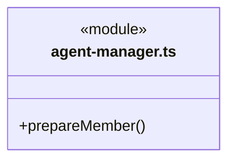
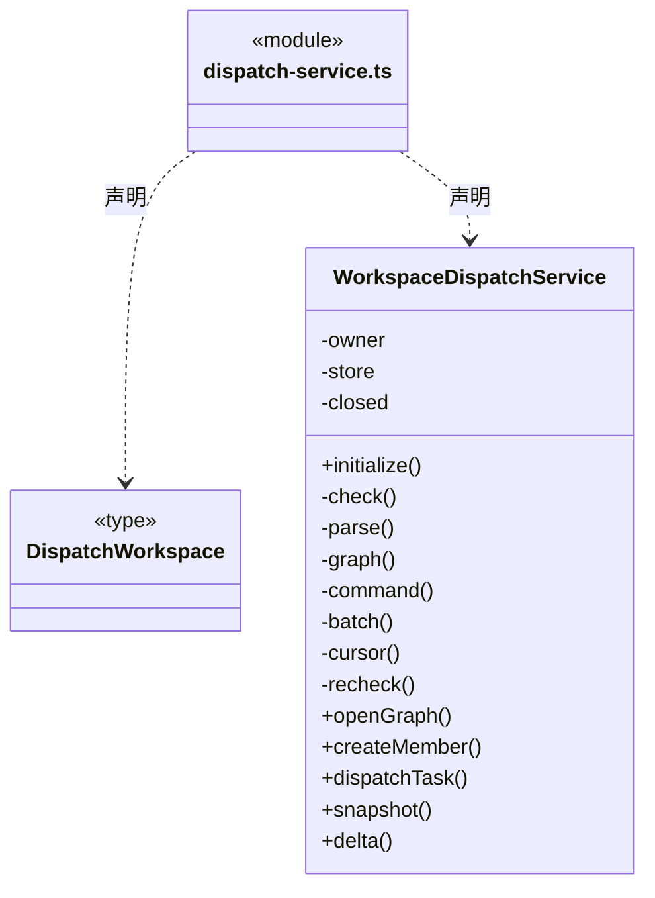
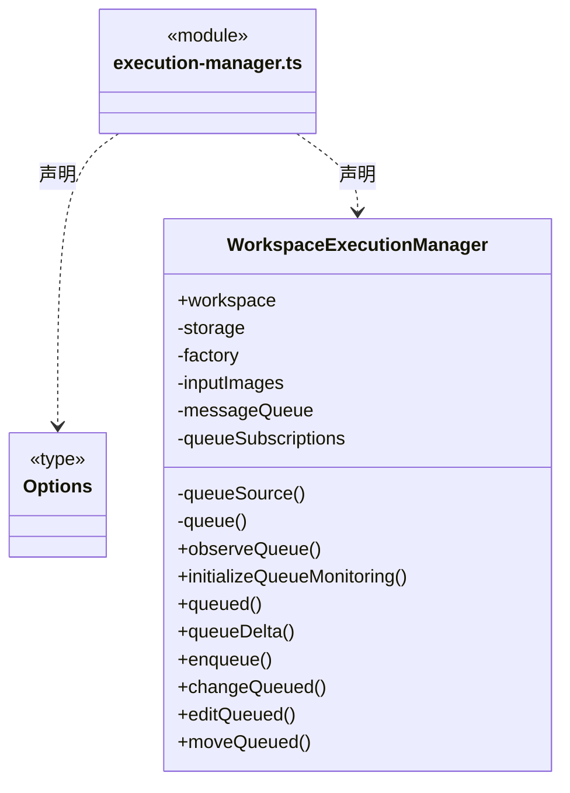
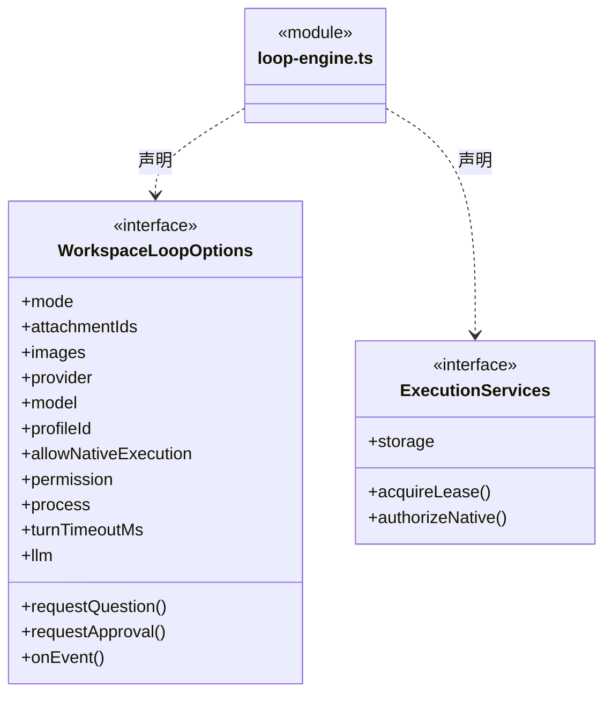
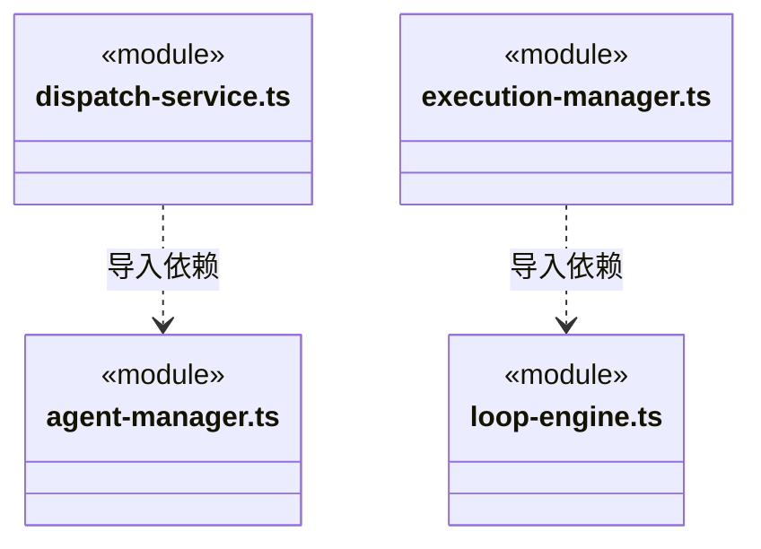
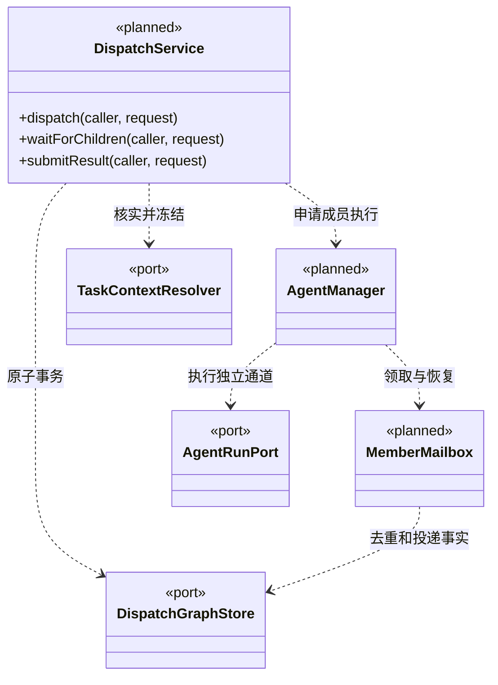

# src/backend/scheduler-engine/execution 架构

## 目录定位

Loop 执行装配、工作区管理与成员派发。成员实例及独立逻辑通道通过同事务登记；派发原子写任务/边/邮箱及图增量，尚不消费邮箱启动成员大脑。

本文描述当前实现。通过分析目录边界后维护的 [源码架构脚本](../../../../scripts/source-architecture.mjs) 同步清单和声明；代码变更时仍须核对职责、关键成员与关系。

## 代码清单

| 文件 | 当前职责 |
| --- | --- |
| [agent-manager.ts](agent-manager.ts) | 根据已核实角色配置注册持久化成员，按主会话分配独立逻辑 Session。 |
| [dispatch-service.ts](dispatch-service.ts) | 工作区的成员注册、主会话派发及任务图增量查询服务。 |
| [execution-manager.ts](execution-manager.ts) | 调度引擎：工作区执行管理，负责主 Agent 普通对话、团队任务执行与多轮历史读取，拒绝旧轮次分叉，挂起并处理逐次工具审批与结构化用户问题，持久化消息队列并在成功结束后串行续接；本次全部通过仅在当前执行期间有效。 |
| [loop-engine.ts](loop-engine.ts) | 调度引擎：将工作区内部知识服务、内核锁与前置策略注入独立 LoopRuntime。 |

## 架构类图

### agent-manager.ts


直接依赖：[../../core/foundation/errors.ts](../../core/foundation/errors.ts)、[../../core/team/agent-types.ts](../../core/team/agent-types.ts)、[../../core/tasks/dispatch-storage.ts](../../core/tasks/dispatch-storage.ts)、[../../core/tasks/graph-types.ts](../../core/tasks/graph-types.ts)。

### dispatch-service.ts



直接依赖：[../../core/foundation/errors.ts](../../core/foundation/errors.ts)、[../../core/foundation/serialization.ts](../../core/foundation/serialization.ts)、[../../core/knowledge/ports.ts](../../core/knowledge/ports.ts)、[../../core/knowledge/types.ts](../../core/knowledge/types.ts)、[../../core/tasks/dispatch-storage.ts](../../core/tasks/dispatch-storage.ts)、[../../core/tasks/dispatch-commands.ts](../../core/tasks/dispatch-commands.ts)、[../../core/tasks/graph-types.ts](../../core/tasks/graph-types.ts)、[../context/dispatch-context.ts](../context/dispatch-context.ts)、[agent-manager.ts](agent-manager.ts)。

### execution-manager.ts



直接依赖：[../conversation/message-queue.ts](../conversation/message-queue.ts)、[../conversation/approvals.ts](../conversation/approvals.ts)、[../conversation/questions.ts](../conversation/questions.ts)、[../conversation/main-agent.ts](../conversation/main-agent.ts)、[../../core/knowledge/ports.ts](../../core/knowledge/ports.ts)、[../../core/foundation/errors.ts](../../core/foundation/errors.ts)、[../../core/foundation/identity.ts](../../core/foundation/identity.ts)、[../../core/brain/storage.ts](../../core/brain/storage.ts)、[../../core/brain/index.ts](../../core/brain/index.ts)、[loop-engine.ts](loop-engine.ts)、[../context/team-workflow.ts](../context/team-workflow.ts)、[../../core/team/model.ts](../../core/team/model.ts)、[../../core/workspace/model.ts](../../core/workspace/model.ts)、[../../core/brain/types.ts](../../core/brain/types.ts)。

### loop-engine.ts



直接依赖：[../conversation/questions.ts](../conversation/questions.ts)、[../../core/foundation/paths.ts](../../core/foundation/paths.ts)、[../../core/knowledge/ports.ts](../../core/knowledge/ports.ts)、[../tools/knowledge-tools.ts](../tools/knowledge-tools.ts)、[../context/team-workflow.ts](../context/team-workflow.ts)、[../conversation/main-agent.ts](../conversation/main-agent.ts)、[../../core/brain/types.ts](../../core/brain/types.ts)、[../../core/brain/index.ts](../../core/brain/index.ts)、[../../core/brain/pi/rpc.ts](../../core/brain/pi/rpc.ts)、[../../core/brain/llm/ports.ts](../../core/brain/llm/ports.ts)、[../../core/policy/tool-policy.ts](../../core/policy/tool-policy.ts)、[../../core/tools/questions.ts](../../core/tools/questions.ts)、[../../core/tasks/progress-tools.ts](../../core/tasks/progress-tools.ts)、[../../core/brain/storage.ts](../../core/brain/storage.ts)。

### 本目录调用边界




## 子目录导航

无子目录。

[返回上层](../ARCHITECTURE.md)。

每次修改本目录代码，同步维护文件头、关键契约说明及本图。未实现的治理、证据验收和自动编排能力不列入当前类图。

## 设计契约 v1 与落地范围

以下内容区分已接通能力与后续设计；以各节的实现状态为准，不将目标图当作现状图。维护源：[CONTRACT.md](CONTRACT.md)；生成类图时同步附加，勿直接修改本附录。

### 成员派发与执行调度契约

第一条闭环已实现：`prepareMember` 注册稳定成员/独立逻辑通道，`WorkspaceDispatchService` 接收本机用户的主会话派发，核实成员与多模块关系并原子保存节点、边、pending 信封及事件。支持 Snapshot/Delta、幂等与重开恢复。本轮没有消费邮箱、启动成员大脑或让模型递归派发；以下执行、结果回传与恢复运行段仍为后续目标。节点规则见 [core/tasks](../../core/tasks/CONTRACT.md)，成员身份见 [core/team](../../core/team/CONTRACT.md)。

#### 职责和端口

调度器接收目标分析后的任务请求，核验成员、多模块维护关系、依赖与权限，再持久化派发。模型负责提出分工，程序负责边界与事实。主 Agent 与自定义 Agent 均调用同一入口；组织的父子关系不决定谁能指挥谁，也不改变工具授权。

现有 `dispatch-service.ts` 负责建图、成员注册、主会话派发及读取；`agent-manager.ts` 负责成员身份与逻辑 Session 分配，尚不持有执行租约；存储端口已下沉 Core 的 `dispatch-storage.ts`。可靠投递/唤醒尚未拆出 `mailbox.ts`。下面 `AgentDispatchService` 是后续模型执行命令契约，不能视为当前同名实现。

当前可调用的方法为 `initialize / openGraph / createMember / dispatchTask / snapshot / delta / close`。initialize 只恢复存储供全局监管建立基线，不创建或执行任务。公开命令 Schema 拒绝任意 requester、parentTaskId 或运行状态；派发请求人固定来自该主会话根。只保存配置与模块的知识版本，没有保存完整角色/Workflow 正文：未来启动执行前必须冻结可恢复上下文，并重新核对基线，版本不符时阻塞重新准备。

应用级动态索引位于相邻的 `runtime/`：main 注入已提交派发观察和 Loop 事件订阅，WorkspaceExecutionManager 另提供 `observeQueue / initializeQueueMonitoring` 报告保存后的队列负载。业务服务不反向依赖全局管理器；全局索引不接管知识或执行权限。

```ts
// 以下为服务边界示意；GraphIdentity / ModuleBinding 等复用 Core 契约。
type DispatchCaller = {
  identity: GraphIdentity;
  agent: AgentRef;
  taskId?: string; runId?: string;
  leaseEpoch: number; // 进程接管代际，不替代稳定的 agentInstanceId
  permissionSnapshotId: string;
};
type TaskDraft = {
  assigneeAgentId: string;
  moduleIds: string[];
  goal: string;
  acceptance: { id: string; text: string }[];
  prerequisites: { taskId: string; expectedPlanRevision: number }[];
};
type DispatchRequest = {
  commandId: string;
  parentTaskId?: string;
  expectedParentRevision: number;
  task: TaskDraft;
};
type DispatchReceipt = {
  commandId: string; taskId: string; messageId: string;
  cursor: GraphCursor;
  disposition: 'queued' | 'waiting'; // 已可靠派发，不是执行完成
};
type TurnSubmissionReceipt = {
  submissionId: string; taskId: string; runId: string; planRevision: number;
  kind: 'result' | 'wait'; status: 'staged';
};
interface AgentDispatchService {
  dispatch(caller: DispatchCaller, request: DispatchRequest): Promise<DispatchReceipt>;
  waitForChildren(caller: DispatchCaller, request: {
    commandId: string; taskId: string; expectedRevision: number;
    children: { taskId: string; planRevision: number }[]; reason: string;
  }): Promise<TurnSubmissionReceipt>;
  submitResult(caller: DispatchCaller, request: {
    commandId: string; taskId: string; expectedRevision: number;
    planRevision: number; summary: string;
    evidenceRefs: string[]; limitations: string[];
  }): Promise<TurnSubmissionReceipt>;
}
```

`caller` 完全由可信运行绑定注入，不作为模型参数。根派发使用根节点 revision；成员继续派发必须使用其当前任务作为 parent，不能把节点挂到别人的任务下。派发时由调度器解析接收实例及正确的 agentSessionId，冻结 `ModuleBinding[]`，不接收模型伪造的维护关系或版本。一个请求创建一个节点；并行工作拆成多次请求。

同 `commandId` 的同参重试返回原回执；异参返回冲突。重试去重先于乐观版本检查；新请求版本过期须重读，不能自动覆盖。工具调用层用可信调用 ID 关联 commandId，网络重发与模型再次主动派工不是同一回事。读取/投递确认不替代 `result_ready`。

`submitResult` 仅接受当前 assignee 的活动 run，必须匹配 planRevision；证据引用在该任务运行的可信回执集合中核验。`submitResult / waitForChildren` 先可靠保存 staged 提交，不立即发布 result_ready / waiting；大脑在安全片段边界完成收尾并确认无在途副作用后，调度器再核验版本、提交节点状态和 outbox。提交后的新增写入或失败使 staged 候选失效，不能让下游先消费仍在变化的成果。如果子任务仍未解决，应等待或明确修订范围，不能默默把未完成工作计为完成。候选验收始终为 `not_evaluated`。

#### 一次派发的顺序

1. 核对工作区、根会话、发起实例/租约、当前任务和授权；只允许同图递归派发。
2. 通过 Context 查询成员及全部模块，冻结角色配置、维护关系、Workflow 和权限基线。定位不完整时返回可处理的缺口，不伪造正式任务节点。
3. 在同一提交版本中校验父关系、前置版本及全部启用边的 DAG；持久化新任务、派发边/依赖边、outbox 消息、命令回执与图事件。
4. 持久化成功后才发布图批次并投递邮箱；接收方持久化 inbox 后确认。派发方不持有接收方 Session 的写权限。
5. 依赖未满足则节点为 waiting；可执行时 queued。取得成员执行槽、会话租约及写冲突资源后，先记录 runId 和执行意图，再启动大脑，实际启动事实推进 running。
6. 工具回执和终态由大脑事实接入。交付候选可靠保存后，以结果消息唤醒等待方；等待方核实结果版本后继续自己的任务。

图批次、邮箱与幂等索引必须在同一调度事务中提交。`DispatchGraphStore` 等存储端口契约放 Core 的无实现契约文件，main 实现并注入；调度器不得导入 main 的文件存储或 Electron。

#### 消息、等待与防死锁

内部消息协议放在 Core 的独立契约文件，由调度实现投递；形状如下，AgentRef 来自可信绑定，正文与结果证据单独保存，不进入公开图增量：

```ts
type AgentMessage = {
  messageId: string; commandId: string; identity: GraphIdentity;
  from: AgentRef; to: AgentRef; taskId: string; createdAt: string;
} & (
  | { kind: 'assignment'; planRevision: number }
  | { kind: 'result'; replyTo: string; resultId: string;
      runId: string; planRevision: number }
  | { kind: 'question'; contentRef: string }
  | { kind: 'answer'; replyTo: string; contentRef: string }
);
```

replyTo 引用原始 assignment/question 的 messageId；接收方核对原发送方、taskId、图归属与当前基线。通道需要时将 question/answer 映射为带来源的 followup 执行输入，不冒充新 assignment。

消息由可靠 outbox/inbox 投递，`messageId` 去重后只入队一次；领取、处理完成与业务结果分别记录。通信状态只在真实交付/消费期间出现，不能用动画或网络轮询推断。

父任务等待其直接派发的子任务时维护 `awaitedChildren`，持久化每项 taskId + planRevision，不添加子 → 父边。父任务必须在安全的执行片段边界让出大脑槽位与写冲突租约，收到匹配版本的有效结果后再排队，不让等待占住唯一成员执行槽。自己的子任务也走这个流程。同一成员多个主会话公平排队，不互相混入上下文。

前置依赖只连接任务节点；结果必须来自指定 planRevision 的有效候选。失败/取消的依赖不会因收到一条回复而满足。结果变旧时阻塞尚未执行的依赖任务；已经执行的下游进入基线复核，不自动重放。除了可视化 DAG，调度器还检查实际等待图：当前任务 → 未满足的前置任务，以及父任务 → awaitedChildren。任一新增派发、等待或修订使其成环均拒绝，防止“A 派 B，B 以 A 的结果为前置，A 又等 B”。问答消息本身不添加执行依赖，也不自动挂起整个任务；如需等待必须登记可检查的任务关系。

#### 并发、权限与恢复

- 首版同成员实例串行，不同成员可并行；独立 agentSessionId 与租约保护原生上下文。正常重启保持 agentInstanceId，用 leaseEpoch 拒绝旧进程的迟到回调。
- 模块写作用域重叠的任务串行；命令实际作用域未知按工作区写冲突处理。等待时释放资源，恢复时重新校验文件及知识基线。这不是操作系统沙箱，也不能阻止用户或外部工具编辑。
- 派发授权与接收成员工具操作授权分别校验；不得复制“本次任务全部通过”给新任务。新任务权限不超过工作区策略、发起任务允许范围与接收成员策略的交集，批准由可信入口负责。
- 停止区分请求与实际停止事实；取消自身/子树必须明确 scope。未启动任务可直接取消已排队工作；正在执行的任务等待工具和大脑终态，未知结果为 interrupted。停止不代表回滚。
- 收到 completed 运行事实只结束执行片段；业务任务没有明确交付候选或等待动作时进入 blocked 并给出原因，不由模型回合结束推断业务成功。普通 conversation 运行可以正常结束，不要求创建 TaskNode 或交付候选。
- 崩溃恢复先重建事务与邮箱，再核对在途 run。只重投幂等消息，不自动重放未知副作用。重试沿用 taskId、生成新 runId，并保留失败证据；晚到旧 run 不覆盖新状态。

#### 目标结构类图（待实现）



实施验收至少覆盖：主成员自执行、A 派 B/B 再派 C、A 等自己的子任务、跨图拒绝、两类边联合成环、重复派发和迟到回调、成员串行/上下文隔离、权限不扩张、写冲突、进程中断后未知结果不重放。组织图与任务图渲染放在这些行为验证之后。
