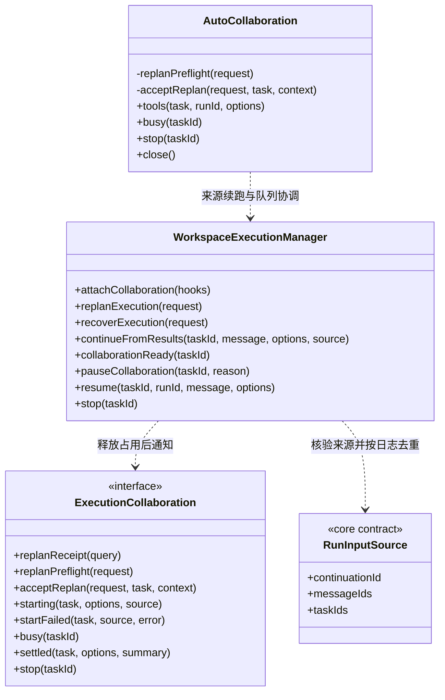
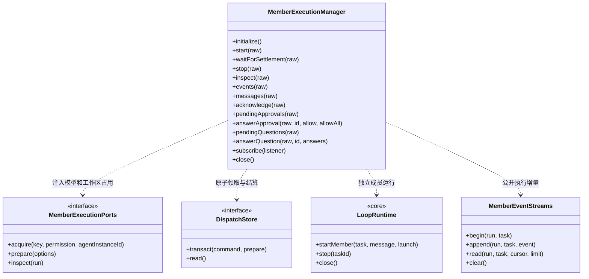
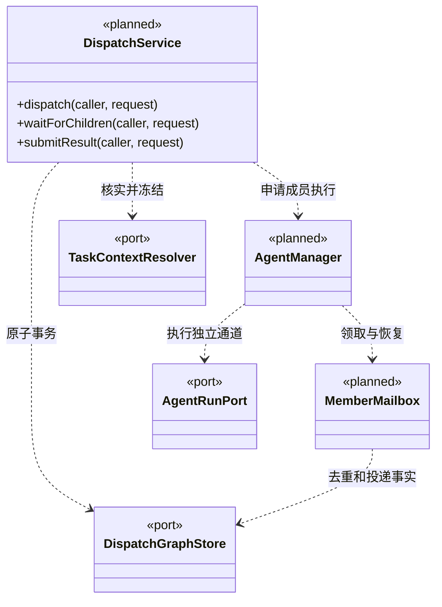

### 成员文件基线与独立只读报告

`loop-engine` 只向可信成员注入 `ArtifactCapturePort`，并将 `cbim_task_artifact_capture` 描述为 maintenance 工具，复用真实 gate/receipt 链。主调度没有该能力。知识复核每次重新核对已冻结执行上下文，不因成员持有业务读/写占用而假定知识不变。

`ArtifactReportService` 按明确 root/task/run 读取 canonical 日志，核对完整 TaskSpec、成员及原生绑定、连续序号和明确的完整性诊断，再验证来源授权、暂存事件与成功采集回执。缺省 baselineId 只列引用；明确选定后才取得短期读占用并核实文件。文件观察使用独立 basis，不借执行回执分页基线，不默认选择最新基线。

显式复核前后核对派发事实、知识版本及 canonical 日志；任一变化将组合观察降为不可核实。未知命令、未完成工具、未覆盖写入始终保留影响范围限制，不能借另一份基线补足所选基线。历史缺失或损坏不补采、不重写、不启动模型；相同文件哈希不等于业务验收或旧成员可以恢复。

### 同周期未启动依赖的单条替换

`QueuedDependencyReplacementService` 由 `WorkspaceDispatchService.replaceQueuedDependency` 提供给当前主轮闭包。事务内先选择同 scope 的原前置、替代候选和目标节点的完整启用后继闭包，核对图/目标/节点/边版本及主运行归属清单；旧周期没有 `runTracking` 不补造身份。闭包中任一任务已领取或执行、已撤销、角色/模块不符合当前计划，整体拒绝。

来源须为安全求助或明确失败。`ScopeGoalService.validateDependencySource` 重读全部登记运行，核对完整 TaskSpec、成员绑定、连续日志、原生会话、终态及工具授权/回执；缺失、截断、未知结果不能算未执行。替代候选使用同一目标证据校验，再核对当前知识基线和来源模块覆盖。每个待办复用知识准备，提交前再次复核候选知识；读取期间停止或知识变化不提交半条边。知识与派发记录不是跨存储原子锁，也不证明外部产物没有变化。

成功事务只退役原边、新建固定候选的依赖边、更新目标节点与其成员等待视图，追加不可变 `dependencyReplacements`。目标任务 revision 增一，planRevision、实例/会话、派发信封、目标和验收不变；来源、替代任务、后继节点不被改写。审计和事件共用提交时间，同命令返回原回执而不重读证据或追加历史；冲突 payload 拒绝。

`AutoCollaboration` 将回执 `trackedTaskIds` 重新纳入当前主轮批次与周期历史；仅当前主轮 settled 后按原权限、并发准入和预算推进原待办。回执不代表全部后继立刻可运行，其他前置仍逐项核实。停止先建立屏障并等待在途提交收口，迟到成功只保留事实，不启动成员；重启不恢复旧批次。最终目标完成仍须真实候选和结构化替代审阅，换边本身不充当成功证据。

### 新业务重规划的主执行接线

`WorkspaceExecutionManager.replanExecution` 与只读核实入口分开，先按稳定命令查询原回执，未受理才预检指定核实周期的证据和显式权限。新业务目标不读取旧 TaskSpec 或复制旧工具参数。`startFreshMain.beforeRun` 经 `AutoCollaboration.acceptReplan` 在真实租约内重新核验并持久化意图，再建立新的 Cycle；同主实例和任务图根不变，新业务使用新原生上下文、执行实例和自己的目标审阅。

队列保持暂停；停止版本在串行排队前捕获，预检、工厂等待及意图提交都受停止屏障保护。已提交后的启动或返回失败保留原回执；仅本次真实 runId 的意图可被故障收束，不能因此关闭旧命令或重复启动。主角色始终只调度和受控知识治理，旧核实周期的只读约束不因新业务获得 ask/execute 而变化。

### 新只读核实周期的主执行接线

`WorkspaceExecutionManager.recoverExecution` 先查询稳定请求回执，未受理才重新核实来源并准备只读模型。`startFreshMain.beforeRun` 通过 `AutoCollaboration.acceptRecovery` 持久化新 scope，然后登记内存 Cycle；模型工具装配只能使用已登记的新周期。普通队列保持暂停，用户观察作为未核实陈述，不改写旧目标或未知工具回执。

停止/关闭先取消尚未 active 的启动信号，等待恢复意图事务结束后收束新周期；提交后的异常只核对并关闭本次真实 runId，不误处理旧重复回执。新周期的主运行与成员启动均受 read 限制，成员回注和 waiting 补充不得提升权限。主 Agent 继续负责模块/团队匹配和目标审阅，实际只读核实由新执行实例承担。

执行前的 `thread` 使用最近可靠新上下文边界，只排除冻结旧运行，要求初始运行存在、初始声明与意图一致，后续按 `resumeFrom` 单链连接，原生身份和任务/主实例绑定一致；不按时钟或最新可读文件回退。`threadView` 一次读取全部可读历史并返回问题占位，仅完整当前链提供续聊头。历史损坏不阻塞独立新周期，当前链损坏仍明确阻断执行。

### 成员派发与执行调度契约

已实现可信桌面入口和主会话模型工具的成员执行闭环：`prepareMember` 注册稳定成员/独立逻辑通道，`WorkspaceDispatchService` 核实成员、多模块关系并原子派发，`MemberExecutionManager` 领取信封后使用同一 `LoopRuntime + PiEngine` 执行、提交候选和返回结果信封。`AutoCollaboration` 在主轮结束并释放占用后推进本轮派发，再把可靠结果回注原主会话。支持 Snapshot/Delta、命令幂等与持久化记录恢复；执行者可恢复求助/等待和重启自动续跑仍未开放。节点规则见 [core/tasks](../../core/tasks/CONTRACT.md)，成员身份见 [core/team](../../core/team/CONTRACT.md)。

### 当前成员执行边界

主 session 默认通过 `conversationBinding(task)` 可靠登记图根和主实例，`mainRootSessionId` 将新主实例固定到所属根；主实例负责调度与团队/业务知识管理，不执行业务任务。`conversation` 承载普通聊天，图根原通道承载结果邮箱；正式业务任务使用独立执行实例。没有自定义执行角色时使用内置静态 `cbim:executor`，禁止把 `cbim:main` 派为执行者。旧共享根保留历史引用，新根不复用遗留共享实例。知识结构错误不阻断内置主对话身份登记，但不放宽正式任务的配置/模块/维护关系校验。

`createWorkspaceLoop` 为主 Agent 保留内部知识查询、预览、对象 CRUD 与知识提交工具，以及派发工具。知识写入走同一日志门禁和用户 `read / ask / execute` 权限：read 拒绝；ask 等待本轮批准；execute 允许进入知识服务的实例、版本和事务校验。`knowledge-write` 不等于业务执行权，主 Agent 的任何 `business-write / command` 描述在审批前独立拒绝，包括未来内部工具；原生 `write / edit / bash` 不注册，即使收到幻觉调用或用户选择完全访问也不放行。知识服务只在 gate 通过后接收运行装配提供的写入能力，不接受模型自行授予权限；`.cbim` 内容仍禁止经原生文件工具直接修改。

- `start` 接收 `workspaceId/rootSessionId/taskId/commandId/expectedRevision/options`。options 只含公开模型标识、read/ask/execute 权限和毫秒超时，默认 read；不能指定成员身份、会话路径、提示词或状态。返回的是已持久化领取回执，不承诺此时已开始生成；相同命令返回原回执，不重复解析模型或执行。
- 领取前拒绝主 Agent、released 执行实例和已关闭调度周期；同主会话有 waiting 周期时返回 GOAL_WAITING，包括旧无 scope 的任务入口，不能通过历史成员运行绕过等待。然后核实依赖、成员占用及工作区写占用，冻结角色/Skill、模块/Workflow、规范全文、前置候选和公开模型参数。密钥仅在主进程闭包中。领取事务同时写 starting、成员 communicating、task queued+activeRunId、assignment claimed。
- `startMember` 使用预分配 runId、固定执行实例通道，日志位于 `dispatch/runs/tasks/`，不混入聊天列表。当前调度周期内每个 task 创建新执行实例和通道，不复用前一 task 的历史；旧无 scope 的显式接口保留原通道兼容行为。前次非 completed、工具结果未知或日志绑定不符的旧通道拒绝盲目续接；尚无异常通道人工对账/重试入口。
- 模型生成前，onEngineReady 提交 running、原生文件绑定、成员 working；回调失败关闭引擎并中断。任务拥有独立审批/问题队列，不继承其他运行的“本次全部通过”。
- `WorkspaceExecutionLease` 为主会话与成员共享。主会话只持有业务文件读取占用，知识写入由知识服务独立串行事务和版本核对保护，不因管理知识而取得业务写权限。正式执行成员同一实例串行，不同成员只读可并行，ask/execute 保守独占工作区业务执行。没有文件范围写锁；角色知识字段不是可执行权限策略。冲突立即返回 busy，不在事务内等待。
- completed 只结束大脑回合。仅同轮结构化计划保持原目标/验收、全部步骤有有效工具证据且调用 cbim_delivery_prepare，才进入 result_ready 并返回候选信封。普通文本、改写目标或知识基线变化得到 blocked；候选 acceptance 始终为 not_evaluated。
- messages 只读取同图指定收件人的 pending 信封；acknowledge 仅消费 result，不新增运行或图反向边。依赖在实际启动时复核并锁定 resultId。自动协调只推进当前进程主轮工具登记的任务，不能把任意历史 pending 信封解释为自动执行授权。
- stop 请求活动运行停止，等真实收尾后提交终态；取消不代表回滚。inspect 不返回密钥、完整知识或原生路径。审批与问题有独立接口，读取详情不会授予权限。
- `events` 核验工作区、主会话、业务任务和 run 归属后，读取白名单投影事件：排除原生会话与冻结知识字段；工具仅公开身份、状态、工作区内且非 `.cbim` 的业务路径和可信回执，原始参数/输出及内部错误不透传。公开对话、任务目标及计划/交付文本保留，仅按字段限长，不做通用密钥或隐私识别。`MemberEventStreams` 首次成功恢复日志后，与实时持久化观察按序号去重合并；后续仅内存增量/noop，工作区关闭时释放缓存。首次读取失败会释放该加载承诺供重试，并发旧失败不清除新加载；已记录的流损坏仍明确失败。首次查询发生在新执行创建日志之前时可返回空前缀，历史损坏不得伪装为空。
- 初始化将 starting/running 收口为 interrupted，保留领取记录、增加 leaseEpoch，不重放模型或未知副作用。初始化失败在当前实例保持失败，重建工作区后再核实。关闭先等待已接收的启动、停止与结算尝试，再关 DispatchStore；close 不重抛收尾错误，结算失败的持久化活动记录留待重开恢复核实，不能把正常返回视为所有任务均已成功结算。

### 主会话协作接续边界

`openScope(identity, scopeId, input?)` 的可信第三参数保存本轮实际 `{message, attachmentIds?}`，创建前复制为 `goal:{revision:1,input:{message,attachmentIds}}`，缺省附件为 []，正文不 trim。相同 scope 重发必须保持正文和附件；稳定命令键的 fingerprint 包含初始输入，事务内及回执后的当前状态再次核验原始 input，不能通过已保存回执改绑输入。计划/审阅推进 goal.revision 后，同原始输入重发仍幂等。无 goal 的旧调用/记录保持兼容且不补造；关闭保留最后 goal 快照。

### 周期目标规划、审阅与结束门禁

`ScopeGoalService(owner, store, ports?)` 与派发复用串行事务；`ScopeGoalPorts.inspectMember(run)` 和 `inspectMain(rootSessionId, runId)` 仅按可信绑定读取 canonical 日志。`inspect` 不读日志；`plan` 解析真实静态角色、有效维护模块、当前知识基线并保存责任映射；无日志端口时仍可规划，但 review / validateCompletion / validateWaiting 明确拒绝。主角色仅治理且 moduleIds=[] 时不要求业务知识通过结构校验，保留修复损坏知识的入口。

- `plan(identity, scopeId, runId, commandId, draft)` 和 `review(...)` 都接受 expectedRevision，幂等命令包含完整草案指纹。身份由主轮闭包注入，模型不能指定 scope、run 或存储路径。最多 64 次决策；不通过重规划删改既有人工作业验收项。
- `validateDispatch(state, scope, task, knowledgeRevision)` 在派发事务中核实存在当前计划、没有阻塞/未清除的审阅、当前知识版本一致，角色与模块集合匹配责任分配。审阅后再派工必须显式 replan。旧无 goal 记录不补造计划。
- 成员证据必须来自本 scope 真实 result_ready 候选，完整绑定 task/run/实例/通道/planRevision；canonical 日志须 completed、无未决工具、结构化交付与候选一致。引用的成功工具回执须有匹配授权、结果正文哈希和最后副作用之后的有效代次。执行知识基线必须等于审阅基线，不能对旧候选仅重盖当前版本。
- 主治理证据只接受当前审阅 run 中 `cbim_knowledge_commit / cbim_object_commit` 的真实成功知识写回执，且结果正文证明同实例、当前知识版本和非空 `.cbim/` 变更。主对话通道从已登记 conversation Session 验证，与图根必须同实例，但不混用图根的任务/邮箱通道。模型正文、任务记录、派发和目标审阅回执均不能自证成功。
- `review complete` 只保存申请，工具执行期间不要求主运行已经 settled。`validateCompletion` 在父级关闭事务内调用且不重入 store：同一主 run 必须实际 completed、无未决工具，计划/审阅当前，图和知识版本未变，审阅后没有新副作用；全部 scope 工作均已终态。缺证据、未满足项或 human 项阻止完成。
- 失败/阻塞/取消/中断任务必须以显式 superseded 关系被本 scope 后续实际成功任务替代，替代模块并集覆盖原范围；知识基线已过期的旧候选同样必须明确替代。关系用线性有色 DFS 拒绝环，不能由模型构造稠密图阻塞主线程。替代本身不删除历史任务或回滚副作用。
- `block` 仅可信协调器调用，保存失败原因并冻结后续决策，不发布虚假任务图事件，也不直接释放实例。普通无 plan、无派工且无业务治理动作的问答保持轻量；一旦有业务计划/派工/知识写入，不能把缺失审阅当作普通结束。

本步核验的是可追溯执行与审阅事实，不是跨知识/派发存储的原子事务或外部产物指纹证明。人工批准、替换原目标与外部文件变更失效仍是后续能力；安全等待后的纯文本显式补充由下述一次性接收协议提供。

### 安全持久等待检查点

`WorkspaceDispatchService.parkScope(identity, scopeId, summary, mainRunIds)` 仅供可信协调器在主运行实际收尾并释放资源后调用。它在派发串行事务内调用 `ScopeGoalService.validateWaiting`：当前 awaiting_user 审阅属于同一主运行，主运行的传入摘要与 canonical 日志均为 completed 且无未决/未知工具；图游标、知识版本、副作用界限未变；本周期任务与成员均已结算，同主会话不存在 starting/running，包括旧无 scope 的运行。所有本周期成员运行再读 canonical 日志核验身份和工具终态；明确 failed/cancelled 可等待，interrupted 或未知副作用拒绝。已有证据仍按原审阅规则复核，不将等待或用户排队文字当成人工验收。

成功后只在现有事务日志写 status=waiting 与 `DispatchScopeWait`，原目标和审阅不改写、graph cursor 不推进，也不新增存储。可信主轮清单立即复制，1–32 个唯一 runId 且包含当前主运行；用于保留已消耗预算，不自动恢复任何运行。等待幂等键包含周期和真实主 runId，同周期后续再等待创建独立检查点；事务后再次核实当前状态，旧成功回执不能掩盖已取消。waiting 占据该根唯一未关闭槽，拒绝新周期、计划、审阅、派工或成员启动；close(cancelled/failed/interrupted) 保留检查点并释放执行实例，close(completed) 拒绝。`recoverScopes` 只收束遗留 active；`waitingScopes` 内部只读枚举 waiting，无 IPC 自动恢复能力。

`AutoCollaboration.initialize` 只重建 waiting 根占位并暂停相应用户队列，不读取/启动模型、不恢复成员租约。busy 同时覆盖正在调度和已安全等待的周期。停泊后移出活动循环；应用 shutdown 保留 waiting；用户 stop 与停泊提交竞争时，仍会在提交完成后查找并取消等待周期。queue enqueue 和普通 resume 在 waiting 时只保存为 paused；继续队列返回 GOAL_WAITING，不能把“同意”等排队文字解释为继续原目标或人工批准。显式补充走独立入口，不解冻 closed 或 goal.blocked。

### 显式补充的单次消费

`dispatch.continuations` 由独立 `ScopeContinuationService` 承担，复用派发事务和日志。`inspect({workspaceId,rootSessionId,scopeId,commandId})` 只读已保存意图；返回绑定三层身份的 `{workspaceId,rootSessionId,scopeId,scopeStatus,continuation}` 或 undefined，不启动模型，也不授予换 ID 重发的权限。active/closed 历史仍可查到原记录。

`accept(request, trustedRunId)` 仅由运行时完成租约和历史预检后的可信 beforeRun 调用；工作区/周期/等待/预期目标与输入版本、预算均核对后，同事务消费等待、增加输入版本并保存意图。指纹包含完整规范请求但不含随机 trustedRunId。相同 commandId 改正文、配置或预期版本返回 COMMAND_ID_CONFLICT；重复相同请求返回原记录，换命令再消费同 wait 拒绝。返回的 fresh 只在本次新事务内存产生，不存入 durable receipt；只有 fresh 才可尝试本次启动，调用方仍须复核停止信号和 scope 当前状态。

提交前失败不消费检查点；提交后运行日志尚未建立、真实 Pi 会话校验失败或启动结果不明，都保留意图，不恢复 waiting 或自动重放。恢复流程将遗留 active 收口 interrupted。补充后旧 plan 保留以保护 human 项，但 inputRevision 不一致；plan 服务按当前输入盖版本，review/派发/完成/再次等待均拒绝过期计划。已有真实候选可在新计划下重新审阅，不伪造证据，也不将用户补充视为人工验收。

### 主会话协作接续边界（续）

`AutoCollaboration` 按工作区装配，只向使用已保存模型配置的主聊天轮次提供 `cbim_dispatch_task / inspect`；正式任务不获得递归工具。主 Agent 不执行业务；`cbim_dispatch_task.agentId` 缺省使用 `cbim:executor`。普通问答不用登记业务节点。模型仅传角色、模块、目标、验收和前置，工作区/会话/runId、scopeId 与实际 toolCallId 由运行绑定提供；稳定调用键映射到持久化命令，同次重发返回原回执。单轮最多登记 100 个不同派发调用，不能在工具 Promise 中等待执行。

一次用户任务对应一个持久化 `DispatchScope`，可以跨多个主模型轮次、多个成员执行和结果回传。`starting` 在模型工厂准备后、模型启动前调用 `openScope`；可信结果回注沿用原周期，不能新建周期。每个模型轮仍保留独立 batch，以准确记录本轮派发和回注来源。普通聊天在最新主轮正常结束且没有规划、派工或知识写入后关闭生命周期；正式工作必须由主 Agent 提交 complete 审阅申请，并在主运行结算后通过真实证据、版本和全周期状态复核，才允许以 completed 关闭。awaiting_user 则须通过独立安全检查后持久等待；其他不满足要求的情况继续分析、重规划或明确记录阻塞，不能把空回复或底层 run.completed 当作成功；首个主轮派发完成不关闭。失败、停止、启动失败和应用退出都会尝试收束活动周期：等待在途派发/启动完成，停止成员并等待真实结算，再调用 `closeScope` 释放执行实例；已安全 waiting 在应用退出时保留。历史任务和运行日志保留，关闭失败继续报告诊断并保留真实状态，不伪装为已释放。

用户队列在周期关闭事务完成前保持 busy，成功关闭后才由 `collaborationReady` 开始下一条 pending 用户消息的新周期；已暂停项不自动恢复。用户停止和启动工厂等待之间用停止版本核验，防止异步返回覆盖较新的停止请求。重开时先 `MemberExecutionManager.initialize` 将遗留运行结算为 interrupted，再 `recoverScopes` 关闭遗留 active 周期、`AutoCollaboration.initialize` 保留安全 waiting 占位；不自动启动任何成员或投递历史结果。

协调器保存主轮选择的公开 profileId/model/permission，不保存密钥或复制 allowAll。主轮安全完成、释放租约后才启动就绪成员；真实租约释放与可靠成员结算触发后续推进，不轮询磁盘。成员启动时重新解析该模型配置并冻结执行知识，同一成员串行，写冲突交给共享租约。未满足外部前置、启动失败或 blocked 如实回传，不伪造候选。

结果先作为 `member-results` 可信来源登记到主会话运行日志，并经 Pi custom 消息送入原生上下文，然后才确认结果信封。来源登记或启动失败保留未处理信封；登记成功但确认失败不重复运行。待处理批次仅存在于当前进程，重启只恢复任务、信封和来源事实，不自动恢复协调执行。

`WorkspaceExecutionManager.attachCollaboration` 由可信装配层调用一次，接收 `starting / startFailed / busy / settled / stop`，不通过公开 IPC 设置回调。`startFailed` 清理已打开的周期，结果回注遇到暂时租约冲突时保留原周期等待。`settled` 仅在运行收尾、工作区占用释放和 active 删除后同步通知协调器；回调登记下一步而不等待成员整轮执行。无法核实收尾时传入 undefined，不把失败当作主会话正常完成。

`continueFromResults` 在会话串行边界中核验最新 chat 运行已 completed、无未决工具且原生会话存在，携带 `RunInputSource` 调用大脑续跑。来源包含稳定的 continuationId、结果 messageIds 和涉及的 taskIds，不允许通过用户 resume 参数注入。失败或 blocked 成员可以没有结果信封，但仍必须有任务集合和接续身份。相同 continuationId、同批来源及相同正文返回已经保存的运行回执；改变集合、正文或改用新标识重复消费 messageId 会拒绝。该去重从运行日志恢复，不靠内存标记；回执只代表可靠启动，候选和收件仍不等于验收。

协作 busy 期间，用户 resume 保存为原用户队列项并返回 queued:true；原文字与发送配置不改变，也不会抢占成员租约。带未决工具核实参数的 resume 拒绝排队，避免静默丢弃核实语义。`collaborationReady` 只尝试队列中已经 pending 的消息，不解除暂停。自动结果单独进入来源明确的续跑，不加入可编辑、删除的用户队列。

无法确认成员结算或续跑的异常会记录到应用运行监管，`pauseCollaboration` 立即建立停止屏障后串行保存队列暂停；不能因清除 busy 而抢跑用户消息。成员结算失败保留真实租约与活动记录，留待核实；不能声称已释放。停止成员失败可观察并向调用方报告，不静默忽略。

用户 stop 先建立本会话的自动续跑停止屏障，再调用协调器停止，最后暂停用户队列并停止主运行；协调器停止不在管理器串行边界内等待，避免反向查询管理器时死锁。停止期间即使协调器已解除 busy，自动队列和迟到结果也不能重启模型；工厂等待后仍复核屏障。显式新用户轮次或继续队列才清除停止屏障。应用重启不自动投递历史结果；已保存的来源用于核实与去重。



当前执行接口与关键调用关系（完整方法以代码为准）：



以下保留进一步调度能力的目标契约；等待/唤醒、任务取消和自动恢复执行仍属后续设计。仅主 Agent 拥有调度职责，执行 Agent 自主理解环境并执行目标模块，协作缺口返回主 Agent 处理，不开放成员递归派发。

#### 职责和端口

调度器接收主 Agent 分析后的任务请求，核验成员、多模块维护关系、依赖与权限，再持久化派发。主 Agent 模型提出分工，也可按本轮权限通过内部知识服务维护团队和业务定义，程序负责边界与事实；执行 Agent 自主探索真实团队与目标模块、选择实现和验证方法，再返回事实或缺口。组织的父子关系不授予派发权；主实例不直接执行业务，没有可选自定义角色时由独立默认执行者承担业务。

`dispatch-service.ts` 负责建图、注册、派发及读取；`agent-manager.ts` 分配身份；`member-execution.ts` 管理领取、执行、结果和恢复，`member-state.ts` 核实交付并组装图事实，`workspace-lease.ts` 管理跨运行占用。存储端口在 Core `dispatch-storage.ts`。下面 `AgentDispatchService` 是后续模型命令契约，不是当前同名实现。

派发服务方法为 `initialize / openGraph / conversationBinding / openScope / closeScope / recoverScopes / createMember / dispatchTask / snapshot / delta / close`，拒绝任意 requester、parentTaskId 或运行状态，请求人固定来自主会话根。`openScope` 开启用户任务级周期；`closeScope` 在在途运行结算后原子释放执行实例并保留历史；`recoverScopes` 将重启前 active 周期结算为 interrupted，保留安全 waiting 且不重放执行。执行管理器另提供 `start / stop / inspect / messages / acknowledge` 与审批/问题接口；启动时冻结正文并复核基线，不符合则拒绝运行。

应用级动态索引位于相邻的 `runtime/`：main 注入已提交派发观察和 Loop 事件订阅，WorkspaceExecutionManager 另提供 `observeQueue / initializeQueueMonitoring` 报告保存后的队列负载。业务服务不反向依赖全局管理器；全局索引不接管知识或执行权限。

```ts
// 以下为服务边界示意；GraphIdentity / ModuleBinding 等复用 Core 契约。
type DispatchCaller = {
  identity: GraphIdentity;
  agent: AgentRef;
  taskId?: string; runId?: string;
  leaseEpoch: number; // 进程接管代际，不替代稳定的 agentInstanceId
  permissionSnapshotId: string;
};
type TaskDraft = {
  assigneeAgentId: string;
  moduleIds: string[];
  goal: string;
  acceptance: { id: string; text: string }[];
  prerequisites: { taskId: string; expectedPlanRevision: number }[];
};
type DispatchRequest = {
  commandId: string;
  parentTaskId?: string;
  expectedParentRevision: number;
  task: TaskDraft;
};
type DispatchReceipt = {
  commandId: string; taskId: string; messageId: string;
  cursor: GraphCursor;
  disposition: 'queued' | 'waiting'; // 已可靠派发，不是执行完成
};
type TurnSubmissionReceipt = {
  submissionId: string; taskId: string; runId: string; planRevision: number;
  kind: 'result' | 'wait'; status: 'staged';
};
interface AgentDispatchService {
  dispatch(caller: DispatchCaller, request: DispatchRequest): Promise<DispatchReceipt>;
  waitForChildren(caller: DispatchCaller, request: {
    commandId: string; taskId: string; expectedRevision: number;
    children: { taskId: string; planRevision: number }[]; reason: string;
  }): Promise<TurnSubmissionReceipt>;
  submitResult(caller: DispatchCaller, request: {
    commandId: string; taskId: string; expectedRevision: number;
    planRevision: number; summary: string;
    evidenceRefs: string[]; limitations: string[];
  }): Promise<TurnSubmissionReceipt>;
}
```

`caller` 完全由可信运行绑定注入，不作为模型参数。只有主 Agent 调度阶段可调用派发，当前派发使用根节点 revision；未来的 parentTaskId 仅表达主调度追加任务的前序关系，不授予执行成员派发权。派发时解析接收实例及正确 agentSessionId，冻结 `ModuleBinding[]`，不接收模型伪造的维护关系或版本。一个请求创建一个节点；并行工作拆成多次请求。

同 `commandId` 的同参重试返回原回执；异参返回冲突。重试去重先于乐观版本检查；新请求版本过期须重读，不能自动覆盖。工具调用层用可信调用 ID 关联 commandId，网络重发与模型再次主动派工不是同一回事。读取/投递确认不替代 `result_ready`。

`submitResult` 仅接受当前 assignee 的活动 run，必须匹配 planRevision；证据引用在该任务运行的可信回执集合中核验。`submitResult / waitForChildren` 先可靠保存 staged 提交，不立即发布 result_ready / waiting；大脑在安全片段边界完成收尾并确认无在途副作用后，调度器再核验版本、提交节点状态和 outbox。提交后的新增写入或失败使 staged 候选失效，不能让下游先消费仍在变化的成果。如果子任务仍未解决，应等待或明确修订范围，不能默默把未完成工作计为完成。候选验收始终为 `not_evaluated`。

#### 一次派发的顺序

1. 核对工作区、根会话、主调度实例/租约、当前运行和授权；执行 Agent 不能调用派发入口。
2. 通过 Context 查询成员及全部模块，冻结角色配置、维护关系、Workflow 和权限基线。定位不完整时返回可处理的缺口，不伪造正式任务节点。
3. 在同一提交版本中校验父关系、前置版本及全部启用边的 DAG；持久化新任务、派发边/依赖边、outbox 消息、命令回执与图事件。
4. 持久化成功后才发布图批次并投递邮箱；接收方持久化 inbox 后确认。派发方不持有接收方 Session 的写权限。
5. 依赖未满足则节点为 waiting；可执行时 queued。取得成员执行槽、会话租约及写冲突资源后，先记录 runId 和执行意图，再启动大脑，实际启动事实推进 running。
6. 工具回执和终态由大脑事实接入。交付候选可靠保存后，以结果消息唤醒等待方；等待方核实结果版本后继续自己的任务。

图批次、邮箱与幂等索引必须在同一调度事务中提交。`DispatchGraphStore` 等存储端口契约放 Core 的无实现契约文件，main 实现并注入；调度器不得导入 main 的文件存储或 Electron。

#### 消息、等待与防死锁

内部消息协议放在 Core 的独立契约文件，由调度实现投递；形状如下，AgentRef 来自可信绑定，正文与结果证据单独保存，不进入公开图增量：

```ts
type AgentMessage = {
  messageId: string; commandId: string; identity: GraphIdentity;
  from: AgentRef; to: AgentRef; taskId: string; createdAt: string;
} & (
  | { kind: 'assignment'; planRevision: number }
  | { kind: 'result'; replyTo: string; resultId: string;
      runId: string; planRevision: number }
  | { kind: 'question'; contentRef: string }
  | { kind: 'answer'; replyTo: string; contentRef: string }
);
```

replyTo 引用原始 assignment/question 的 messageId；接收方核对原发送方、taskId、图归属与当前基线。通道需要时将 question/answer 映射为带来源的 followup 执行输入，不冒充新 assignment。

消息由可靠 outbox/inbox 投递，`messageId` 去重后只入队一次；领取、处理完成与业务结果分别记录。通信状态只在真实交付/消费期间出现，不能用动画或网络轮询推断。

主调度等待已经派发的任务时，目标方案用 `awaitedChildren` 持久化 taskId + planRevision，不添加返回方向的执行边。等待必须在安全片段边界让出大脑槽和工作区占用，收到有效结果后再排队。执行 Agent 若遇到协作缺口则返回主调度，不自行派生子任务或持槽等待未提供的工具。已受理成员与结果回注已接应用级公平准入；原执行成员的持久停泊和恢复仍待实现。

前置依赖只连接任务节点；结果必须来自指定 planRevision 的有效候选。失败/取消的依赖不会因收到一条回复而满足。结果变旧时阻塞尚未执行的依赖任务；已经执行的下游进入基线复核，不自动重放。除了可视化 DAG，调度器还检查实际等待图：当前任务 → 未满足的前置任务，以及父任务 → awaitedChildren。任一新增派发、等待或修订使其成环均拒绝，防止“A 派 B，B 以 A 的结果为前置，A 又等 B”。问答消息本身不添加执行依赖，也不自动挂起整个任务；如需等待必须登记可检查的任务关系。

#### 并发、权限与恢复

- 首版同成员实例串行，不同成员可并行；独立 agentSessionId 与租约保护原生上下文。正常重启保持 agentInstanceId，用 leaseEpoch 拒绝旧进程的迟到回调。
- 模块写作用域重叠的任务串行；命令实际作用域未知按工作区写冲突处理。等待时释放资源，恢复时重新校验文件及知识基线。这不是操作系统沙箱，也不能阻止用户或外部工具编辑。
- 派发授权与接收成员工具操作授权分别校验；不得复制“本次任务全部通过”给新任务。新任务权限不超过工作区策略、发起任务允许范围与接收成员策略的交集，批准由可信入口负责。
- 停止区分请求与实际停止事实；取消自身/子树必须明确 scope。未启动任务可直接取消已排队工作；正在执行的任务等待工具和大脑终态，未知结果为 interrupted。停止不代表回滚。
- 收到 completed 运行事实只结束执行片段；业务任务没有明确交付候选或等待动作时进入 blocked 并给出原因，不由模型回合结束推断业务成功。普通 conversation 运行可以正常结束，不要求创建 TaskNode 或交付候选。
- 崩溃恢复先重建事务与邮箱，再核对在途 run。只重投幂等消息，不自动重放未知副作用。重试沿用 taskId、生成新 runId，并保留失败证据；晚到旧 run 不覆盖新状态。

#### 目标结构类图（待实现）



后续调度验收至少覆盖：主调度派给多个执行者并按返回结果追加后续任务、默认执行者可用、主实例禁止执行业务、执行者不得派工、周期结束释放执行实例、跨图拒绝、依赖成环、重复派发和迟到回调、实例串行/上下文隔离、权限不扩张、写冲突和未知结果不重放。现有任务图渲染只展示实际已接通行为。

### 主会话目标的只读展示端口

`WorkspaceDispatchService.sessionRead` 严格解析主会话身份、graph/scope 两条独立游标与选中详情 stamp，再调用存储的单屏障读取。服务不组合多次独立 read，也不为了展示创建图或周期。它返回生命周期和计划/审阅事实，由界面区分完成申请、等待成员、阻塞与最终结束；不以主模型的 completed 覆盖 scope 状态。原图 snapshot/delta 继续提供兼容读取。

### 成员异常的只读核实

`MemberExecutionManager.report` 委托 `ExecutionReportService`，只调用派发存储 read 与指定 run 的 canonical inspect，不调用 initialize、模型准备、租约申请、结算、收件确认或日志修复。派发状态在日志读取前后各读一次；相关事实改变时整份结果标记为未知。日志与派发存储不是同一个原子事务，`stable` 只表示这两个派发屏障一致，不证明外部产物没有变化。

`execution-report-facts.ts` 根据 proposed、allowed/denied、finished 及可信 receipt 核实工具链、身份和参数/结果摘要；Pi 的 started 可早于权限门禁，只是工具尝试，不作授权证据。重复授权/结束、缺失回执、未知结果与损坏字段保守记为未知；合法 denied 后的原生失败结束仍保持 denied。工具失败可能已有改动，成功仅为成功回执，均不等于验收通过。活动运行尚未收到终态时可以显示 in_flight；终态后的未决操作、截断日志或身份不符不能显示 settled。

报告按稳定基线分页，基线变化重置当前第一页，不缓存或新增持久报告存储。关闭周期仅提供“核实后在新周期处理”的建议，不复活旧实例或自动重放。主目标的审阅、完成和安全等待也拒绝已知 partialTail 日志前缀；旧内存摘要未提供此元数据时不凭空标为截断。显式重试/改派与人工事实确认留待后续步骤，本入口没有这些写操作。
只读日志错误兼容：成员流仅在可信本进程新运行仍为 starting、尚无 startedAt/原生文件、且初始流为空时，将 `RUN_LOG_EMPTY` 视作等待首条事件；已开始或历史空日志不豁免。核实报告始终将该码呈现为 incomplete/unknown，不据 UI 流的等待窗口推断“未执行”。

### 显式新建只读核实周期

`WorkspaceDispatchService.recoveries` 由 `ScopeRecoveryService` 提供 `inspect / preflight / accept / latestContext / priorRunIds`。preflight 仅核对来源，不消费启动许可；accept 接收运行时在租约内确定的 runId、nativeSessionId 和旧运行隔离集合，在调度事务内重新读取 canonical 来源日志并比较精确报告 basis。事务内报告使用绑定候选快照的只读存储端口，避免重入存储锁。来源必须是同主会话已关闭周期，root 不能有活动或等待周期或活动成员；坏日志可以得到 unknown，但不能凭“缺日志”断言没有副作用。

同命令同参返回原始意图，无论新 scope 此后是否关闭；幂等检索先于当前基线与 busy 检查。变参冲突不能换 ID 盲重试。仅本次成功提交在内存返回 `fresh:true`，持久回执不含这个启动许可；受理后读取失败要按原命令核实，不能重新调用模型。关闭与重启保留意图和原历史，不自动恢复或重放旧工具。

新 scope 使用新的原生主上下文，同时保留主会话及主实例身份。`latestContext` 按 scopes 持久插入顺序取最后一次核实或业务重规划意图，不能按时间或“最后可读日志”绕过损坏；`priorRunIds` 合并此前隔离集合与两类新周期/补充启动意图，包含尚未创建日志的运行。没有任务图的旧普通聊天返回空上下文，而真正核实的 preflight/accept 仍严格核对主图身份。

核实周期仅允许只读观察与重新取证。MemberExecutionManager 在准备引擎和获取执行租约前拒绝 ask/execute；补充等待输入也不可升权，持久 invariants 继续验证所有成员运行与补充权限。新成员实例不复用已关闭来源实例。观察文字、核实工具回执和模型 completed 都不等于业务验收；正式写入重规划与重派尚未在此入口开放。

### 已完成核实的业务重规划证明与受理

`ScopeReplanService` 通过独立 `replans.preview / inspect / preflight / accept` 提供新业务周期。preview 只读、按显式点击核实；不足时返回安全 issues，不回显坏日志正文或路径。accept 在真实 runId 到达后于单一派发事务重查来源、完成证明、当前知识、模块覆盖和 source report 的联合 basis，并保存新 scope；事务内报告读取绑定候选状态，不重入存储。主会话不得有 active/waiting 周期或活动成员运行。

`ScopeGoalService.validateCompletedInspection` 不把封存周期伪装成 active，也不要求释放成员后的当前图游标等于旧审阅游标。它重新验证当前 complete 审阅、全部任务和替代关系、真实交付候选/工具哈希及当前知识基线；逐一检查所有成员运行和从 review 沿 resumeFrom 追到 initialRunId 的完整主链。主链限 32 轮、无环、同主身份，同一 session.bound 原生身份/路径，初始 freshMain 必须匹配持久意图。未知回执、不完整日志、未决工具、活动租约、写入或命令授权均拒绝。

canonical 日志和知识在核验末尾重读，派发预览前后也比较状态；变化使证明失效。它们不是跨存储原子锁，更不证明外部产物未经修改。原业务来源报告可以仍为 unknown，新核实证据不能抹掉这一事实。requiredModules 包括原业务计划和所选来源任务的模块并集，成功核实候选须完整覆盖。原业务 human 项进入不可变 proof，首个新计划即强制继承；旧来源无计划则拒绝。

新 scopeId 等于新命令 UUID；原输入/选项/proof/context 永不改写。重复同命令先查原受理事实，不再核实或重新启动；改参拒绝，fresh 只在本次事务内存成立。受理后返回读取失败仍须查询原命令，不能换 ID 重发。关闭旧周期、重启及读取均不产生自动重放。正式业务新计划只在已核实模块集合中派发新成员，主角色仍不直接执行业务；read-only recovery 的权限限制保持独立。

没有业务产物指纹时，已完成 inspection 只可作为同 root 最新已提交周期的依据。其后任何新周期均使旧 inspection 的新请求返回 REPLAN_STALE，包括已经取消的业务重规划和普通对话；显式完成新的核实后可使用新来源。同命令的历史回执仍在这项检查之前返回，不因已受理导致无法查询。

### 成员问题的安全结算与回传

`member-help-state.ts` 只从 canonical 日志计算可靠求助。成员必须正常 completed、引擎关闭成功、日志完整且没有停止/中断、未决或未知工具；请求事件、可信绑定、已授权输入和成功返回正文须一致，工具回执身份及参数/结果 hash 均须匹配。引用的尝试调用必须属于当前运行并已结束。求助前的已授权调用不能跨过请求仍在执行；后续只读任务查询可被验证层识别，但当前运行工具门闩直接拒绝所有新工具。明确 denied 不表示执行过，也不取消此前有效请求。已完成写操作保留 lastEffectSeq，并不被求助抹掉。

`MemberExecutionManager` 在实际引擎关闭后、结算事务内重读日志；核实失败保留 blocked 诊断而不发布 help/result。停止入口先核实可信活动绑定，再同步设置停止标记，避免被 canonical 重读事务挡住；提交准备末端再次检查停止，防止迟到安全交接。正常求助则原子提交 run completed、task blocked + help、assignment processed、反向 help 信封和成员 idle，并在提交之后释放执行租约。成员显示“本轮执行结束，待主调度新安排”，不是可恢复停泊。

已暂存求助的运行不能同时生成交付候选。确认 result/help 收件均不启动模型。主调度须依据问题重新规划，创建新任务和新执行实例；原求助任务保持不可变。旧 starting/running 的重启接管只标记 interrupted，不重放日志中的求助。已有未启动依赖仍按原 DAG 与等待门禁处理，可使用下述明确撤销协议；任务改线或旧成员恢复尚未开放。

### 主调度撤销未启动任务

`WorkspaceDispatchService.cancelQueued` 委托 `QueuedTaskCancelService`。服务在派发存储事务内调用 Core 的 `queuedCancellationSelection`，准确核对图游标、任务版本、原周期和 never-run/never-claimed 事实；不读取模型、不发送停止、不复制旧工具参数。只有显式提供完整的启用依赖后继集合才能提交，任何一项不满足则全部不变。成员实例仅从空闲/等待转 idle，租约和通道保留至原周期关闭。

返回回执包含明确 cancelledTaskIds 与提交后 graphCursor；记录保存提交前基线与原节点版本。幂等同命令在当前状态检查前返回旧结果，变参拒绝；读取或重启不会重新撤销或启动工具。领取和撤销竞争由同一个 store.tail 串行屏障决定，已经登记 run 的任务不能换名为未启动撤销。

AutoCollaboration 只在成功撤销回执后，从当前派发批次的待启动集合移除相应任务，周期历史 task 集合仍保留。若本轮新派发随后全部撤销，直接依据当前主运行及原目标门禁处理 awaiting_user，不额外生成一次无意义回注；失败不改待执行集合。撤销推进图游标，必须重新审阅才可安全等待；已有人工条件、完整终态要求和真实新候选替代的完成规则均不改变。本步骤不支持活动任务取消、任务改线或原执行实例恢复。

未选择 run 的执行报告识别可信 `cancelledBeforeStart`：校验记录形状、scope/原版本/时间/图基线、原始收发身份、唯一已消费且无 claim 的 assignment，以及持久运行和节点都没有执行事实。满足时返回 `not_started/not_expected`，不要求选择不存在的轮次，也不读取日志或启动模型；普通 cancelled、缺失/损坏记录或任何领取矛盾仍为 unknown。领取信封和持久 run 同时进入读前/读后基线，发生变化不能保留未启动结论。此结论仅针对该任务，不证明其它任务未改变工作区。

### 已受理协作的全局并发等待

`ExecutionLaunchContext` 和 `ExecutionAdmissionWait` 是可信进程内端口，不进入用户 Options、公开 IPC 或模型 Schema。工作区装配把主/成员实际租约接入唯一全局准入服务；`WorkspaceExecutionLease.canAcquire` 仅判断实例串行与读写冲突，资格检查不占资源。主普通启动在准入成功后的 `beforeRun` 打开 scope；成员在同一领取事务内先取得资格再记录 run/claim。直接请求没有长期等待票，额度不足明确未受理。

成员拿到名额后仍须在知识准备、模型解析及提交前的每个异步边界核实批次/owner资格。已核实归属的待启动请求有独立停止标记，手动 stop 不必等待同一派发事务才能生效；跨 root 的停止不能设置标记。持久提交期间失效则保留已提交意图，以取消结算收尾，不创建大脑。执行前重查知识后的边界也复核资格，防止退役与准备交错后短暂启动模型。已登记 handle 持独立 AbortController，由 stop/close 及 owner 退役同步触发，传入 startMember 覆盖 Runtime.active 尚未注册的窗口；停止不是回滚，未知启动仍保留 interrupted。

`AutoCollaboration` 的每个活动批次保存按稳定请求键去重的撤票回调。成员启动或主结果回注遇 `CAPACITY_WAITING` 保留原批次、原任务与信封，不写失败、不确认收件、不产生新 run。额度与本地租约变化只通知批次重新推进；重新推进仍检查当前周期、实例、任务版本、知识及依赖。批次停止、撤销对应未启动任务、正常退出或应用关闭立即撤票，迟到回调不能复活旧任务。容量等待不等同持久 `scope.status=waiting`，也不构成工作时长或 Token 消耗。

首次聊天和普通用户队列不加入协作准入票。首轮拒绝保留用户草稿；已保存用户队列尝试不足则保留并暂停原条目，额度释放不会自行解除暂停，用户须明确继续。显式补充/核实/重规划仍先核对原命令回执，未受理时准入错误不得被描述为已创建新周期。重启不恢复准入票；原安全等待与未知结果的持久门禁保持不变。

### 周期运行归属与按需计量

普通主轮在 Runtime 的 beforeRun 取得真实 runId 后，使用 `openScope(identity,scopeId,input,runId)` 原子创建周期与 `runTracking`。结果回注通过 `registerMainRun` 追加原周期；显式补充在消费 waiting 的事务内追加，新核实与业务重规划各在其受理事务登记独立首轮。追加只保存周期、不顺带改变图或目标。legacy 缺少清单时原样保留，不能从时间、TaskSpec 或已有文件猜测完整归属。已登记却无日志的运行仍保留为未核实意图；fresh 上下文排除集合包含这些清单。

`ScopeUsageService.read` 只读取所选 scope 的最多 32 个主轮及有界成员来源。成员使用 task.scopeId/runIds 与 DispatchRun.binding，保留实例释放后的历史；主轮必须匹配登记实例及 conversation 通道。日志事件顺序、身份和 run.started 正文绑定必须与摘要一致。日志缺失、损坏、未知完整性、部分用量或未知价格分别报告，不能视为免费或零消耗。

服务复用 canonical 日志端口；每次显式查询前后读取派发基线，变化时整份报告标记 changed_during_read，不签发完整总数。它不扫描无关主会话、不初始化成员、不补写日志、不修复任务、不轮询或启动模型。两次派发屏障不能证明整个查询跨文件原子，活动日志可能继续增长；读取时间只代表本次观察。金额是已知价格下的估算，不是供应商账单。`collect(state, input)` 复用同一严格归属与计量算法但不读取派发存储，可由已经持有事务屏障的额度服务调用；公开报告不是启动许可。

## 运行间软限额

`ScopeBudgetService` 在新普通周期、只读核实周期、业务重规划周期创建时冻结应用策略。默认关闭，旧无 budget 的周期不补造。启用时，首轮证明与主清单同事务写入；结果回注、用户显式补充与成员领取都先在当前派发事务中重读精确 canonical 日志，再将 `budget.lastAdmission` 与本次新增主运行或 DispatchRun 一起提交。策略改变仅影响下个周期，不能抹去当前已报告用量、复活旧执行实例或提升权限。

主执行入口在 beforeRun 前取得 `holdMain(runId)`，在启动失败或引擎关闭后释放。它只用于识别登记后尚未写日志的可信进程内窗口，重启不会恢复该占位。成员以已经持久登记的 starting/running 为在途依据。启用额度的同周期一次只启动一个真实运行；已有在途先返回 `SCOPE_BUDGET_WAITING`，调用方释放本次临时名额并保留批次，原运行结算事件再唤醒核实。没有在途时，缺失、损坏、未完整报告的所需计量拒绝启动；仅配置 Token 不要求价格可知，配置费用才要求可靠估算。

达到阈值返回 `SCOPE_BUDGET_EXCEEDED`，所需用量无法核实返回 `SCOPE_BUDGET_UNVERIFIABLE`。拒绝必须先在独立 scope mutation 保存 `budget.blocked`，事务外再抛错；不新增运行、不领取信封、不签发启动回执。等待补充被拒绝时，原 wait、goal/input 版本、continuations 和运行清单保持原样；它不是 `goal.blocked`，不能破坏安全检查点。拒绝命令在内部日志中可幂等读取，但公开 continuation/recovery/replan receipt 仍只返回真实已受理意图。

自动成员或主回注遇到预算拒绝时，原批次暂停用户队列并关闭为 failed，不再调用主模型解释拒绝。完成复核、正常终态、消息确认与已满足条件的安全 park 不受此门禁限制；本轮最终超过阈值仍可以真实完成或等待用户。此边界只限制下一次运行；单轮 Pi 内多个请求、重试、摘要仍可能超额，不宣称硬 Token 或账单上限。
