# src/backend/scheduler-engine/goals 架构

## 目录定位

目标周期、等待、续执行、恢复与重计划编排。ScopeGoalService 的跨域依赖仍在，目录迁移不冒充职责重构。

本文描述当前实现。通过分析目录边界后维护的 [源码架构脚本](../../../../scripts/source-architecture.mjs) 同步清单和声明；代码变更时仍须核对职责、关键成员与关系。

## 代码清单

| 文件 | 当前职责 |
| --- | --- |
| [main-command-request.ts](main-command-request.ts) | 共享主调度原命令的指纹构造，从已核实 canonical 参数复原历史请求，包含原子前置增删。 |
| [queued-dependency-addition-service.ts](queued-dependency-addition-service.ts) | 在同一派发事务核实未领取任务及两端后继，为原目标追加一条结果前置。 |
| [queued-dependency-replacement-service.ts](queued-dependency-replacement-service.ts) | 主调度在同一事务核实旧前置、安全替代候选与未启动后继，并原子提交单条依赖替换。 |
| [queued-dependency-revision-service.ts](queued-dependency-revision-service.ts) | 在同一可靠事务中退役和新增未领取目标的多条前置，保存原请求与完整闭包审计。 |
| [queued-task-cancel-service.ts](queued-task-cancel-service.ts) | 主调度在单个派发事务中撤销明确的一组尚未启动任务。 |
| [scope-active-input-evidence.ts](scope-active-input-evidence.ts) | 把目标补充的持久接收记录与原主运行的可信插入日志逐项核对。 |
| [scope-active-input-service.ts](scope-active-input-service.ts) | 在派发事务中登记运行中插入的准备、真实接收和不确定事实。 |
| [scope-continuation-service.ts](scope-continuation-service.ts) | 原子消费安全等待，保存用户原始补充、可选附件快照清单和一次性主运行意图。 |
| [scope-goal-service.ts](scope-goal-service.ts) | 保存目标计划与审阅，核验返工前的原始日志及精确拒绝候选；替代仍须真实新成果，人工项不因业务拒绝而降级。 |
| [scope-human-continuation-service.ts](scope-human-continuation-service.ts) | 将当前等待中的最新人工决定全集转换成一次可信主运行接续意图。 |
| [scope-human-decision-service.ts](scope-human-decision-service.ts) | 核实安全等待中的人工验收项和明确选定文件，保存本机显式决定及不可变依据。 |
| [scope-recovery-service.ts](scope-recovery-service.ts) | 为已关闭周期的异常执行创建独立只读核实周期，持久化用户观察和一次性全新上下文意图。 |
| [scope-replan-service.ts](scope-replan-service.ts) | 在完成的只读核实基础上创建独立业务周期，冻结真实证据、原人工约束和用户明确的新目标。 |

## 架构类图

### main-command-request.ts

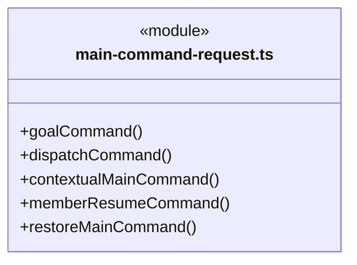

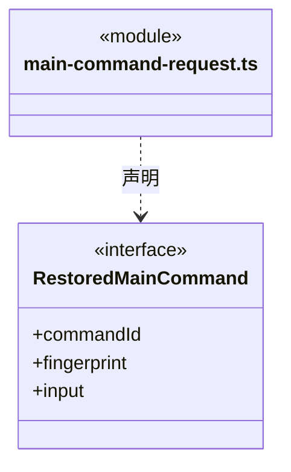

直接依赖：[../../core/foundation/serialization.ts](../../core/foundation/serialization.ts)、[../../core/foundation/errors.ts](../../core/foundation/errors.ts)、[../../core/tasks/graph-types.ts](../../core/tasks/graph-types.ts)、[../../core/dispatch/dispatch-storage.ts](../../core/dispatch/dispatch-storage.ts)、[../../core/tasks/dispatch-commands.ts](../../core/tasks/dispatch-commands.ts)、[../../core/tasks/scope-goal.ts](../../core/tasks/scope-goal.ts)、[../../core/tasks/queued-task-cancel.ts](../../core/tasks/queued-task-cancel.ts)、[../../core/tasks/queued-dependency-replacement.ts](../../core/tasks/queued-dependency-replacement.ts)、[../../core/tasks/queued-dependency-addition.ts](../../core/tasks/queued-dependency-addition.ts)、[../../core/tasks/queued-dependency-revision.ts](../../core/tasks/queued-dependency-revision.ts)、[../../core/tasks/queued-member-resume.ts](../../core/tasks/queued-member-resume.ts)、[../../core/tasks/checkpoint-handoff.ts](../../core/tasks/checkpoint-handoff.ts)、[../../core/tasks/command-verification.ts](../../core/tasks/command-verification.ts)、[../../core/tasks/main-tool-output.ts](../../core/tasks/main-tool-output.ts)、[../tools/main-tool-contracts.ts](../tools/main-tool-contracts.ts)。

### queued-dependency-addition-service.ts

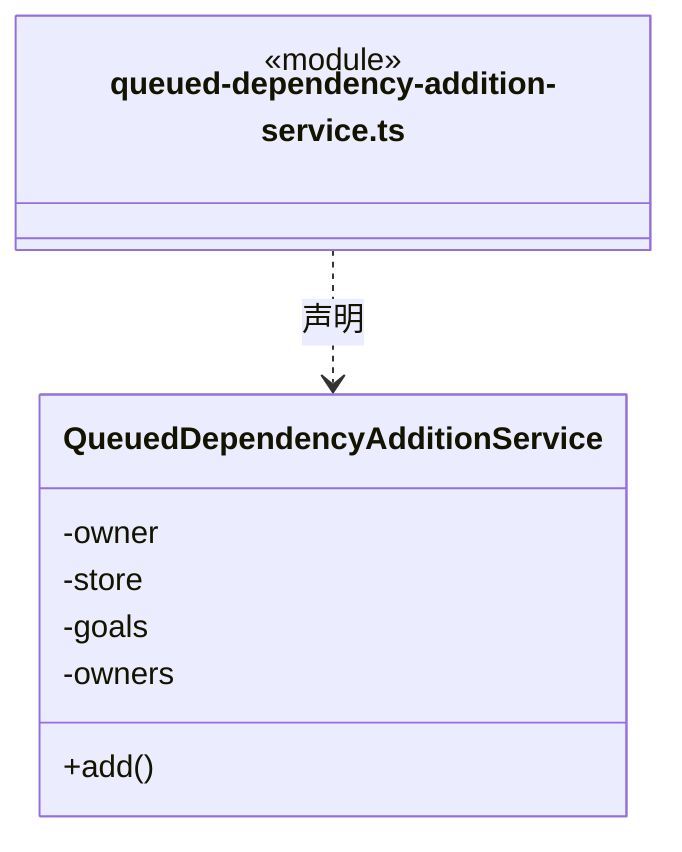

直接依赖：[../../core/foundation/errors.ts](../../core/foundation/errors.ts)、[../../core/foundation/serialization.ts](../../core/foundation/serialization.ts)、[main-command-request.ts](main-command-request.ts)、[../../core/dispatch/dispatch-storage.ts](../../core/dispatch/dispatch-storage.ts)、[../../core/tasks/graph-types.ts](../../core/tasks/graph-types.ts)、[../../core/tasks/queued-dependency-addition.ts](../../core/tasks/queued-dependency-addition.ts)、[../../core/tasks/queued-dependency-addition-rules.ts](../../core/tasks/queued-dependency-addition-rules.ts)、[../context/execution-context.ts](../context/execution-context.ts)、[../members/member-state.ts](../members/member-state.ts)、[scope-goal-service.ts](scope-goal-service.ts)、[../dispatch/owner-execution-service.ts](../dispatch/owner-execution-service.ts)、[../../core/team/member-execution-binding.ts](../../core/team/member-execution-binding.ts)。

### queued-dependency-replacement-service.ts

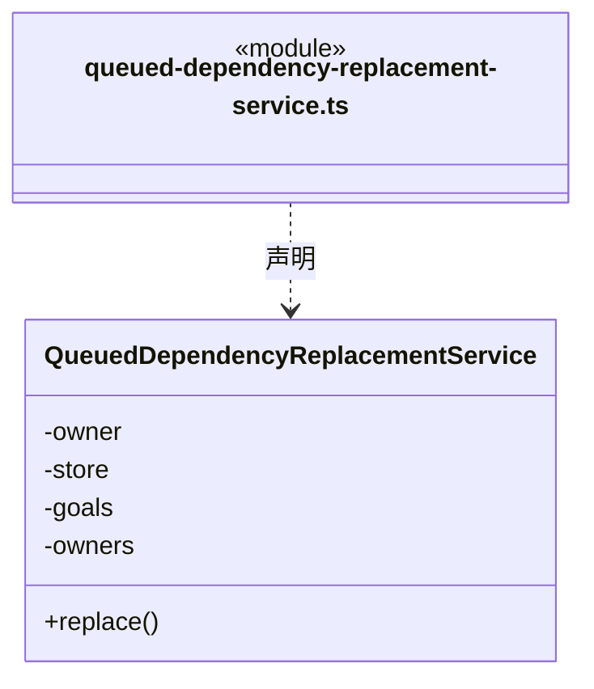

直接依赖：[../../core/foundation/errors.ts](../../core/foundation/errors.ts)、[../../core/foundation/serialization.ts](../../core/foundation/serialization.ts)、[main-command-request.ts](main-command-request.ts)、[../../core/dispatch/dispatch-storage.ts](../../core/dispatch/dispatch-storage.ts)、[../../core/tasks/graph-types.ts](../../core/tasks/graph-types.ts)、[../../core/tasks/queued-dependency-replacement.ts](../../core/tasks/queued-dependency-replacement.ts)、[../../core/tasks/queued-dependency-replacement-rules.ts](../../core/tasks/queued-dependency-replacement-rules.ts)、[../context/execution-context.ts](../context/execution-context.ts)、[../members/member-state.ts](../members/member-state.ts)、[scope-goal-service.ts](scope-goal-service.ts)、[../dispatch/owner-execution-service.ts](../dispatch/owner-execution-service.ts)、[../../core/team/member-execution-binding.ts](../../core/team/member-execution-binding.ts)。

### queued-dependency-revision-service.ts

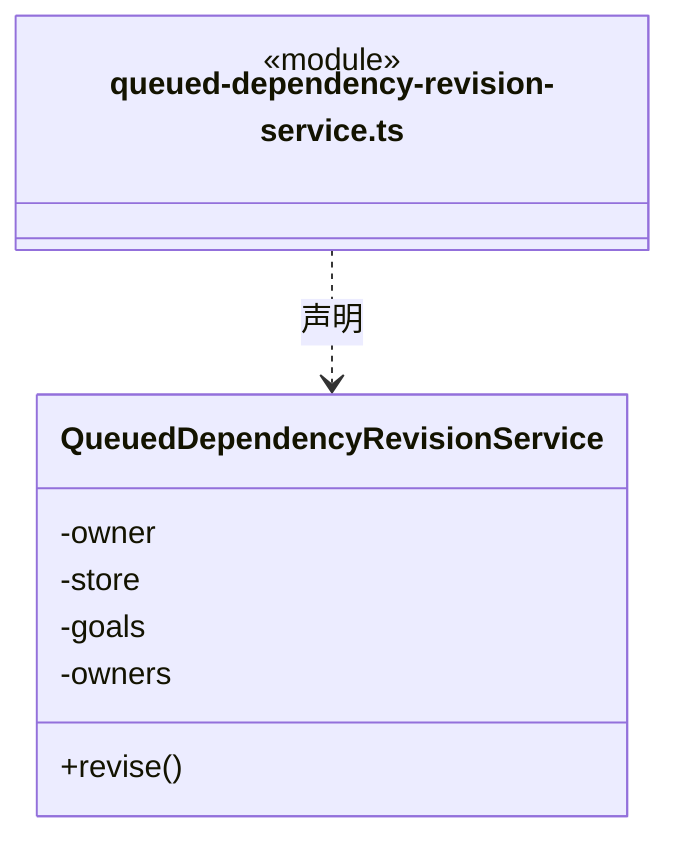

直接依赖：[../../core/foundation/errors.ts](../../core/foundation/errors.ts)、[main-command-request.ts](main-command-request.ts)、[../../core/dispatch/dispatch-storage.ts](../../core/dispatch/dispatch-storage.ts)、[../../core/tasks/graph-types.ts](../../core/tasks/graph-types.ts)、[../../core/tasks/queued-dependency-revision.ts](../../core/tasks/queued-dependency-revision.ts)、[../../core/tasks/queued-dependency-revision-rules.ts](../../core/tasks/queued-dependency-revision-rules.ts)、[../context/execution-context.ts](../context/execution-context.ts)、[../members/member-state.ts](../members/member-state.ts)、[scope-goal-service.ts](scope-goal-service.ts)、[../dispatch/owner-execution-service.ts](../dispatch/owner-execution-service.ts)、[../../core/team/member-execution-binding.ts](../../core/team/member-execution-binding.ts)。

### queued-task-cancel-service.ts

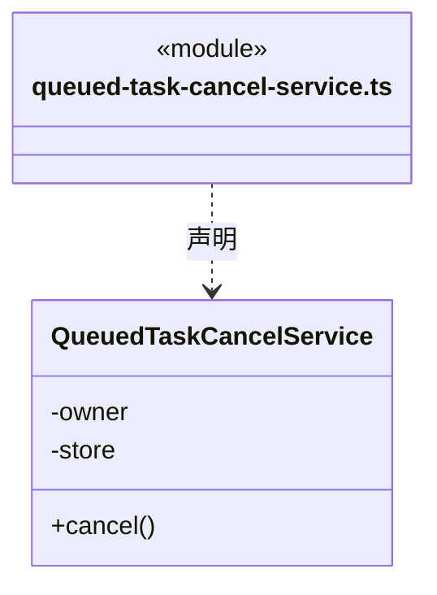

直接依赖：[../../core/foundation/errors.ts](../../core/foundation/errors.ts)、[../../core/foundation/serialization.ts](../../core/foundation/serialization.ts)、[main-command-request.ts](main-command-request.ts)、[../../core/knowledge/ports.ts](../../core/knowledge/ports.ts)、[../../core/dispatch/dispatch-storage.ts](../../core/dispatch/dispatch-storage.ts)、[../../core/tasks/graph-types.ts](../../core/tasks/graph-types.ts)、[../../core/tasks/queued-task-cancel.ts](../../core/tasks/queued-task-cancel.ts)、[../../core/tasks/queued-task-cancel-rules.ts](../../core/tasks/queued-task-cancel-rules.ts)。

### scope-active-input-evidence.ts

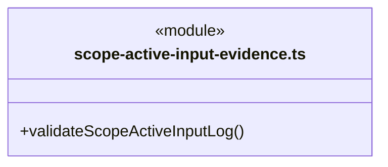

直接依赖：[../../core/foundation/errors.ts](../../core/foundation/errors.ts)、[../../core/execution/types.ts](../../core/execution/types.ts)、[../../core/tasks/dispatch-scope.ts](../../core/tasks/dispatch-scope.ts)、[../../core/tasks/scope-goal.ts](../../core/tasks/scope-goal.ts)、[../../core/tasks/scope-active-input.ts](../../core/tasks/scope-active-input.ts)、[../../core/tasks/scope-active-input-rules.ts](../../core/tasks/scope-active-input-rules.ts)。

### scope-active-input-service.ts

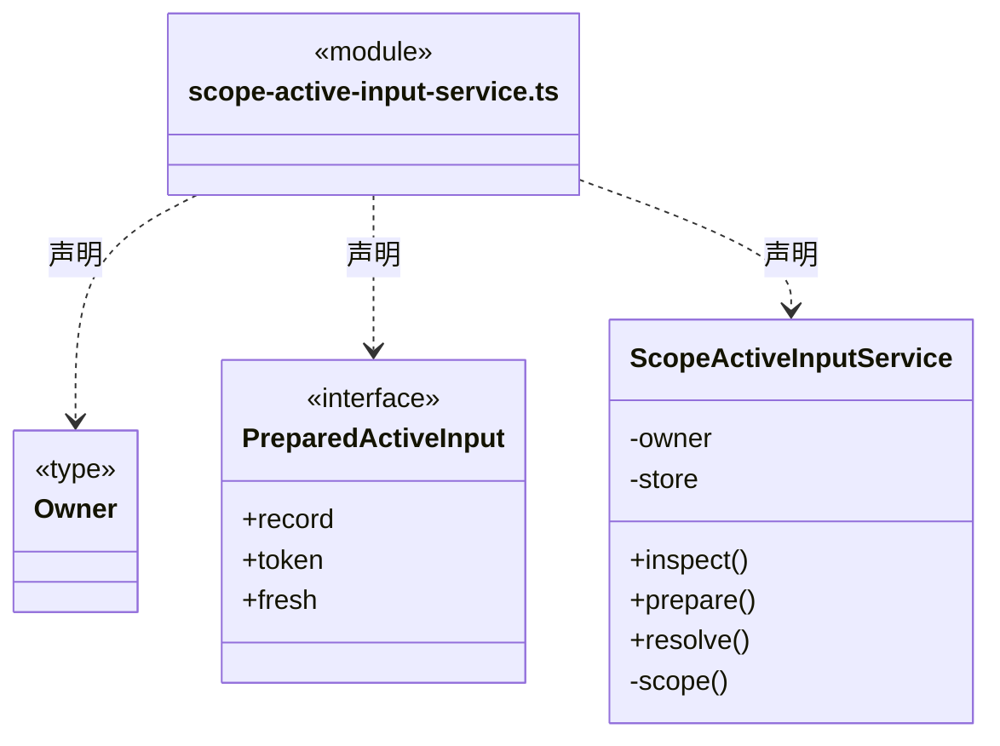

直接依赖：[../../core/foundation/errors.ts](../../core/foundation/errors.ts)、[../../core/foundation/serialization.ts](../../core/foundation/serialization.ts)、[../../core/knowledge/ports.ts](../../core/knowledge/ports.ts)、[../../core/dispatch/dispatch-storage.ts](../../core/dispatch/dispatch-storage.ts)、[../../core/tasks/dispatch-scope.ts](../../core/tasks/dispatch-scope.ts)、[../../core/tasks/graph-types.ts](../../core/tasks/graph-types.ts)、[../../core/tasks/scope-goal.ts](../../core/tasks/scope-goal.ts)、[../../core/tasks/scope-continuation-record.ts](../../core/tasks/scope-continuation-record.ts)、[../../core/tasks/scope-active-input.ts](../../core/tasks/scope-active-input.ts)、[../../core/tasks/scope-active-input-rules.ts](../../core/tasks/scope-active-input-rules.ts)。

### scope-continuation-service.ts

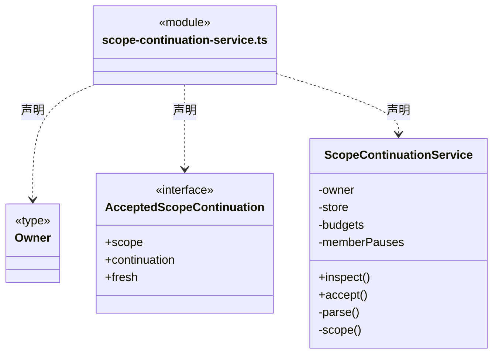

直接依赖：[../../core/foundation/errors.ts](../../core/foundation/errors.ts)、[../../core/foundation/identity.ts](../../core/foundation/identity.ts)、[../../core/foundation/serialization.ts](../../core/foundation/serialization.ts)、[../../core/knowledge/ports.ts](../../core/knowledge/ports.ts)、[../../core/dispatch/dispatch-storage.ts](../../core/dispatch/dispatch-storage.ts)、[../../core/tasks/dispatch-scope.ts](../../core/tasks/dispatch-scope.ts)、[../../core/tasks/scope-run-tracking.ts](../../core/tasks/scope-run-tracking.ts)、[../../core/tasks/scope-goal.ts](../../core/tasks/scope-goal.ts)、[../../core/tasks/scope-continuation-attachments.ts](../../core/tasks/scope-continuation-attachments.ts)、[../../core/tasks/scope-continuation.ts](../../core/tasks/scope-continuation.ts)、[../budget/scope-budget-service.ts](../budget/scope-budget-service.ts)、[../../core/tasks/scope-continuation-record.ts](../../core/tasks/scope-continuation-record.ts)、[../../core/tasks/scope-active-input.ts](../../core/tasks/scope-active-input.ts)、[../members/member-pause-service.ts](../members/member-pause-service.ts)、[../dispatch/owner-execution-service.ts](../dispatch/owner-execution-service.ts)。

### scope-goal-service.ts

成员 1/3（同名节点为同一声明，跨图合并阅读）。

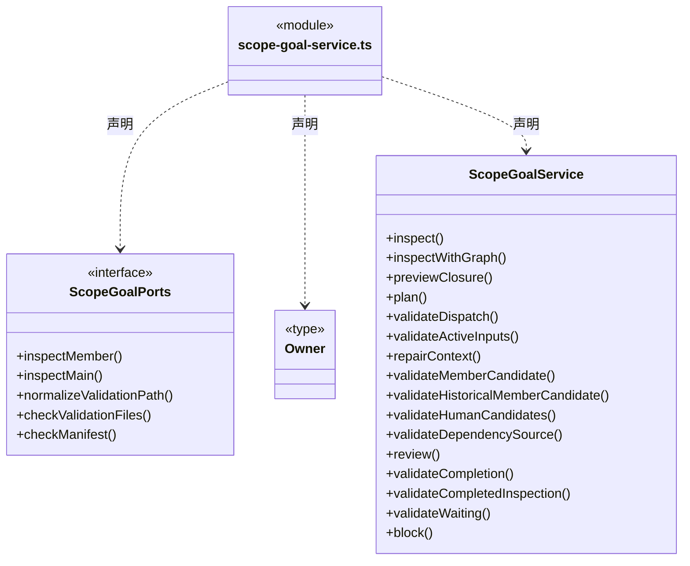

成员 2/3（同名节点为同一声明，跨图合并阅读）。

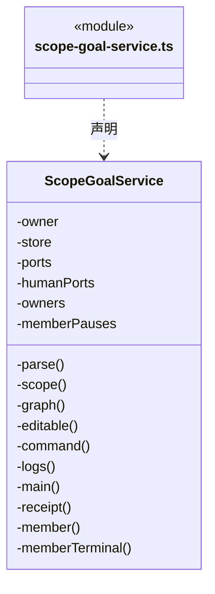

成员 3/3（同名节点为同一声明，跨图合并阅读）。

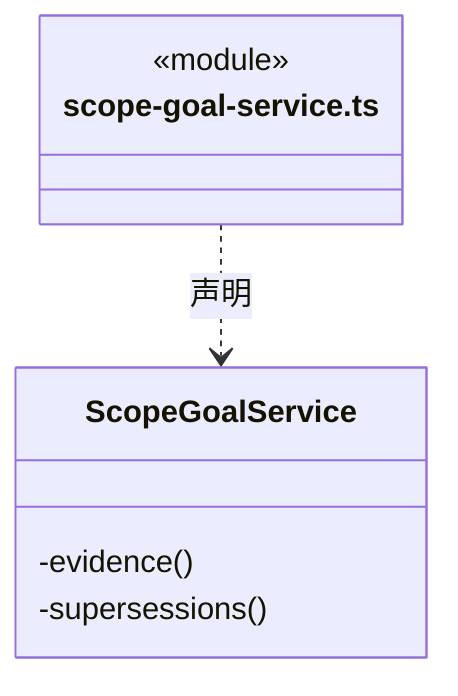

直接依赖：[../context/automatic-context.ts](../context/automatic-context.ts)、[../../core/team/automatic-execution.ts](../../core/team/automatic-execution.ts)、[../../core/tools/questions.ts](../../core/tools/questions.ts)、[../../core/tasks/scope-active-input.ts](../../core/tasks/scope-active-input.ts)、[scope-active-input-evidence.ts](scope-active-input-evidence.ts)、[../../core/foundation/errors.ts](../../core/foundation/errors.ts)、[../../core/foundation/serialization.ts](../../core/foundation/serialization.ts)、[main-command-request.ts](main-command-request.ts)、[../../core/knowledge/ports.ts](../../core/knowledge/ports.ts)、[../../core/execution/types.ts](../../core/execution/types.ts)、[../../core/tools/types.ts](../../core/tools/types.ts)、[../../core/dispatch/dispatch-storage.ts](../../core/dispatch/dispatch-storage.ts)、[../../core/tasks/dispatch-execution.ts](../../core/tasks/dispatch-execution.ts)、[../../core/tasks/dispatch-commands.ts](../../core/tasks/dispatch-commands.ts)、[../../core/tasks/dispatch-scope.ts](../../core/tasks/dispatch-scope.ts)、[../../core/tasks/graph-types.ts](../../core/tasks/graph-types.ts)、[../../core/tasks/scope-goal.ts](../../core/tasks/scope-goal.ts)、[../context/dispatch-context.ts](../context/dispatch-context.ts)、[../evidence/execution-report-facts.ts](../evidence/execution-report-facts.ts)、[../members/member-help-state.ts](../members/member-help-state.ts)、[../runtime/member-events.ts](../runtime/member-events.ts)、[../evidence/human-decision-evidence.ts](../evidence/human-decision-evidence.ts)、[../../core/tasks/human-decisions.ts](../../core/tasks/human-decisions.ts)、[../../core/tasks/human-continuation-rules.ts](../../core/tasks/human-continuation-rules.ts)、[../members/member-workflow.ts](../members/member-workflow.ts)、[../../core/evidence/output-manifest.ts](../../core/evidence/output-manifest.ts)、[../../core/evidence/artifact-baseline.ts](../../core/evidence/artifact-baseline.ts)、[../../core/tasks/workflow-selection.ts](../../core/tasks/workflow-selection.ts)、[../../core/team/member-execution-binding.ts](../../core/team/member-execution-binding.ts)、[../dispatch/owner-execution-service.ts](../dispatch/owner-execution-service.ts)、[../../core/tasks/checkpoint-handoff-rules.ts](../../core/tasks/checkpoint-handoff-rules.ts)、[../members/member-checkpoint-verifier.ts](../members/member-checkpoint-verifier.ts)、[../members/member-pause-service.ts](../members/member-pause-service.ts)、[../../core/tasks/coordination-preview.ts](../../core/tasks/coordination-preview.ts)、[../../core/tasks/queued-task-cancel.ts](../../core/tasks/queued-task-cancel.ts)、[../../core/team/workspace-member.ts](../../core/team/workspace-member.ts)。

### scope-human-continuation-service.ts

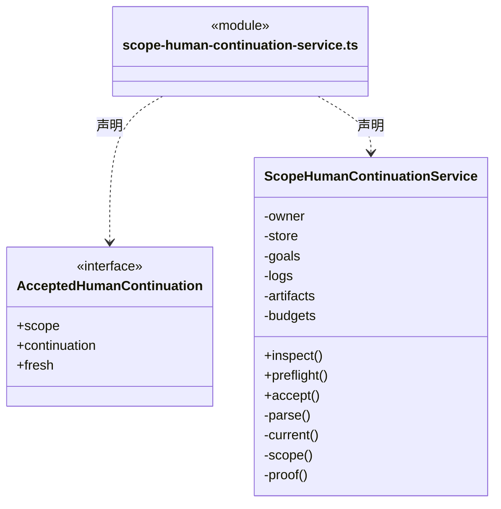

直接依赖：[../../core/foundation/errors.ts](../../core/foundation/errors.ts)、[../../core/foundation/serialization.ts](../../core/foundation/serialization.ts)、[../../core/foundation/identity.ts](../../core/foundation/identity.ts)、[../../core/knowledge/ports.ts](../../core/knowledge/ports.ts)、[../../core/dispatch/dispatch-storage.ts](../../core/dispatch/dispatch-storage.ts)、[../../core/tasks/dispatch-scope.ts](../../core/tasks/dispatch-scope.ts)、[../../core/tasks/scope-goal.ts](../../core/tasks/scope-goal.ts)、[../../core/tasks/scope-run-tracking.ts](../../core/tasks/scope-run-tracking.ts)、[../../core/tasks/human-continue.ts](../../core/tasks/human-continue.ts)、[../../core/tasks/scope-continuation-record.ts](../../core/tasks/scope-continuation-record.ts)、[../../core/tasks/human-continuation-rules.ts](../../core/tasks/human-continuation-rules.ts)、[scope-goal-service.ts](scope-goal-service.ts)、[../evidence/human-decision-evidence.ts](../evidence/human-decision-evidence.ts)、[../budget/scope-budget-service.ts](../budget/scope-budget-service.ts)、[../evidence/human-evidence-state.ts](../evidence/human-evidence-state.ts)。

### scope-human-decision-service.ts

成员 1/2（同名节点为同一声明，跨图合并阅读）。

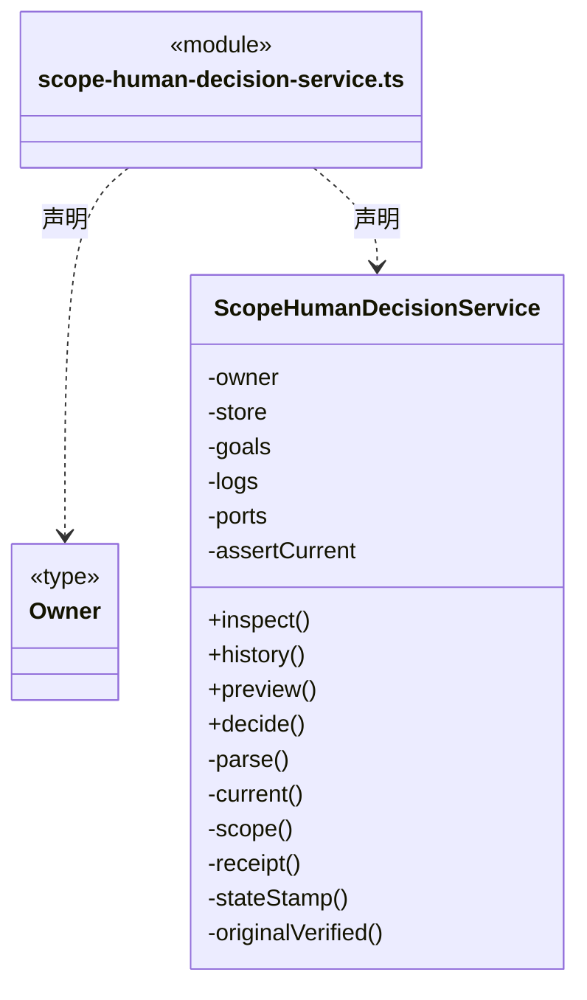

成员 2/2（同名节点为同一声明，跨图合并阅读）。

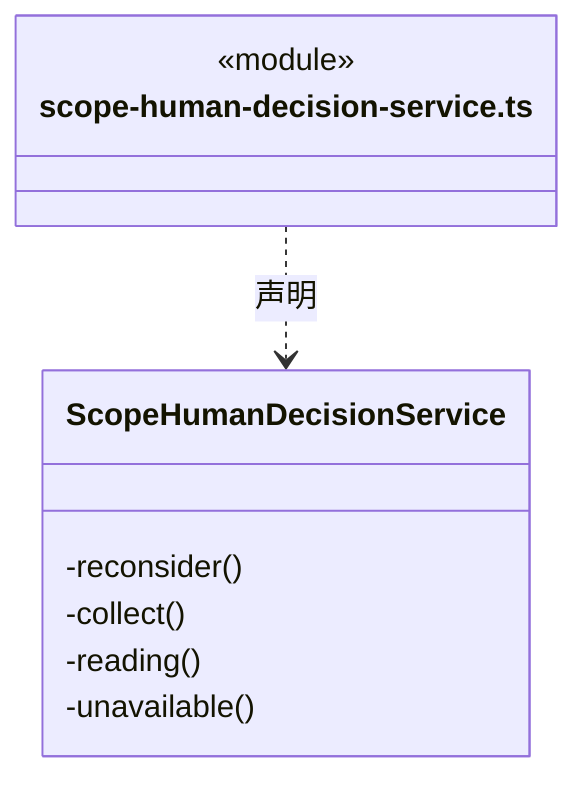

直接依赖：[../../core/foundation/errors.ts](../../core/foundation/errors.ts)、[../../core/foundation/serialization.ts](../../core/foundation/serialization.ts)、[../../core/knowledge/ports.ts](../../core/knowledge/ports.ts)、[../../core/dispatch/dispatch-storage.ts](../../core/dispatch/dispatch-storage.ts)、[../../core/tasks/dispatch-scope.ts](../../core/tasks/dispatch-scope.ts)、[../../core/tasks/scope-goal.ts](../../core/tasks/scope-goal.ts)、[../../core/evidence/artifact-baseline.ts](../../core/evidence/artifact-baseline.ts)、[../../core/evidence/artifact-evidence.ts](../../core/evidence/artifact-evidence.ts)、[../../core/evidence/complete-output-evidence.ts](../../core/evidence/complete-output-evidence.ts)、[../../core/evidence/output-manifest.ts](../../core/evidence/output-manifest.ts)、[../../core/tasks/human-decisions.ts](../../core/tasks/human-decisions.ts)、[../../core/tasks/human-decision-proof.ts](../../core/tasks/human-decision-proof.ts)、[../../core/tasks/human-reconsideration.ts](../../core/tasks/human-reconsideration.ts)、[scope-goal-service.ts](scope-goal-service.ts)、[../evidence/human-decision-evidence.ts](../evidence/human-decision-evidence.ts)、[../evidence/human-evidence-state.ts](../evidence/human-evidence-state.ts)。

### scope-recovery-service.ts

成员 1/2（同名节点为同一声明，跨图合并阅读）。

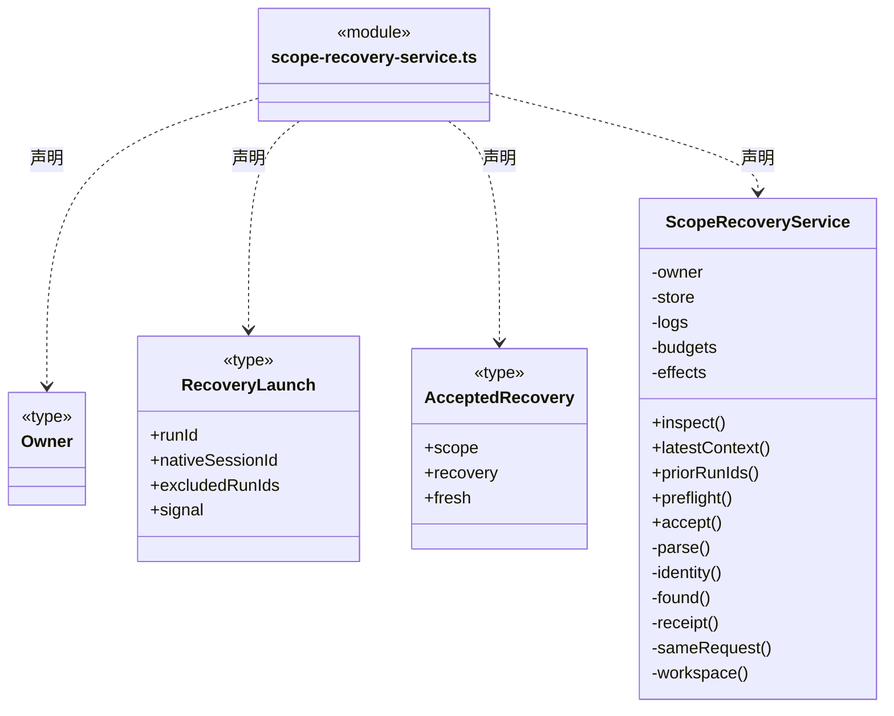

成员 2/2（同名节点为同一声明，跨图合并阅读）。

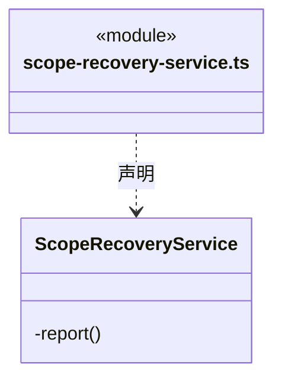

直接依赖：[../../core/foundation/errors.ts](../../core/foundation/errors.ts)、[../../core/foundation/serialization.ts](../../core/foundation/serialization.ts)、[../../core/knowledge/ports.ts](../../core/knowledge/ports.ts)、[../../core/dispatch/dispatch-storage.ts](../../core/dispatch/dispatch-storage.ts)、[../../core/tasks/dispatch-scope.ts](../../core/tasks/dispatch-scope.ts)、[../../core/tasks/graph-types.ts](../../core/tasks/graph-types.ts)、[../../core/tasks/dispatch-commands.ts](../../core/tasks/dispatch-commands.ts)、[../../core/tasks/scope-recovery.ts](../../core/tasks/scope-recovery.ts)、[../../core/tasks/scope-goal.ts](../../core/tasks/scope-goal.ts)、[../../core/tasks/fresh-context.ts](../../core/tasks/fresh-context.ts)、[../evidence/execution-report-service.ts](../evidence/execution-report-service.ts)、[scope-goal-service.ts](scope-goal-service.ts)、[../../core/tasks/scope-run-tracking.ts](../../core/tasks/scope-run-tracking.ts)、[../evidence/effect-observation-service.ts](../evidence/effect-observation-service.ts)、[../evidence/effect-source.ts](../evidence/effect-source.ts)、[../../core/tasks/effect-observation.ts](../../core/tasks/effect-observation.ts)、[../budget/scope-budget-service.ts](../budget/scope-budget-service.ts)。

### scope-replan-service.ts

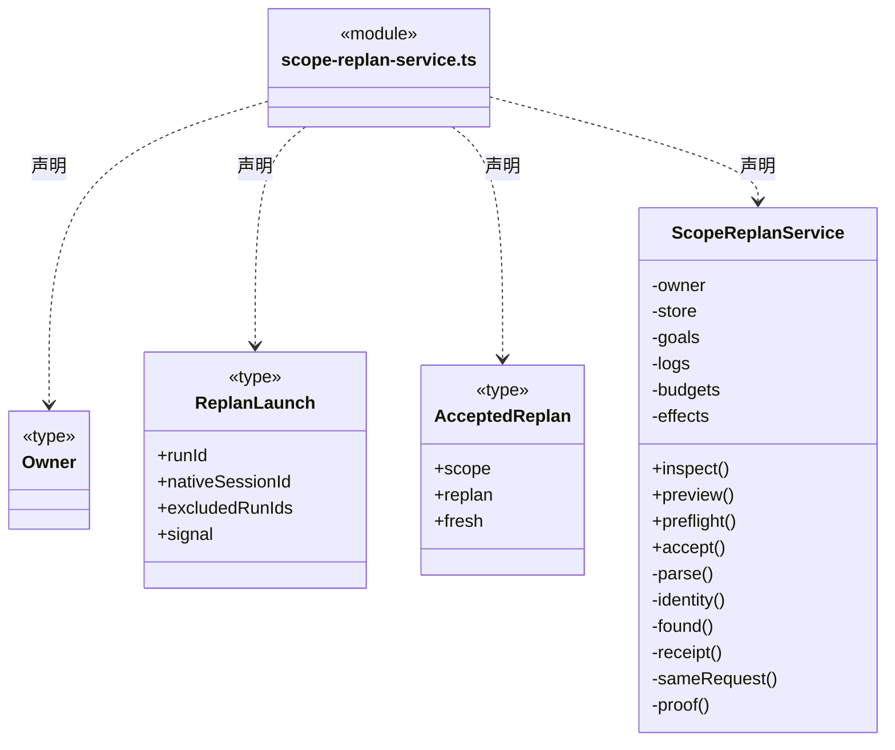

直接依赖：[../../core/foundation/errors.ts](../../core/foundation/errors.ts)、[../../core/foundation/serialization.ts](../../core/foundation/serialization.ts)、[../../core/knowledge/ports.ts](../../core/knowledge/ports.ts)、[../../core/dispatch/dispatch-storage.ts](../../core/dispatch/dispatch-storage.ts)、[../../core/tasks/dispatch-scope.ts](../../core/tasks/dispatch-scope.ts)、[../../core/tasks/fresh-context.ts](../../core/tasks/fresh-context.ts)、[../../core/tasks/scope-replan.ts](../../core/tasks/scope-replan.ts)、[../../core/tasks/scope-goal.ts](../../core/tasks/scope-goal.ts)、[scope-goal-service.ts](scope-goal-service.ts)、[../../core/tasks/scope-run-tracking.ts](../../core/tasks/scope-run-tracking.ts)、[../evidence/execution-report-service.ts](../evidence/execution-report-service.ts)、[../context/dispatch-context.ts](../context/dispatch-context.ts)、[../evidence/effect-observation-service.ts](../evidence/effect-observation-service.ts)、[../evidence/effect-source.ts](../evidence/effect-source.ts)、[../../core/tasks/effect-observation.ts](../../core/tasks/effect-observation.ts)、[../budget/scope-budget-service.ts](../budget/scope-budget-service.ts)。

### 本目录调用边界

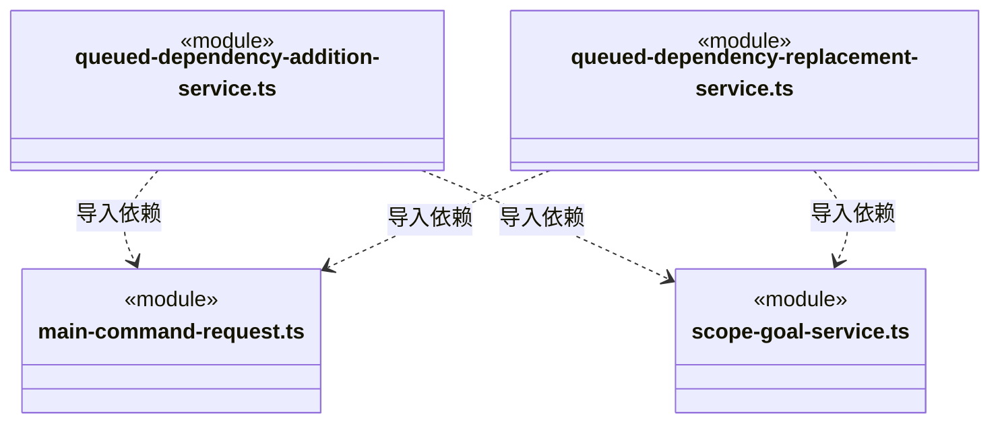

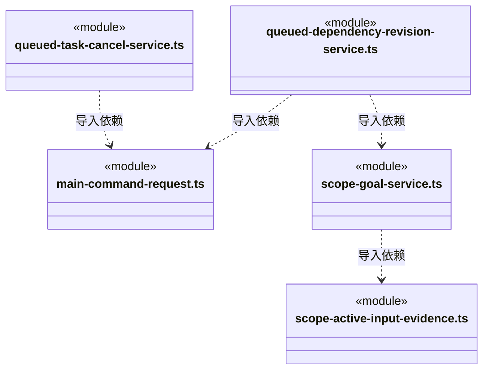

```mermaid
classDiagram
class N_src_backend_scheduler_engine_goals_scope_goal_service_ts["scope-goal-service.ts"] {
  <<module>>
}
class N_src_backend_scheduler_engine_goals_main_command_request_ts["main-command-request.ts"] {
  <<module>>
}
class N_src_backend_scheduler_engine_goals_scope_human_continuation_service_ts["scope-human-continuation-service.ts"] {
  <<module>>
}
class N_src_backend_scheduler_engine_goals_scope_human_decision_service_ts["scope-human-decision-service.ts"] {
  <<module>>
}
class N_src_backend_scheduler_engine_goals_scope_recovery_service_ts["scope-recovery-service.ts"] {
  <<module>>
}
N_src_backend_scheduler_engine_goals_scope_goal_service_ts ..> N_src_backend_scheduler_engine_goals_main_command_request_ts : 导入依赖
N_src_backend_scheduler_engine_goals_scope_human_continuation_service_ts ..> N_src_backend_scheduler_engine_goals_scope_goal_service_ts : 导入依赖
N_src_backend_scheduler_engine_goals_scope_human_decision_service_ts ..> N_src_backend_scheduler_engine_goals_scope_goal_service_ts : 导入依赖
N_src_backend_scheduler_engine_goals_scope_recovery_service_ts ..> N_src_backend_scheduler_engine_goals_scope_goal_service_ts : 导入依赖
```

```mermaid
classDiagram
class N_src_backend_scheduler_engine_goals_scope_replan_service_ts["scope-replan-service.ts"] {
  <<module>>
}
class N_src_backend_scheduler_engine_goals_scope_goal_service_ts["scope-goal-service.ts"] {
  <<module>>
}
N_src_backend_scheduler_engine_goals_scope_replan_service_ts ..> N_src_backend_scheduler_engine_goals_scope_goal_service_ts : 导入依赖
```


## 子目录导航

无子目录。

[返回上层](../ARCHITECTURE.md)。

每次修改本目录代码，同步维护文件头、关键契约说明及本图。未实现的治理、证据验收和自动编排能力不列入当前类图。
