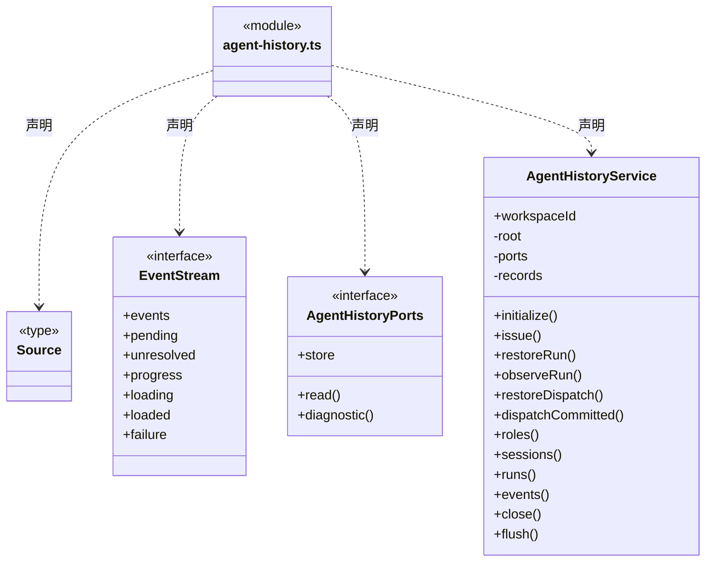
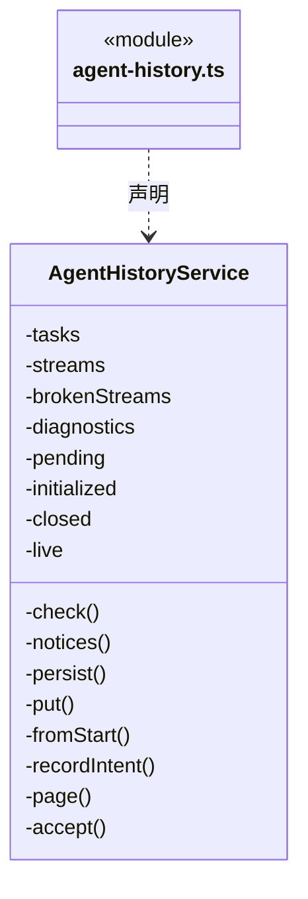
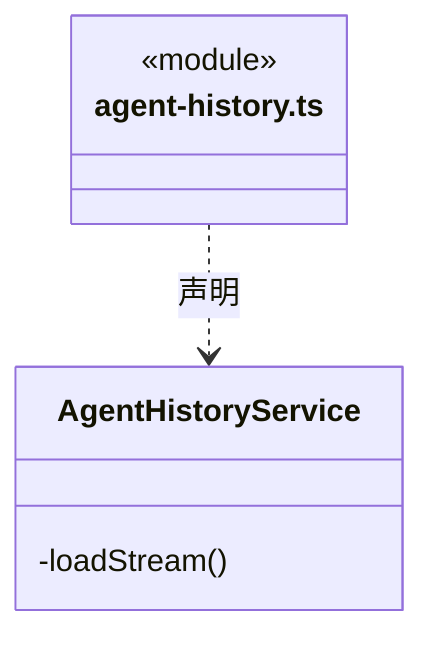

# src/backend/scheduler-engine/history 架构

## 目录定位

会话履历查询编排，依赖 Core 履历契约，实际文件索引在 main/history。

本文描述当前实现。通过分析目录边界后维护的 [源码架构脚本](../../../../scripts/source-architecture.mjs) 同步清单和声明；代码变更时仍须核对职责、关键成员与关系。

## 代码清单

| 文件 | 当前职责 |
| --- | --- |
| [agent-history.ts](agent-history.ts) | 按工作区静态角色归档 Session 与运行摘要，向团队节点提供分页历史和受限事件详情。 |

## 架构类图

### agent-history.ts

成员 1/3（同名节点为同一声明，跨图合并阅读）。

成员 2/3（同名节点为同一声明，跨图合并阅读）。

成员 3/3（同名节点为同一声明，跨图合并阅读）。

直接依赖：[../../core/foundation/errors.ts](../../core/foundation/errors.ts)、[../../core/execution/types.ts](../../core/execution/types.ts)、[../../core/execution/conversation-binding.ts](../../core/execution/conversation-binding.ts)、[../../core/execution/member-run.ts](../../core/execution/member-run.ts)、[../../core/dispatch/dispatch-storage.ts](../../core/dispatch/dispatch-storage.ts)、[../../core/tasks/dispatch-execution.ts](../../core/tasks/dispatch-execution.ts)、[../../core/tasks/graph-types.ts](../../core/tasks/graph-types.ts)、[../../core/tasks/member-events.ts](../../core/tasks/member-events.ts)、[../../core/team/session-history.ts](../../core/team/session-history.ts)、[../../core/team/session-history-storage.ts](../../core/team/session-history-storage.ts)、[../runtime/public-run-events.ts](../runtime/public-run-events.ts)。

## 子目录导航

无子目录。

[返回上层](../ARCHITECTURE.md)。

每次修改本目录代码，同步维护文件头、关键契约说明及本图。未实现的治理、证据验收和自动编排能力不列入当前类图。
