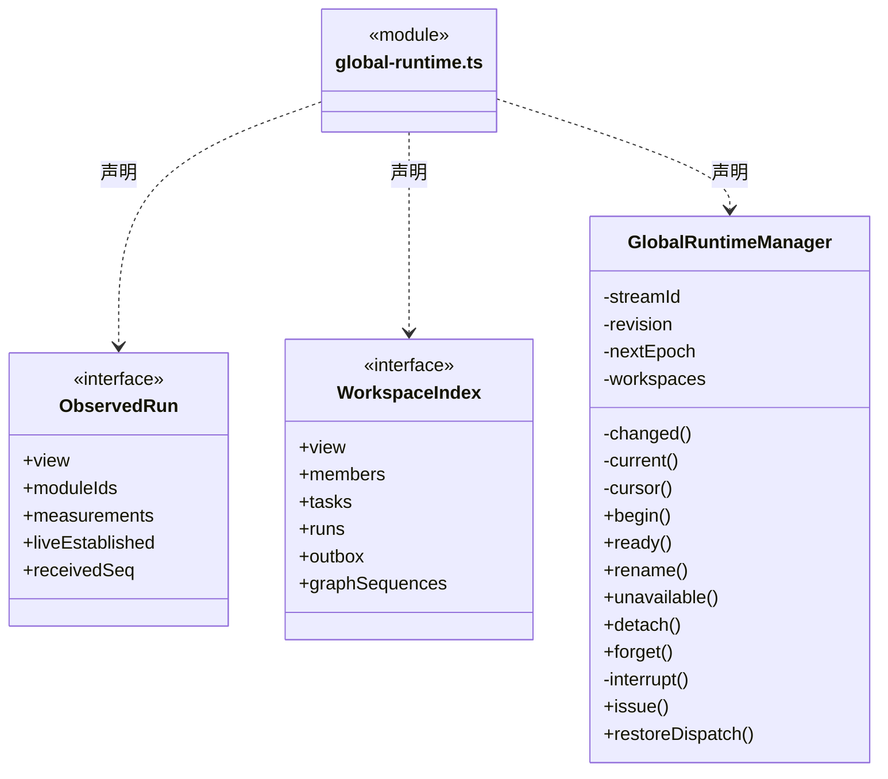
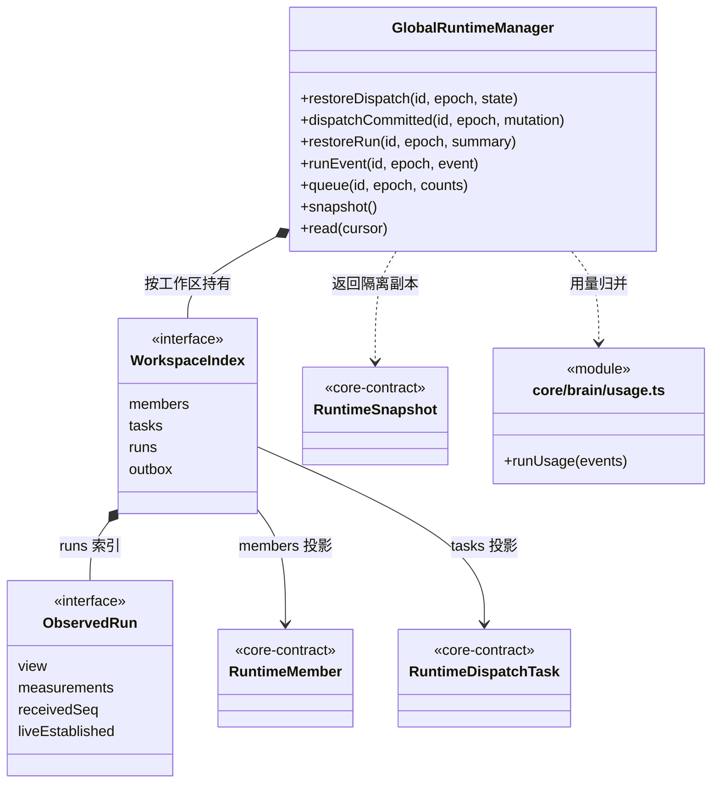

# src/backend/scheduler-engine/runtime 架构

## 目录定位

应用级动态运行索引：以工作区代际接收提交事实，聚合成员、任务、队列和真实轮次用量；重复事件不重复计费，无变化游标读取不重建快照。工作区仍持有日志与执行权限。

本文描述当前实现。通过分析目录边界后维护的 [源码架构脚本](../../../../scripts/source-architecture.mjs) 同步清单和声明；代码变更时仍须核对职责、关键成员与关系。

## 代码清单

| 文件 | 当前职责 |
| --- | --- |
| [global-runtime.ts](global-runtime.ts) | 维护整个应用的成员实例、派发任务及实际 Loop 消耗索引，接收 main 在可靠提交后送来的事实。 |

## 架构类图

### global-runtime.ts

直接依赖：[../../core/brain/types.ts](../../core/brain/types.ts)、[../../core/brain/usage.ts](../../core/brain/usage.ts)、[../../core/tasks/dispatch-storage.ts](../../core/tasks/dispatch-storage.ts)、[../../core/tasks/graph-types.ts](../../core/tasks/graph-types.ts)、[../../core/team/agent-types.ts](../../core/team/agent-types.ts)、[../../core/runtime/types.ts](../../core/runtime/types.ts)。

## 子目录导航

无子目录。

[返回上层](../ARCHITECTURE.md)。

每次修改本目录代码，同步维护文件头、关键契约说明及本图。未实现的治理、证据验收和自动编排能力不列入当前类图。

## 设计契约 v1 与落地范围

以下内容区分已接通能力与后续设计；以各节的实现状态为准，不将目标图当作现状图。维护源：[CONTRACT.md](CONTRACT.md)；生成类图时同步附加，勿直接修改本附录。

### 应用级动态索引（已实现）

GlobalRuntimeManager 由 Application 单例持有，管理所有接入工作区的成员/任务索引和实际 Loop 用量；工作区服务负责命令、事务和执行，本目录只接收提交事实。

- begin/ready/unavailable/detach/forget/rename 管理接入代际和可用性；旧 epoch 不污染新实例，关闭保留历史并清除活动观察。
- restoreDispatch/dispatchCommitted 接收初始基线与新事务；增量只更新受影响对象，不读取磁盘。
- restoreRun/runEvent 按 workspace/task/run/seq 去重；较新未结束的恢复记录不会把 live run 判成中断，有真实终态时收口。
- queue 只接收保存后的计数；正文、凭据和知识不进入缓存。
- snapshot/read 输出公开 DTO；issue 明示不完整来源。未知价格和未报告消费不当成免费。

负载是观察量，不是并发配额。成员执行槽、邮箱消费、公平调度和预算策略尚未接入。

#### 当前关键协作关系

下面补充上方自动类图中因成员数量限制未展开的公开入口；GlobalRuntimeManager、WorkspaceIndex 与 ObservedRun 是同一批实际代码节点，不是另一套管理器。

