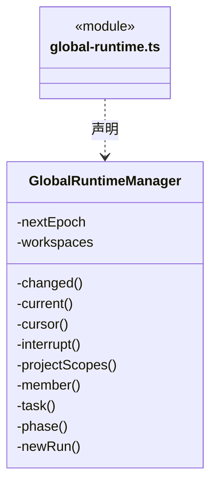
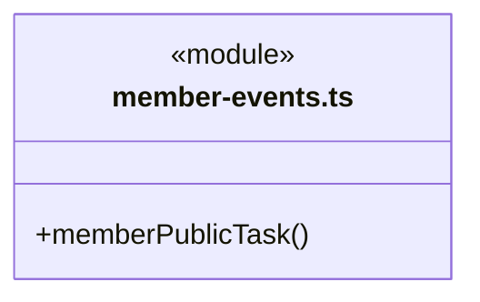
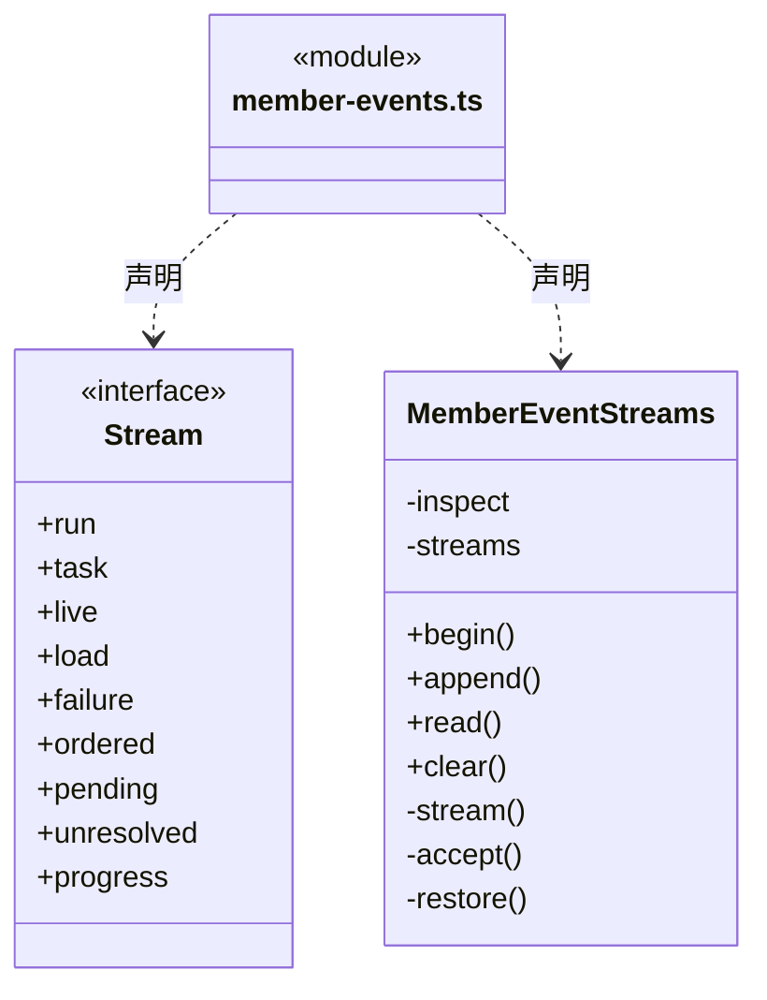
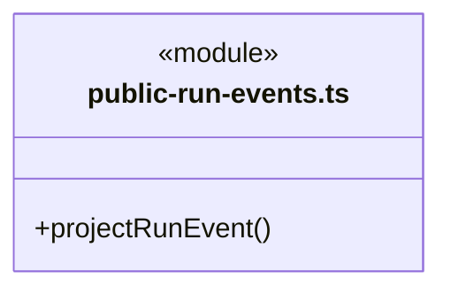
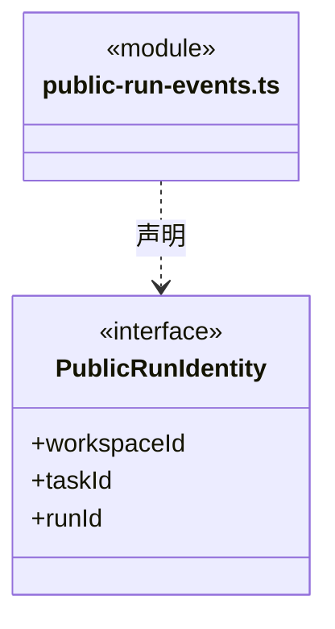
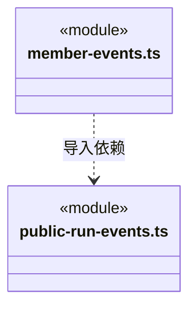
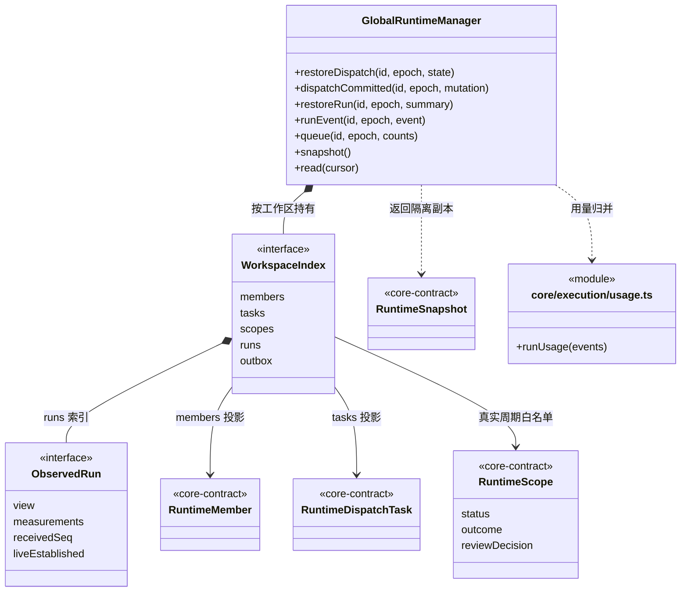

# src/backend/scheduler-engine/runtime 架构

## 目录定位

监管、履历与全局并发准入职责分离。可靠提交同步周期白名单，scope-only 更新独立游标，未变投影不重复发布；检查点计待办而不占活动名额，报告用量不授予额度或恢复权。

本文描述当前实现。通过分析目录边界后维护的 [源码架构脚本](../../../../scripts/source-architecture.mjs) 同步清单和声明；代码变更时仍须核对职责、关键成员与关系。

## 代码清单

| 文件 | 当前职责 |
| --- | --- |
| [global-runtime.ts](global-runtime.ts) | 维护整个应用的成员、派发任务、目标周期与实际 Loop 消耗索引，接收 main 的可靠提交；周期结算独立于模型轮次，成员运行不重复生成任务。 |
| [member-events.ts](member-events.ts) | 将成员运行日志投影为可公开的连续事件流，并按 run 缓存首次恢复及后续已落盘增量。 |
| [public-run-events.ts](public-run-events.ts) | 把主会话和成员运行事件转换为可展示的公开消息、工具状态、计划与证据摘要。 |

## 架构类图

### global-runtime.ts

成员 1/2（同名节点为同一声明，跨图合并阅读）。

成员 2/2（同名节点为同一声明，跨图合并阅读）。

直接依赖：[../../core/execution/types.ts](../../core/execution/types.ts)、[../../core/execution/member-run.ts](../../core/execution/member-run.ts)、[../../core/execution/conversation-binding.ts](../../core/execution/conversation-binding.ts)、[../../core/execution/usage.ts](../../core/execution/usage.ts)、[../../core/runtime/runtime-scope.ts](../../core/runtime/runtime-scope.ts)、[../../core/dispatch/dispatch-storage.ts](../../core/dispatch/dispatch-storage.ts)、[../../core/tasks/graph-types.ts](../../core/tasks/graph-types.ts)、[../../core/team/agent-types.ts](../../core/team/agent-types.ts)、[../../core/runtime/types.ts](../../core/runtime/types.ts)。

### member-events.ts

直接依赖：[../../core/foundation/errors.ts](../../core/foundation/errors.ts)、[../../core/execution/types.ts](../../core/execution/types.ts)、[../../core/tasks/dispatch-execution.ts](../../core/tasks/dispatch-execution.ts)、[../../core/tasks/graph-types.ts](../../core/tasks/graph-types.ts)、[../../core/evidence/progress.ts](../../core/evidence/progress.ts)、[../../core/tasks/member-events.ts](../../core/tasks/member-events.ts)、[public-run-events.ts](public-run-events.ts)。

### public-run-events.ts

直接依赖：[../../core/execution/types.ts](../../core/execution/types.ts)、[../../core/evidence/progress.ts](../../core/evidence/progress.ts)、[../../core/tools/types.ts](../../core/tools/types.ts)、[../../core/tools/scope-schema.ts](../../core/tools/scope-schema.ts)、[../../core/evidence/validation.ts](../../core/evidence/validation.ts)。

### 本目录调用边界

## 子目录导航

无子目录。

[返回上层](../ARCHITECTURE.md)。

每次修改本目录代码，同步维护文件头、关键契约说明及本图。未实现的治理、证据验收和自动编排能力不列入当前类图。

## 设计契约 v1 与落地范围

以下内容区分已接通能力与后续设计；以各节的实现状态为准，不将目标图当作现状图。维护源：[CONTRACT.md](CONTRACT.md)；生成类图时同步附加，勿直接修改本附录。

### 静态 Agent 的 Session 历史（已实现）

`AgentHistoryService` 按 `workspaceId + agentId → sessionId → taskId/runId` 建立独立只读归档。它接收已经持久化的两套运行事件和派发领取意图；不启动模型、不领取任务、不确认信封，不持有审批能力。静态定义删除与实例 released 不删归档，也不把历史记录计为当前人员活动。

- 已登记主/成员分别采用日志中的 `conversationBinding / memberBinding`，从原 `agentSessionId` 分组，不能按角色名或最近会话补造实例。旧日志仅有明确 `TaskSpec.agentId` 时使用 `legacy:<taskId>` 分组；这不是新的运行通道，实例/通道字段保持缺省。没有角色、跨工作区或矛盾绑定登记诊断，不猜归属。
- `restoreDispatch / dispatchCommitted` 保留模型与日志创建前的 `DispatchRun` 意图，启动失败也有一条履历。`restoreRun / observeRun` 只更新已核实的摘要，保持 canonical 日志唯一；重复恢复幂等。成员终态以派发事务为准，不被迟到的原生日志覆盖。
- `roles / sessions / runs` 只查询内存中的持久化索引，不触发日志扫描。分页使用固定创建时间和稳定身份，排序与游标过滤共用比较器，游标绑定工作区、角色及查询层级；默认 30 条、最大 100 条。
- `events` 校验角色、会话、任务、run 与游标后按需读取该 canonical run 一次，通过共享 `projectRunEvent` 白名单公开消息与工具状态。后续依赖已落盘增量，默认 200 条、最大 500 条；无变化返回 noop。未决工具和计划在追加时增量维护，不每次轮询遍历正文。
- 缓存采用 LRU，仅淘汰已加载的非活动详情；加载中与活动流暂留，避免读取与实时事件交错时丢失前缀。重复序号内容冲突保留故障，不能通过淘汰/重读掩盖；原日志损坏明确失败。没有 canonical 的已登记启动失败允许返回空事件和真实失败状态，不能伪造执行消息。
- 索引异步串行写入独立存储端口；失败记录可见 diagnostics 并保留 canonical 回补依据，不回滚或中断已发生的执行。装配方复用监管已有启动扫描，关闭先排空执行并撤订阅，再等待历史 `close` 完成索引写入。

### 应用级动态索引（已实现）

GlobalRuntimeManager 由 Application 单例持有，管理所有接入工作区的成员/任务索引和实际 Loop 用量；工作区服务负责命令、事务和执行，索引自身只接收提交事实。新增运行准入由下述独立 GlobalRunAdmission 处理，不从统计缓存推断执行资格。

- begin/ready/unavailable/detach/forget/rename 管理接入代际和可用性；旧 epoch 不污染新实例，关闭保留历史并清除活动观察。
- restoreDispatch/dispatchCommitted 接收初始基线与新事务；增量只更新受影响对象，不读取磁盘。邮箱只计 pending，claimed/processed 事务使信封退出待消费负载。
- 目标周期从同一 `DispatchObserver.loaded/committed` 白名单投影到 `WorkspaceIndex.scopes`。store 在可靠提交后按工作区串行同步通知；scope-only 提交独立推进全局游标，不借用图序号或 goalRevision。同一公开投影重放保持 noop，一次成员/任务/周期组合提交只增加一次全局版本；先核整批周期身份，失败不留下半批周期、成员或任务。
- 周期覆盖保留持久插入顺序，不按时间推断最新；旧日志没有 scopes 时不造周期。关闭工作区只改变可用性和当前运行观察，不改写持久等待或关闭结果；重开由新的 epoch 恢复真实周期，旧代际回调被忽略。Loop 最近运行 completed 与目标 waiting 可以同时存在，界面必须分开展示。
- restoreRun/runEvent 按 workspace/task/run/seq 去重；较新未结束的恢复记录不会把 live run 判成中断，有真实终态时收口。成员绑定从 run.started 或 RunSummary 明确读取并校验，摘要与起始记录冲突时拒绝发布。
- 带 memberBinding 的轮次计入运行与累计消耗，业务任务只使用 dispatch 图节点；不会再合成第二个 source=loop 任务。普通主对话使用 conversationBinding 对应的实例和对话通道，同一轮次禁止同时携带两种绑定。摘要与起始会话绑定冲突时拒绝发布；同角色名的既有无绑定对话仍保持 role-only。
- 主对话活动由本代际真实 run.started 和后续 phase 投影到已登记成员；每个主会话默认有独立主实例，计数不按 cbim:main 角色合并。等待授权、工具执行和终态即时更新 activeConversation/活动统计，不改写持久化 AgentInstance，也不创建 TaskNode。缺少登记实例时保留运行记录但不补造人员；关闭、不可用和历史恢复不计算对话活跃。
- queue 只接收保存后的计数；正文、凭据和知识不进入缓存。
- checkpointed 计入 waitingDispatchTasks，表示仍需主调度安排的未完任务；正常停泊不计 activeRuns/workingMembers，也不持有准入名额。周期释放后沿既有历史规则排除当前等待压力，运行消耗保留。
- 周期释放事务携带的成员 lifecycle= released 立即投影为非当前活动；公开成员、任务与运行历史保留，当前实例数和活跃/排队压力排除释放的执行实例。主调度实例没有执行周期，保持会话身份；累计 Token 消费不随释放清零。
- snapshot/read 输出公开 DTO；issue 明示不完整来源。未知价格和未报告消费不当成免费。

负载是观察量，不是并发配额。成员执行槽与邮箱领取由 execution 服务管理，GlobalRuntimeManager 只接收事实；全局准入由本目录独立的 GlobalRunAdmission 实现，周期预算由 execution 的可信运行门禁核实，不能使用此监管用量授权。main 的 WorkspaceRuntimeMonitor 在恢复前订阅对话与成员运行，启动恢复不调用模型；历史分别扫描 loop-engine/tasks 与 dispatch/runs/tasks，并核验来源、任务与成员绑定。

#### 当前关键协作关系

下面补充上方自动类图中因成员数量限制未展开的公开入口；GlobalRuntimeManager、WorkspaceIndex 与 ObservedRun 是同一批实际代码节点，不是另一套管理器。

### 应用级运行准入

`GlobalRunAdmission` 不依赖 Application、磁盘或引擎实现。`attempt(request, LocalAdmissionPort)` 在同一个同步段核对全局额度、本地 canAcquire、isCurrent 并取得本地租约，成功后才登记全局占用。返回 granted/release、waiting/ticket 或 denied/reason。等待不占全局名额或本地租约；本地领取异常不得伪装为获准。同请求键（workspace/epoch/requestId）重试保持原票序与时间，完整请求变参拒绝；已运行请求拒绝重复领取，不返回第二把释放句柄。

等待采用 FIFO，但只选择当前本地可领取的请求。更早 writer（ask/execute）即使暂时被本地读占用阻塞，仍阻止同工作区后来 reader 插队；其它工作区可绕过本地阻塞推进。direct 不排票且不能抢占更早 eligible 票据所需的最后名额。内部短暂计算通知顺序，不把通知当作预占许可，真正启动仍须原协调器再次 attempt 并验证任务版本与停止状态。

`wake` 合并到微任务，仅通知可轮到的原 onReady。释放、显式配置、本地租约变化、撤票或失效清理可触发；等待 attempt 本身不自唤醒重试，避免空转。`withdraw` 只移除明确身份等待票；`retireOwner` 使旧工作区装配代际永久失效并撤票，既有占用仍计入额度直到真实释放。release 幂等，先移全局占用，再释放本地并通知重试；读取和重启都不会创建任务。

`restorePolicy` 只允许首次 attempt/configure 前的空态启动恢复一次。`configure` 按当前 policy.revision 做 CAS，返回递增后的策略；调用方先可靠保存再调用，下降不取消已运行任务。`snapshot/read` 仅复制内存中的公开事实，不调用本地端口、不清理票据、不扫描日志；observeChange 只是隔离异常的更新通知。进程内流标识和票据不会从历史重建。此准入器只控制已接入运行的数量及既有本地冲突，不提供费用预算、操作系统沙箱、抢占或成员恢复。
