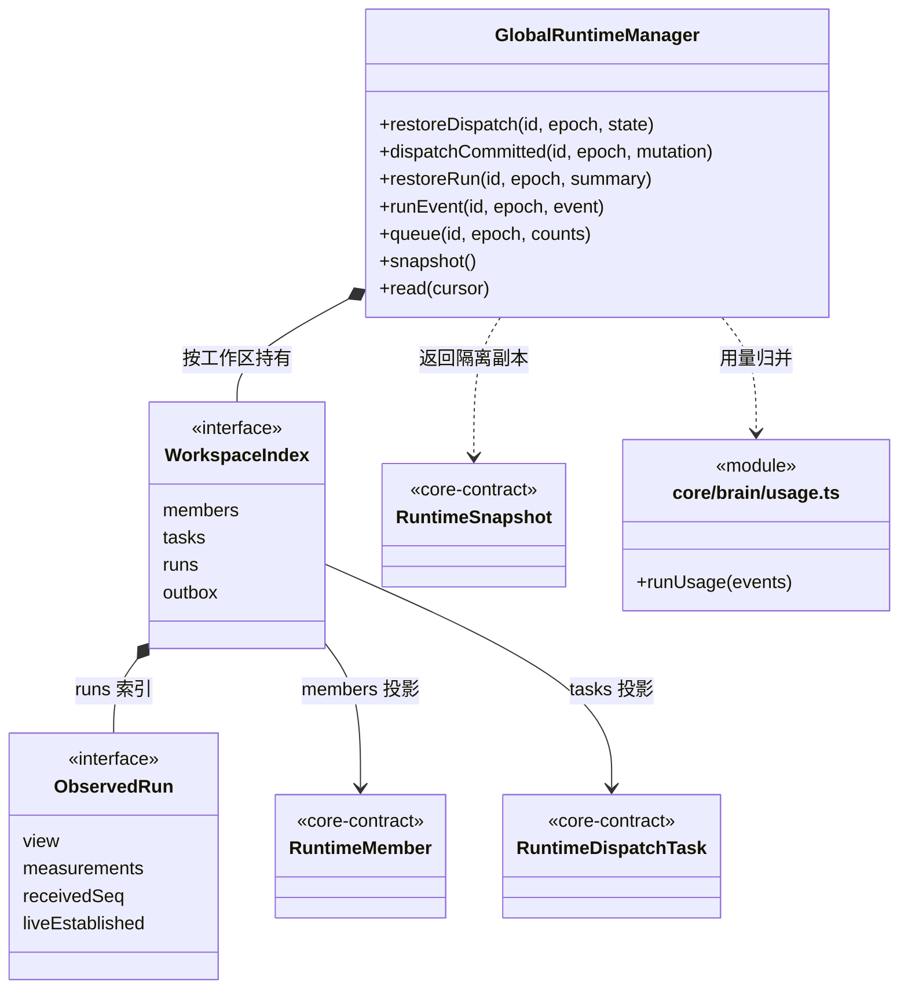

### 应用级动态索引（已实现）

GlobalRuntimeManager 由 Application 单例持有，管理所有接入工作区的成员/任务索引和实际 Loop 用量；工作区服务负责命令、事务和执行，本目录只接收提交事实。

- begin/ready/unavailable/detach/forget/rename 管理接入代际和可用性；旧 epoch 不污染新实例，关闭保留历史并清除活动观察。
- restoreDispatch/dispatchCommitted 接收初始基线与新事务；增量只更新受影响对象，不读取磁盘。
- restoreRun/runEvent 按 workspace/task/run/seq 去重；较新未结束的恢复记录不会把 live run 判成中断，有真实终态时收口。
- queue 只接收保存后的计数；正文、凭据和知识不进入缓存。
- snapshot/read 输出公开 DTO；issue 明示不完整来源。未知价格和未报告消费不当成免费。

负载是观察量，不是并发配额。成员执行槽、邮箱消费、公平调度和预算策略尚未接入。

#### 当前关键协作关系

下面补充上方自动类图中因成员数量限制未展开的公开入口；GlobalRuntimeManager、WorkspaceIndex 与 ObservedRun 是同一批实际代码节点，不是另一套管理器。

