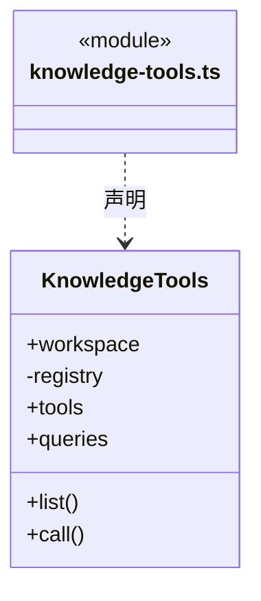

# src/backend/scheduler-engine/tools 架构

## 目录定位

把 Core 知识能力暴露为 cbim_ 工具。内置 Loop 与可选 MCP 复用同一参数、身份及写授权检查。

本文描述当前实现。通过分析目录边界后维护的 [源码架构脚本](../../../../scripts/source-architecture.mjs) 同步清单和声明；代码变更时仍须核对职责、关键成员与关系。

## 代码清单

| 文件 | 当前职责 |
| --- | --- |
| [knowledge-tools.ts](knowledge-tools.ts) | 调度层知识工具适配，向内部大脑和可选 MCP 暴露相同工具。 |

## 架构类图

### knowledge-tools.ts

直接依赖：[../../core/tools/registry.ts](../../core/tools/registry.ts)、[../../core/knowledge/ports.ts](../../core/knowledge/ports.ts)、[../../core/foundation/errors.ts](../../core/foundation/errors.ts)、[../../core/knowledge/builtins.ts](../../core/knowledge/builtins.ts)、[../../core/knowledge/knowledge-queries.ts](../../core/knowledge/knowledge-queries.ts)、[../../core/knowledge/object-crud.ts](../../core/knowledge/object-crud.ts)。

## 子目录导航

无子目录。

[返回上层](../ARCHITECTURE.md)。

每次修改本目录代码，同步维护文件头、关键契约说明及本图。未实现的治理、证据验收和自动编排能力不列入当前类图。
