# src/backend/scheduler-engine/tools 架构

## 目录定位

把知识、主调度及实际装配的用户交互注册为 cbim_ 工具。新增前置追加与已有主调度工具共用固定运行身份、原命令映射和严格单次编码输出，回执只证明保存；坏回包先核实原记录。QuestionTools冻结原题，严格核验答案或取消，坏回包不重问；维护和问答回执不算业务证据，执行者不获得调度权。 知识查询和事务刷新分别注入最小读/写端口，写权限及原请求版本检查保持。 负责人发现和计划/派发选择共享严格协议，固定主运行身份，历史回执不签发新领取许可。 主工具显式放弃原检查点/预约，绑定原 run/call 命令，坏回包只核实原事实，不取得业务完成资格。 主 Agent 可按明确原 run/call 查询控制面事务；可信闭包固定工作区和根，读取本身无写命令且不触发成员执行。 知识提交和对象提交的执行参数与历史核实使用同一解析定义，权限及当前实例核验仍在实际执行入口。 FeedbackTools 只在桌面主会话实际连接后注册；严格解析反馈字段，未知只核实原提交，不能让模型改投目标或提供凭据。

本文描述当前实现。通过分析目录边界后维护的 [源码架构脚本](../../../../scripts/source-architecture.mjs) 同步清单和声明；代码变更时仍须核对职责、关键成员与关系。

## 代码清单

| 文件 | 当前职责 |
| --- | --- |
| [candidate-review-tools.ts](candidate-review-tools.ts) | 仅向主运行提供精确成员候选审阅入口。 |
| [command-report-contract.ts](command-report-contract.ts) | 声明主调度原命令核实工具的只读元数据及唯一 wire 归属校验。 |
| [coordination-contracts.ts](coordination-contracts.ts) | 校验只读闭包预览的原运行归属和提交依据。 |
| [coordination-tools.ts](coordination-tools.ts) | 主运行的统一状态与原回执读取入口，保留各领域实际校验和恢复语义。 |
| [dispatch-tools.ts](dispatch-tools.ts) | 把主调度的派发、查询、未启动撤销、依赖修订及检查点预约/明确放弃转换为内部工具，并组合目标工具。 |
| [feedback-status-tool.ts](feedback-status-tool.ts) | 主会话的反馈可用性只读诊断，区分本轮装配事实与当前本机连接事实。 |
| [feedback-tools.ts](feedback-tools.ts) | 主会话的 GitHub 反馈提交与原提交核实工具，承接两项内置 Skill 的格式字段。 |
| [goal-tools.ts](goal-tools.ts) | 将主 Agent 当前用户目标、真实补充历史的读取及规划审阅端口注册为内部 Loop 工具。 |
| [governance-tools.ts](governance-tools.ts) | 将每个真实主运行的治理窄端口装配成发现、分类与调用一致的四项工具。 |
| [knowledge-contracts.ts](knowledge-contracts.ts) | 将实际知识工具与 Core 业务输出 Schema、取消及恢复说明绑定，供工具注册使用。 |
| [knowledge-tools.ts](knowledge-tools.ts) | 向 CBIM 内部大脑提供知识查询、对象事务和内置 Skill 工具。 |
| [main-tool-contracts.ts](main-tool-contracts.ts) | 绑定主调度工具的公开回包、取消恢复说明及可信命令键，前置多边修订使用独立命令域。 |
| [module-ownership-tools.ts](module-ownership-tools.ts) | 把本轮真实主运行的模块责任端口转换为发现、分类和执行一致的四工具。 |
| [question-tools.ts](question-tools.ts) | 为已装配用户交互端口的主/成员运行提供结构化提问工具及严格答案回包。 |
| [repository-tools.ts](repository-tools.ts) | 把主进程捕获的资源仓库只读端口装配为主调度可调用的两个工具。 |
| [web-tools.ts](web-tools.ts) | 将主进程公开网页读取端口注册为两个只读主 Agent 工具。 |
| [workspace-member-tools.ts](workspace-member-tools.ts) | 将主运行岗位端口注册为查询、预览、提交与原回执四项工具。 |

## 架构类图

### candidate-review-tools.ts

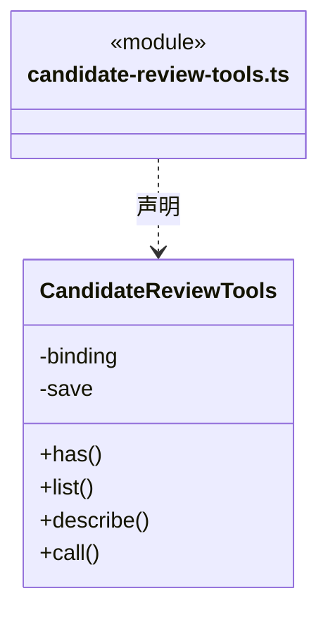

直接依赖：[../../core/tasks/candidate-review.ts](../../core/tasks/candidate-review.ts)、[../../core/tasks/graph-rules.ts](../../core/tasks/graph-rules.ts)、[../../core/tools/results.ts](../../core/tools/results.ts)、[../../core/foundation/errors.ts](../../core/foundation/errors.ts)、[../../core/tasks/graph-types.ts](../../core/tasks/graph-types.ts)、[../../core/tasks/main-tool-output.ts](../../core/tasks/main-tool-output.ts)。

### command-report-contract.ts

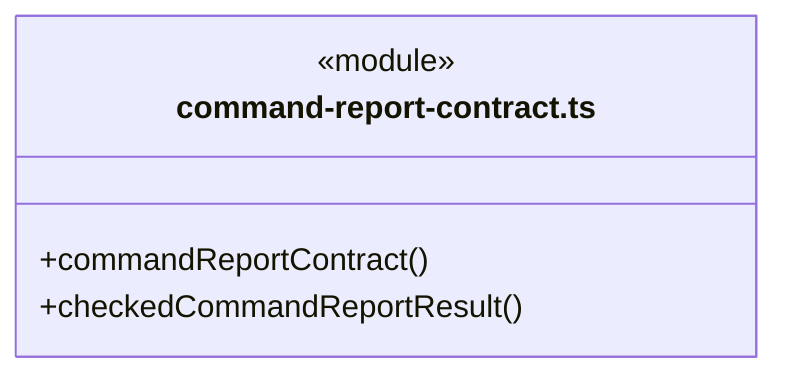

直接依赖：[../../core/foundation/errors.ts](../../core/foundation/errors.ts)、[../../core/tasks/command-verification.ts](../../core/tasks/command-verification.ts)、[../../core/tools/results.ts](../../core/tools/results.ts)、[../../core/tools/contracts.ts](../../core/tools/contracts.ts)。

### coordination-contracts.ts

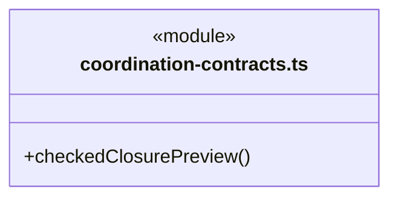

直接依赖：[../../core/tasks/coordination-preview.ts](../../core/tasks/coordination-preview.ts)、[../../core/tasks/main-tool-output.ts](../../core/tasks/main-tool-output.ts)、[../../core/tasks/queued-task-cancel.ts](../../core/tasks/queued-task-cancel.ts)、[../../core/tools/results.ts](../../core/tools/results.ts)。

### coordination-tools.ts

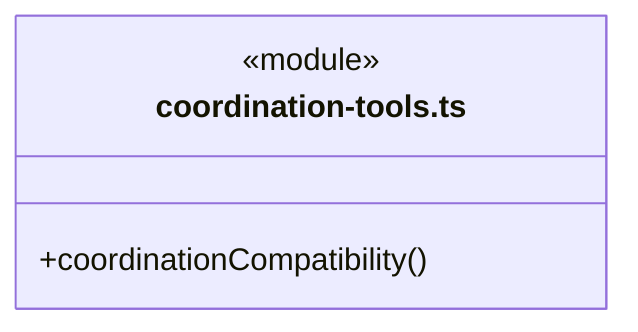

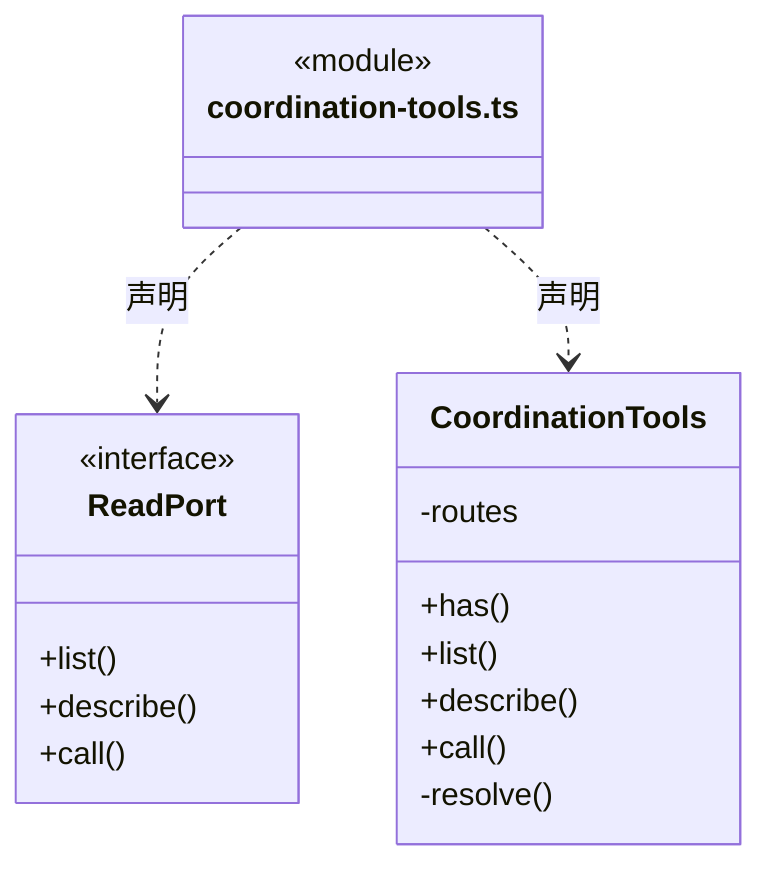

直接依赖：[../../core/foundation/errors.ts](../../core/foundation/errors.ts)、[../../core/tasks/coordination-preview.ts](../../core/tasks/coordination-preview.ts)、[../../core/tasks/main-tool-output.ts](../../core/tasks/main-tool-output.ts)、[../../core/tools/results.ts](../../core/tools/results.ts)、[../../core/execution/engine-tools.ts](../../core/execution/engine-tools.ts)、[../../core/tools/policy/tool-policy.ts](../../core/tools/policy/tool-policy.ts)。

### dispatch-tools.ts

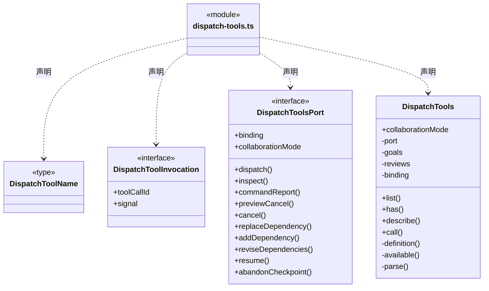

直接依赖：[candidate-review-tools.ts](candidate-review-tools.ts)、[../../core/tools/outcome.ts](../../core/tools/outcome.ts)、[coordination-contracts.ts](coordination-contracts.ts)、[../../core/tasks/coordination-preview.ts](../../core/tasks/coordination-preview.ts)、[../../core/foundation/errors.ts](../../core/foundation/errors.ts)、[../../core/tasks/dispatch-commands.ts](../../core/tasks/dispatch-commands.ts)、[../../core/tasks/workflow-selection.ts](../../core/tasks/workflow-selection.ts)、[../../core/tasks/queued-task-cancel.ts](../../core/tasks/queued-task-cancel.ts)、[../../core/tasks/queued-dependency-replacement.ts](../../core/tasks/queued-dependency-replacement.ts)、[../../core/tasks/queued-dependency-addition.ts](../../core/tasks/queued-dependency-addition.ts)、[../../core/tasks/queued-dependency-revision.ts](../../core/tasks/queued-dependency-revision.ts)、[../../core/tasks/main-tool-output.ts](../../core/tasks/main-tool-output.ts)、[main-tool-contracts.ts](main-tool-contracts.ts)、[command-report-contract.ts](command-report-contract.ts)、[../../core/tasks/command-verification.ts](../../core/tasks/command-verification.ts)、[goal-tools.ts](goal-tools.ts)、[../../core/tasks/queued-member-resume.ts](../../core/tasks/queued-member-resume.ts)、[../../core/tasks/checkpoint-handoff.ts](../../core/tasks/checkpoint-handoff.ts)。

### feedback-status-tool.ts

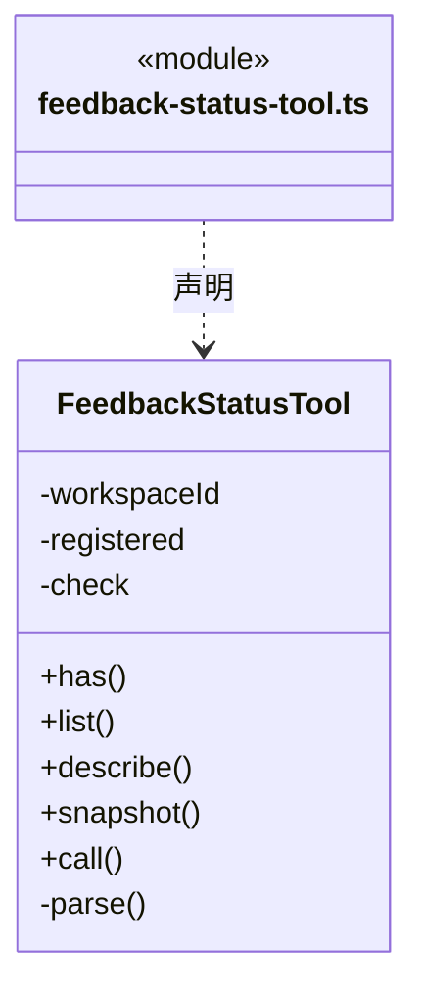

直接依赖：[../../core/foundation/errors.ts](../../core/foundation/errors.ts)、[../../core/tools/results.ts](../../core/tools/results.ts)、[../../core/tools/policy/tool-policy.ts](../../core/tools/policy/tool-policy.ts)、[../../core/connectors/github-feedback.ts](../../core/connectors/github-feedback.ts)。

### feedback-tools.ts

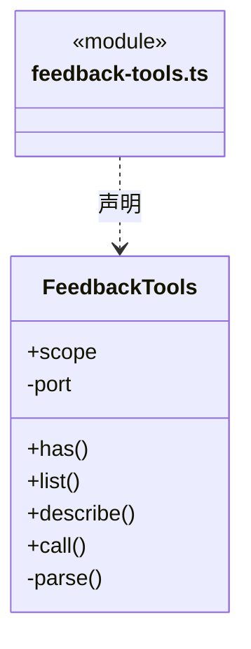

直接依赖：[../../core/foundation/errors.ts](../../core/foundation/errors.ts)、[../../core/tools/results.ts](../../core/tools/results.ts)、[../../core/tools/scope-schema.ts](../../core/tools/scope-schema.ts)、[../../core/tools/policy/tool-policy.ts](../../core/tools/policy/tool-policy.ts)、[../../core/connectors/github-feedback.ts](../../core/connectors/github-feedback.ts)。

### goal-tools.ts

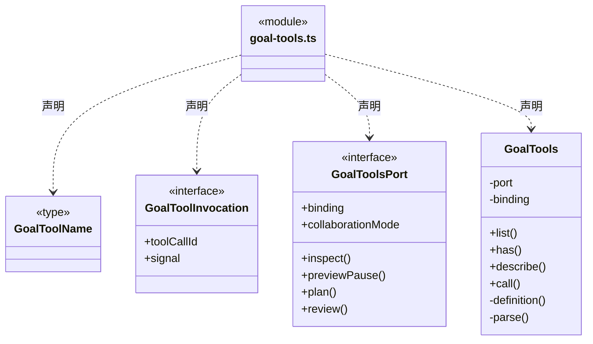

直接依赖：[../../core/tools/outcome.ts](../../core/tools/outcome.ts)、[coordination-contracts.ts](coordination-contracts.ts)、[../../core/tasks/coordination-preview.ts](../../core/tasks/coordination-preview.ts)、[../../core/foundation/errors.ts](../../core/foundation/errors.ts)、[../../core/tasks/scope-goal.ts](../../core/tasks/scope-goal.ts)、[../../core/tasks/main-tool-output.ts](../../core/tasks/main-tool-output.ts)、[main-tool-contracts.ts](main-tool-contracts.ts)。

### governance-tools.ts

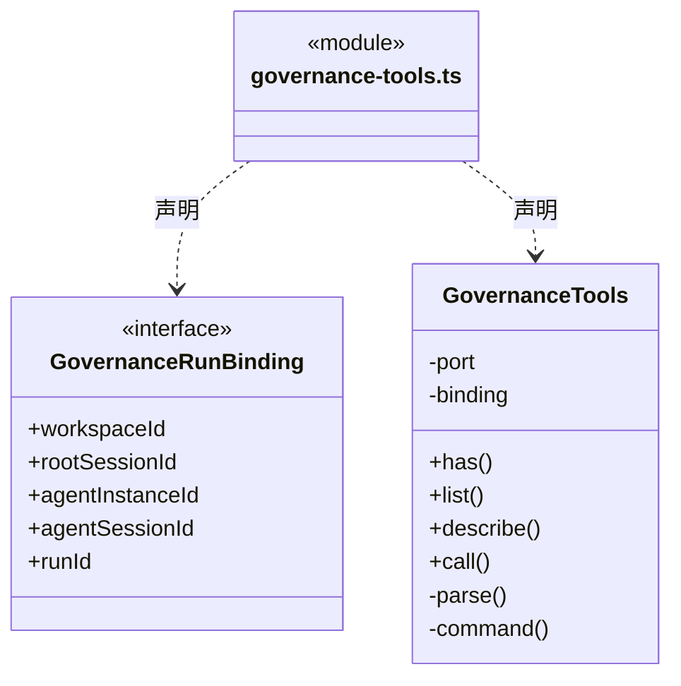

直接依赖：[../../core/tools/outcome.ts](../../core/tools/outcome.ts)、[../../core/foundation/errors.ts](../../core/foundation/errors.ts)、[../../core/tools/results.ts](../../core/tools/results.ts)、[../../core/tools/policy/tool-policy.ts](../../core/tools/policy/tool-policy.ts)、[../../core/governance/module-governance-rules.ts](../../core/governance/module-governance-rules.ts)、[../../core/governance/module-governance-tools.ts](../../core/governance/module-governance-tools.ts)。

### knowledge-contracts.ts

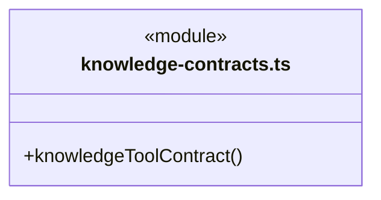

直接依赖：[../../core/foundation/errors.ts](../../core/foundation/errors.ts)、[../../core/knowledge/builtins.ts](../../core/knowledge/builtins.ts)、[../../core/knowledge/tool-output-base.ts](../../core/knowledge/tool-output-base.ts)、[../../core/knowledge/tool-output-queries.ts](../../core/knowledge/tool-output-queries.ts)、[../../core/knowledge/tool-output-builtins.ts](../../core/knowledge/tool-output-builtins.ts)、[../../core/knowledge/tool-output-transactions.ts](../../core/knowledge/tool-output-transactions.ts)、[../../core/tools/contracts.ts](../../core/tools/contracts.ts)。

### knowledge-tools.ts

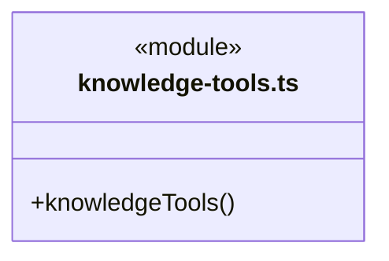

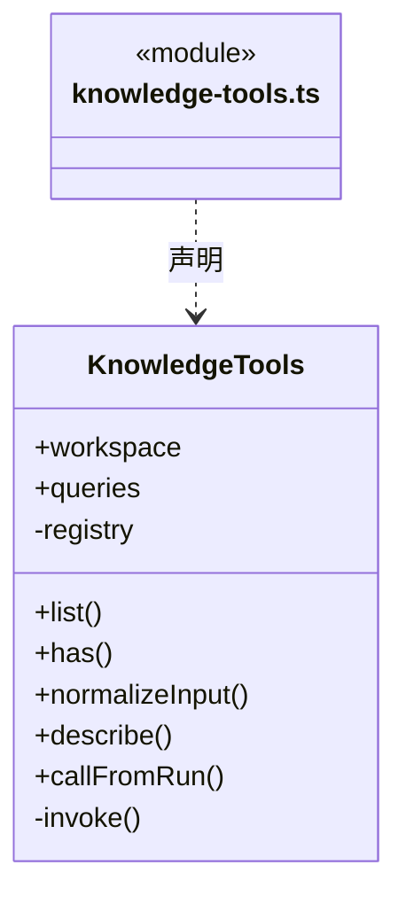

直接依赖：[../../core/tools/registry.ts](../../core/tools/registry.ts)、[../../core/knowledge/ports.ts](../../core/knowledge/ports.ts)、[../../core/foundation/errors.ts](../../core/foundation/errors.ts)、[../../core/knowledge/builtins.ts](../../core/knowledge/builtins.ts)、[../../core/knowledge/knowledge-queries.ts](../../core/knowledge/knowledge-queries.ts)、[../../core/knowledge/knowledge-refresh.ts](../../core/knowledge/knowledge-refresh.ts)、[../../core/knowledge/object-crud.ts](../../core/knowledge/object-crud.ts)、[../../core/tools/types.ts](../../core/tools/types.ts)、[knowledge-contracts.ts](knowledge-contracts.ts)、[../../core/knowledge/knowledge-write-input.ts](../../core/knowledge/knowledge-write-input.ts)。

### main-tool-contracts.ts

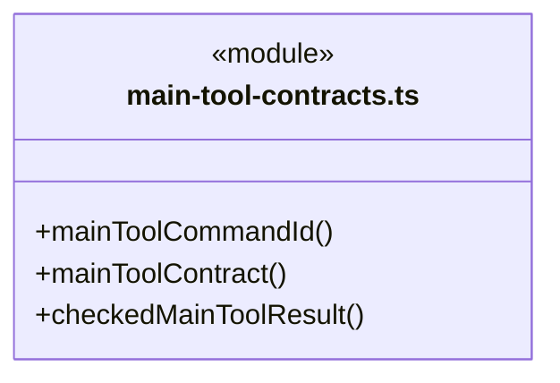

直接依赖：[../../core/foundation/serialization.ts](../../core/foundation/serialization.ts)、[../../core/tasks/main-tool-output.ts](../../core/tasks/main-tool-output.ts)、[../../core/tools/contracts.ts](../../core/tools/contracts.ts)、[../../core/tools/results.ts](../../core/tools/results.ts)。

### module-ownership-tools.ts

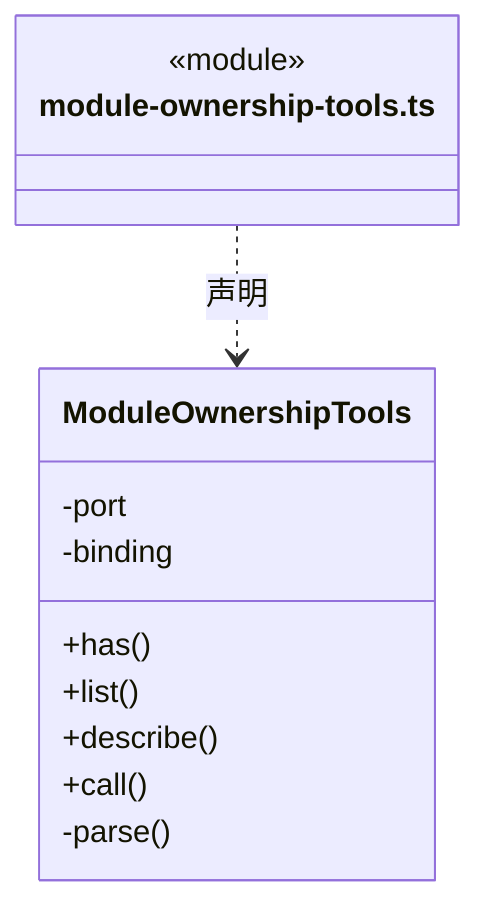

直接依赖：[../../core/tools/outcome.ts](../../core/tools/outcome.ts)、[../../core/foundation/errors.ts](../../core/foundation/errors.ts)、[../../core/tools/results.ts](../../core/tools/results.ts)、[../../core/tools/policy/tool-policy.ts](../../core/tools/policy/tool-policy.ts)、[../../core/workspace/module-ownership-rules.ts](../../core/workspace/module-ownership-rules.ts)、[../../core/workspace/module-ownership.ts](../../core/workspace/module-ownership.ts)、[../../core/workspace/module-ownership-tool-policy.ts](../../core/workspace/module-ownership-tool-policy.ts)、[../../core/workspace/module-ownership-tools.ts](../../core/workspace/module-ownership-tools.ts)。

### question-tools.ts

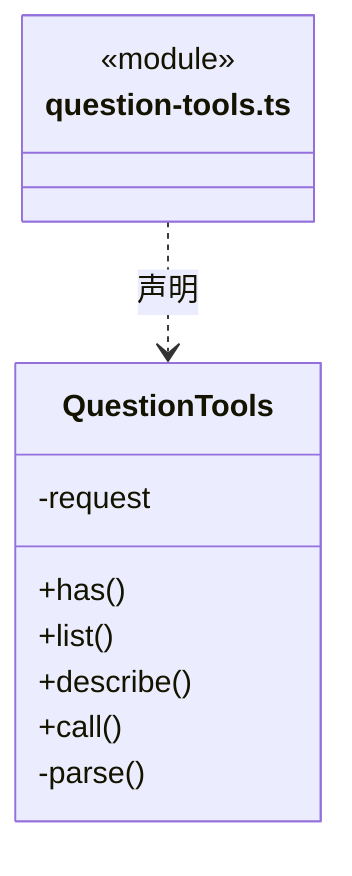

直接依赖：[../../core/tools/questions.ts](../../core/tools/questions.ts)、[../../core/tools/results.ts](../../core/tools/results.ts)、[../../core/tools/contracts.ts](../../core/tools/contracts.ts)、[../../core/tools/policy/tool-policy.ts](../../core/tools/policy/tool-policy.ts)、[../../core/foundation/errors.ts](../../core/foundation/errors.ts)。

### repository-tools.ts

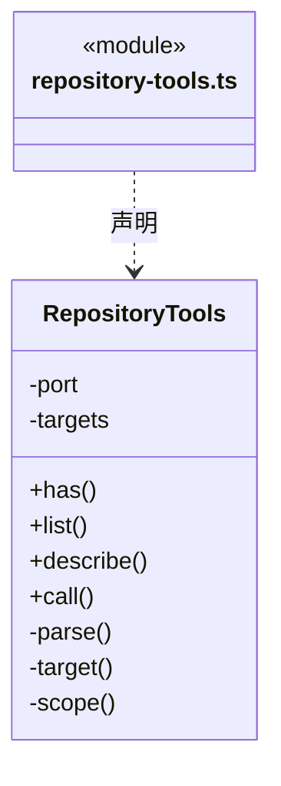

直接依赖：[../../core/foundation/errors.ts](../../core/foundation/errors.ts)、[../../core/tools/results.ts](../../core/tools/results.ts)、[../../core/tools/policy/tool-policy.ts](../../core/tools/policy/tool-policy.ts)、[../../core/connectors/repository-tools.ts](../../core/connectors/repository-tools.ts)。

### web-tools.ts

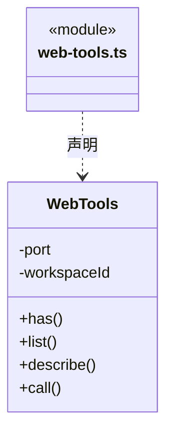

直接依赖：[../../core/connectors/web-tools.ts](../../core/connectors/web-tools.ts)、[../../core/tools/results.ts](../../core/tools/results.ts)、[../../core/tools/policy/tool-policy.ts](../../core/tools/policy/tool-policy.ts)。

### workspace-member-tools.ts

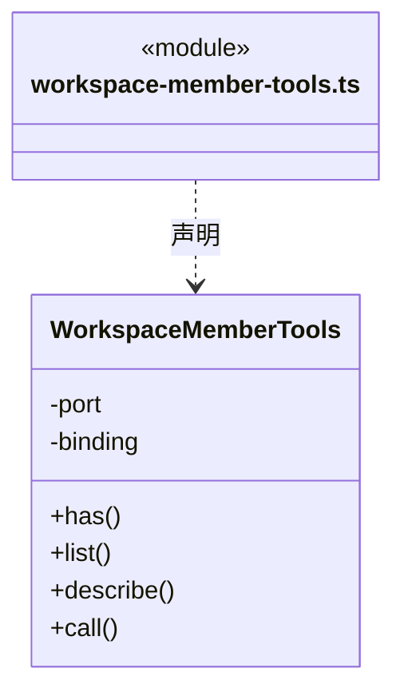

直接依赖：[../../core/tools/outcome.ts](../../core/tools/outcome.ts)、[../../core/foundation/errors.ts](../../core/foundation/errors.ts)、[../../core/tools/results.ts](../../core/tools/results.ts)、[../../core/tools/policy/tool-policy.ts](../../core/tools/policy/tool-policy.ts)、[../../core/team/workspace-member-rules.ts](../../core/team/workspace-member-rules.ts)、[../../core/team/workspace-member-tools.ts](../../core/team/workspace-member-tools.ts)。

### 本目录调用边界

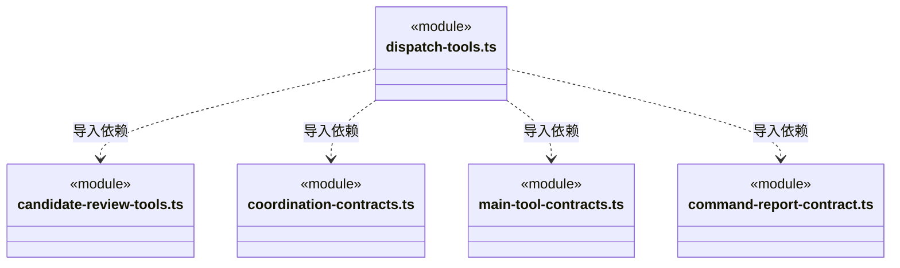

```mermaid
classDiagram
class N_src_backend_scheduler_engine_tools_dispatch_tools_ts["dispatch-tools.ts"] {
  <<module>>
}
class N_src_backend_scheduler_engine_tools_goal_tools_ts["goal-tools.ts"] {
  <<module>>
}
class N_src_backend_scheduler_engine_tools_coordination_contracts_ts["coordination-contracts.ts"] {
  <<module>>
}
class N_src_backend_scheduler_engine_tools_main_tool_contracts_ts["main-tool-contracts.ts"] {
  <<module>>
}
class N_src_backend_scheduler_engine_tools_knowledge_tools_ts["knowledge-tools.ts"] {
  <<module>>
}
class N_src_backend_scheduler_engine_tools_knowledge_contracts_ts["knowledge-contracts.ts"] {
  <<module>>
}
N_src_backend_scheduler_engine_tools_dispatch_tools_ts ..> N_src_backend_scheduler_engine_tools_goal_tools_ts : 导入依赖
N_src_backend_scheduler_engine_tools_goal_tools_ts ..> N_src_backend_scheduler_engine_tools_coordination_contracts_ts : 导入依赖
N_src_backend_scheduler_engine_tools_goal_tools_ts ..> N_src_backend_scheduler_engine_tools_main_tool_contracts_ts : 导入依赖
N_src_backend_scheduler_engine_tools_knowledge_tools_ts ..> N_src_backend_scheduler_engine_tools_knowledge_contracts_ts : 导入依赖
```


## 子目录导航

无子目录。

[返回上层](../ARCHITECTURE.md)。

每次修改本目录代码，同步维护文件头、关键契约说明及本图。未实现的治理、证据验收和自动编排能力不列入当前类图。

## 设计契约 v1 与落地范围

以下内容区分已接通能力与后续设计；以各节的实现状态为准，不将目标图当作现状图。维护源：[CONTRACT.md](CONTRACT.md)；生成类图时同步附加，勿直接修改本附录。

### 网页读取端口

WebTools 将可信主进程端口装为 cbim_web_fetch 与 cbim_web_search，分类为 read/workspace，严格解析输入并核对输出长度、查询与条数；单次调用无自动重试。仅桌面主会话装配，未配置 Brave 时搜索返回设置提示；读取网页不需要搜索密钥。资料不提升权限。

### 知识查询与刷新分别装配

`KnowledgeTools` 将只读注册表/详情交给 Core 的 `KnowledgeQueries`，将索引刷新交给 独立的 `KnowledgeRefresh.refresh`。查询门面不再拥有刷新能力；调用前的 Schema、实例身份、写授权、取消检查及调用后的唯一输出快照校验保持在原工具边界。公开工具名称、版本与恢复协议不变，不因为重构重放提交。具体依赖与事务所有者见 [知识契约](../../core/knowledge/CONTRACT.md#固定快照读取的逻辑边界与公共入口)。

### 项目根模块查询 v2

`cbim_module_registry` v2 始终返回独立的 `projectRoot`，搜索只筛选真实模块；`cbim_module_get` v2 可读取 `cbim:project` 的 builtin 定义及内联说明，不伪造 definitionFile。创建子模块不会令根范围消失；工具身份/版本、严格输出核验和知识路径保护不变。根查询不是正式委派资格，仍由派发服务核真实配置。

### 主会话 GitHub 反馈工具

`FeedbackTools` 只包装实际装配的可信端口。submit 输入按 BUG／需求分支严格解析，不接受仓库、地址、凭据或授权字段；receipt 无参数，只核实原提交。单次端口调用后校验唯一 JSON 快照，成功只含 submitted 与 operationId，坏输出不重发。目标和授权经 loop-engine 交统一策略；缺连接时不注册，成员／CLI 不继承，不混入知识工具目录。

模型公开 JSON Schema 与运行时均仅要求 `kind/summary`，补充字段可省略或空白；缺失主栏目的占位由 Core 统一生成。工具错误提示只指出真实格式/长度问题，不引导补齐所有栏目。此向后兼容的输入放宽保留 v1 的外部写身份、固定授权及原提交核实。

`FeedbackStatusTool` 独立提供主会话的 `cbim_feedback_status`；没有提交端口时仍可诊断。两项操作工具的装配事实来自实际 `FeedbackTools` 实例，本机连接事实来自注入的只读端口；没有诊断服务时明确报告组件未装配，端口异常不转换成未连接。输入只接受空对象，输出严格区分未连接、等待本机接收授权、已连接但本轮需更新、代际变化及故障。不刷新冻结目标，不读提交历史，不调用写端口。

诊断文案和反馈可用性判断独立于稳定的提交／去重机制；需要调整用户下一步提示时修改本工具及产品 Skill，不修改 GitHub 写入账本或 Pi 通用桥。变化频率目前来自本次缺陷和交互需求，未以提交次数证明长期稳定性。

### 主目标查询的活动输入

`cbim_goal_inspect` 的同一快照包含原 input、活动补充记录和等待 continuations。提示明确区分 pending/unknown 与已接收快照：接收后使用新 inputRevision 重规划，不把旧计划或已清除的 review 当成当前结论；未知时只查询原事实，不自动重派或声称完成。严格输出保持真实记录形状，不从工具成功回执推断用户验收或新增权限。

### 主调度模块治理工具

`GovernanceTools` 仅消费本轮真实主实例的独立端口，实际发现和调用 `cbim_governance_get/observe/propose/receipt` 四项，不混入知识 catalog，不注册保护登记、批准或实施。严格校验原始参数后才调用领域端口，模型不能提交 workspace/root/run/commandId/actor/权限或路径；可信 scope 固定为当前 knowledge，effects 逐项为 read/maintenance/preview/read，私有待办持久化不冒充正式知识写入。

每个工具仅执行一次领域操作，再通过 `checkedJsonToolResult` 核唯一 JSON 输出快照、真实身份和原请求选择；对同一编码文本检查 128 KiB 上限，不再序列化原对象或重试领域调用。输出失败不回显正文；写操作的错误附可信原 commandId 供只读核实，不能换 ID 重放。摘要最多最近20条并说明 total/truncated，原/新正文各限16 KiB UTF-8，只有 complete 携带全文；oversized 不带片段，不可据此完整替换。

`get` 的显式记录不存在即拒绝，不自动挑最新。`receipt` 限同根会话真实模型来源，未查到是 unknown。取消在持久化前检查，进入保存后不承诺撤销已发生的记录；治理回执不进入 TaskProgress、Workflow 或目标完成业务证据。

治理修订仍使用这四个工具。主模型读取显式源提案的真实反馈后，用新的观察和精确正文方案提交最多8条 `respondsToDecisionIds`；服务冻结来源且核实 current。get 显示当前/已替代状态和真实本机评价，模型不能提交 feedback/assessments、批准或实施。引用不是已回应，批准不是已理解；正文不需修改的纯解释仍为普通对话，不伪造正文差异来建立治理记录。

### 主调度资源仓库只读工具

`RepositoryTools` 只消费本轮可信捕获的 `RepositoryToolsPort`，注册 `cbim_repository_list/get` 两项真实只读工具；不并入 `cbim_knowledge_tool_catalog/describe` 的知识工具族。执行成员和没有端口的兼容装配不注册它们。工具描述提供有界目标名称/ID，资料正文、名称和目录都不构成新的指令或授权。

模型只能提供 connectorId、目录分页或明确资源/版本/正文分块参数；严格拒绝额外 URL、令牌、仓库身份、连接代际或授权字段。`describe` 同步核验参数并从私有目标表生成 `repository` scope，未授权 ID 在网络前拒绝。真实 `list/get` 交原捕获闭包，不重新选择当前共享来源。

领域执行一次后复用 `checkedJsonToolResult` 核唯一 JSON 快照，除 Core 输出形状外还核原 scope、请求版本、资源 ID、offset 与请求上限。输出无效不返回正文，也不自动重读；取消信号前后检查。最多 50 项目录摘要或 4096 个 Unicode codepoint，全文哈希和 totalCharacters 不会被分块哈希或末页标记替代。返回仅说明资料读取事实，不能充当工作区业务验证、文件采集或可恢复检查点依据。

### 当前知识与维护工具边界

知识接口先执行领域校验和授权，再由 `ToolRegistry.invokeResolved` 执行一次领域函数，并通过 Core `checkedJsonToolResult` 校验实际业务输出的唯一 JSON 快照。返回协议外壳仍由 Pi 桥 `validateToolResult` 核验。输出无效为 `TOOL_OUTPUT_INVALID`，不回显正文、不把空值解释为操作成功，也不回滚或重放已执行的领域操作。

`knowledge-contracts.ts` 为原有 26 个真实知识工具和两个发现工具逐一绑定 Core 输出 Schema 与恢复说明。所有服务生成的结构严格校验；原始 definition、people 和不可用引用保留诊断 JSON，不把 `structural:false` 或 `not_found` 改写成工具错误。元数据不替代输入校验、可信实例身份、read/ask/execute 权限或单次审批。

`cbim_knowledge_tool_catalog` 接收 workspaceId/instanceId，返回 `family:knowledge` 和实际 28 个条目的名称、可选描述、版本、副作用摘要，不一次灌入全部输出 Schema。`cbim_knowledge_tool_describe` 另接 name，按需返回该条目完整 inputSchema/outputSchema/version/effects/cancellation/recovery；只能描述实际知识注册项，未知名称拒绝，不包含原生、派发、外部链接器或凭据。查询自身也只返回有限 Schema，不执行被描述工具。

取消说明统一为 `preflight_only`：调用开始前检查信号，领域调用开始后不承诺打断或回滚。恢复说明按真实接口区分：普通查询 `read_again`；知识/移动/对象预览 `new_preview`（移动可能产生新 requestId，对象预览产生实例内 planId）；知识提交 `same_request` 且原 requestId/输入一致；对象提交 `same_plan`，不承诺后续清理警告逐字不变；知识刷新 `inspect_before_retry`；维护启动/取消 `query_task`。这些说明不是自动重试指令，返回丢失时不能换新 ID 代替未知提交，也不能把同 ID 当作跨实例授权。

`cbim_agent_registry` 的 `builtinAgents` 固定为空数组，不再公开内置默认执行角色。`cbim_agent_get` 查询 `cbim:executor` 返回 `AGENT_RETIRED`。未配置自定义负责 Agent 的模块由主 Agent 在当前会话执行，不创建 `.cbim/` 默认角色文件。

`cbim_rules_validate` 创建知识规则维护任务；`cbim_task_status/cbim_task_cancel` 只接受本工作区维护接口返回的 ID。对话任务、执行计划和团队派发任务不在其范围内，取消未知 ID 返回 `TASK_NOT_FOUND`。运行中的合法任务只是请求取消，已结束任务返回真实终态；这些工具不用于召唤成员或终止当前大脑。

### 成员派发工具适配契约

目标分工与 `cbim_dispatch_task` 的可选 `workflowSelections` 按模块显式选择实际挂载的流程；工具严格核对选择唯一且属于本次 moduleIds，再交服务解析真实知识。缺省保持首项行为，显式选择必须与目标计划一致。描述明确禁止借其他模块的流程、填写正文/版本或将已失效 ID 静默换成首项；这不新增工具或业务权限。

`cbim_goal_plan` 的主角色分工仍可绑定治理 moduleIds，但不得带 `workflowSelections`；工具在实际端口前拒绝，避免将未执行的业务流程包装为知识治理完成。执行角色选择规则不变。

当前适配器已实现 `cbim_dispatch_task`、`cbim_dispatch_inspect`、`cbim_dispatch_cancel`、`cbim_dispatch_replace_dependency`、`cbim_dispatch_add_dependency`、`cbim_dispatch_revise_dependencies`、`cbim_dispatch_resume` 和 `cbim_dispatch_abandon_checkpoint`。撤销、各类依赖变更、预约与放弃分别只有对应真实端口存在时注册；兼容装配不广告或接受不存在的能力。主 Agent 不能被派成独立成员；未配置自定义岗位的模块由主 Agent 在当前会话执行。派发给自定义岗位时必须显式提供当前 `ownerSelection` 与对应 `agentId`，失效配置不回退。执行成员没有派发、撤销、依赖修订、续执行预约或检查点放弃权，其他未实现名称不进入活动清单。

`DispatchTools` 可以通过第二个构造参数组合真实 `GoalTools`。缺省不注册任何目标工具，已有派发端口保持不变；组合后 list、has、describe、call 都按实际名称转交目标适配器，不因 `cbim_goal_` 前缀接受未知操作。

工具全部使用 `cbim_` 前缀，由内部 Loop 通过工具网关调用调度服务。`DispatchTools` 严格解析参数，拒绝额外身份、授权和状态字段；调用 ID 来自已通过一次性 gate 的桥元数据，缺少时拒绝，不能在模型参数或输入哈希中猜测。`dispatch` 仅可靠入队，主轮结束后启动与结果续跑由注入的调度服务负责；`inspect` 不启动、不重试、不确认收件。只有真实服务可用时才将 Schema 加入模型能力清单。

| 工具与状态 | 模型提交内容 | 服务返回内容 |
| --- | --- | --- |
| `cbim_dispatch_task`（当前） | 自定义负责岗位、moduleIds、ownerSelection、可选 workflowSelections、goal、acceptance、前置版本；拒绝 cbim:main 与已退役的 cbim:executor | taskId、messageId、图游标；本周期创建独立执行实例，不是执行结果 |
| `cbim_dispatch_inspect`（当前） | 可选本图 taskId，缺省查本图 | 经授权的任务/依赖/有效结果，不含其他成员私有上下文；当前不接收模型图游标 |
| `cbim_dispatch_cancel`（当前，未启动任务） | expectedGraphCursor 的 streamId/seq、targets 的 taskId/expectedRevision、reason | 当前周期明确集合的原子撤销回执；不自动扩展后继，不停止活动运行，不造候选或执行日志 |
| `cbim_dispatch_wait`（待实现） | 当前任务的 children（taskId + planRevision）与 reason | staged 等待提交；大脑安全让出执行槽后才切换 waiting |
| `cbim_dispatch_result`（待实现） | summary、evidenceRefs、limitations、预期计划版本 | staged 结果提交；安全结束并复核后才发布候选，不自动验收 |
| `cbim_dispatch_message`（待实现） | 同图接收成员、关联 taskId、question/answer 正文及 replyTo | 消息接收回执；不能通过聊天正文创建未登记任务 |
| `cbim_dispatch_revise`（待实现） | 本任务 expectedRevision、变更候选、reason | 修订回执或冲突；运行中影响范围的变更先停止旧范围执行 |

取消复用 Core `cancelQueuedTasksInputSchema`，禁止模型夹带 scope/run/command/权限/cascade。服务核实未领取、无运行和依赖后继；缺项或版本变化整批拒绝，错误不能被适配器包装成成功。可信调用 ID 与主运行共同生成稳定命令键，回执只证明待办已撤销。运行中取消、递归派发子树和任意依赖修订仍未通过此工具开放。

维护任务工具 `cbim_task_status/cancel` 与本组派发工具保持不同职责。派发/未启动撤销维护执行记录，查询是只读；均不直接签发成员业务写权限。主会话 read 模式可以登记只读委派、撤销自己的未启动任务，成员每次业务工具仍独立接受运行门禁；入队或撤销回执都不是业务完成证据。

### 主目标规划与审阅工具

`goal-tools.ts` 复用 Core `scope-goal.ts` 的 `goalPlanInputSchema` 和 `goalReviewInputSchema`，在权限描述与实际调用时分别严格校验，不复制领域 Schema，也不默默丢弃未知字段。只有主会话装配了目标服务端口时，以下三个工具才进入运行工具表；执行成员不获得它们。

| 工具 | 模型输入 | 实际语义 |
| --- | --- | --- |
| `cbim_goal_inspect` | 严格空对象 | 读取当前目标、版本和装配端返回的本图事实，不启动执行、不确认完成 |
| `cbim_goal_plan` | `expectedRevision` 与 Core 声明的目标、约束、验收项、分工和原因 | 保存计划候选；不派发成员、不改原始用户输入、不扩大权限 |
| `cbim_goal_review` | `expectedRevision` 与 Core 声明的检查、真实证据引用、缺口和下一步决定 | 保存审阅；`decision=complete` 仅申请当前主运行可靠结算后的门禁复核 |

`GoalToolsPort` 为只读 `binding` 加 `inspect()`、`plan(input, invocation)`、`review(input, invocation)`；`DispatchToolsPort` 同样要求绑定本轮 workspace/root/scope/run。构造时复制身份，`invocation` 只携带桥提供的 `toolCallId` 和 `AbortSignal`。持久化 commandId 由可信原 run/call 生成，模型不能夹带这些身份，也不能通过 approved、人工通过等字段签发批准。读取只声明 `read`，计划/审阅只声明 `maintenance`；工具描述不是业务写授权。缺失可信调用 ID、已取消调用、未知名称或非法输入均不得进入服务。

九项主工具统一经 `checkedJsonToolResult`：领域方法只执行一次，原始公开值只序列化一次，严格 Schema 及可信调用关联校验针对同一 wire；校验后发送原字符串，不使用解析结果裁剪、补默认值或二次编码。首次 await 前独立复制原请求，端口不能修改传入对象后与自身比较绕过输出核验。`main-tool-contracts.ts` 复用已存在的命令键算法，新增追加使用独立 `auto-add-dependency-` 域；输出的 commandId、根会话、scope/run、请求版本和操作对象按实际字段核对。续执行回执没有新 runId 或 commandId，不能添加这些字段冒称已经运行；完整图可保留同根历史周期。

`cbim_goal_inspect` 使用同一次权威存储读取的 scope 与 graph。公开 scope 保留原输入、计划、人工意见、等待和补充、只读核实与业务重规划的来源/权限/约束，剔除 recovery/replan 的私有原生上下文；公开 Schema 不接受未知字段。空值和损坏输出报告 `TOOL_OUTPUT_INVALID`，明确操作可能已发生，原已提交记录不回滚、不自动重试，也不把新模型调用当作原命令恢复。

九项工具的实际 list 条目含 outputSchema、version、effects、cancellation、recovery；它们不加入知识工具 catalog/describe。取消说明为 `preflight_only`：入口及服务支持的受理前边界可检查停止，已进入事务不承诺中断或回滚。查询可显式重新读取；写操作未知结果先查询现有事实，不能更换调用 ID 盲目再派发或决策。是否具备证据、是否存在在途执行、目标和知识版本是否有效仍由可信服务及主运行结算负责；输出结构通过不能签发业务完成或人工批准。

#### 未领取任务追加前置

`cbim_dispatch_add_dependency` 严格接收图/目标版本、source/target 节点及计划版本和 reason；可信 workspace/root/scope/run/call 注入独立命令键。effects 为 maintenance，preflight_only 不承诺提交后回滚，恢复方式为 inspect_before_retry。服务核实原两端和完整启用后继；成功回执的 trackedTaskIds 按图持久顺序，不要求 target 第一，也不携带伪造的来源结果。

回包损坏时保留真实已提交审计，抛 TOOL_OUTPUT_INVALID，不自动再加边。尚未到达服务的可信失败回执仍表示业务尝试，不能走普通聊天完成例外；调用成功仅是调度维护，所有 cbim_dispatch_ 回执仍不能作为业务完成证据。

`cbim_goal_*` 和派发、执行计划及交付候选工具一样，不进入 `TaskProgressTools` 的业务证据集合。知识治理可以引用主运行中实际成功的知识工具回执，无需伪造执行成员；主 Agent 的业务文件写入和命令权限仍保持拒绝。完整闭环与持久化完成门禁以 [execution 契约](../CONTRACT.md) 为准。

#### 未启动依赖替换工具

`cbim_dispatch_replace_dependency` 仅在装配可信主调度端口时可发现和调用，效果为 `maintenance`。输入严格限定图游标、目标版本、目标节点版本、旧依赖边版本、替代候选的节点/计划/run/result 引用及原因；workspace、root、scope、主 run 和幂等命令由运行闭包注入，不能由模型指定。缺调用 ID、已取消或 Schema 非法均不进入服务。

它只申请一次单条依赖替换，不复活旧成员、不递归派工、不改变权限、不证明业务完成。服务回执包含真实 `trackedTaskIds`，由协调器重新跟踪未启动下游；工具成功不代表下游已执行。端口前拒绝的可信回执也被主周期识别为业务尝试，不能按无计划普通聊天成功关闭。`cbim_dispatch_*` 仍排除在业务证据集合外。

#### 可信调用上下文

`cbim_dispatch_resume` 仅在主会话装配真实 resume 端口时注册，严格接收图/目标/任务版本、checkpointId 和 reason。scope、main run、command 与调用 ID 来自可信闭包；maintenance 回执仅表示一次原任务续执行已预约。工具不能指定路径、模型或权限，不启动引擎、不确认交付；原主轮结束后调度再次核实才可能领取。失败、取消、旧 help、跨周期和重启后检查点不能由此复活，普通成员没有该工具。

调度入口见 [execution](../CONTRACT.md)。主 Agent 是调度员及知识管理者：可直接调用 cbim_ 知识 CRUD，写入仍由 read/ask/execute、版本与事务校验；Team 主业务写/命令拒绝，Auto 主会话按原周期模式及本轮权限直接工作。派发工具绑定可信 workspaceId、rootSessionId、runId、toolCallId 和周期，模型不能指定实例或授权。主会话与图根共享实例，业务任务使用独立执行实例。治理与业务验收的人工决定不能由模型签署。

commandId 由工具网关把当前可信 runId/toolCallId 映射到持久化调用键；同一次工具调用的重发沿用原键，不重新创建节点。模型再次主动调用产生新请求，工具返回已有节点帮助其判断，不用目标文本相似度擅自合并不同任务。内部系统事实也使用稳定来源事件键，避免重启后重复投影。

适配器只校验/转换输入和输出，任务不变量、状态迁移、权限与版本规则归调度/Core。派发和消息工具受策略控制，结果写入必须来自绑定的责任成员与当前运行。用户的“本次任务全部通过”只在现有授权生命周期内生效，不传播到新成员任务。

`cbim_dispatch_wait` 登记等待后不无限挂起工具 Promise 占住成员槽；需大脑适配器明确支持在安全片段边界停止本轮并回传等待事实。未接通此能力前不把 wait 工具交给模型。任务分析可使用现有知识查询，但正式 dispatch 缺模块/维护关系时返回结构化 gap，禁止伪造成已派发。

#### 目标结构类图（待实现）

```mermaid
classDiagram
class DispatchToolAdapter { <<planned>> }
class TrustedRunContext { <<contract>> }
class AgentDispatchService { <<scheduler boundary>> }
class ToolPolicy { <<core boundary>> }
DispatchToolAdapter ..> TrustedRunContext : 注入身份与幂等键
DispatchToolAdapter ..> ToolPolicy : 按作用域授权
DispatchToolAdapter ..> AgentDispatchService : 提交请求
```

验证须覆盖伪造身份/审批拒绝、工具重发不重复派发、过期版本、成员读模式写拒绝、接收确认与业务结果区分、无实现不注册。工具测试通过也不替代真实多成员大脑运行验收。
# 已消费人工意见的目标引用

`cbim_goal_review` 的人工证据仅支持 `{kind:human-decision,decisionId,continuationId}`，只用于当前输入版本已实际消费的 accept 对应 human satisfied。模型没有保存或继续人工决定的工具。负面决定只通过 `superseded.humanDecision` 溯源，必须由接续后新任务补做；需要新人工意见时仍引用真实 member-result 并等待。工具回执不等于决定或目标已完成，最终仍由运行结算门禁复核主体、日志、知识和选定文件。
### 结构化提问工具包装

`QuestionTools` 仅在真实用户交互端口存在时提供 `cbim_ask_user_question`，不加入知识工具目录。list、describe 和 call 共用严格输入；分类仍为 read，不扩大主或成员权限，也不触发工具审批。元数据公开真实输出 Schema、等待期间可取消及先核实后重试的限制。

调用前独立冻结已解析原题，传给端口的对象变异不能改变核验依据。领域等待只调用一次，结果沿 `checkedJsonToolResult` 单次编码、校验原 wire 并直接发送，保持 answers 或 cancelled 形状，不补用户、批准或运行身份。用户回答已消费后发生 `TOOL_OUTPUT_INVALID` 仍不回滚、不重新弹题、不自动重复请求；输出异常不泄露正文。

### 模块岗位负责人主工具

`ModuleOwnershipTools` 只在真实主周期端口存在时注册 `cbim_module_owner_inspect/change_preview/change_commit/receipt`，不进入共享知识目录或成员工具集合。inspect 支持岗位摘要发现、明确模块查询及岗位反查，分页最多 20 项并校验原选择/游标；不返回能力正文或凭据。change_commit 的 knowledge-write 效果沿既有 read/ask/execute 授权，不把预览 basis 当成批准。

raw 输入在任何领域调用前严格校验；发送端口的对象与原期望独立克隆。结果只执行一次 JSON 编码，在同一 wire 校验身份、原输入、游标、关系动作和真实主 actor，之后发送原编码文本，最多 128 KiB。新读写必须匹配当前 instanceId，原回执查询可返回同主根旧实例记录。提交后坏输出或停止不撤销原审计；安全错误保留稳定 commandId，恢复只查询原命令，不自动重写。

### 模块来源明确采纳

责任工具的原严格 change 协议增加 `kind:adopt_source`，只带原绑定、模块和理由，不接 nextOwner/来源证明；由真实主工厂复用服务采纳当前来源。唯一输出 wire 核 action=adopt_source、原负责人和原 bindingId，不能把缺省 nextOwner 误判为解除。权限仍为原 knowledge-write，回执仍排除业务验收，未知后只查原 commandId。

岗位进入执行后，明确模块 inspect 另返回按真实岗位分组的执行选择与缺口，选择不保证未来领取、凭据或供应商可用。未指定自定义岗位或旧内置执行者归 execution=main，不伪造 ownerSelection。自定义岗位必须携带精确 selection；服务重建 ownerBinding，不能靠模型声明身份或主模型选型补齐。工具仍在唯一 wire 校验实际输入/绑定，保存后坏回包不得重新派工。

### 检查点交接放弃

`cbim_dispatch_abandon_checkpoint` 仅在主调度装配真实端口时注册，effects 为 maintenance，取消说明为受理前检查，未知结果先 inspect 原任务的 checkpointAbandonment。请求明确图/目标/任务/计划/检查点版本及可空的原恢复预约 ID；workspace/root/scope/run/command 从可信闭包取得。独立冻结输入后才调用服务，回执只编码一次并核原身份和审计，不因输出错误重新放弃。回执不能用作业务或人工验收证据，不证明已回滚、迁移或执行新任务。
### 原主命令核实工具

`cbim_dispatch_command_report` 仅在真实主运行的可选只读端口存在时注册，严格参数只有 runId/toolCallId；可信闭包固定 workspace/root，与桌面报告使用同一服务。read 效果不触发写审批，没有写 commandId、不改变 Auto.workRequested；dispatch 前缀继续排除业务证据。输入在 await 前独立冻结，结果沿唯一 JSON wire 严格核原选择与主身份并限制 128 KiB UTF-8；坏输出不查询第二次、不执行原工具。九项写工具的 recovery.queryTool 指向此报告，原指纹构造由 main-command-request 与提交方共用，查询自身没有写命令映射。


### 知识提交原输入复原

cbim_knowledge_commit、知识预览与 cbim_object_commit 使用 Core 的共享输入定义。字段顺序和既有 strip 语义不变，真实执行仍由当前实例和一次性权限门禁控制；历史观察仅复原同一解析后的原请求，不能借共享 Schema 调用写入口或获得授权。

### 刷新原事务与契约版本

cbim_knowledge_refresh 实际注册 v2，要求 revision/requestId，恢复元数据 same_request；新调用缺字段在授权/执行前拒绝，不再内部生成随机 ID。其它知识工具保持 v1。describe 从实际条目返回 contractVersion，领域只执行一次，坏回包不重发。

## 多边前置修订工具（Step42）

cbim_dispatch_revise_dependencies 仅在主实例 reviseDependencies 真实端口存在时公开。严格输入是 expectedGraphCursor/expectedGoalRevision、target、remove、add、reason，不接工作区/actor/权限/结果；effects=maintenance，v1，preflight_only，inspect_before_retry 指向原命令报告。唯一 wire 比较原请求、身份、命令、图后继、增删来源与原闭包，端口修改参数不能改变校验依据。输出失败不回滚原事务，不换键重做；成员没有本能力。

#### 已放弃检查点的单条替换

cbim_dispatch_replace_dependency 的原严格输入/wire/维护契约不变，来源资格扩展为已经通过 abandon_checkpoint 明确放弃的可靠检查点；普通取消、未放弃、已续执行或未知来源不具资格。实际工具描述明确原日志、证明及信封完整、新候选和当前后继绑定。回包损坏仍只核原命令，不重新放弃或换边。

## 审阅的成员等待清单

cbim_goal_review 的严格输入增加可选 memberPause；仅 awaiting_user 接受，逐项记录 checkpoint/unstarted、task及plan版本、原检查点ID和图游标。工具描述解释全量保留与用户明确继续；原 wire 输出核完整清单与原请求一致，省略、替换或损坏回包拒绝，不重做已提交审阅。其余工具名、调用键和维护效果不变，原命令报告继续按完整原请求核实。

cbim_dispatch_resume 只预约同任务最新未消费检查点；每任务最多16段，每段一个信封。输入仍为当前图/目标/任务版本和真实 checkpointId，不新增由模型指定的运行、原生路径或额度字段。


### 自动与团队协作模式

GoalTools / DispatchTools 的 collaborationMode 来自可信 Cycle，默认 Team；仅 Auto 的计划及派发 Schema 容许缺 ownerSelection，服务与 Store 仍校验资格。模型输入没有模式、兜底证明或模型配置字段。自动回执保持 fallbackBinding 与原 scope/agent/module 对应，未知结果不重新执行。

### 真人花名册退役

KnowledgeTools 与知识协议目录同步移除 cbim_people_list，不再公开 people-schema。角色查询保留 authorPeople 空数组兼容旧响应；能力、岗位负责人和模型的查询及授权保持独立。

### 对象预览 v2

cbim_object_preview 的 data 按 kind 判别，模块中文名必须写在 body 的 H1，结构化 name 来自 slug。工具发现与实际入口使用同一 Schema，既有实例、版本、事务和逐次写权限不变。

对象预览的工具描述和字段 Schema 共同公开根 ID、顺序父子创建及正文约束；structural:false 返回全部校验问题，不冒充执行异常。知识提交回执与业务目标验收分别解释。

模块负责人 inspect 公开四级优先级及 matches 输入：LLM 分析由当前主 Agent 完成，返回的选择才用于新目标和派发；静态 Agent、岗位与运行身份不互换。
## 岗位治理工具

WorkspaceMemberTools 注册 cbim_member_inspect/change_preview/change_commit/receipt，输入拒绝身份、凭据及模型选型，输出严格核对工作区、原选择、命令与预览依据，128 KiB 上限。提交错误携带原 commandId，回包丢失或停止不能自动重放；能力采纳与模块来源 adopt_source 不是同一操作。

### 主运行规范入口与只读预览

`CoordinationTools` 仅组合实际装配的只读工具：cbim_state_inspect 的 state 一次返回 scope/graph 和 versions（goalRevision、planRevision、graphCursor、所有任务 revision、当前周期候选证据）；task/owner/member/governance 分别委托原端口，不伪称跨知识、模型和 Store 的原子快照。cbim_receipt_inspect 按 dispatch/owner/member/governance 选择原回执，保留原身份约束和 unknown/absent。没有任意工具名路由；旧族目录标为兼容，不更改历史指纹。

组合目录将每份独立 input Schema 的本地 `#` / `#/…` 引用重定位到实际 `oneOf/<index>/properties/input`，索引按本轮已装配路由计算。原兼容工具目录保持独立且不被改写；真实调用继续由原端口做严格输入和只读权限校验。目录回归编译实际负责人 Schema，并校验真实 Pi 请求中的组合目录，防止模型供应商在首次请求时因悬空引用返回 400。

cbim_dispatch_cancel 增加 includeClosure:true；cbim_goal_review 的 {decision:awaiting_user,memberPause:{includeClosure:true}} 只读预览。两者返回需确认的完整清单和 issues，不提交/启动；去掉预览参数后按原完整写协议提交，版本竞争继续拒绝。只有真实端口装配才公开该 Schema 分支；预览输出核对本轮归属。

调度/目标、岗位、责任、治理的未知写错误附统一回执地址与原命令/调用，供只读核实，不自动重做。普通对象维护规范入口为 object_preview/commit，底层 knowledge_preview/commit 标为文件事务兼容；goal_plan/review 是主周期目标，task_plan/step 是运行内步骤，不能互代。


## 主 Agent 候选审阅工具

CandidateReviewTools 由 AutoCollaboration 向主运行装配 cbim_dispatch_review，输入精确 taskId/expectedRevision/resultId、accept|reject 和理由。回执须通过 TaskNodeSchema 并匹配冻结的工作区、主会话、周期、主 run 以及原请求；坏回包只报告未知，不重试。结果不明确时以 cbim_dispatch_inspect 只读核实原任务 candidateReview。成员工具目录不装配此入口，成功只代表审阅已保存，不表示后继已执行。


## 当前工作区身份的缺省语义

KnowledgeTools 的身份查询与身份默认值共用 currentIdentity：先 workspace.assert 核实本服务绑定实例，再取得 workspaceId/instanceId。知识工具 Schema 中这两个字段允许省略，解析时自动使用当前绑定；不会创建第二次模型工具调用或伪造查询事件，运行适配在 proposed 前冻结解析后的生效参数；有差异时另存 originalInput，原模型输入仍保留。显式旧 ID、其它工作区、null、空值仍校验并拒绝，不换绑也不自动重试。查询列表不要求可选 query；revision/requestId/planId 等业务字段按原 Schema 保持必填或可选，写入仍需原运行授权。其它有独立身份语义的成员、派发和治理工具不借此补业务身份。
