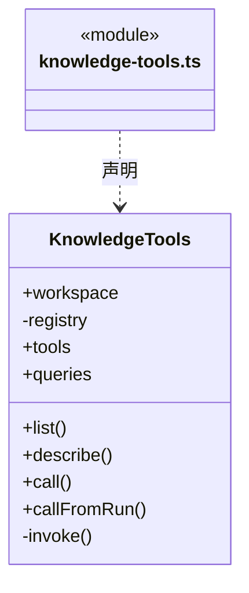

# src/backend/scheduler-engine/tools 架构

## 目录定位

把 Core 知识能力暴露为 cbim_ 工具。内置 Loop 与可选 MCP 复用参数、身份和领域检查；内部 Loop 使用单次 gate 授权，外部 MCP 仍核验写凭据与实例开关。返回结果须通过统一协议校验；维护任务 ID 与对话、成员派发任务区分，取消未知 ID 明确报错。

本文描述当前实现。通过分析目录边界后维护的 [源码架构脚本](../../../../scripts/source-architecture.mjs) 同步清单和声明；代码变更时仍须核对职责、关键成员与关系。

## 代码清单

| 文件 | 当前职责 |
| --- | --- |
| [knowledge-tools.ts](knowledge-tools.ts) | 调度层知识工具适配，向内部大脑和可选 MCP 暴露相同工具。 |

## 架构类图

### knowledge-tools.ts

直接依赖：[../../core/tools/registry.ts](../../core/tools/registry.ts)、[../../core/knowledge/ports.ts](../../core/knowledge/ports.ts)、[../../core/foundation/errors.ts](../../core/foundation/errors.ts)、[../../core/knowledge/builtins.ts](../../core/knowledge/builtins.ts)、[../../core/knowledge/knowledge-queries.ts](../../core/knowledge/knowledge-queries.ts)、[../../core/knowledge/object-crud.ts](../../core/knowledge/object-crud.ts)、[../../core/tools/types.ts](../../core/tools/types.ts)、[../../core/tools/results.ts](../../core/tools/results.ts)。

## 子目录导航

无子目录。

[返回上层](../ARCHITECTURE.md)。

每次修改本目录代码，同步维护文件头、关键契约说明及本图。未实现的治理、证据验收和自动编排能力不列入当前类图。

## 设计契约 v1 与落地范围

以下内容区分已接通能力与后续设计；以各节的实现状态为准，不将目标图当作现状图。维护源：[CONTRACT.md](CONTRACT.md)；生成类图时同步附加，勿直接修改本附录。

### 当前知识与维护工具边界

知识接口先执行领域校验和授权，再通过 Core 的 `jsonToolResult/validateToolResult` 返回有效文本协议。无效返回值明确失败，不把空值解释为操作成功；输出校验不回滚或重放已执行的领域操作。

`cbim_rules_validate` 创建知识规则维护任务；`cbim_task_status/cbim_task_cancel` 只接受本工作区维护接口返回的 ID。对话任务、执行计划和团队派发任务不在其范围内，取消未知 ID 返回 `TASK_NOT_FOUND`。运行中的合法任务只是请求取消，已结束任务返回真实终态；这些工具不用于召唤成员或终止当前大脑。
