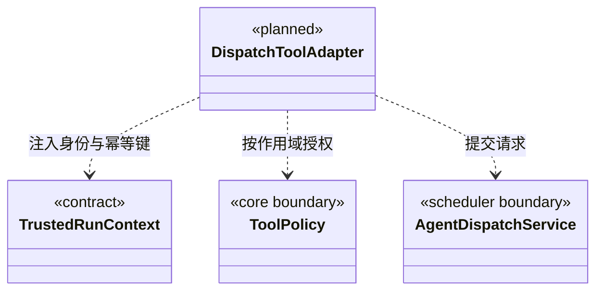

### 当前知识与维护工具边界

知识接口先执行领域校验和授权，再通过 Core 的 `jsonToolResult/validateToolResult` 返回有效文本协议。无效返回值明确失败，不把空值解释为操作成功；输出校验不回滚或重放已执行的领域操作。

`cbim_rules_validate` 创建知识规则维护任务；`cbim_task_status/cbim_task_cancel` 只接受本工作区维护接口返回的 ID。对话任务、执行计划和团队派发任务不在其范围内，取消未知 ID 返回 `TASK_NOT_FOUND`。运行中的合法任务只是请求取消，已结束任务返回真实终态；这些工具不用于召唤成员或终止当前大脑。

### 成员派发工具适配契约

状态：工具设计，尚未注册。现有知识工具与 `cbim_task_plan / cbim_task_inspect / cbim_task_step / cbim_delivery_prepare` 的任务内进度语义继续保留；不能把同名旧工具静默切换成跨成员派发工具。

后续工具全部使用 `cbim_` 前缀，由内部 Loop 通过工具网关调用调度服务。只有真实服务可用时才将 Schema 加入模型能力清单，文档中的设计名称不作为可调用占位工具。

| 拟定工具 | 模型提交内容 | 服务返回内容 |
| --- | --- | --- |
| `cbim_dispatch_task` | 接收 agentId、moduleIds、goal、acceptance、前置任务版本 | 可靠派发回执、taskId、messageId、图游标；不是执行结果 |
| `cbim_dispatch_inspect` | 本图 taskId 或游标 | 经授权的任务/依赖/有效结果或增量，不含其他成员私有上下文 |
| `cbim_dispatch_wait` | 当前任务的 children（taskId + planRevision）与 reason | staged 等待提交；大脑安全让出执行槽后才切换 waiting |
| `cbim_dispatch_result` | summary、evidenceRefs、limitations、预期计划版本 | staged 结果提交；安全结束并复核后才发布候选，不自动验收 |
| `cbim_dispatch_message` | 同图接收成员、关联 taskId、question/answer 正文及 replyTo | 消息接收回执；不能通过聊天正文创建未登记任务 |
| `cbim_dispatch_revise` | 本任务 expectedRevision、变更候选、reason | 修订回执或冲突；运行中影响范围的变更先停止旧范围执行 |
| `cbim_dispatch_cancel` | taskId、expectedRevision、self/subtree 取消范围、reason | 取消请求/停止跟踪，不伪造已停止或回滚 |

维护任务工具 `cbim_task_status/cancel` 与本组派发工具也保持不同职责。待实现的 `cbim_dispatch_*` 契约由本组适配器拥有；已有工具的实际清单仍以运行注册表为准。

#### 可信调用上下文

调度入口见 [execution](../execution/CONTRACT.md)。workspaceId、rootSessionId、requester、agentInstanceId、agentSessionId、runId、leaseEpoch、permissionSnapshotId 均从运行绑定注入，不由模型提供；taskId 仅业务任务执行时存在。主会话分析和首次派发使用 conversation 绑定，不伪造 TaskNode；wait/result 工具仅向 task 绑定开放。模型不能用参数冒充他人、伪造维护关系、修改状态或签署人工批准。

commandId 由工具网关把当前可信 runId/toolCallId 映射到持久化调用键；同一次工具调用的重发沿用原键，不重新创建节点。模型再次主动调用产生新请求，工具返回已有节点帮助其判断，不用目标文本相似度擅自合并不同任务。内部系统事实也使用稳定来源事件键，避免重启后重复投影。

适配器只校验/转换输入和输出，任务不变量、状态迁移、权限与版本规则归调度/Core。派发和消息工具受策略控制，结果写入必须来自绑定的责任成员与当前运行。用户的“本次任务全部通过”只在现有授权生命周期内生效，不传播到新成员任务。

`cbim_dispatch_wait` 登记等待后不无限挂起工具 Promise 占住成员槽；需大脑适配器明确支持在安全片段边界停止本轮并回传等待事实。未接通此能力前不把 wait 工具交给模型。任务分析可使用现有知识查询，但正式 dispatch 缺模块/维护关系时返回结构化 gap，禁止伪造成已派发。

#### 目标结构类图（待实现）

验证须覆盖伪造身份/审批拒绝、工具重发不重复派发、过期版本、读模式写拒绝、接收确认与业务结果区分、无实现不注册。工具测试通过也不替代真实多成员大脑运行验收。
