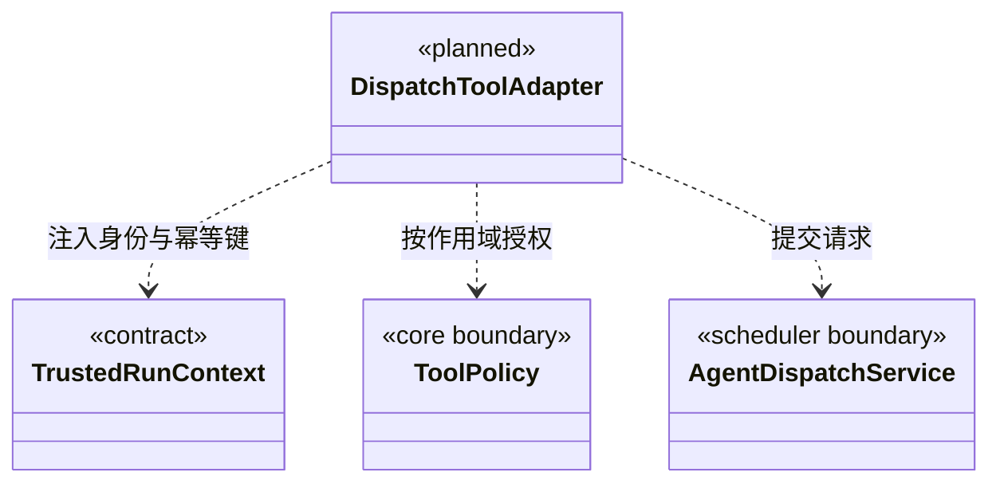

### 当前知识与维护工具边界

知识接口先执行领域校验和授权，再由 `ToolRegistry.invokeResolved` 执行一次领域函数，并通过 Core `checkedJsonToolResult` 校验实际业务输出的唯一 JSON 快照。返回协议外壳仍由 Pi 桥 `validateToolResult` 核验。输出无效为 `TOOL_OUTPUT_INVALID`，不回显正文、不把空值解释为操作成功，也不回滚或重放已执行的领域操作。

`knowledge-contracts.ts` 为原有 26 个真实知识工具和两个发现工具逐一绑定 Core 输出 Schema 与恢复说明。所有服务生成的结构严格校验；原始 definition、people 和不可用引用保留诊断 JSON，不把 `structural:false` 或 `not_found` 改写成工具错误。元数据不替代输入校验、可信实例身份、read/ask/execute 权限或单次审批。

`cbim_knowledge_tool_catalog` 接收 workspaceId/instanceId，返回 `family:knowledge` 和实际 28 个条目的名称、可选描述、版本、副作用摘要，不一次灌入全部输出 Schema。`cbim_knowledge_tool_describe` 另接 name，按需返回该条目完整 inputSchema/outputSchema/version/effects/cancellation/recovery；只能描述实际知识注册项，未知名称拒绝，不包含原生、派发、外部链接器或凭据。查询自身也只返回有限 Schema，不执行被描述工具。

取消说明统一为 `preflight_only`：调用开始前检查信号，领域调用开始后不承诺打断或回滚。恢复说明按真实接口区分：普通查询 `read_again`；知识/移动/对象预览 `new_preview`（移动可能产生新 requestId，对象预览产生实例内 planId）；知识提交 `same_request` 且原 requestId/输入一致；对象提交 `same_plan`，不承诺后续清理警告逐字不变；知识刷新 `inspect_before_retry`；维护启动/取消 `query_task`。这些说明不是自动重试指令，返回丢失时不能换新 ID 代替未知提交，也不能把同 ID 当作跨实例授权。

`cbim_agent_registry` 的 `builtinAgents` 公开应用静态默认执行角色 `cbim:executor`，与项目注册的 `groups` 分开，关键词同时过滤两者；`cbim_agent_get` 接受该 ID，返回静态定义、执行原则和当前 Team 根继承的 Skill。正文装配与正式派发共用 `defaultExecutorConfiguration`，不创建或修改 `.cbim/` 文件，也不把该静态角色当作已经存在的动态执行实例。默认角色同样需要真实模块、维护关系和本模块 Workflow。

`cbim_rules_validate` 创建知识规则维护任务；`cbim_task_status/cbim_task_cancel` 只接受本工作区维护接口返回的 ID。对话任务、执行计划和团队派发任务不在其范围内，取消未知 ID 返回 `TASK_NOT_FOUND`。运行中的合法任务只是请求取消，已结束任务返回真实终态；这些工具不用于召唤成员或终止当前大脑。

### 成员派发工具适配契约

当前适配器已实现 `cbim_dispatch_task`、`cbim_dispatch_inspect`，以及装配 `cancel` 端口后的 `cbim_dispatch_cancel`。只在可信主调度会话注册；没有取消服务的兼容装配不会广告或接受该工具。主 Agent 永远不能成为执行者；省略 agentId 使用静态默认执行角色 `cbim:executor`。执行成员没有派发或取消调度任务权。其余 `cbim_dispatch_*` 为待实现契约，不进入活动工具清单。

`DispatchTools` 可以通过第二个构造参数组合真实 `GoalTools`。缺省不注册任何目标工具，已有派发端口保持不变；组合后 list、has、describe、call 都按实际名称转交目标适配器，不因 `cbim_goal_` 前缀接受未知操作。

工具全部使用 `cbim_` 前缀，由内部 Loop 通过工具网关调用调度服务。`DispatchTools` 严格解析参数，拒绝额外身份、授权和状态字段；调用 ID 来自已通过一次性 gate 的桥元数据，缺少时拒绝，不能在模型参数或输入哈希中猜测。`dispatch` 仅可靠入队，主轮结束后启动与结果续跑由注入的调度服务负责；`inspect` 不启动、不重试、不确认收件。只有真实服务可用时才将 Schema 加入模型能力清单。

| 工具与状态 | 模型提交内容 | 服务返回内容 |
| --- | --- | --- |
| `cbim_dispatch_task`（当前） | 自定义执行角色或默认 cbim:executor、moduleIds、goal、acceptance、前置版本；拒绝 cbim:main | taskId、messageId、图游标；本周期创建独立执行实例，不是执行结果 |
| `cbim_dispatch_inspect`（当前） | 可选本图 taskId，缺省查本图 | 经授权的任务/依赖/有效结果，不含其他成员私有上下文；当前不接收模型图游标 |
| `cbim_dispatch_cancel`（当前，未启动任务） | expectedGraphCursor 的 streamId/seq、targets 的 taskId/expectedRevision、reason | 当前周期明确集合的原子撤销回执；不自动扩展后继，不停止活动运行，不造候选或执行日志 |
| `cbim_dispatch_wait`（待实现） | 当前任务的 children（taskId + planRevision）与 reason | staged 等待提交；大脑安全让出执行槽后才切换 waiting |
| `cbim_dispatch_result`（待实现） | summary、evidenceRefs、limitations、预期计划版本 | staged 结果提交；安全结束并复核后才发布候选，不自动验收 |
| `cbim_dispatch_message`（待实现） | 同图接收成员、关联 taskId、question/answer 正文及 replyTo | 消息接收回执；不能通过聊天正文创建未登记任务 |
| `cbim_dispatch_revise`（待实现） | 本任务 expectedRevision、变更候选、reason | 修订回执或冲突；运行中影响范围的变更先停止旧范围执行 |

取消复用 Core `cancelQueuedTasksInputSchema`，禁止模型夹带 scope/run/command/权限/cascade。服务核实未领取、无运行和依赖后继；缺项或版本变化整批拒绝，错误不能被适配器包装成成功。可信调用 ID 与主运行共同生成稳定命令键，回执只证明待办已撤销。运行中取消、递归派发子树和任意依赖修订仍未通过此工具开放。

维护任务工具 `cbim_task_status/cancel` 与本组派发工具保持不同职责。派发/未启动撤销维护执行记录，查询是只读；均不直接签发成员业务写权限。主会话 read 模式可以登记只读委派、撤销自己的未启动任务，成员每次业务工具仍独立接受运行门禁；入队或撤销回执都不是业务完成证据。

### 主目标规划与审阅工具

`goal-tools.ts` 复用 Core `scope-goal.ts` 的 `goalPlanInputSchema` 和 `goalReviewInputSchema`，在权限描述与实际调用时分别严格校验，不复制领域 Schema，也不默默丢弃未知字段。只有主会话装配了目标服务端口时，以下三个工具才进入运行工具表；执行成员不获得它们。

| 工具 | 模型输入 | 实际语义 |
| --- | --- | --- |
| `cbim_goal_inspect` | 严格空对象 | 读取当前目标、版本和装配端返回的本图事实，不启动执行、不确认完成 |
| `cbim_goal_plan` | `expectedRevision` 与 Core 声明的目标、约束、验收项、分工和原因 | 保存计划候选；不派发成员、不改原始用户输入、不扩大权限 |
| `cbim_goal_review` | `expectedRevision` 与 Core 声明的检查、真实证据引用、缺口和下一步决定 | 保存审阅；`decision=complete` 仅申请当前主运行可靠结算后的门禁复核 |

`GoalToolsPort` 为 `inspect()`、`plan(input, invocation)`、`review(input, invocation)`；`invocation` 只携带桥提供的 `toolCallId` 和 `AbortSignal`。workspace、rootSession、scope、run 和持久化 commandId 由装配闭包绑定，模型不能夹带这些身份，也不能通过 approved、人工通过等字段签发批准。读取只声明 `read`，计划/审阅只声明 `maintenance`；工具描述不是业务写授权。缺失可信调用 ID、已取消调用、未知名称或非法输入均不得进入服务。

工具适配器只返回实际服务结果，统一经 `jsonToolResult` 序列化；不将空值、领域失败或缺失返回值包装为完成。是否具备证据、是否存在在途执行、目标和知识版本是否有效由可信目标服务及主运行结算负责。工具当前仍在执行时，不能要求该主 run 已是 completed；也不能把审阅调用成功当成关闭周期或人工验收。

`cbim_goal_*` 和派发、执行计划及交付候选工具一样，不进入 `TaskProgressTools` 的业务证据集合。知识治理可以引用主运行中实际成功的知识工具回执，无需伪造执行成员；主 Agent 的业务文件写入和命令权限仍保持拒绝。完整闭环与持久化完成门禁以 [execution 契约](../execution/CONTRACT.md) 为准。

#### 未启动依赖替换工具

`cbim_dispatch_replace_dependency` 仅在装配可信主调度端口时可发现和调用，效果为 `maintenance`。输入严格限定图游标、目标版本、目标节点版本、旧依赖边版本、替代候选的节点/计划/run/result 引用及原因；workspace、root、scope、主 run 和幂等命令由运行闭包注入，不能由模型指定。缺调用 ID、已取消或 Schema 非法均不进入服务。

它只申请一次单条依赖替换，不复活旧成员、不递归派工、不改变权限、不证明业务完成。服务回执包含真实 `trackedTaskIds`，由协调器重新跟踪未启动下游；工具成功不代表下游已执行。端口前拒绝的可信回执也被主周期识别为业务尝试，不能按无计划普通聊天成功关闭。`cbim_dispatch_*` 仍排除在业务证据集合外。

#### 可信调用上下文

`cbim_dispatch_resume` 仅在主会话装配真实 resume 端口时注册，严格接收图/目标/任务版本、checkpointId 和 reason。scope、main run、command 与调用 ID 来自可信闭包；maintenance 回执仅表示一次原任务续执行已预约。工具不能指定路径、模型或权限，不启动引擎、不确认交付；原主轮结束后调度再次核实才可能领取。失败、取消、旧 help、跨周期和重启后检查点不能由此复活，普通成员没有该工具。

调度入口见 [execution](../execution/CONTRACT.md)。主 Agent 是调度员及知识管理者：可直接调用 cbim_ 知识 CRUD，写入仍由 read/ask/execute、版本与事务校验；主业务写/命令始终拒绝。派发工具绑定可信 workspaceId、rootSessionId、runId、toolCallId 和周期，模型不能指定实例或授权。主会话与图根共享实例，业务任务使用独立执行实例。治理与业务验收的人工决定不能由模型签署。

commandId 由工具网关把当前可信 runId/toolCallId 映射到持久化调用键；同一次工具调用的重发沿用原键，不重新创建节点。模型再次主动调用产生新请求，工具返回已有节点帮助其判断，不用目标文本相似度擅自合并不同任务。内部系统事实也使用稳定来源事件键，避免重启后重复投影。

适配器只校验/转换输入和输出，任务不变量、状态迁移、权限与版本规则归调度/Core。派发和消息工具受策略控制，结果写入必须来自绑定的责任成员与当前运行。用户的“本次任务全部通过”只在现有授权生命周期内生效，不传播到新成员任务。

`cbim_dispatch_wait` 登记等待后不无限挂起工具 Promise 占住成员槽；需大脑适配器明确支持在安全片段边界停止本轮并回传等待事实。未接通此能力前不把 wait 工具交给模型。任务分析可使用现有知识查询，但正式 dispatch 缺模块/维护关系时返回结构化 gap，禁止伪造成已派发。

#### 目标结构类图（待实现）

验证须覆盖伪造身份/审批拒绝、工具重发不重复派发、过期版本、成员读模式写拒绝、接收确认与业务结果区分、无实现不注册。工具测试通过也不替代真实多成员大脑运行验收。
# 已消费人工意见的目标引用

`cbim_goal_review` 的人工证据仅支持 `{kind:human-decision,decisionId,continuationId}`，只用于当前输入版本已实际消费的 accept 对应 human satisfied。模型没有保存或继续人工决定的工具。负面决定只通过 `superseded.humanDecision` 溯源，必须由接续后新任务补做；需要新人工意见时仍引用真实 member-result 并等待。工具回执不等于决定或目标已完成，最终仍由运行结算门禁复核主体、日志、知识和选定文件。
