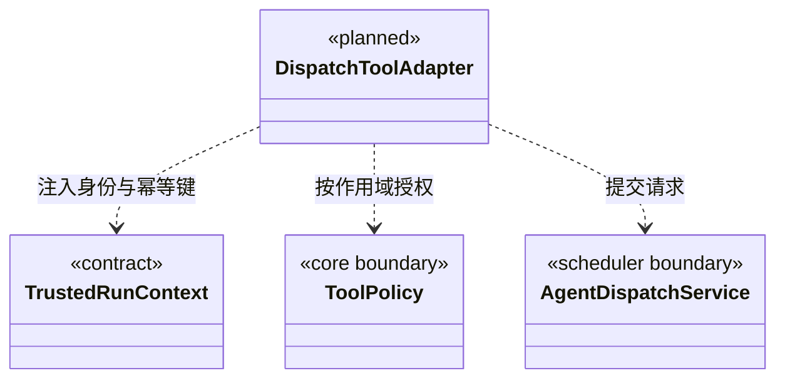

### 当前知识与维护工具边界

知识接口先执行领域校验和授权，再通过 Core 的 `jsonToolResult/validateToolResult` 返回有效文本协议。无效返回值明确失败，不把空值解释为操作成功；输出校验不回滚或重放已执行的领域操作。

`cbim_agent_registry` 的 `builtinAgents` 公开应用静态默认执行角色 `cbim:executor`，与项目注册的 `groups` 分开，关键词同时过滤两者；`cbim_agent_get` 接受该 ID，返回静态定义、执行原则和当前 Team 根继承的 Skill。正文装配与正式派发共用 `defaultExecutorConfiguration`，不创建或修改 `.cbim/` 文件，也不把该静态角色当作已经存在的动态执行实例。默认角色同样需要真实模块、维护关系和本模块 Workflow。

`cbim_rules_validate` 创建知识规则维护任务；`cbim_task_status/cbim_task_cancel` 只接受本工作区维护接口返回的 ID。对话任务、执行计划和团队派发任务不在其范围内，取消未知 ID 返回 `TASK_NOT_FOUND`。运行中的合法任务只是请求取消，已结束任务返回真实终态；这些工具不用于召唤成员或终止当前大脑。

### 成员派发工具适配契约

当前适配器已实现 `cbim_dispatch_task` 与 `cbim_dispatch_inspect`，只在主调度会话装配真实端口时注册。主 Agent 永远不能成为执行者；省略 agentId 使用静态默认执行角色 `cbim:executor`。执行成员没有派发权。其余 `cbim_dispatch_*` 为待实现契约，不进入活动工具清单。现有知识工具和任务内进度工具保留自己的语义，不改名冒充跨成员调度。

工具全部使用 `cbim_` 前缀，由内部 Loop 通过工具网关调用调度服务。`DispatchTools` 严格解析参数，拒绝额外身份、授权和状态字段；调用 ID 来自已通过一次性 gate 的桥元数据，缺少时拒绝，不能在模型参数或输入哈希中猜测。`dispatch` 仅可靠入队，主轮结束后启动与结果续跑由注入的调度服务负责；`inspect` 不启动、不重试、不确认收件。只有真实服务可用时才将 Schema 加入模型能力清单。

| 工具与状态 | 模型提交内容 | 服务返回内容 |
| --- | --- | --- |
| `cbim_dispatch_task`（当前） | 自定义执行角色或默认 cbim:executor、moduleIds、goal、acceptance、前置版本；拒绝 cbim:main | taskId、messageId、图游标；本周期创建独立执行实例，不是执行结果 |

| `cbim_dispatch_inspect`（当前） | 可选本图 taskId，缺省查本图 | 经授权的任务/依赖/有效结果，不含其他成员私有上下文；当前不接收模型图游标 |
| `cbim_dispatch_wait`（待实现） | 当前任务的 children（taskId + planRevision）与 reason | staged 等待提交；大脑安全让出执行槽后才切换 waiting |
| `cbim_dispatch_result`（待实现） | summary、evidenceRefs、limitations、预期计划版本 | staged 结果提交；安全结束并复核后才发布候选，不自动验收 |
| `cbim_dispatch_message`（待实现） | 同图接收成员、关联 taskId、question/answer 正文及 replyTo | 消息接收回执；不能通过聊天正文创建未登记任务 |
| `cbim_dispatch_revise`（待实现） | 本任务 expectedRevision、变更候选、reason | 修订回执或冲突；运行中影响范围的变更先停止旧范围执行 |
| `cbim_dispatch_cancel`（待实现） | taskId、expectedRevision、self/subtree 取消范围、reason | 取消请求/停止跟踪，不伪造已停止或回滚 |

维护任务工具 `cbim_task_status/cancel` 与本组派发工具保持不同职责。派发是维护执行记录，查询是只读；它们均不直接签发成员业务写权限。主会话 read 模式可以登记只读委派，成员的每次业务工具仍独立接受其运行门禁；不能将入队回执作为业务完成证据。完整能力清单以实际运行注册表为准。

#### 可信调用上下文

调度入口见 [execution](../execution/CONTRACT.md)。主 Agent 是调度员及知识管理者：可直接调用 cbim_ 知识 CRUD，写入仍由 read/ask/execute、版本与事务校验；主业务写/命令始终拒绝。派发工具绑定可信 workspaceId、rootSessionId、runId、toolCallId 和周期，模型不能指定实例或授权。主会话与图根共享实例，业务任务使用独立执行实例。治理与业务验收的人工决定不能由模型签署。

commandId 由工具网关把当前可信 runId/toolCallId 映射到持久化调用键；同一次工具调用的重发沿用原键，不重新创建节点。模型再次主动调用产生新请求，工具返回已有节点帮助其判断，不用目标文本相似度擅自合并不同任务。内部系统事实也使用稳定来源事件键，避免重启后重复投影。

适配器只校验/转换输入和输出，任务不变量、状态迁移、权限与版本规则归调度/Core。派发和消息工具受策略控制，结果写入必须来自绑定的责任成员与当前运行。用户的“本次任务全部通过”只在现有授权生命周期内生效，不传播到新成员任务。

`cbim_dispatch_wait` 登记等待后不无限挂起工具 Promise 占住成员槽；需大脑适配器明确支持在安全片段边界停止本轮并回传等待事实。未接通此能力前不把 wait 工具交给模型。任务分析可使用现有知识查询，但正式 dispatch 缺模块/维护关系时返回结构化 gap，禁止伪造成已派发。

#### 目标结构类图（待实现）

验证须覆盖伪造身份/审批拒绝、工具重发不重复派发、过期版本、成员读模式写拒绝、接收确认与业务结果区分、无实现不注册。工具测试通过也不替代真实多成员大脑运行验收。
