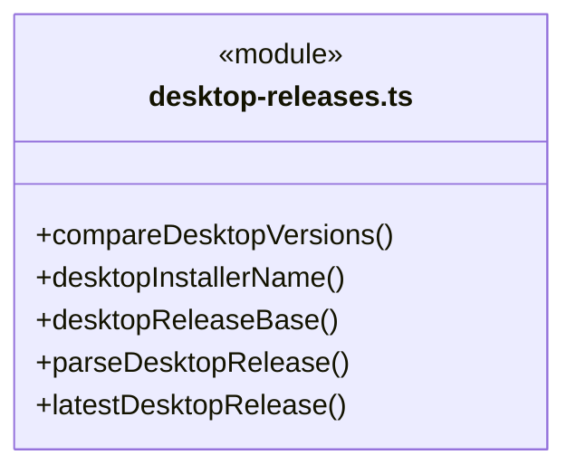
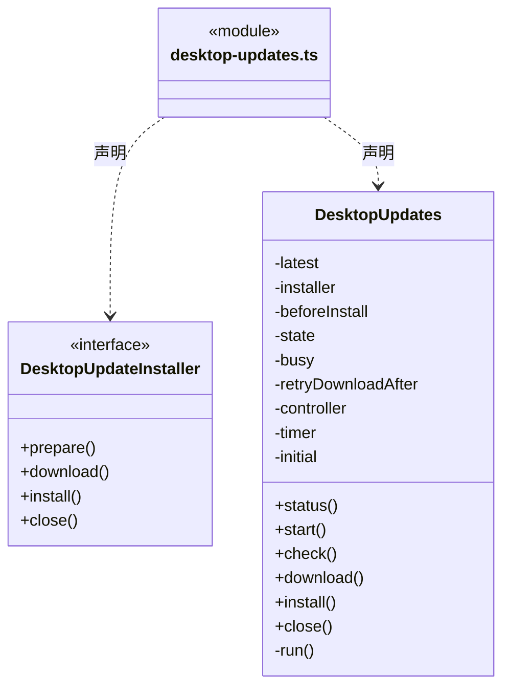
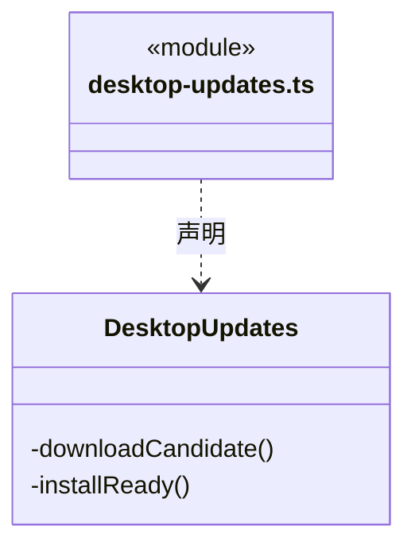
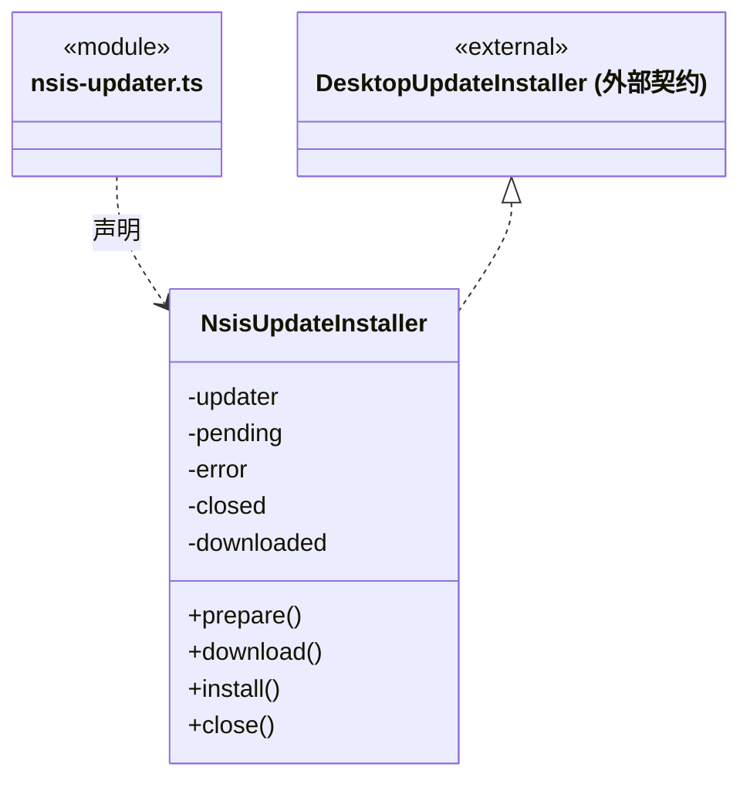
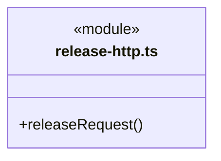
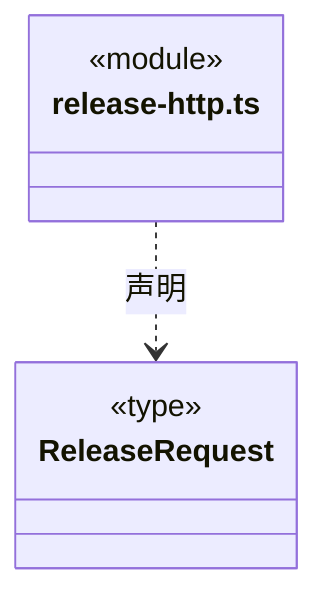
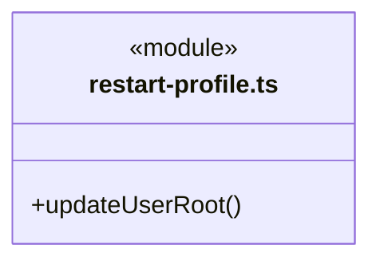
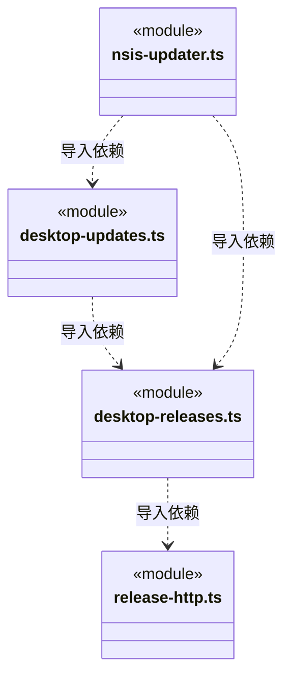

# src/backend/updater 架构

## 目录定位

独立桌面更新子系统：公开 Release 读取、稳定版本筛选、后台预下载与用户确认重启的状态机和 NSIS 适配均在此目录。只依赖公开更新契约及系统/第三方库，不导入 main、scheduler-engine 或 core/runtime；仅明确安装时通过关闭回调等待主程序排空。安装包缓存独立于运行数据。

本文描述当前实现。通过分析目录边界后维护的 [源码架构脚本](../../../scripts/source-architecture.mjs) 同步清单和声明；代码变更时仍须核对职责、关键成员与关系。

## 代码清单

| 文件 | 当前职责 |
| --- | --- |
| [desktop-releases.ts](desktop-releases.ts) | 读取固定 GitHub 仓库中独立 desktop-v 通道的公开稳定发布。 |
| [desktop-updates.ts](desktop-updates.ts) | 桌面更新的单实例状态机，后台检查并预下载，用户确认后才排空业务和重启安装。 |
| [nsis-updater.ts](nsis-updater.ts) | electron-updater 的 Windows NSIS 适配，固定发布源并优先差分下载、校验安装包。 |
| [release-http.ts](release-http.ts) | 更新子系统读取公开 Release 列表的独立 HTTP 边界。 |
| [restart-profile.ts](restart-profile.ts) | 恢复安装器显式传回的本机用户目录，供 Main 在初始化任何业务数据之前调用。 |

## 架构类图

### desktop-releases.ts

直接依赖：[../../bridge/contracts/desktop-updates.ts](../../bridge/contracts/desktop-updates.ts)、[release-http.ts](release-http.ts)。

### desktop-updates.ts

成员 1/2（同名节点为同一声明，跨图合并阅读）。

成员 2/2（同名节点为同一声明，跨图合并阅读）。

直接依赖：[../../bridge/contracts/desktop-updates.ts](../../bridge/contracts/desktop-updates.ts)、[desktop-releases.ts](desktop-releases.ts)。

### nsis-updater.ts

直接依赖：[../../bridge/contracts/desktop-updates.ts](../../bridge/contracts/desktop-updates.ts)、[desktop-updates.ts](desktop-updates.ts)、[desktop-releases.ts](desktop-releases.ts)。

### release-http.ts

### restart-profile.ts

### 本目录调用边界

## 子目录导航

无子目录。

[返回上层](../ARCHITECTURE.md)。

每次修改本目录代码，同步维护文件头、关键契约说明及本图。未实现的治理、证据验收和自动编排能力不列入当前类图。

## 设计契约 v1 与落地范围

以下内容区分已接通能力与后续设计；以各节的实现状态为准，不将目标图当作现状图。维护源：[CONTRACT.md](CONTRACT.md)；生成类图时同步附加，勿直接修改本附录。

# 桌面更新子系统

更新程序集中于本目录，与 main 的业务资源、scheduler-engine 及 core/runtime 分离。只依赖公开 `DesktopUpdateStatus` / `DesktopRelease` 契约、系统和第三方库；Main 负责启动、固定 IPC 和业务关闭回调，不向本模块暴露工作区、模型或反馈 Token。

`release-http` 只读固定公开 GitHub Release 列表，不附凭据、不重定向，单请求 20 秒、响应 2 MiB。`desktop-releases` 只接受 `nan023062/cbim` 的 `desktop-vX.Y.Z` 稳定版本、匹配的 Windows x64 安装包及清单；不消费旧 Python 内核 v1.x。检查失败明确报告，不以空列表冒充当前已是最新版。

`DesktopUpdates` 在正式安装版启动后 10 秒检查，定时器每 60 秒触发；发现新版后自动准备、下载并校验，成功停在 ready，不排空业务或安装。在途操作合并；已就绪候选冻结到用户安装或进程退出，不因后续检查替换。检查失败保留已知新版与本次完成时间，下一分钟重新检查。下载失败后五分钟内只检查版本；五分钟后重试下载，发现不同版本或用户手动重试时无需等待。错误仅在更新页显示，不弹全局错误。checkedAt 是最近完成检查的时间，失败也记录，不能据此声称已联网成功。

download 只手动重试准备安装包；后台预下载与手动下载都不授权重启。用户在 ready 明确点击 install 后，公开 installing 两秒让窗口展示进度，随后调用 Main 注入的正常关闭回调；只在排空成功后调用安装器。下载尚未完成时的 install 不排队授权，须就绪后再次确认。弹窗关闭或 IPC 回包丢失不触发第二次安装。下载失败回到 available；排空／安装失败停在 ready，保留缓存，只能明确重试 install，不由计时器或普通退出重放。

Main 的普通退出在开始排空前 close 更新服务；提示阶段、下载中或排空中迟到的结果不能继续安装。close 清除计时器并禁用本进程的更新动作；如果普通关闭失败保留窗口，明确提示需重新启动以恢复检查。已授权安装由成功排空后的 quitting 标识与普通退出区分；缓存不会在新进程启动时自动安装。

`NsisUpdateInstaller` 重新核对 `latest.yml` 的准确版本、唯一安装文件名及 SHA-512，关闭自动下载、退出自动安装、预发布、降级和网络安装器。首版未配置发布者证书，不宣称通过签名校验。固定 HTTPS 发布及清单负责来源与完整性，下载完成不代表升级完成。

NSIS 下载启用 electron-updater 的差分模式：读取新旧 `.exe.blockmap`，复用缓存 `installer.exe` 的相同数据块，通过单段 HTTP Range 获取变化块，再校验完整安装包 SHA-512。当前锁定版本的 Generic Provider 会同时替换发布目录和文件名里的版本；缺旧索引缓存时从对应旧 `desktop-v` 标签获取，不能只从新标签找旧文件。禁用多段 multipart Range，避免要求附件重定向后的对象存储支持该格式。缺缓存、索引不可用、Range 不支持或重建校验失败时由原下载器回退全量；全量也必须通过校验。缓存复用和差分成功均不触发安装。

差分降低网络传输，不改变最终缓存安装包大小或 NSIS 安装方式；具体节省量取决于版本差异。首次升级到包含本实现的版本仍由旧客户端执行，后续版本间更新才能使用新行为。真实公开安装升级及网络节省量须按对应版本制品验收，单元夹具不代表公开包比例。

安装包产物位于仓库 `build/desktop-release/<version>/`；用户下载缓存位于 `%LOCALAPPDATA%/cbim-desktop-updater/`，与安装程序目录、用户 `~/.cbim` 及业务工作区分开。重新启动后检查公开版本并重新校验已有缓存，相同包由 electron-updater 复用，成功仍停在 ready；缓存不会在启动或退出时自动安装。

`restart-profile` 在 Main 初始化之前核对重启目录。`packaging/updater/` 中的 NSIS 启动模板将原进程明确配置的 `CBIM_USER_DATA_ROOT` 作为更新重启参数传回，解决 Windows Shell 不继承环境的问题；只传目录、不传凭据，正常安装沿用默认目录。重复、相对、带引号／控制字符或超长参数直接拒绝，不静默打开默认用户数据。
