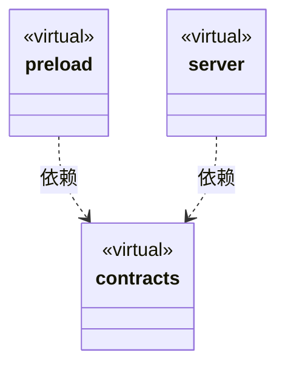

# src/bridge 架构

## 设计意图

连接业务应用与桌面宿主。通信契约、页面安全桥和可信服务端分别封装，业务状态与生命周期交给 Logic，平台技术机制使用 Core。

## 主要组成

本层由下列子模块组合，每个子模块作为独立的虚拟类封装参与本层协作。

<!-- architecture:generated:start -->

## 架构关系

标注为 `virtual` 的节点是直接子模块的虚拟类封装；内部设计沿下方入口阅读。

## 子模块

| 虚拟封装 | 整体职责 |
| --- | --- |
| [contracts](contracts/ARCHITECTURE.md) | 定义桌面与业务服务之间可序列化的请求、响应和展示数据。按业务组织契约，由统一调用映射关联操作与输入输出；不向页面暴露凭据、文件句柄或服务实例。 |
| [preload](preload/ARCHITECTURE.md) | 固定 Electron IPC 桥；不向页面暴露 Node、凭据或任意磁盘 API。 实现关联调用签名并沿原信封转发，不重试错误或改变主Frame授权。 |
| [server](server/ARCHITECTURE.md) | 将 Electron 和 CLI 的外部请求接入 Logic/Application。Application 适配类负责委托，main 负责宿主装配，启动、通信和平台传输各自封装；业务生命周期仍由 Logic 持有。 |

[上层设计](../ARCHITECTURE.md)

<!-- architecture:generated:end -->
