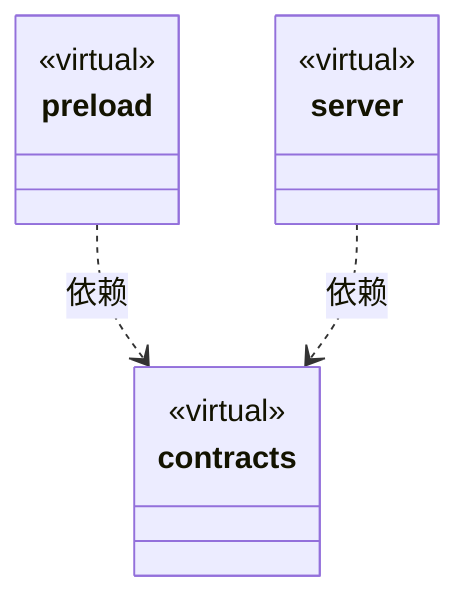

# src/bridge 架构

## 设计意图

把桌面宿主与业务应用连接起来，同时限制页面可触达的能力。通信数据、安全桥和可信服务端分别封装，业务规则与权威状态留在 Logic。

`contracts` 定义双方共同理解的操作与数据；`preload` 向页面开放固定调用；`server` 校验接入身份、解析请求并委托业务服务。宿主平台能力由 server 装配，页面不能借协议取得任意 Node/Electron 能力。

## 主要组成

本层没有直接产品实现，由下方子模块组成；每个直接子模块作为一个虚拟封装，只在本层呈现整体职责与协作。

<!-- architecture:generated:start -->

## 架构关系

标注为 `virtual` 的节点是直接子模块的虚拟类封装；内部设计沿下方入口阅读。

## 子模块

| 虚拟封装 | 整体职责 |
| --- | --- |
| [contracts](contracts/ARCHITECTURE.md) | 声明当前桌面与页面之间的数据协议，避免页面加载业务服务、凭据和平台实现。旧 IPC 兼容协议已随旧宿主移除。 |
| [preload](preload/ARCHITECTURE.md) | 向当前页面提供受限桌面菜单能力。业务请求经当前桌面通信入口传递，不公开任意 Node API。 |
| [server](server/ARCHITECTURE.md) | 提供当前桌面进程的可信通信和平台边界。业务实例由 logic-new/application 创建，Electron 能力由 desktop 注入；旧 IPC、命令行与应用装配入口已退役。 |

[上层设计](../ARCHITECTURE.md)

<!-- architecture:generated:end -->
