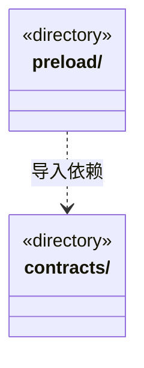

# src/bridge 架构

## 目录定位

前后端通信边界：contracts 声明公开数据，preload 提供 Electron 安全桥。契约可重导出 Core 公开类型和纯函数，不暴露后端服务、凭据和存储实现。

本文描述当前实现。通过分析目录边界后维护的 [源码架构脚本](../../scripts/source-architecture.mjs) 同步清单和声明；代码变更时仍须核对职责、关键成员与关系。

## 代码清单

本层无直接代码文件。

## 架构类图

各图中的同名节点表示同一目录边界；跨组及完整直接依赖如下（无边不代表继承）：

- `preload` → `contracts`：导入。

## 子目录导航

- [contracts/](contracts/ARCHITECTURE.md)：可序列化 IPC 与展示契约；多来源附件只传选择身份，公开旧v1/新v2清单与真实仓库目录，不暴露凭据。图增量公开前置追加/替换审计而非执行许可，目标摘要公开运行内补充计数与未核实状态，详情保留已接收快照，纯协议不携IO。排队插入必须传用户点击时的原主run，缺失不推测当前轮次。检查点私有恢复证明留在后端；结构验证公开当时文件/规则指纹及无原值诊断，人工决定与文件观察保留真实依据。岗位IPC只传明确选择与公开采纳/回执，类型不带凭据或后端哈希IO。 桌面更新只公开版本、日志、阶段和进度，不传安装路径或任意命令。 ipc-call 用联合元组关联全部164项操作（含1项退役拒绝）；九个新增业务组共享请求Schema与响应，纯workspace-view避免类型循环。 owner-execution 公开原岗位绑定与显式当前观察；按任务修订核对身份，不公开解密配置。 公开检查点放弃审计和请求/回执纯契约，不向渲染进程授予主调度处置身份。 command-verification 只导出严格公共报告和八工具支持矩阵，隐藏原事务和执行准备信息。 effect-observation 只公开来源联合及严格公共 DTO，恢复／重规划保留旧协议并显式绑定新处置，不暴露正文备份或原生上下文。 controlled-files 仅导出公开纯协议与限制，隐藏 blob、原生文件身份、句柄和后端规则。
- [preload/](preload/ARCHITECTURE.md)：固定 Electron IPC 桥；不向页面暴露 Node、凭据或任意磁盘 API。 实现关联调用签名并沿原信封转发，不重试错误或改变主Frame授权。

[返回上层](../ARCHITECTURE.md)。

每次修改本目录代码，同步维护文件头、关键契约说明及本图。未实现的治理、证据验收和自动编排能力不列入当前类图。
