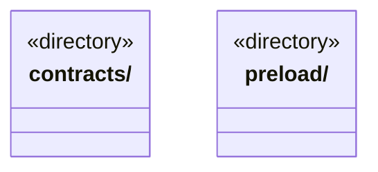

# src/bridge 架构

## 目录定位

前后端通信边界：contracts 声明公开数据，preload 提供 Electron 安全桥。契约可重导出 Core 公开类型和纯函数，不暴露后端服务、凭据和存储实现。

本文描述当前实现。通过分析目录边界后维护的 [源码架构脚本](../../scripts/source-architecture.mjs) 同步清单和声明；代码变更时仍须核对职责、关键成员与关系。

## 代码清单

本层无直接代码文件。

## 架构类图

各图中的同名节点表示同一目录边界；跨组及完整直接依赖如下（无边不代表继承）：

本层无目录间直接导入关系。

## 子目录导航

- [contracts/](contracts/ARCHITECTURE.md)：可序列化 IPC 与展示契约。图增量公开检查点及续执行预约，私有日志/原生会话恢复证明留在后端。文件观察、前置替换、软限额和用量公开冻结事实及缺口，不签发启动许可。 人工决定只公开严格选择/意见和有界证明，身份、基线及回执互相核对。
- [preload/](preload/ARCHITECTURE.md)：固定 Electron IPC 桥；不向页面暴露 Node、凭据或任意磁盘 API。

[返回上层](../ARCHITECTURE.md)。

每次修改本目录代码，同步维护文件头、关键契约说明及本图。未实现的治理、证据验收和自动编排能力不列入当前类图。
