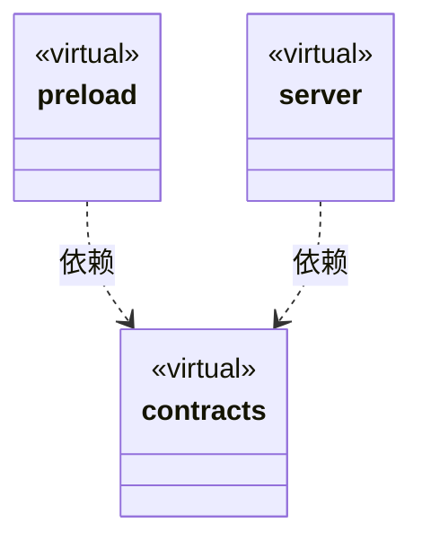

# src/bridge 架构

## 设计意图

把桌面宿主与业务应用连接起来，同时限制页面可触达的能力。通信数据、安全桥和可信服务端分别封装，业务规则与权威状态留在 Logic。

`contracts` 定义双方共同理解的操作与数据；`preload` 向页面开放固定调用；`server` 校验接入身份、解析请求并委托业务服务。宿主平台能力由 server 装配，页面不能借协议取得任意 Node/Electron 能力。

## 主要组成

本层没有直接产品实现，由下方子模块组成；每个直接子模块作为一个虚拟封装，只在本层呈现整体职责与协作。

<!-- architecture:generated:start -->

## 架构关系

标注为 `virtual` 的节点是直接子模块的虚拟类封装；内部设计沿下方入口阅读。

## 子模块

| 虚拟封装 | 整体职责 |
| --- | --- |
| [contracts](contracts/ARCHITECTURE.md) | 定义页面与可信服务端之间可序列化的操作、输入输出和展示事实，使通信消费者不必加载业务服务或平台实现。 |
| [preload](preload/ARCHITECTURE.md) | 在 Electron 的隔离上下文中提供最小页面调用桥，让界面只使用声明过的操作和文件导入能力。 |
| [server](server/ARCHITECTURE.md) | 承接 Electron 与 CLI 的可信入口，把外部操作连接到唯一业务应用，并管理桌面窗口与宿主资源。 |

[上层设计](../ARCHITECTURE.md)

<!-- architecture:generated:end -->
