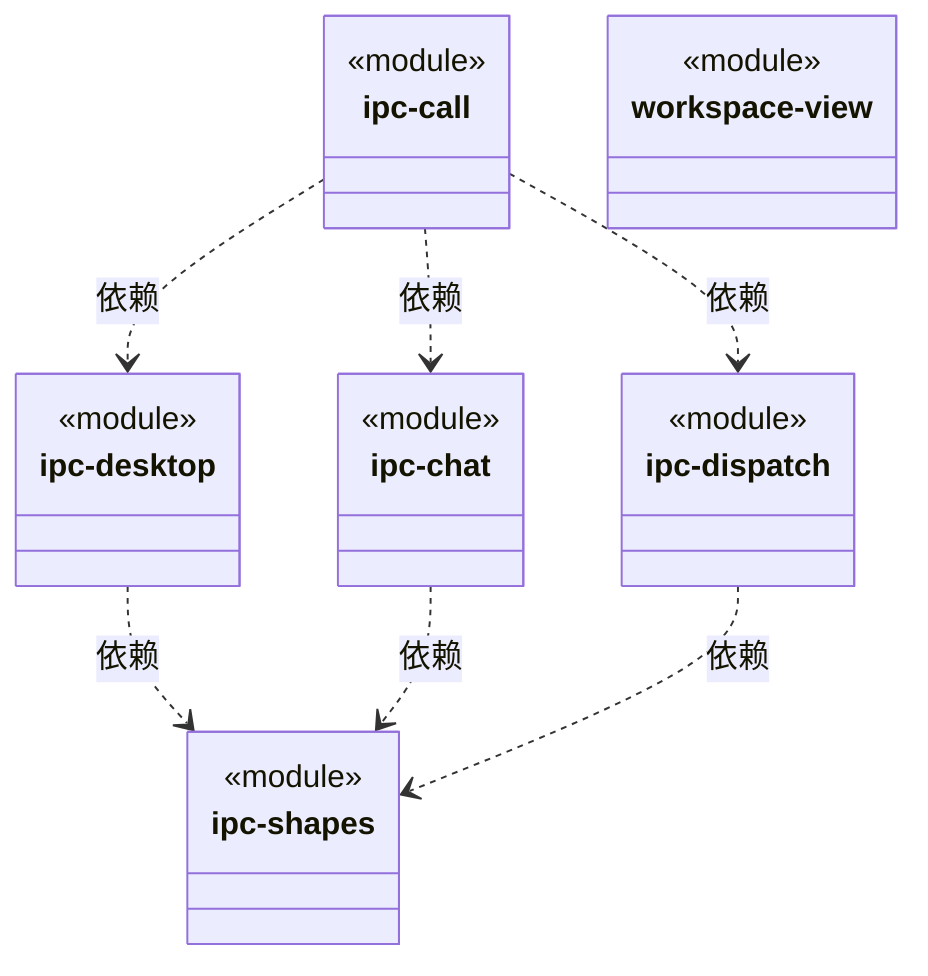

# src/bridge/contracts 架构

## 设计意图

定义页面与可信服务端之间可序列化的操作、输入输出和展示事实，使通信消费者不必加载业务服务或平台实现。

`ipc-call` 组合按领域拆分的操作映射和输入 Schema，`ipc-shapes` 提供信封公共形状，其他协议文件转接明确的业务公开数据。结构解析只检查传输边界；工作区有效性、授权和事务由服务端业务入口继续核实。此处没有状态实例，新增操作须同时保持调用名、请求与响应关联。

## 主要组成

| 组成 | 定位 |
| --- | --- |
| [ipc-call](ipc-call.ts) | 关联全部桌面 IPC 操作名、请求与响应，并为主进程提供结构解析入口。 |
| [ipc-shapes](ipc-shapes.ts) | IPC 外层信封的少量公共输入形状；业务字段继续使用各领域公开协议。 |
| [workspace-view](workspace-view.ts) | 转接工作区业务公开数据。 |
| [ipc-desktop](ipc-desktop.ts) | 声明由可信桌面宿主直接处理的操作，和业务应用路由分开。 |
| [ipc-chat](ipc-chat.ts) | 关联主会话输入、消息队列与对话读取的请求／响应。 |
| [ipc-dispatch](ipc-dispatch.ts) | 关联派发、任务核实与显式处置操作的通信类型。 |

<!-- architecture:generated:start -->

## 架构关系

[上层设计](../ARCHITECTURE.md)

<!-- architecture:generated:end -->
