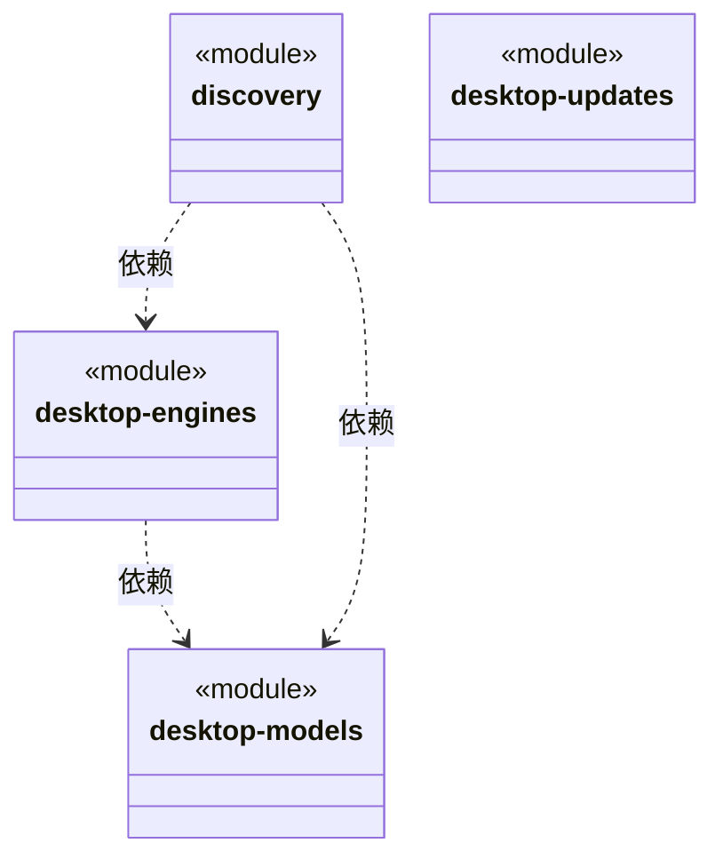

# src/bridge/contracts 架构

## 设计意图

声明当前桌面与页面之间的数据协议，避免页面加载业务服务、凭据和平台实现。旧 IPC 兼容协议已随旧宿主移除。

## 主要组成

| 组成 | 定位 |
| --- | --- |
| [desktop-engines](desktop-engines.ts) | 引擎安装和目录展示契约。 |
| [desktop-models](desktop-models.ts) | 模型配置与选型契约。 |
| [desktop-updates](desktop-updates.ts) | 桌面更新状态契约。 |
| [discovery](discovery.ts) | 当前客户端发现与连接契约。 |

<!-- architecture:generated:start -->

## 架构关系

[上层设计](../ARCHITECTURE.md)

<!-- architecture:generated:end -->
