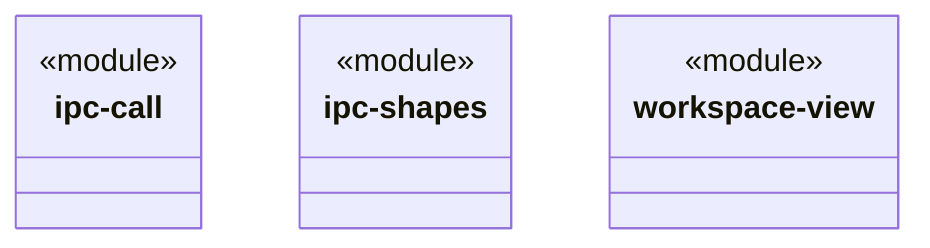

# src/bridge/contracts 架构

## 设计意图

定义桌面与业务服务之间可序列化的请求、响应和展示数据。按业务组织契约，由统一调用映射关联操作与输入输出；不向页面暴露凭据、文件句柄或服务实例。

## 主要组成

| 组成 | 定位 |
| --- | --- |
| [ipc-call](ipc-call.ts) | 关联全部桌面 IPC 操作名、请求与响应，并为主进程提供结构解析入口。 |
| [ipc-shapes](ipc-shapes.ts) | IPC 外层信封的少量公共输入形状；业务字段继续使用各领域公开协议。 |
| [workspace-view](workspace-view.ts) | 转接工作区业务公开数据。 |

<!-- architecture:generated:start -->

## 架构关系

[上层设计](../ARCHITECTURE.md)

<!-- architecture:generated:end -->
