# src/bridge/contracts 架构

## 目录定位

可序列化 IPC 与展示契约；多来源附件只传选择身份，公开旧v1/新v2清单与真实仓库目录，不暴露凭据。图增量公开前置追加/替换审计而非执行许可，目标摘要公开运行内补充计数与未核实状态，详情保留已接收快照，纯协议不携IO。排队插入必须传用户点击时的原主run，缺失不推测当前轮次。检查点私有恢复证明留在后端；结构验证公开当时文件/规则指纹及无原值诊断，人工决定与文件观察保留真实依据。岗位IPC只传明确选择与公开采纳/回执，类型不带凭据或后端哈希IO。 桌面更新只公开版本、日志、阶段和进度，不传安装路径或任意命令。 ipc-call 用联合元组关联全部172项操作（含1项退役拒绝）；分组契约共享请求Schema与响应，纯workspace-view避免类型循环。 owner-execution 公开原岗位绑定与显式当前观察；按任务修订核对身份，不公开解密配置。 公开检查点放弃审计和请求/回执纯契约，不向渲染进程授予主调度处置身份。 command-verification 只导出严格公共报告和八工具支持矩阵，隐藏原事务和执行准备信息。 effect-observation 只公开来源联合及严格公共 DTO，恢复／重规划保留旧协议并显式绑定新处置，不暴露正文备份或原生上下文。 controlled-files 仅导出公开纯协议与限制，隐藏 blob、原生文件身份、句柄和后端规则。

本文描述当前实现。通过分析目录边界后维护的 [源码架构脚本](../../../scripts/source-architecture.mjs) 同步清单和声明；代码变更时仍须核对职责、关键成员与关系。

## 代码清单

| 文件 | 当前职责 |
| --- | --- |
| [admission.ts](admission.ts) | 向界面公开全局并发策略、当前占用及准入等待的可序列化契约。 |
| [agent-history-ipc.ts](agent-history-ipc.ts) | 关联角色历史四个只读 IPC 操作的请求、响应与运行时输入解析。 |
| [agent-history.ts](agent-history.ts) | 向团队静态节点公开只读的角色 Session 历史协议。 |
| [architecture.ts](architecture.ts) | 团队/业务架构编辑的桌面 IPC 契约，只公开对象操作、预览差异和提交回执。 |
| [automation.ts](automation.ts) | 自动化桌面的固定请求、运行时校验与公开返回映射。 |
| [chat.ts](chat.ts) | 对话附件、执行权限和待审批请求的跨进程契约。 |
| [command-verification.ts](command-verification.ts) | 向桌面视图导出原主命令的只读核实协议和固定支持矩阵。 |
| [controlled-files.ts](controlled-files.ts) | 向桌面公开受控文件原操作查询和显式补偿的纯协议。 |
| [desktop-updates.ts](desktop-updates.ts) | 正式桌面版本、后台预下载进度与用户确认重启安装的公开 IPC 数据。 |
| [dispatch.ts](dispatch.ts) | 向桌面消费者公开成员派发、执行增量、主会话图以及独立目标周期摘要/详情，并导出无 IO 的投影校验及归并函数。 |
| [effect-observation.ts](effect-observation.ts) | 向桌面公开原调用影响观察、明确处置与后续周期关系的纯契约。 |
| [execution.ts](execution.ts) | 对话、运行和排队在 IPC 中传递的可序列化类型。 |
| [github-feedback.ts](github-feedback.ts) | 设置界面的 GitHub 公开连接协议。 |
| [governance.ts](governance.ts) | 向业务架构界面公开模块知识治理的纯数据与严格校验协议。 |
| [human-continue.ts](human-continue.ts) | 公开按已保存人工决定继续原目标的严格请求与回执，连接桌面和调度入口。 |
| [human-decisions.ts](human-decisions.ts) | 向桌面公开人工决定的序列化请求、依据预览与不可变记录。 |
| [ipc-call.ts](ipc-call.ts) | 关联全部桌面 IPC 操作名、请求与响应，并为主进程提供结构解析入口。 |
| [ipc-chat.ts](ipc-chat.ts) | 显式附件导入与快照预览的公开 IPC 请求与响应。 |
| [ipc-desktop.ts](ipc-desktop.ts) | 桌面更新、终端、选择器与链接打开的公开 IPC 请求与响应。 |
| [ipc-dispatch.ts](ipc-dispatch.ts) | 成员派发、运行核实与人工处置的公开 IPC 请求与响应，保留历史派发命令的回执查询兼容。 |
| [ipc-governance.ts](ipc-governance.ts) | 模块治理观察、提案、决定与实施的公开 IPC 请求与响应。 |
| [ipc-loop.ts](ipc-loop.ts) | 会话、排队、历史与安全续接的公开 IPC 请求与响应。 |
| [ipc-people.ts](ipc-people.ts) | 岗位登记与模块责任的公开 IPC 请求与响应。 |
| [ipc-resources.ts](ipc-resources.ts) | 资源仓库、共享连接与架构包的公开 IPC 请求与响应。 |
| [ipc-settings.ts](ipc-settings.ts) | 模型、准入、预算与反馈账号设置的公开 IPC 请求与响应。 |
| [ipc-shapes.ts](ipc-shapes.ts) | IPC 外层信封的少量公共输入形状；业务字段继续使用各领域公开协议。 |
| [ipc-workspace.ts](ipc-workspace.ts) | 工作区生命周期与知识编辑的公开 IPC 请求与响应。 |
| [isolated-executions.ts](isolated-executions.ts) | 向桌面导出原隔离执行核实与清理的公开 DTO。 |
| [knowledge-source.ts](knowledge-source.ts) | 向桌面公开知识来源身份、采纳预览和当前核实状态的纯数据协议。 |
| [knowledge-transactions.ts](knowledge-transactions.ts) | 向只读执行视图公开知识预览和提交的严格返回协议。 |
| [model-actions.ts](model-actions.ts) | 声明主 Agent 选型和供应商设置的桌面请求、运行时校验及返回值映射。 |
| [models.ts](models.ts) | 模型配置界面消费的公开模型信息与停止原因格式化。 |
| [module-ownership.ts](module-ownership.ts) | 公开模块负责人控制面的纯数据协议，供业务架构、项目岗位与 Main IPC 使用。 |
| [output-manifest.ts](output-manifest.ts) | 桌面完整产物面板使用的纯 DTO 与严格结构校验，不导出后端文件或日志读取实现。 |
| [owner-execution.ts](owner-execution.ts) | 公开岗位执行的选择、冻结绑定及纯身份校验，供任务和目标视图核对历史归属。 |
| [repository-connections.ts](repository-connections.ts) | 向桌面公开工作区资源仓库链接器的登记、授权和真实 HTTP 核验协议。 |
| [resources.ts](resources.ts) | 资源种类、仓库快照、登录占位及仓库状态的共享类型。 |
| [runtime.ts](runtime.ts) | 公开应用级成员、任务、目标周期和已报告用量的只读契约及严格传输校验。 |
| [scope-budget.ts](scope-budget.ts) | 公开目标周期额度策略及只读逐请求摘要，供设置和目标卡片经 IPC 展示；不公开预留或终态写入端口。 |
| [scope-usage.ts](scope-usage.ts) | 向桌面任务视图公开周期用量的严格查询与报告契约。 |
| [usage.ts](usage.ts) | 向界面公开 Core 的纯执行计量函数及单轮用量类型。 |
| [workspace-members.ts](workspace-members.ts) | 公开项目岗位登记、预览与原命令回执的数据协议，供 Main IPC 和团队页面核对身份。 |
| [workspace-view.ts](workspace-view.ts) | 工作区登记与运行视图的公开数据，供 IPC 协议和界面共同引用。 |
| [workspace.ts](workspace.ts) | 跨进程工作区、知识事务与 IPC 数据契约。 |

## 架构类图

### admission.ts


直接依赖：[../../backend/core/runtime/admission.ts](../../backend/core/runtime/admission.ts)。

### agent-history-ipc.ts

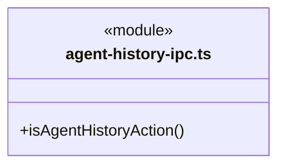

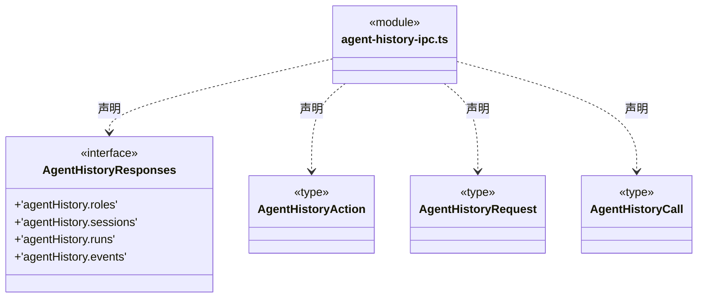

直接依赖：[../../backend/core/team/session-history.ts](../../backend/core/team/session-history.ts)、[agent-history.ts](agent-history.ts)。

### agent-history.ts

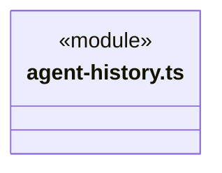
直接依赖：[../../backend/core/team/session-history.ts](../../backend/core/team/session-history.ts)。

### architecture.ts

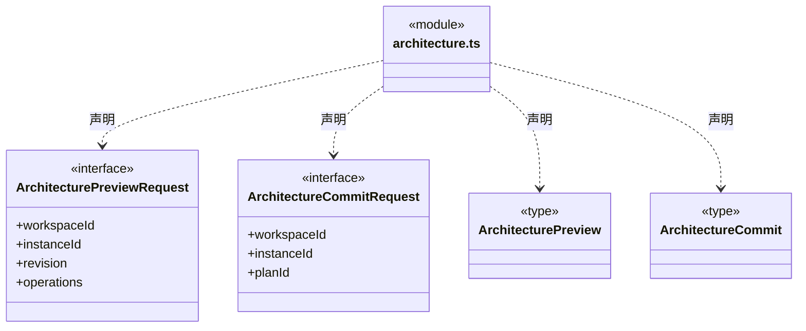

直接依赖：[../../backend/core/knowledge/object-crud.ts](../../backend/core/knowledge/object-crud.ts)、[../../backend/core/workspace/module-outline.ts](../../backend/core/workspace/module-outline.ts)。

### automation.ts

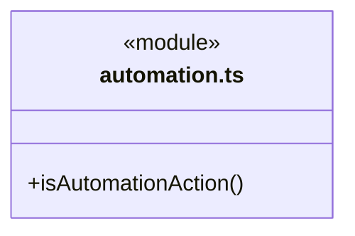

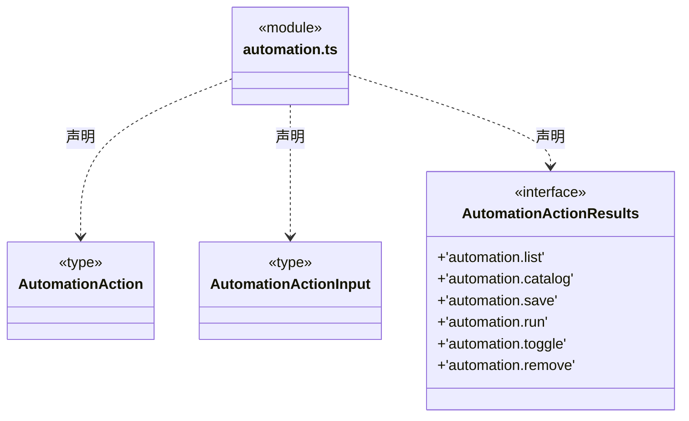

直接依赖：[../../backend/core/automation/contracts.ts](../../backend/core/automation/contracts.ts)。

### chat.ts

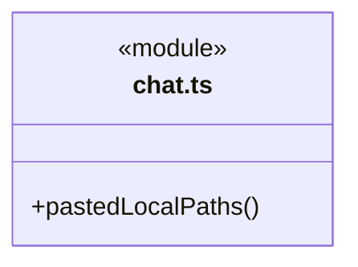

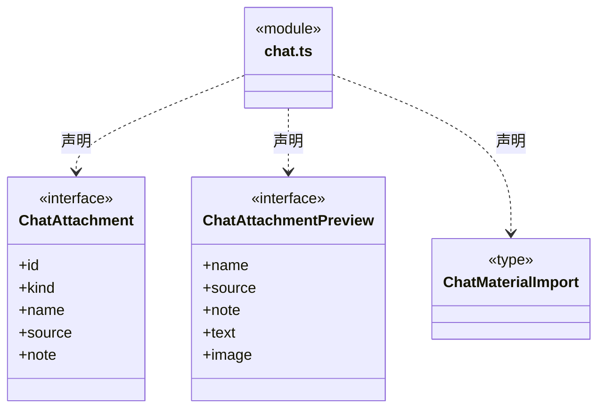

直接依赖：[../../backend/core/execution/types.ts](../../backend/core/execution/types.ts)。

### command-verification.ts

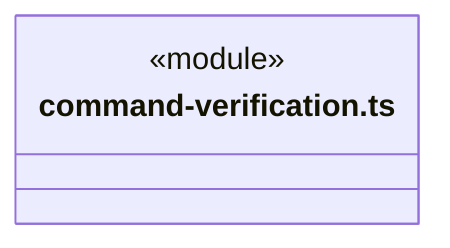
直接依赖：[../../backend/core/tasks/command-verification.ts](../../backend/core/tasks/command-verification.ts)。

### controlled-files.ts

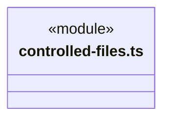
直接依赖：[../../backend/core/file-operations/controlled-file-operation.ts](../../backend/core/file-operations/controlled-file-operation.ts)。

### desktop-updates.ts

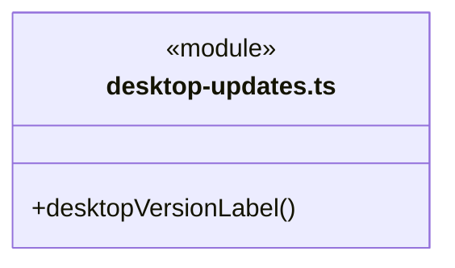

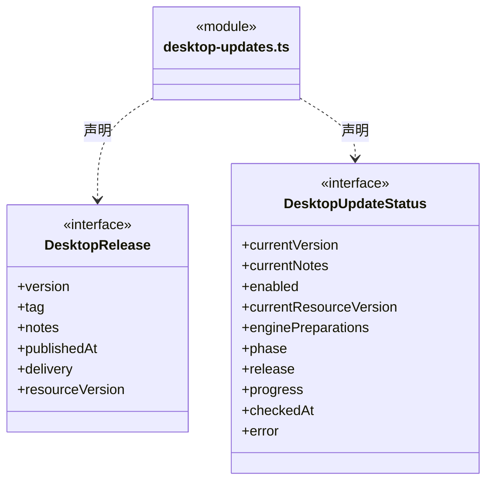


### dispatch.ts

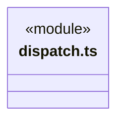
直接依赖：[../../backend/core/tasks/graph-types.ts](../../backend/core/tasks/graph-types.ts)、[../../backend/core/tasks/queued-dependency-replacement.ts](../../backend/core/tasks/queued-dependency-replacement.ts)、[../../backend/core/tasks/queued-dependency-addition.ts](../../backend/core/tasks/queued-dependency-addition.ts)、[../../backend/core/tasks/queued-dependency-revision.ts](../../backend/core/tasks/queued-dependency-revision.ts)、[../../backend/core/tasks/member-checkpoint.ts](../../backend/core/tasks/member-checkpoint.ts)、[../../backend/core/tasks/member-checkpoint-chain.ts](../../backend/core/tasks/member-checkpoint-chain.ts)、[../../backend/core/tasks/checkpoint-handoff.ts](../../backend/core/tasks/checkpoint-handoff.ts)、[../../backend/core/tasks/queued-member-resume.ts](../../backend/core/tasks/queued-member-resume.ts)、[../../backend/core/tasks/dispatch-commands.ts](../../backend/core/tasks/dispatch-commands.ts)、[../../backend/core/tasks/dispatch-receipt.ts](../../backend/core/tasks/dispatch-receipt.ts)、[../../backend/core/tools/receipt-schema.ts](../../backend/core/tools/receipt-schema.ts)、[../../backend/core/tasks/member-commands.ts](../../backend/core/tasks/member-commands.ts)、[../../backend/core/tasks/member-events.ts](../../backend/core/tasks/member-events.ts)、[../../backend/core/tasks/graph-reducer.ts](../../backend/core/tasks/graph-reducer.ts)、[../../backend/core/tasks/graph-rules.ts](../../backend/core/tasks/graph-rules.ts)、[../../backend/core/tasks/dispatch-scope.ts](../../backend/core/tasks/dispatch-scope.ts)、[../../backend/core/tasks/scope-public.ts](../../backend/core/tasks/scope-public.ts)、[../../backend/core/tasks/scope-view.ts](../../backend/core/tasks/scope-view.ts)、[../../backend/core/tasks/scope-continuation.ts](../../backend/core/tasks/scope-continuation.ts)、[../../backend/core/tasks/execution-report.ts](../../backend/core/tasks/execution-report.ts)、[../../backend/core/evidence/artifact-baseline.ts](../../backend/core/evidence/artifact-baseline.ts)、[../../backend/core/tasks/scope-recovery.ts](../../backend/core/tasks/scope-recovery.ts)、[../../backend/core/tasks/scope-replan.ts](../../backend/core/tasks/scope-replan.ts)、[../../backend/core/tasks/scope-active-input.ts](../../backend/core/tasks/scope-active-input.ts)、[../../backend/core/tasks/scope-continuation-attachments.ts](../../backend/core/tasks/scope-continuation-attachments.ts)。

### effect-observation.ts

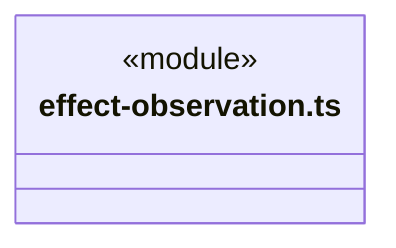
直接依赖：[../../backend/core/tasks/effect-observation.ts](../../backend/core/tasks/effect-observation.ts)。

### execution.ts

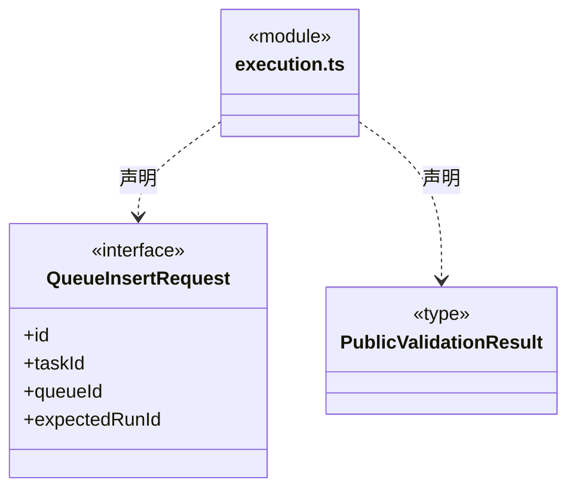

直接依赖：[../../backend/core/execution/types.ts](../../backend/core/execution/types.ts)、[../../backend/core/tasks/types.ts](../../backend/core/tasks/types.ts)、[../../backend/core/tasks/queue.ts](../../backend/core/tasks/queue.ts)、[../../backend/core/tools/questions.ts](../../backend/core/tools/questions.ts)、[../../backend/core/tools/input-validation.ts](../../backend/core/tools/input-validation.ts)、[../../backend/core/tools/scope-schema.ts](../../backend/core/tools/scope-schema.ts)、[../../backend/core/evidence/validation.ts](../../backend/core/evidence/validation.ts)。

### github-feedback.ts

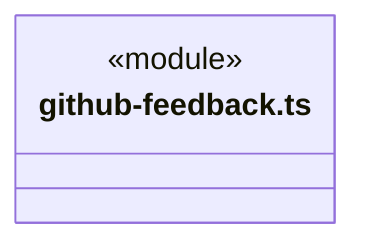
直接依赖：[../../backend/core/connectors/github-feedback.ts](../../backend/core/connectors/github-feedback.ts)。

### governance.ts

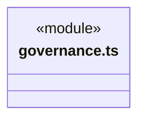
直接依赖：[../../backend/core/governance/module-governance.ts](../../backend/core/governance/module-governance.ts)。

### human-continue.ts

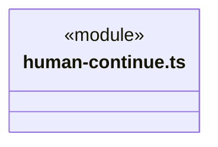
直接依赖：[../../backend/core/tasks/human-continue.ts](../../backend/core/tasks/human-continue.ts)、[../../backend/core/tasks/scope-continuation-record.ts](../../backend/core/tasks/scope-continuation-record.ts)。

### human-decisions.ts

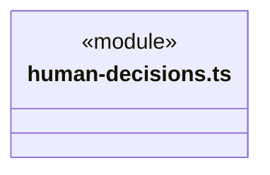
直接依赖：[../../backend/core/tasks/human-decisions.ts](../../backend/core/tasks/human-decisions.ts)。

### ipc-call.ts

```mermaid
classDiagram
class N_src_bridge_contracts_ipc_call_ts["ipc-call.ts"] {
  <<module>>
  +isIpcAction()
  +parseIpcRequest()
  +ipcSuccess()
  +checkedIpcCall()
}
```

```mermaid
classDiagram
class N_src_bridge_contracts_ipc_call_ts["ipc-call.ts"] {
  <<module>>
}
class N_src_bridge_contracts_ipc_call_ts_IpcResponses["IpcResponses"] {
  <<interface>>

}
N_src_bridge_contracts_ipc_call_ts ..> N_src_bridge_contracts_ipc_call_ts_IpcResponses : 声明
class N_src_bridge_contracts_ipc_call_ts_external_AgentHistoryResponses["AgentHistoryResponses (外部契约)"] {
  <<external>>
}
N_src_bridge_contracts_ipc_call_ts_external_AgentHistoryResponses <|-- N_src_bridge_contracts_ipc_call_ts_IpcResponses
class N_src_bridge_contracts_ipc_call_ts_external_PeopleIpcResponses["PeopleIpcResponses (外部契约)"] {
  <<external>>
}
N_src_bridge_contracts_ipc_call_ts_external_PeopleIpcResponses <|-- N_src_bridge_contracts_ipc_call_ts_IpcResponses
class N_src_bridge_contracts_ipc_call_ts_external_GovernanceIpcResponses["GovernanceIpcResponses (外部契约)"] {
  <<external>>
}
N_src_bridge_contracts_ipc_call_ts_external_GovernanceIpcResponses <|-- N_src_bridge_contracts_ipc_call_ts_IpcResponses
class N_src_bridge_contracts_ipc_call_ts_external_DispatchIpcResponses["DispatchIpcResponses (外部契约)"] {
  <<external>>
}
N_src_bridge_contracts_ipc_call_ts_external_DispatchIpcResponses <|-- N_src_bridge_contracts_ipc_call_ts_IpcResponses
class N_src_bridge_contracts_ipc_call_ts_external_SettingsIpcResponses["SettingsIpcResponses (外部契约)"] {
  <<external>>
}
N_src_bridge_contracts_ipc_call_ts_external_SettingsIpcResponses <|-- N_src_bridge_contracts_ipc_call_ts_IpcResponses
class N_src_bridge_contracts_ipc_call_ts_external_LoopIpcResponses["LoopIpcResponses (外部契约)"] {
  <<external>>
}
N_src_bridge_contracts_ipc_call_ts_external_LoopIpcResponses <|-- N_src_bridge_contracts_ipc_call_ts_IpcResponses
class N_src_bridge_contracts_ipc_call_ts_external_ChatIpcResponses["ChatIpcResponses (外部契约)"] {
  <<external>>
}
N_src_bridge_contracts_ipc_call_ts_external_ChatIpcResponses <|-- N_src_bridge_contracts_ipc_call_ts_IpcResponses
class N_src_bridge_contracts_ipc_call_ts_external_ResourcesIpcResponses["ResourcesIpcResponses (外部契约)"] {
  <<external>>
}
N_src_bridge_contracts_ipc_call_ts_external_ResourcesIpcResponses <|-- N_src_bridge_contracts_ipc_call_ts_IpcResponses
class N_src_bridge_contracts_ipc_call_ts_external_WorkspaceIpcResponses["WorkspaceIpcResponses (外部契约)"] {
  <<external>>
}
N_src_bridge_contracts_ipc_call_ts_external_WorkspaceIpcResponses <|-- N_src_bridge_contracts_ipc_call_ts_IpcResponses
class N_src_bridge_contracts_ipc_call_ts_external_DesktopIpcResponses["DesktopIpcResponses (外部契约)"] {
  <<external>>
}
N_src_bridge_contracts_ipc_call_ts_external_DesktopIpcResponses <|-- N_src_bridge_contracts_ipc_call_ts_IpcResponses
class N_src_bridge_contracts_ipc_call_ts_external_AutomationActionResults["AutomationActionResults (外部契约)"] {
  <<external>>
}
N_src_bridge_contracts_ipc_call_ts_external_AutomationActionResults <|-- N_src_bridge_contracts_ipc_call_ts_IpcResponses
class N_src_bridge_contracts_ipc_call_ts_IpcAction["IpcAction"] {
  <<type>>

}
N_src_bridge_contracts_ipc_call_ts ..> N_src_bridge_contracts_ipc_call_ts_IpcAction : 声明
class N_src_bridge_contracts_ipc_call_ts_IpcRequest["IpcRequest"] {
  <<type>>

}
N_src_bridge_contracts_ipc_call_ts ..> N_src_bridge_contracts_ipc_call_ts_IpcRequest : 声明
class N_src_bridge_contracts_ipc_call_ts_IpcResponse["IpcResponse"] {
  <<type>>

}
N_src_bridge_contracts_ipc_call_ts ..> N_src_bridge_contracts_ipc_call_ts_IpcResponse : 声明
```

```mermaid
classDiagram
class N_src_bridge_contracts_ipc_call_ts["ipc-call.ts"] {
  <<module>>
}
class N_src_bridge_contracts_ipc_call_ts_IpcCall["IpcCall"] {
  <<type>>

}
N_src_bridge_contracts_ipc_call_ts ..> N_src_bridge_contracts_ipc_call_ts_IpcCall : 声明
class N_src_bridge_contracts_ipc_call_ts_ExactIpcCall["ExactIpcCall"] {
  <<type>>

}
N_src_bridge_contracts_ipc_call_ts ..> N_src_bridge_contracts_ipc_call_ts_ExactIpcCall : 声明
class N_src_bridge_contracts_ipc_call_ts_IpcCaller["IpcCaller"] {
  <<interface>>

}
N_src_bridge_contracts_ipc_call_ts ..> N_src_bridge_contracts_ipc_call_ts_IpcCaller : 声明
class N_src_bridge_contracts_ipc_call_ts_IpcHandlers["IpcHandlers"] {
  <<type>>

}
N_src_bridge_contracts_ipc_call_ts ..> N_src_bridge_contracts_ipc_call_ts_IpcHandlers : 声明
```

```mermaid
classDiagram
class N_src_bridge_contracts_ipc_call_ts["ipc-call.ts"] {
  <<module>>
}
class N_src_bridge_contracts_ipc_call_ts_DesktopIpcAction["DesktopIpcAction"] {
  <<type>>

}
N_src_bridge_contracts_ipc_call_ts ..> N_src_bridge_contracts_ipc_call_ts_DesktopIpcAction : 声明
class N_src_bridge_contracts_ipc_call_ts_ApplicationIpcAction["ApplicationIpcAction"] {
  <<type>>

}
N_src_bridge_contracts_ipc_call_ts ..> N_src_bridge_contracts_ipc_call_ts_ApplicationIpcAction : 声明
class N_src_bridge_contracts_ipc_call_ts_IpcResult["IpcResult"] {
  <<type>>

}
N_src_bridge_contracts_ipc_call_ts ..> N_src_bridge_contracts_ipc_call_ts_IpcResult : 声明
class N_src_bridge_contracts_ipc_call_ts_IpcCallerFor["IpcCallerFor"] {
  <<type>>

}
N_src_bridge_contracts_ipc_call_ts ..> N_src_bridge_contracts_ipc_call_ts_IpcCallerFor : 声明
```

直接依赖：[agent-history-ipc.ts](agent-history-ipc.ts)、[ipc-people.ts](ipc-people.ts)、[ipc-governance.ts](ipc-governance.ts)、[ipc-dispatch.ts](ipc-dispatch.ts)、[ipc-settings.ts](ipc-settings.ts)、[ipc-loop.ts](ipc-loop.ts)、[ipc-chat.ts](ipc-chat.ts)、[ipc-resources.ts](ipc-resources.ts)、[ipc-workspace.ts](ipc-workspace.ts)、[ipc-desktop.ts](ipc-desktop.ts)、[automation.ts](automation.ts)。

### ipc-chat.ts

```mermaid
classDiagram
class N_src_bridge_contracts_ipc_chat_ts["ipc-chat.ts"] {
  <<module>>
}
class N_src_bridge_contracts_ipc_chat_ts_ChatIpcResponses["ChatIpcResponses"] {
  <<interface>>
  +'chat.paths'
  +'chat.image'
  +'chat.attach'
  +'chat.materialTargets'
  +'chat.materialList'
  +'chat.import'
  +'chat.importCancel'
  +'chat.connectors'
  +'chat.preview'
}
N_src_bridge_contracts_ipc_chat_ts ..> N_src_bridge_contracts_ipc_chat_ts_ChatIpcResponses : 声明
```

直接依赖：[ipc-shapes.ts](ipc-shapes.ts)、[../../backend/core/connectors/repository-tools.ts](../../backend/core/connectors/repository-tools.ts)、[chat.ts](chat.ts)。

### ipc-desktop.ts

```mermaid
classDiagram
class N_src_bridge_contracts_ipc_desktop_ts["ipc-desktop.ts"] {
  <<module>>
}
class N_src_bridge_contracts_ipc_desktop_ts_DesktopIpcResponses["DesktopIpcResponses"] {
  <<interface>>
  +'desktop.updates.status'
  +'desktop.updates.check'
  +'desktop.updates.download'
  +'desktop.updates.install'
  +'terminal.start'
  +'terminal.read'
  +'terminal.close'
  +'github.feedback.openLogin'
  +'chat.openLink'
  +'chat.pick'
  +'chooseFolder'
}
N_src_bridge_contracts_ipc_desktop_ts ..> N_src_bridge_contracts_ipc_desktop_ts_DesktopIpcResponses : 声明
```

直接依赖：[ipc-shapes.ts](ipc-shapes.ts)、[chat.ts](chat.ts)、[desktop-updates.ts](desktop-updates.ts)。

### ipc-dispatch.ts

成员 1/3（同名节点为同一声明，跨图合并阅读）。

```mermaid
classDiagram
class N_src_bridge_contracts_ipc_dispatch_ts["ipc-dispatch.ts"] {
  <<module>>
}
class N_src_bridge_contracts_ipc_dispatch_ts_DispatchIpcResponses["DispatchIpcResponses"] {
  <<interface>>
  +'dispatch.isolatedExecutionReport'
  +'dispatch.controlledFileReport'
  +'dispatch.fileCompensationPreview'
  +'dispatch.fileCompensate'
  +'dispatch.open'
  +'dispatch.memberCreate'
  +'dispatch.commandReport'
  +'dispatch.effectObserve'
  +'dispatch.effectDispositionList'
  +'dispatch.effectRelations'
  +'dispatch.effectDisposition'
  +'dispatch.sessionRead'
  +'dispatch.scopeUsage'
  +'dispatch.requestBudget'
  +'dispatch.executionStart'
  +'dispatch.executionInspect'
}
N_src_bridge_contracts_ipc_dispatch_ts ..> N_src_bridge_contracts_ipc_dispatch_ts_DispatchIpcResponses : 声明
```

成员 2/3（同名节点为同一声明，跨图合并阅读）。

```mermaid
classDiagram
class N_src_bridge_contracts_ipc_dispatch_ts["ipc-dispatch.ts"] {
  <<module>>
}
class N_src_bridge_contracts_ipc_dispatch_ts_DispatchIpcResponses["DispatchIpcResponses"] {
  <<interface>>
  +'dispatch.executionReport'
  +'dispatch.artifactReport'
  +'dispatch.manifestReport'
  +'dispatch.replans.preview'
  +'dispatch.humanPreview'
  +'dispatch.humanHistory'
  +'dispatch.humanDecide'
  +'dispatch.executionEvents'
  +'dispatch.isolatedExecutionCleanup'
  +'dispatch.fileCompensationReceipt'
  +'dispatch.effectDispositionReceipt'
  +'dispatch.humanReceipt'
  +'dispatch.task'
  +'dispatch.ownerInspect'
  +'dispatch.graphSnapshot'
  +'dispatch.graphDelta'
}
N_src_bridge_contracts_ipc_dispatch_ts ..> N_src_bridge_contracts_ipc_dispatch_ts_DispatchIpcResponses : 声明
```

成员 3/3（同名节点为同一声明，跨图合并阅读）。

```mermaid
classDiagram
class N_src_bridge_contracts_ipc_dispatch_ts["ipc-dispatch.ts"] {
  <<module>>
}
class N_src_bridge_contracts_ipc_dispatch_ts_DispatchIpcResponses["DispatchIpcResponses"] {
  <<interface>>
  +'dispatch.executionStop'
  +'dispatch.messages'
  +'dispatch.acknowledge'
  +'dispatch.approvals'
  +'dispatch.approve'
  +'dispatch.questions'
  +'dispatch.answerQuestion'
}
N_src_bridge_contracts_ipc_dispatch_ts ..> N_src_bridge_contracts_ipc_dispatch_ts_DispatchIpcResponses : 声明
```

直接依赖：[ipc-shapes.ts](ipc-shapes.ts)、[../../backend/core/tools/policy/types.ts](../../backend/core/tools/policy/types.ts)、[../../backend/core/evidence/artifact-baseline.ts](../../backend/core/evidence/artifact-baseline.ts)、[../../backend/core/tasks/command-verification.ts](../../backend/core/tasks/command-verification.ts)、[../../backend/core/file-operations/controlled-file-operation.ts](../../backend/core/file-operations/controlled-file-operation.ts)、[../../backend/core/tasks/dispatch-commands.ts](../../backend/core/tasks/dispatch-commands.ts)、[../../backend/core/dispatch/dispatch-storage.ts](../../backend/core/dispatch/dispatch-storage.ts)、[../../backend/core/tasks/effect-observation.ts](../../backend/core/tasks/effect-observation.ts)、[../../backend/core/tasks/execution-report.ts](../../backend/core/tasks/execution-report.ts)、[../../backend/core/tasks/graph-types.ts](../../backend/core/tasks/graph-types.ts)、[../../backend/core/tasks/human-decisions.ts](../../backend/core/tasks/human-decisions.ts)、[../../backend/core/file-operations/isolated-execution-recovery.ts](../../backend/core/file-operations/isolated-execution-recovery.ts)、[../../backend/core/tasks/member-commands.ts](../../backend/core/tasks/member-commands.ts)、[../../backend/core/tasks/member-events.ts](../../backend/core/tasks/member-events.ts)、[../../backend/core/budget/model-request-budget.ts](../../backend/core/budget/model-request-budget.ts)、[../../backend/core/evidence/output-manifest.ts](../../backend/core/evidence/output-manifest.ts)、[../../backend/core/tasks/scope-replan.ts](../../backend/core/tasks/scope-replan.ts)、[../../backend/core/budget/scope-usage.ts](../../backend/core/budget/scope-usage.ts)、[../../backend/core/tasks/scope-view.ts](../../backend/core/tasks/scope-view.ts)、[../../backend/core/team/owner-execution-discovery.ts](../../backend/core/team/owner-execution-discovery.ts)、[../../backend/core/tools/questions.ts](../../backend/core/tools/questions.ts)。

### ipc-governance.ts

```mermaid
classDiagram
class N_src_bridge_contracts_ipc_governance_ts["ipc-governance.ts"] {
  <<module>>
}
class N_src_bridge_contracts_ipc_governance_ts_GovernanceIpcResponses["GovernanceIpcResponses"] {
  <<interface>>
  +'governance.list'
  +'governance.receipt'
  +'governance.unaccepted'
  +'governance.register'
  +'governance.observe'
  +'governance.propose'
  +'governance.decide'
  +'governance.apply'
}
N_src_bridge_contracts_ipc_governance_ts ..> N_src_bridge_contracts_ipc_governance_ts_GovernanceIpcResponses : 声明
```

直接依赖：[../../backend/core/governance/module-governance.ts](../../backend/core/governance/module-governance.ts)。

### ipc-loop.ts

成员 1/2（同名节点为同一声明，跨图合并阅读）。

```mermaid
classDiagram
class N_src_bridge_contracts_ipc_loop_ts["ipc-loop.ts"] {
  <<module>>
}
class N_src_bridge_contracts_ipc_loop_ts_LoopIpcResponses["LoopIpcResponses"] {
  <<interface>>
  +'loop.prepare'
  +'loop.choices'
  +'loop.thread'
  +'loop.threadView'
  +'loop.start'
  +'loop.queue'
  +'loop.queueDelta'
  +'loop.enqueue'
  +'loop.chat'
  +'loop.resume'
  +'loop.queueChange'
  +'loop.queueEdit'
  +'loop.queueMove'
  +'loop.queueInsert'
  +'loop.queueContinue'
  +'loop.goalContinue'
}
N_src_bridge_contracts_ipc_loop_ts ..> N_src_bridge_contracts_ipc_loop_ts_LoopIpcResponses : 声明
```

成员 2/2（同名节点为同一声明，跨图合并阅读）。

```mermaid
classDiagram
class N_src_bridge_contracts_ipc_loop_ts["ipc-loop.ts"] {
  <<module>>
}
class N_src_bridge_contracts_ipc_loop_ts_LoopIpcResponses["LoopIpcResponses"] {
  <<interface>>
  +'loop.goalContinuation'
  +'loop.humanContinue'
  +'loop.humanContinuation'
  +'loop.recoveryStart'
  +'loop.recoveryReceipt'
  +'loop.replanStart'
  +'loop.replanReceipt'
  +'loop.questions'
  +'loop.approvals'
  +'loop.answerQuestion'
  +'loop.approve'
  +'loop.stop'
  +'loop.inspect'
  +'loop.list'
}
N_src_bridge_contracts_ipc_loop_ts ..> N_src_bridge_contracts_ipc_loop_ts_LoopIpcResponses : 声明
```

直接依赖：[ipc-shapes.ts](ipc-shapes.ts)、[../../backend/core/execution/types.ts](../../backend/core/execution/types.ts)、[../../backend/core/tools/policy/types.ts](../../backend/core/tools/policy/types.ts)、[../../backend/core/tasks/human-continue.ts](../../backend/core/tasks/human-continue.ts)、[../../backend/core/tasks/queue.ts](../../backend/core/tasks/queue.ts)、[../../backend/core/tasks/scope-continuation.ts](../../backend/core/tasks/scope-continuation.ts)、[../../backend/core/tasks/scope-recovery.ts](../../backend/core/tasks/scope-recovery.ts)、[../../backend/core/tasks/scope-replan.ts](../../backend/core/tasks/scope-replan.ts)、[../../backend/core/tasks/types.ts](../../backend/core/tasks/types.ts)、[../../backend/core/tools/questions.ts](../../backend/core/tools/questions.ts)。

### ipc-people.ts

```mermaid
classDiagram
class N_src_bridge_contracts_ipc_people_ts["ipc-people.ts"] {
  <<module>>
}
class N_src_bridge_contracts_ipc_people_ts_PeopleIpcResponses["PeopleIpcResponses"] {
  <<interface>>
  +'workspace.members.list'
  +'workspace.members.get'
  +'workspace.members.preview'
  +'workspace.members.receipt'
  +'workspace.members.commit'
  +'workspace.ownerships.list'
  +'workspace.ownerships.get'
  +'workspace.ownerships.byMember'
  +'workspace.ownerships.preview'
  +'workspace.ownerships.receipt'
  +'workspace.ownerships.commit'
}
N_src_bridge_contracts_ipc_people_ts ..> N_src_bridge_contracts_ipc_people_ts_PeopleIpcResponses : 声明
```

直接依赖：[../../backend/core/team/workspace-member.ts](../../backend/core/team/workspace-member.ts)、[../../backend/core/workspace/module-ownership.ts](../../backend/core/workspace/module-ownership.ts)。

### ipc-resources.ts

成员 1/2（同名节点为同一声明，跨图合并阅读）。

```mermaid
classDiagram
class N_src_bridge_contracts_ipc_resources_ts["ipc-resources.ts"] {
  <<module>>
}
class N_src_bridge_contracts_ipc_resources_ts_ResourcesIpcResponses["ResourcesIpcResponses"] {
  <<interface>>
  +'resources.status'
  +'resources.list'
  +'resources.configure'
  +'resources.save'
  +'resources.remove'
  +'resources.share'
  +'resources.stopSharing'
  +'resources.connection'
  +'resources.connection.list'
  +'resources.connection.preview'
  +'resources.connection.commit'
  +'resources.connection.commitReceipt'
  +'resources.connection.unaccepted'
  +'resources.connection.grant'
  +'resources.connection.revoke'
  +'resources.connection.check'
}
N_src_bridge_contracts_ipc_resources_ts ..> N_src_bridge_contracts_ipc_resources_ts_ResourcesIpcResponses : 声明
```

成员 2/2（同名节点为同一声明，跨图合并阅读）。

```mermaid
classDiagram
class N_src_bridge_contracts_ipc_resources_ts["ipc-resources.ts"] {
  <<module>>
}
class N_src_bridge_contracts_ipc_resources_ts_ResourcesIpcResponses["ResourcesIpcResponses"] {
  <<interface>>
  +'resources.connection.receipt'
  +'resources.publishWorkspace'
  +'resources.importPreview'
  +'resources.importCommit'
}
N_src_bridge_contracts_ipc_resources_ts ..> N_src_bridge_contracts_ipc_resources_ts_ResourcesIpcResponses : 声明
```

直接依赖：[ipc-shapes.ts](ipc-shapes.ts)、[../../backend/core/connectors/repository-connection.ts](../../backend/core/connectors/repository-connection.ts)、[../../backend/core/knowledge/types.ts](../../backend/core/knowledge/types.ts)、[resources.ts](resources.ts)。

### ipc-settings.ts

```mermaid
classDiagram
class N_src_bridge_contracts_ipc_settings_ts["ipc-settings.ts"] {
  <<module>>
}
class N_src_bridge_contracts_ipc_settings_ts_SettingsIpcResponses["SettingsIpcResponses"] {
  <<interface>>
  +'web.settings'
  +'web.configure'
  +'runtime.snapshot'
  +'runtime.read'
  +'admission.read'
  +'admission.settings'
  +'admission.configure'
  +'budget.settings'
  +'budget.configure'
  +'github.feedback.status'
  +'github.feedback.cancel'
  +'github.feedback.disconnect'
  +'github.feedback.begin'
  +'github.feedback.poll'
}
N_src_bridge_contracts_ipc_settings_ts ..> N_src_bridge_contracts_ipc_settings_ts_SettingsIpcResponses : 声明
class N_src_bridge_contracts_ipc_settings_ts_external_ModelActionResults["ModelActionResults (外部契约)"] {
  <<external>>
}
N_src_bridge_contracts_ipc_settings_ts_external_ModelActionResults <|-- N_src_bridge_contracts_ipc_settings_ts_SettingsIpcResponses
```

直接依赖：[../../backend/core/connectors/web-tools.ts](../../backend/core/connectors/web-tools.ts)、[ipc-shapes.ts](ipc-shapes.ts)、[models.ts](models.ts)、[../../backend/core/connectors/github-feedback.ts](../../backend/core/connectors/github-feedback.ts)、[../../backend/core/runtime/admission.ts](../../backend/core/runtime/admission.ts)、[../../backend/core/runtime/types.ts](../../backend/core/runtime/types.ts)、[../../backend/core/budget/scope-budget.ts](../../backend/core/budget/scope-budget.ts)、[model-actions.ts](model-actions.ts)。

### ipc-shapes.ts

```mermaid
classDiagram
class N_src_bridge_contracts_ipc_shapes_ts["ipc-shapes.ts"] {
  <<module>>
}
```
直接依赖：[../../backend/core/tools/questions.ts](../../backend/core/tools/questions.ts)。

### ipc-workspace.ts

```mermaid
classDiagram
class N_src_bridge_contracts_ipc_workspace_ts["ipc-workspace.ts"] {
  <<module>>
}
class N_src_bridge_contracts_ipc_workspace_ts_WorkspaceIpcResponses["WorkspaceIpcResponses"] {
  <<interface>>
  +'list'
  +'add'
  +'relocate'
  +'open'
  +'remove'
  +'rename'
  +'snapshot'
  +'preview'
  +'commit'
  +'movePreview'
  +'task'
  +'cancelTask'
  +'local'
  +'architecture.preview'
  +'architecture.commit'
}
N_src_bridge_contracts_ipc_workspace_ts ..> N_src_bridge_contracts_ipc_workspace_ts_WorkspaceIpcResponses : 声明
```

直接依赖：[ipc-shapes.ts](ipc-shapes.ts)、[../../backend/core/knowledge/object-contract.ts](../../backend/core/knowledge/object-contract.ts)、[../../backend/core/knowledge/types.ts](../../backend/core/knowledge/types.ts)、[workspace-view.ts](workspace-view.ts)。

### isolated-executions.ts

```mermaid
classDiagram
class N_src_bridge_contracts_isolated_executions_ts["isolated-executions.ts"] {
  <<module>>
}
```
直接依赖：[../../backend/core/file-operations/isolated-execution-recovery.ts](../../backend/core/file-operations/isolated-execution-recovery.ts)。

### knowledge-source.ts

```mermaid
classDiagram
class N_src_bridge_contracts_knowledge_source_ts["knowledge-source.ts"] {
  <<module>>
}
```
直接依赖：[../../backend/core/workspace/knowledge-source.ts](../../backend/core/workspace/knowledge-source.ts)。

### knowledge-transactions.ts

```mermaid
classDiagram
class N_src_bridge_contracts_knowledge_transactions_ts["knowledge-transactions.ts"] {
  <<module>>
}
```
直接依赖：[../../backend/core/knowledge/tool-output-transactions.ts](../../backend/core/knowledge/tool-output-transactions.ts)。

### model-actions.ts

```mermaid
classDiagram
class N_src_bridge_contracts_model_actions_ts["model-actions.ts"] {
  <<module>>
  +isModelAction()
}
```

```mermaid
classDiagram
class N_src_bridge_contracts_model_actions_ts["model-actions.ts"] {
  <<module>>
}
class N_src_bridge_contracts_model_actions_ts_ModelAction["ModelAction"] {
  <<type>>

}
N_src_bridge_contracts_model_actions_ts ..> N_src_bridge_contracts_model_actions_ts_ModelAction : 声明
class N_src_bridge_contracts_model_actions_ts_ModelActionInput["ModelActionInput"] {
  <<type>>

}
N_src_bridge_contracts_model_actions_ts ..> N_src_bridge_contracts_model_actions_ts_ModelActionInput : 声明
class N_src_bridge_contracts_model_actions_ts_ModelActionResults["ModelActionResults"] {
  <<interface>>
  +'agent.mainSettings'
  +'agent.configureMain'
  +'models.list'
  +'models.save'
  +'models.select'
  +'models.remove'
  +'models.test'
  +'models.discover'
  +'models.discoverDetails'
}
N_src_bridge_contracts_model_actions_ts ..> N_src_bridge_contracts_model_actions_ts_ModelActionResults : 声明
```

直接依赖：[models.ts](models.ts)、[../../backend/core/team/agent-runtime.ts](../../backend/core/team/agent-runtime.ts)。

### models.ts

```mermaid
classDiagram
class N_src_bridge_contracts_models_ts["models.ts"] {
  <<module>>
}
```
直接依赖：[../../logic/models/index.ts](../../logic/models/index.ts)、[../../backend/core/team/agent-runtime.ts](../../backend/core/team/agent-runtime.ts)、[../../backend/core/execution/model-errors.ts](../../backend/core/execution/model-errors.ts)。

### module-ownership.ts

```mermaid
classDiagram
class N_src_bridge_contracts_module_ownership_ts["module-ownership.ts"] {
  <<module>>
}
```
直接依赖：[../../backend/core/workspace/module-ownership.ts](../../backend/core/workspace/module-ownership.ts)。

### output-manifest.ts

```mermaid
classDiagram
class N_src_bridge_contracts_output_manifest_ts["output-manifest.ts"] {
  <<module>>
}
```
直接依赖：[../../backend/core/evidence/output-manifest.ts](../../backend/core/evidence/output-manifest.ts)。

### owner-execution.ts

```mermaid
classDiagram
class N_src_bridge_contracts_owner_execution_ts["owner-execution.ts"] {
  <<module>>
}
```
直接依赖：[../../backend/core/team/member-execution-binding.ts](../../backend/core/team/member-execution-binding.ts)、[../../backend/core/team/owner-execution-discovery.ts](../../backend/core/team/owner-execution-discovery.ts)、[../../backend/core/team/automatic-execution.ts](../../backend/core/team/automatic-execution.ts)。

### repository-connections.ts

```mermaid
classDiagram
class N_src_bridge_contracts_repository_connections_ts["repository-connections.ts"] {
  <<module>>
}
```
直接依赖：[../../backend/core/connectors/repository-connection.ts](../../backend/core/connectors/repository-connection.ts)、[../../backend/core/connectors/repository-tools.ts](../../backend/core/connectors/repository-tools.ts)。

### resources.ts

```mermaid
classDiagram
class N_src_bridge_contracts_resources_ts["resources.ts"] {
  <<module>>
}
class N_src_bridge_contracts_resources_ts_ResourceKind["ResourceKind"] {
  <<type>>

}
N_src_bridge_contracts_resources_ts ..> N_src_bridge_contracts_resources_ts_ResourceKind : 声明
class N_src_bridge_contracts_resources_ts_ResourceCategory["ResourceCategory"] {
  <<type>>

}
N_src_bridge_contracts_resources_ts ..> N_src_bridge_contracts_resources_ts_ResourceCategory : 声明
class N_src_bridge_contracts_resources_ts_ResourceDefinition["ResourceDefinition"] {
  <<interface>>
  +id
  +kind
  +name
  +summary
  +content
  +updatedAt
}
N_src_bridge_contracts_resources_ts ..> N_src_bridge_contracts_resources_ts_ResourceDefinition : 声明
class N_src_bridge_contracts_resources_ts_ResourceLibrarySnapshot["ResourceLibrarySnapshot"] {
  <<interface>>
  +repositoryId
  +revision
  +items
}
N_src_bridge_contracts_resources_ts ..> N_src_bridge_contracts_resources_ts_ResourceLibrarySnapshot : 声明
```

```mermaid
classDiagram
class N_src_bridge_contracts_resources_ts["resources.ts"] {
  <<module>>
}
class N_src_bridge_contracts_resources_ts_RepositoryConfig["RepositoryConfig"] {
  <<type>>

}
N_src_bridge_contracts_resources_ts ..> N_src_bridge_contracts_resources_ts_RepositoryConfig : 声明
class N_src_bridge_contracts_resources_ts_RepositorySession["RepositorySession"] {
  <<type>>

}
N_src_bridge_contracts_resources_ts ..> N_src_bridge_contracts_resources_ts_RepositorySession : 声明
class N_src_bridge_contracts_resources_ts_RepositoryStatus["RepositoryStatus"] {
  <<interface>>
  +session
  +source
  +config
  +error
  +sharing
}
N_src_bridge_contracts_resources_ts ..> N_src_bridge_contracts_resources_ts_RepositoryStatus : 声明
class N_src_bridge_contracts_resources_ts_PublishWorkspaceInput["PublishWorkspaceInput"] {
  <<interface>>
  +workspaceId
  +instanceId
  +revision
  +repositoryId
  +repositoryRevision
  +kind
  +objectId
  +name
  +summary
}
N_src_bridge_contracts_resources_ts ..> N_src_bridge_contracts_resources_ts_PublishWorkspaceInput : 声明
```

```mermaid
classDiagram
class N_src_bridge_contracts_resources_ts["resources.ts"] {
  <<module>>
}
class N_src_bridge_contracts_resources_ts_ImportWorkspacePreviewInput["ImportWorkspacePreviewInput"] {
  <<interface>>
  +workspaceId
  +instanceId
  +revision
  +repositoryId
  +repositoryRevision
  +resourceId
  +mode
  +targetParentId
  +slug
}
N_src_bridge_contracts_resources_ts ..> N_src_bridge_contracts_resources_ts_ImportWorkspacePreviewInput : 声明
class N_src_bridge_contracts_resources_ts_ImportWorkspaceCommitInput["ImportWorkspaceCommitInput"] {
  <<interface>>
  +workspaceId
  +instanceId
  +planId
}
N_src_bridge_contracts_resources_ts ..> N_src_bridge_contracts_resources_ts_ImportWorkspaceCommitInput : 声明
class N_src_bridge_contracts_resources_ts_PublishWorkspaceResult["PublishWorkspaceResult"] {
  <<interface>>
  +repository
  +resourceId
  +warnings
  +removedBindings
}
N_src_bridge_contracts_resources_ts ..> N_src_bridge_contracts_resources_ts_PublishWorkspaceResult : 声明
class N_src_bridge_contracts_resources_ts_ImportWorkspacePreview["ImportWorkspacePreview"] {
  <<type>>
  +planId
  +kind
  +mode
  +targetRoot
  +files
  +warnings
  +removedBindings
}
N_src_bridge_contracts_resources_ts ..> N_src_bridge_contracts_resources_ts_ImportWorkspacePreview : 声明
```

直接依赖：[../../backend/core/knowledge/portable-package.ts](../../backend/core/knowledge/portable-package.ts)、[../../backend/core/knowledge/types.ts](../../backend/core/knowledge/types.ts)。

### runtime.ts

```mermaid
classDiagram
class N_src_bridge_contracts_runtime_ts["runtime.ts"] {
  <<module>>
}
```
直接依赖：[../../backend/core/runtime/types.ts](../../backend/core/runtime/types.ts)、[../../backend/core/runtime/runtime-validation.ts](../../backend/core/runtime/runtime-validation.ts)。

### scope-budget.ts

```mermaid
classDiagram
class N_src_bridge_contracts_scope_budget_ts["scope-budget.ts"] {
  <<module>>
}
```
直接依赖：[../../backend/core/budget/scope-budget.ts](../../backend/core/budget/scope-budget.ts)、[../../backend/core/budget/model-request-budget.ts](../../backend/core/budget/model-request-budget.ts)。

### scope-usage.ts

```mermaid
classDiagram
class N_src_bridge_contracts_scope_usage_ts["scope-usage.ts"] {
  <<module>>
}
```
直接依赖：[../../backend/core/budget/scope-usage.ts](../../backend/core/budget/scope-usage.ts)。

### usage.ts

```mermaid
classDiagram
class N_src_bridge_contracts_usage_ts["usage.ts"] {
  <<module>>
}
```
直接依赖：[../../backend/core/execution/usage.ts](../../backend/core/execution/usage.ts)。

### workspace-members.ts

```mermaid
classDiagram
class N_src_bridge_contracts_workspace_members_ts["workspace-members.ts"] {
  <<module>>
}
```
直接依赖：[../../backend/core/team/workspace-member.ts](../../backend/core/team/workspace-member.ts)。

### workspace-view.ts

```mermaid
classDiagram
class N_src_bridge_contracts_workspace_view_ts["workspace-view.ts"] {
  <<module>>
}
class N_src_bridge_contracts_workspace_view_ts_WorkspaceEntry["WorkspaceEntry"] {
  <<interface>>
  +id
  +path
  +name
  +lastOpened
  +previousIds
}
N_src_bridge_contracts_workspace_view_ts ..> N_src_bridge_contracts_workspace_view_ts_WorkspaceEntry : 声明
class N_src_bridge_contracts_workspace_view_ts_Catalog["Catalog"] {
  <<interface>>
  +version
  +entries
  +recent
}
N_src_bridge_contracts_workspace_view_ts ..> N_src_bridge_contracts_workspace_view_ts_Catalog : 声明
class N_src_bridge_contracts_workspace_view_ts_WorkspaceView["WorkspaceView"] {
  <<interface>>
  +state
  +error
  +tasks
  +revision
  +changed
  +instanceId
  +knowledgeErrors
}
N_src_bridge_contracts_workspace_view_ts ..> N_src_bridge_contracts_workspace_view_ts_WorkspaceView : 声明
N_src_bridge_contracts_workspace_view_ts_WorkspaceEntry <|-- N_src_bridge_contracts_workspace_view_ts_WorkspaceView
```

直接依赖：[../../backend/core/knowledge/types.ts](../../backend/core/knowledge/types.ts)。

### workspace.ts

```mermaid
classDiagram
class N_src_bridge_contracts_workspace_ts["workspace.ts"] {
  <<module>>
}
class N_src_bridge_contracts_workspace_ts_Bridge["Bridge"] {
  <<interface>>
  +call
  +importFiles()
}
N_src_bridge_contracts_workspace_ts ..> N_src_bridge_contracts_workspace_ts_Bridge : 声明
```

直接依赖：[ipc-call.ts](ipc-call.ts)、[../../backend/core/knowledge/types.ts](../../backend/core/knowledge/types.ts)、[../../backend/core/workspace/project-root.ts](../../backend/core/workspace/project-root.ts)、[workspace-view.ts](workspace-view.ts)、[chat.ts](chat.ts)。

### 本目录调用边界

```mermaid
classDiagram
class N_src_bridge_contracts_agent_history_ipc_ts["agent-history-ipc.ts"] {
  <<module>>
}
class N_src_bridge_contracts_agent_history_ts["agent-history.ts"] {
  <<module>>
}
class N_src_bridge_contracts_ipc_call_ts["ipc-call.ts"] {
  <<module>>
}
class N_src_bridge_contracts_ipc_people_ts["ipc-people.ts"] {
  <<module>>
}
class N_src_bridge_contracts_ipc_governance_ts["ipc-governance.ts"] {
  <<module>>
}
N_src_bridge_contracts_agent_history_ipc_ts ..> N_src_bridge_contracts_agent_history_ts : 导入依赖
N_src_bridge_contracts_ipc_call_ts ..> N_src_bridge_contracts_agent_history_ipc_ts : 导入依赖
N_src_bridge_contracts_ipc_call_ts ..> N_src_bridge_contracts_ipc_people_ts : 导入依赖
N_src_bridge_contracts_ipc_call_ts ..> N_src_bridge_contracts_ipc_governance_ts : 导入依赖
```

```mermaid
classDiagram
class N_src_bridge_contracts_ipc_call_ts["ipc-call.ts"] {
  <<module>>
}
class N_src_bridge_contracts_ipc_dispatch_ts["ipc-dispatch.ts"] {
  <<module>>
}
class N_src_bridge_contracts_ipc_settings_ts["ipc-settings.ts"] {
  <<module>>
}
class N_src_bridge_contracts_ipc_loop_ts["ipc-loop.ts"] {
  <<module>>
}
class N_src_bridge_contracts_ipc_chat_ts["ipc-chat.ts"] {
  <<module>>
}
N_src_bridge_contracts_ipc_call_ts ..> N_src_bridge_contracts_ipc_dispatch_ts : 导入依赖
N_src_bridge_contracts_ipc_call_ts ..> N_src_bridge_contracts_ipc_settings_ts : 导入依赖
N_src_bridge_contracts_ipc_call_ts ..> N_src_bridge_contracts_ipc_loop_ts : 导入依赖
N_src_bridge_contracts_ipc_call_ts ..> N_src_bridge_contracts_ipc_chat_ts : 导入依赖
```

```mermaid
classDiagram
class N_src_bridge_contracts_ipc_call_ts["ipc-call.ts"] {
  <<module>>
}
class N_src_bridge_contracts_ipc_resources_ts["ipc-resources.ts"] {
  <<module>>
}
class N_src_bridge_contracts_ipc_workspace_ts["ipc-workspace.ts"] {
  <<module>>
}
class N_src_bridge_contracts_ipc_desktop_ts["ipc-desktop.ts"] {
  <<module>>
}
class N_src_bridge_contracts_automation_ts["automation.ts"] {
  <<module>>
}
N_src_bridge_contracts_ipc_call_ts ..> N_src_bridge_contracts_ipc_resources_ts : 导入依赖
N_src_bridge_contracts_ipc_call_ts ..> N_src_bridge_contracts_ipc_workspace_ts : 导入依赖
N_src_bridge_contracts_ipc_call_ts ..> N_src_bridge_contracts_ipc_desktop_ts : 导入依赖
N_src_bridge_contracts_ipc_call_ts ..> N_src_bridge_contracts_automation_ts : 导入依赖
```

```mermaid
classDiagram
class N_src_bridge_contracts_ipc_chat_ts["ipc-chat.ts"] {
  <<module>>
}
class N_src_bridge_contracts_ipc_shapes_ts["ipc-shapes.ts"] {
  <<module>>
}
class N_src_bridge_contracts_chat_ts["chat.ts"] {
  <<module>>
}
class N_src_bridge_contracts_ipc_desktop_ts["ipc-desktop.ts"] {
  <<module>>
}
N_src_bridge_contracts_ipc_chat_ts ..> N_src_bridge_contracts_ipc_shapes_ts : 导入依赖
N_src_bridge_contracts_ipc_chat_ts ..> N_src_bridge_contracts_chat_ts : 导入依赖
N_src_bridge_contracts_ipc_desktop_ts ..> N_src_bridge_contracts_ipc_shapes_ts : 导入依赖
N_src_bridge_contracts_ipc_desktop_ts ..> N_src_bridge_contracts_chat_ts : 导入依赖
```

```mermaid
classDiagram
class N_src_bridge_contracts_ipc_desktop_ts["ipc-desktop.ts"] {
  <<module>>
}
class N_src_bridge_contracts_desktop_updates_ts["desktop-updates.ts"] {
  <<module>>
}
class N_src_bridge_contracts_ipc_dispatch_ts["ipc-dispatch.ts"] {
  <<module>>
}
class N_src_bridge_contracts_ipc_shapes_ts["ipc-shapes.ts"] {
  <<module>>
}
class N_src_bridge_contracts_ipc_loop_ts["ipc-loop.ts"] {
  <<module>>
}
class N_src_bridge_contracts_ipc_resources_ts["ipc-resources.ts"] {
  <<module>>
}
N_src_bridge_contracts_ipc_desktop_ts ..> N_src_bridge_contracts_desktop_updates_ts : 导入依赖
N_src_bridge_contracts_ipc_dispatch_ts ..> N_src_bridge_contracts_ipc_shapes_ts : 导入依赖
N_src_bridge_contracts_ipc_loop_ts ..> N_src_bridge_contracts_ipc_shapes_ts : 导入依赖
N_src_bridge_contracts_ipc_resources_ts ..> N_src_bridge_contracts_ipc_shapes_ts : 导入依赖
```

```mermaid
classDiagram
class N_src_bridge_contracts_ipc_resources_ts["ipc-resources.ts"] {
  <<module>>
}
class N_src_bridge_contracts_resources_ts["resources.ts"] {
  <<module>>
}
class N_src_bridge_contracts_ipc_settings_ts["ipc-settings.ts"] {
  <<module>>
}
class N_src_bridge_contracts_ipc_shapes_ts["ipc-shapes.ts"] {
  <<module>>
}
class N_src_bridge_contracts_models_ts["models.ts"] {
  <<module>>
}
class N_src_bridge_contracts_model_actions_ts["model-actions.ts"] {
  <<module>>
}
N_src_bridge_contracts_ipc_resources_ts ..> N_src_bridge_contracts_resources_ts : 导入依赖
N_src_bridge_contracts_ipc_settings_ts ..> N_src_bridge_contracts_ipc_shapes_ts : 导入依赖
N_src_bridge_contracts_ipc_settings_ts ..> N_src_bridge_contracts_models_ts : 导入依赖
N_src_bridge_contracts_ipc_settings_ts ..> N_src_bridge_contracts_model_actions_ts : 导入依赖
```

```mermaid
classDiagram
class N_src_bridge_contracts_ipc_workspace_ts["ipc-workspace.ts"] {
  <<module>>
}
class N_src_bridge_contracts_ipc_shapes_ts["ipc-shapes.ts"] {
  <<module>>
}
class N_src_bridge_contracts_workspace_view_ts["workspace-view.ts"] {
  <<module>>
}
class N_src_bridge_contracts_model_actions_ts["model-actions.ts"] {
  <<module>>
}
class N_src_bridge_contracts_models_ts["models.ts"] {
  <<module>>
}
class N_src_bridge_contracts_workspace_ts["workspace.ts"] {
  <<module>>
}
class N_src_bridge_contracts_ipc_call_ts["ipc-call.ts"] {
  <<module>>
}
N_src_bridge_contracts_ipc_workspace_ts ..> N_src_bridge_contracts_ipc_shapes_ts : 导入依赖
N_src_bridge_contracts_ipc_workspace_ts ..> N_src_bridge_contracts_workspace_view_ts : 导入依赖
N_src_bridge_contracts_model_actions_ts ..> N_src_bridge_contracts_models_ts : 导入依赖
N_src_bridge_contracts_workspace_ts ..> N_src_bridge_contracts_ipc_call_ts : 导入依赖
```

```mermaid
classDiagram
class N_src_bridge_contracts_workspace_ts["workspace.ts"] {
  <<module>>
}
class N_src_bridge_contracts_workspace_view_ts["workspace-view.ts"] {
  <<module>>
}
class N_src_bridge_contracts_chat_ts["chat.ts"] {
  <<module>>
}
N_src_bridge_contracts_workspace_ts ..> N_src_bridge_contracts_workspace_view_ts : 导入依赖
N_src_bridge_contracts_workspace_ts ..> N_src_bridge_contracts_chat_ts : 导入依赖
```


## 子目录导航

无子目录。

[返回上层](../ARCHITECTURE.md)。

每次修改本目录代码，同步维护文件头、关键契约说明及本图。未实现的治理、证据验收和自动编排能力不列入当前类图。

## 设计契约 v1 与落地范围

以下内容区分已接通能力与后续设计；以各节的实现状态为准，不将目标图当作现状图。维护源：[CONTRACT.md](CONTRACT.md)；生成类图时同步附加，勿直接修改本附录。

### 图片与路径粘贴

chat.paths/chat.image 是桌面明确粘贴的窄协议；路径不等于授予执行权限，图片上限5 MiB、单批最多12项。ChatAttachmentPreview 可带固定MIME图片字节，ChatAttachment 标签元数据仍无正文。pastedLocalPaths 只把整个剪贴板为绝对本地路径列表视为引用；普通句子、相对路径、网页URL保留文本。Main 再校验，前端识别不是授权。

### 供应商兼容接口

models 公开纯供应商预设和 connectionForEngine/providerSupportsEngine；配置可带 autoDetect 与 alternateConnections，不包含密钥。model-actions 的 models.test 可显式带 engine，返回实际 api/baseUrl/engine；测试只接受已保存配置身份与型号，不接受临时转发地址。未传 engine 保持主接口行为。

### 网页与搜索设置

ipc-settings 声明 web.settings/web.configure 的严格请求及 WebSettingsView 响应；公开 browserRobotsPolicy（allow/respect），配置输入可省略以兼容旧调用；只公开凭据是否存在，不返回密钥。网页执行与代理端口不暴露给渲染进程。

### 桌面更新状态

`DesktopUpdateStatus.checkedAt` 是最近完成的检查时间，包括失败尝试；`error` 区分离线或失败，不能把有时间误作已是最新版。后台预下载成功停在 `ready`，等待用户确认重启；有错误时表示上次安装未完成、等待显式重试。`download` 不授权安装，`installing` 只由明确的 `install` 动作进入，包含可见重启提示与业务排空。只有新进程的 currentVersion 证明升级。公开协议不包含安装路径、命令、凭据或可修改的更新源。

### 项目根显示契约

`workspace.ts` 重导出纯 `projectRootModuleId` 与 `projectRootModule`，让业务架构与只读知识查询使用同一内置身份。没有新增 IPC 或写入能力，不把项目根转成真实知识文件或可分配岗位。

### 检查点交接放弃

`dispatch` 重导出 Core 的严格 `AbandonCheckpointInput`、`CheckpointAbandonment` 和 `AbandonCheckpointReceipt` 及对应 Schema。任务公开原处置审计，不公开 native、canonical 路径或历史证明私有内容。这里只提供序列化契约；没有新增让渲染进程冒主身份发起处置的 IPC，模型工具仍由可信主运行闭包注入身份。回执只证明原待办取消，不证明新任务启动、成果通过或副作用回滚。

### 按模块负责人执行的公开契约

公开绑定协议从 Core 的纯叶子 Schema 重导出：选择只携带预期岗位、能力/模型指纹和模块责任版本，不能提交完整配置、凭据或自证来源；实际任务及目标分配保存服务生成的不可变 `OwnerExecutionBinding`。工作区岗位 `memberId`、静态 `agentId`、执行实例与运行各自保持独立身份。

新显式 `dispatch.task` 要求原主会话的活动 `scopeId`，与模型工具共用真实计划和负责人门禁；旧成功命令只查询原事实，不能据旧无 scope 输入创建新任务。执行请求保留权限与超时，成员模型由已采纳岗位配置确定，主聊天的模型选项不替换成员模型。只读差异查询必须同时绑定原工作区、会话和任务，不修改来源、任务或模型。

`dispatch.ownerInspect` 同时核原 workspace/root/task/revision 与原冻结绑定，返回一次当前负责人配置观察；不重派任务或隐式采纳。任务和目标视图分别展示原派发绑定与本次查询的差异。旧缺失绑定只说明历史无可信岗位记录，新领取须重新规划；查询一致也不是未来领取许可。

### 工作区资源仓库连接

`execution.ts` 重导出仓库 ToolScope 的纯严格 Schema 与类型，主对话/核实报告可展示历史仓库身份；不导出主进程读取闭包、授权存储或凭据。

`repository-connections.ts` 仅重导出 Core 桌面 DTO 与纯 Schema。知识 preview/commit 与本机 grant/revoke 是独立操作；授权命令具有固定 commandId、定义哈希及独立授权版本。list 公开安全状态，check 只返回真实 HTTP 的前 20 项资源摘要、身份和版本；不公开令牌、地址、正文或运行服务。receipt/commitReceipt 查询只核实原命令/事务，不重放；unaccepted 只在旧实例退役、真实存储没有原记录时证明未受理，普通缺回执不能冒充此证明。

### R08 跨等待意见公开边界

原人工预览/提交请求增加可选 `reconsidersDecisionId`，预览增加 `HumanReconsideration` 八项对照，记录保留原意见链接。Bridge 只重导严格序列化契约，不导出后端日志读取、Node 比较实现或“来源已验证”参数。旧请求与记录不回填新字段，没有新增 IPC 或模型批准工具。

### 人工决定接续的桌面契约

`human-continue.ts` 只公开 Core 的严格请求、查询、回执和联合类型判别。`loop.humanContinue` 接当前等待、目标/输入/决定版本、最新决定 ID 全集、稳定命令及明确模型权限；不接自由正文、actor 或证明。`loop.humanContinuation` 按完整 workspace/root/scope/command 读取原意图，读取不执行。

`scope.continuations` 兼容旧纯文本记录，新增 `kind:human_decisions`，没有伪造的 input.message。公开人工接续保留旧等待、实际消费的决定、业务主体、受理前任务 ID 集合及真实新运行；前任务集合用于核验返工是新任务。受理回执不代表运行仍在执行或目标完成，身份和冻结内容必须逐项校验。审阅引用 human-decision 只声明所引用的真实决定，是否适用由调度引擎核验。

### 人工决定的桌面契约

`human-decisions.ts` 只重导出 Core 严格序列化 DTO 与校验器。`dispatch.humanPreview` 接 workspace/root/scope/criterion 与明确 baseline 选择；响应返回来源、所选有界文件观察、basis、独立决定序列及限制，预览不是提交许可。`dispatch.humanDecide` 另接 commandId、expectedBasis、expectedDecisionRevision、决定及意见；actor/文件正文/可信证明不可由请求传入。

`dispatch.humanReceipt` 按原命令读取回执，`dispatch.humanHistory` 返回本周期最多 64 条不可变记录。回执和历史的 proof.identity 必须匹配外层身份。图与主模型完成结论不因记录改变；只在周期摘要增加独立 humanDecisions 计数和时间，完整历史来自已核验的详情。无模型工具可调用人工提交，也没有隐式继续/批准接口。

### 已提交的前置替换审计

`dispatch.ts` 重导出 `DependencyReplacement` 和严格 `dependencyReplacementSchema`；`TaskNode.dependencyReplacements` 随既有图增量传递。界面可显示替换前后身份与原因，但没有通过该 DTO 直接修改边、启动成员或批准验收的入口；真实换边只由可信主调度运行调用服务。

### 目标软限额设置与投影

`scope-budget` 仅导出严格软限额策略与周期摘要。桌面可明确保存新周期默认值，不能指定当前周期的新限额、编造准入证明或预算消费；当前策略与拒绝从真实目标摘要读取。

### 主会话历史展示契约

`execution.ts` 导出 `ConversationThreadView {runs,issues,resumeRunId?}`。坏日志问题独立于运行摘要，仍可显示正常历史；没有可续聊头时不得从 `runs.at(-1)` 推导执行目标。后端明确隔离旧上下文后，新链可以使用同一主实例继续调度，当前链损坏仍阻止续接。

### 显式补充请求与回执

`dispatch.ts` 重导出 `GoalContinuationRequest / GoalContinuationReceipt` 及两者 Schema。请求冻结完整目标身份、waitId、目标与输入版本、稳定 commandId、原文和明确模型/权限；本步无附件。回执携带同一身份、scopeStatus、continuationId、旧检查点、输入版本、真实 runId 与已保存配置。前端校验响应和冻结请求匹配，未知响应只查询或原请求重试，不能换 ID 自动再次执行。

### 任务派发图公开契约

已通过 `dispatch.ts` 导出真实节点/增量及命令回执类型，以及无 IO 的 `applyGraphBatch / validateGraph` 供前端校验并归并图增量。Application IPC 已接 `dispatch.open / dispatch.memberCreate / dispatch.task / dispatch.graphSnapshot / dispatch.graphDelta / dispatch.sessionRead`；主会话模型派发工具和当前批次自动执行/回注已接通，图订阅推送与通用历史协作恢复仍为后续能力。

### 主会话图与目标周期联合读取

`dispatch.sessionRead({identity,graphCursor?,scopeCursor?,selectedScopeId?,detailStamp?,limit?})` 返回 `DispatchSessionRead {graph:GraphDelta,scopes:ScopeDelta,detail:ScopeDetailRead}`，三份数据来自同一已提交存储屏障。工作区/主会话身份显式绑定，跨会话游标或选择拒绝，不依赖当前 UI 选中项；读取不创建任务或启动模型。

`ScopeCursor` 增加 `kind:'scopes'`，使用独立 streamId/seq；plan/review/block/close 只能推进本流，不推进任务图。`ScopeSnapshot {identity,cursor,scopes}` 与 `ScopeEventBatch {identity,streamId,seq,scopes}` 只携带变更摘要。`ScopeSummary` 含 scopeId、status、createdAt、可选 closedAt/outcome、hasGoal/hasPlan、可选 goalRevision/inputPreview/objective/reviewDecision/blockedReason，以及 `{scopeId,streamId,seq}` stamp；三个文本摘要最多 240 字符。`ScopeDelta` 保持 reset/delta/noop 结构，scope 历史超过 256 批后 reset，limit 每页 1–500 个完整批次。

`ScopeDetailRead` 为 updated `{stamp,scope:DispatchScope}`、noop `{stamp}` 或 empty。缺省选择 active 或 waiting 的未关闭周期，否则最后创建的周期；选择固定后可检查历史完整输入、计划、逐项审阅和阻塞原因。详情 stamp 包含最后周期变更序号，block/close 即使目标版本不增加仍刷新详情。完整 `goal.input` 可包含大正文，仅在选择或 stamp 改变时传输。分页增量尚未到头部时 detail 可能比本页 cursor 新，不能因此拒绝有效响应。前端须先验证全部响应再统一替换投影，并使用同一个轮询请求消费两条流。

`DispatchScope` 的 closed/outcome 是周期终态；`goal.review.decision:'complete'` 仅为等待复核的完成申请。模型运行 completed 不等于目标成功，历史没有 goal 时保持无记录。`applyScopeBatch / validateScopeSnapshot` 经 Bridge 提供纯归并与结构校验，不导入后端存储实现。

成员执行已接 `dispatch.executionStart / dispatch.executionStop / dispatch.executionInspect`，可信桌面请求须携带 `workspaceId + rootSessionId + taskId`，启动另带幂等 `commandId`、`expectedRevision` 及公开模型/权限选项。`MemberExecutionView` 只公开任务和运行状态，不返回原生会话路径、完整提示词或密钥。`dispatch.approvals / dispatch.approve / dispatch.questions / dispatch.answerQuestion` 使用相同任务身份；批准仅对当前执行有效。

`dispatch.messages / dispatch.acknowledge` 使用 `workspaceId + rootSessionId + agentSessionId` 限定收件人。确认只消费结果信封，不把任务候选变为已验收；读取或收件本身不会发起模型调用。派发和成员执行共用同一事务存储，终态提交完成后才能释放成员占用。手工派发仍需明确启动；主会话本轮工具派发由协调器推进并可靠回注。执行者无递归派发权，历史唤醒和失败任务重试尚未接通。

跨进程的图快照与增量只包含可序列化数据；Bridge 另重导出无 IO 的图校验/归并函数供前端本地消费，不把这些函数作为 IPC 数据传输。节点约束、角色实例和任务状态由 Core 定义，调度产生真实事实；前端不得根据助手回复文字推断“已派发”或直接写图状态。

### 成员执行增量入口

`dispatch.executionEvents` 接收 `workspaceId/rootSessionId/taskId/runId` 和可选 `{runId,seq}` cursor、limit（默认 200，最大 500）。返回 `MemberEventsRead`：reset/delta 携带当前 `MemberRunView`、cursor、连续 `StoredEvent[]` 和 hasMore；noop 仍携带 run/cursor，用于同步最终事务状态而不替换事件数组。游标属于其他 run 时拒绝，游标超前时 reset，分页必须消费到 hasMore=false 后再等待下一次更新。

公开投影在后端按事件类型和字段白名单完成：保留公开对话文本、有限用量/状态、结构化计划、工具名、授权/成功/失败/未知状态、本轮回执和工作区业务路径。工具原始 input/result、write.content、知识工具正文、命令参数、冻结知识及原生 Session 路径字段不透传；工具结果只返回受限摘要，内部错误替换为通用文案。`session.bound` 替换为 `engine.status` 并保留原 seq，未识别事件也只保留通用状态。公开对话、任务目标/验收要求和计划正文仍作为业务文本保留，不保证自动识别其中的密钥或个人信息，前端不再执行二次脱敏。首次读取恢复日志后仅合并已落盘观察事件，后续轮询不重复扫描日志。

### 静态 Agent 的 Session 履历

`agent-history.ts` 公开 `AgentHistoryRole / AgentHistorySession / AgentHistoryRun` 与只读分页协议。四个 IPC 入口分别为：

- `agentHistory.roles({workspaceId})`：已有履历的静态角色及记录数，包含当前定义已不存在的角色。
- `agentHistory.sessions({workspaceId,agentId,cursor?,limit?})`：角色的独立 Session 分组。
- `agentHistory.runs({workspaceId,agentId,sessionId,cursor?,limit?})`：本 Session 的任务运行摘要。
- `agentHistory.events({workspaceId,agentId,sessionId,taskId,runId,cursor?,limit?})`：指定轮次的公开事件增量，复用 `MemberEventsRead` 的 reset/delta/noop。

列表默认每页 30 条、最多 100 条；事件默认 200 条、最多 500 条。游标与身份绑定，跨角色、Session 或运行复用不能静默切换目标。详情仍核验全部归属，不接收客户端文件路径。诊断字段报告未能归档或恢复的记录，不以空列表伪装完整。

主/成员详情共用 `public-run-events.ts` 白名单。主会话保留本轮用户输入；回注显示系统来源；成员启动只显示正式任务目标，不公开内部启动提示词。所有入口都不启动/恢复执行、不审批、不确认信封；实例释放和知识定义删除不改变读取历史的身份。

### 稳定身份与节点范围

```ts
interface GraphIdentity {
  workspaceId: string;
  rootSessionId: string;
}

interface GraphCursor extends GraphIdentity {
  streamId: string;
  seq: number;
}

interface GraphSnapshot {
  version: 1;
  identity: GraphIdentity;
  cursor: GraphCursor;
  root: SessionRootNode;
  tasks: TaskNode[];
  edges: GraphEdge[];
  agents: AgentGraphView[];
}
```

根节点 `SessionRootNode` 表示主 Agent 的当前 Session，图内普通任务节点表达执行 Agent、涉及模块列表、任务目标、状态和结果引用。节点、边与成员投影的完整领域结构以 Core 契约为准，本层重导出公开类型和纯校验/归并函数，不引用具体执行器或存储实现。

`rootSessionId` 是最初主 Agent 的会话范围；被派发成员拥有自己的 `agentSessionId`。`taskId` 是图节点身份，`runId` 是执行尝试身份，不能用现有 `loop.taskId` 同时代替这三类标识。

任务改派、重试和重规划遵循领域版本规则。完成和取消节点保留以供追溯；当前协议不提供物理删除节点事件。返回结果更新对应节点和等待状态，不增加反向返回边。

### 原子增量批次

```ts
type GraphChange =
  | { type: 'root.upserted'; root: SessionRootNode }
  | { type: 'task.upserted'; task: TaskNode }
  | { type: 'edge.upserted'; edge: GraphEdge }
  | { type: 'agent.upserted'; agent: AgentGraphView };

interface GraphEventBatch {
  version: 1;
  identity: GraphIdentity;
  streamId: string;
  seq: number;
  eventId: string;
  commandId: string;
  cause: GraphCause;
  committedAt: string;
  changes: GraphChange[];
}

type GraphDelta =
  | { mode: 'noop'; cursor: GraphCursor }
  | {
      mode: 'delta';
      from: GraphCursor; cursor: GraphCursor;
      batches: GraphEventBatch[]; hasMore: boolean;
    }
  | {
      mode: 'reset';
      reason: 'initial' | 'stream_changed' | 'history_compacted' | 'cursor_ahead';
      snapshot: GraphSnapshot; cursor: GraphCursor;
    };
```

- `seq` 按原子提交批次递增，从 1 开始，跨正常重启保持连续。0 仅代表内部空前缀；graph.created 在 seq=1 原子提交根，公开快照始终有根。一次命令造成多个对象变化时，必须在同一个批次中发布。
- `changes` 只包含有变化对象，但每个对象都是完整新快照；使用稳定 ID 替换旧对象，不把局部字段缺省错误地理解为“保留旧值”。
- `committedAt` 为 UTC ISO 8601 时间；顺序以 `seq` 为准。`cause` 是 Core 定义的 `GraphCause` 事实枚举，由后端根据真实提交填写，不接受模型自报的发送者。可信发送者等审计信息保存在内部命令记录；公开批次不包含私有推理、密钥或原始凭据。
- `delta.from` 必须等于客户端提交的游标；`cursor` 表示本次响应已经返回到的最后提交位置，不直接跳到尚未返回的服务端头部。
- `batches` 内序号必须连续；一次响应不拆开批次。`hasMore` 为 true 时，客户端使用返回的 `cursor` 继续读取。
- `noop` 不带对象列表或正文，前端保留已有引用与布局。`reset` 的快照整体替换相同图身份的本地投影，不能与旧流对象混合。
- 每种响应均由 `cursor` 携带明确图身份；`reset.cursor` 必须与 `reset.snapshot.cursor` 完全一致，且快照的 `identity` 与游标身份一致。

### IPC 与后续订阅入口

```ts
// 当前 IPC action 为 dispatch.graphSnapshot / dispatch.graphDelta。
interface DispatchGraphApi {
  graphSnapshot(input: { identity: GraphIdentity }): Promise<GraphSnapshot>;
  graphDelta(input: {
    identity: GraphIdentity; cursor?: GraphCursor; limit?: number;
  }): Promise<GraphDelta>;
}
```

`limit` 按完整批次计数，建议默认 100、允许 1～500，由后端严格校验。首次未提供游标时返回 `mode:'reset', reason:'initial'`；图尚不存在时返回 `GRAPH_NOT_FOUND`，读取不能暗中创建执行任务。

后续订阅使用相同 `GraphEventBatch`，不另造 UI 专用状态协议。订阅断线不影响任务执行；客户端以最后成功应用的游标调用增量接口补读。初始快照与订阅之间发生的变更也通过游标补读消除缺口。

任何调用与返回都核验 `workspaceId + rootSessionId`。当工作区或会话切换时，前端取消旧订阅并丢弃不匹配的迟到响应；不能只比较 `seq` 或 `taskId`。IPC 调用者的权限由主进程核验，图身份不是授权凭据。

### 消费与错误处理

前端只有整份响应校验通过后才替换投影并推进游标；`delta.from` 必须等于当前游标，重复的旧 delta 也会因起点不匹配而被拒绝，随后由 Hook 不带游标请求权威 reset。相同游标的 noop，以及相同游标且内容一致的 reset，保留已有对象引用；同版本内容冲突或序号断档均保留旧图并重载，不直接跳过批次。Core 归并函数的批次幂等只在保留对应重放证明时成立，不能据此承诺前端任意历史 delta 都可自动去重。

| 情况 | 返回与处理 |
| --- | --- |
| 请求身份与游标身份不同、或者订阅越过已授权图范围 | `GRAPH_IDENTITY_MISMATCH`，拒绝；不能 reset 到另一张图 |
| 当前图没有新提交 | `noop`，不替换节点或重复回读全图 |
| 同图合法游标属于旧流 | `reset / stream_changed` |
| 游标早于保留历史区间 | `reset / history_compacted` |
| 游标序号超出当前持久化头部 | `reset / cursor_ahead`；不假装已经同步 |
| 参数非法或 limit 越界 | `GRAPH_INPUT_INVALID` |
| 协议版本无法识别 | `GRAPH_VERSION_UNSUPPORTED`，停止应用，提示升级或重新加载 |
| 工作区未运行或正在关闭 | 返回明确生命周期错误，保留本地最后已确认投影并标记暂不可更新 |

读取接口不包含写权限、命令输入或模型参数。后续任务命令与图增量查询分别定义：命令需要 `commandId` 和预期对象版本，重复命令返回原回执；前端不能通过发送 `GraphChange` 绕过调度创建任务。

### 当前会话与团队全局状态

此图只显示当前主 Agent Session 调度的任务；执行者没有递归派发权。`agents` 的状态及任务引用均为本图局部事实投影；兼容历史成员可能跨图共享引用，本图 idle 不意味着全局空闲。工作区组织图保持静态定义，其角色履历使用独立的只读历史接口，不在任务图协议中隐式夹带其他会话内容。

图中的 `result_ready` 表示待交接候选，与执行完成、消息确认及业务验收分别表达。公开图不允许前端或模型把“收到返回消息”“进程结束”“有成功工具回执”自动转换成业务验收通过。

### 周期用量读取

`scope-usage.ts` 重导出严格的 `ScopeUsageInput / ScopeUsageReport` 及 Schema。`dispatch.scopeUsage` 只接 workspaceId/rootSessionId/scopeId，不接路径或写入操作。公开已登记运行、已报告 token、估算美元、读取时间及缺失/未知情况；不包含原生会话文件、模型凭据或聊天/工具正文。完整归属与完整计量分别声明，读取不是预算授权或业务验收。

### 桌面架构 CRUD 契约

`architecture.ts` 导出 ObjectOperation、ArchitecturePreviewRequest/CommitRequest 和回执。预览绑定工作区/实例/知识版本，响应保留校验、差异、路径、对象 ID 和 planId；确认提交只携带身份和 planId。不再接收真人登记或维护确认，岗位负责人使用独立契约。字段类型不暴露桌面服务或存储实现。
### 只读执行核实

`dispatch.ts` 重导出 Core 的 `ExecutionReportInput / ExecutionReport` 和相应 Schema。报告区分在途、结算与未知，不把失败/取消当作回滚；不包含原始工具参数、结果或原生路径。分页基线变化时重置第一页，前端不能合并不同核实版本。该契约不提供批准、复活或重派命令。

### 显式新只读核实周期

`dispatch.ts` 导出 `RecoveryRequest / RecoveryLookup / RecoveryReceipt` 及对应 Schema。`loop.recoveryStart` 接收 workspace/root/commandId、来源 scope/task/可选 run/reportBasis、固定 inspect_effects、分开的用户观察和目标、明确模型及 read 权限；没有附件或任意路径。`loop.recoveryReceipt` 只按 workspace/root/command 查询，不要求调用方先知道新周期 ID。

回执外层包含新 scopeId/status，recovery 返回原命令/source+basis/operation/观察/目标/options、可信来源状态与新 runId。原生 ID 和旧运行排除集合不在公开回执中。回执表示持久受理，不保证模型仍在运行；身份或冻结内容不匹配不能视作成功。`ScopeSummary.readOnly` 只公开核实周期的只读约束，供后续显式补充继续固定 read。

### 独立正式业务重规划

`dispatch.ts` 导出 `ReplanPreviewInput / ReplanPreview / ReplanRequest / ReplanLookup / ReplanReceipt` 及严格 Schema。`dispatch.replans.preview` 按 workspace/root/inspectionScopeId 只读返回 eligible、联合 basis、图/目标/知识版本、requiredModules、inheritedHuman 和问题列表；预览不是启动许可。

`loop.replanStart` 只接新 UUID、明确 source.inspectionScopeId/expectedBasis、纯文本新目标与 ask/execute 模型配置。`loop.replanReceipt` 按 workspace/root/command 查询原意图。公开 replan 包含 acceptedAt、business_replan、冻结目标与配置、source.proof 和新 runId；proof 是可信版本摘要而非新的工具回执，不含私有原生 ID/排除集合。回执只证明已受理，不代表业务验收完成。`ScopeSummary.origin` 区分 inspection 与 business_replan，普通和旧周期保持缺省。
### 成员检查点的公开边界

`dispatch.ts` 只导出 MemberCheckpointRecord、MemberResumeRequest 及严格 Schema；不导出后端 checkpointProof 或原生历史指纹。TaskNode.checkpoints 是已正常结束并核实的交接，resumeRequest 是主调度预约审计，后继 run 才表示真正领取。公开图复用原 task/实例/会话，不新增虚假任务节点。该 Bridge 不提供前端直达的续执行或审批入口，关闭后仅可读历史。

### 文件基线的只读边界

`dispatch.ts` 公开 Core 的 ArtifactReportInput/ArtifactReport 及严格 Schema。请求必须明确 workspace/root/task/run；无 baselineId 只枚举可靠记录，显式选择才复核文件。响应包含有界相对路径和哈希，不含文件正文、平台根路径、凭据或可恢复执行授权。与既有执行报告分页、核实周期创建的基线分别处理。

### 模块知识治理

governance.ts 仅重导 Core 严格纯协议。界面按明确工作区/实例/模块核对列表、原命令及精确提案依据；决定与实施分别提交，actor由可信服务确定。公开实施状态区分未提交、待核实、已提交、回滚与恢复异常；完整知识回执不等于业务验收。

治理公开契约包含可选的真实来源类型，供界面区分主运行、本机操作和缺少来源的旧记录。不会公开模型工具端口、私有账本或原命令签发能力；来源本身不是批准凭据。

反馈、冻结回应引用、当前来源状态和本机逐项评价均为公开数据；只有服务生成引用证明和来源状态。新提案只提交原决定 ID，模型和页面不能声明“当前有效”或替后端冻结原 basis。

### 成员结构验证投影

`execution.ts` 的 `PublicValidationResult` 只暴露选定要求、文件指纹、当时结论和无原值诊断。真实成员绑定由后端投影前核实，不向页面透传 Schema、业务文件正文或运行私有上下文。暂存检查事件必须配合后续工具回执展示，不授予当前有效性或业务验收。

### 排队消息插入的原运行身份

`execution.ts` 的 `QueueInsertRequest` 固定 `{id,taskId,queueId,expectedRunId}`。`id` 是目标工作区，`expectedRunId` 是用户明确插入时正在执行的主轮，必填且不能由路由补成最新运行。请求只是尝试插入已有排队消息，不修改它保存的权限或模型，也不授权成员等待或目标 waiting 恢复。拒绝与未知结果不自动换轮重试。
### 等待资料与来源快照

`chat.ts` 的 `repository_resource` 表示已导入的静态资料，`ChatMaterialImport` 只传选择身份，不含正文或授权证明。目录/文件由原生选择器返回，网络导入和目录分页使用独立 `importId` 关联取消。`repository-connections.ts` 公开现有纯目录页和目标 Schema，供界面严格核对原工作区、共享代际及版本；不暴露网络地址或凭据。

`dispatch.ts` 公开 continuation manifest v1/v2 类型。旧 v1 保持原结构，新来源的 v2 记录导入事实与截取范围；授权版本只是当时记录，不授予重连、安装或执行权。
# 项目岗位登记数据边界

`knowledge-source.ts` 只重导来源引用、核实状态和预览选择；不公开 source authority、journal正文或写前屏障的写端口。预览中的 expectedRef 只是当前版本预期，客户端不能提交自证来源。岗位/责任旧记录可缺省来源，新明确采纳由后端生成；责任独立 `adopt_source` 允许同owner增加一版，不能被一般负责人变更冒用。

`workspace-members.ts` 只重导 Core team 的严格 DTO/Schema。五个 `workspace.members.*` IPC 传递明确岗位选择、实例、版本、预览依据及紧凑原命令回执；界面不能提交 actor、能力正文或模型凭据。registry cursor 与任务图/周期游标分开，稳定 memberId 不取代现有 agentInstanceId。登记回执本身不是执行许可；正式派发另行核实原计划和模块负责人。

`module-ownership.ts` 重导 Core workspace 的责任关系、查询依据、预览和回执协议；六个 `workspace.ownerships.*` IPC 不开放任意审计或 actor 写入。负责人引用 memberId，与静态 Agent 和运行实例分别表达。查询分页同时冻结责任/岗位游标与知识版本；单条责任变更不改任务图。来源观察 hash 不是受控来源代次；登记接口不提供旧任务交接授权，新任务经独立派发门禁进入当前负责人执行。
# 原主命令核实

`command-verification.ts` 只转出 Core 的严格请求、报告及九类写工具支持矩阵。桌面传原 workspace/root/run/call，scope、稳定命令与指纹由后端原记录推导；公共结果不包含 Prepared、native、私有路径或原始事务帧。`committed` 仅证明原控制面事务已保存，`absent` 不能证明未执行，报告不签发恢复或验收资格。

## 异常影响与新周期关联

effect-observation.ts 只重导Core的严格来源、观察、处置与关系DTO，不暴露平台文件服务或Store。五个桌面IPC分别观察、保存本机明确处置、查询原回执、读取同来源处置摘要和查询后续关系。客户端不提交actor、文件内容/路径、scope、native或证明；source始终区分真实main/member。

dispatch.ts 扩展recovery来源联合及纯身份helper，旧无kind字段保持原shape；新main分支不含成员task。可选dispositionId只在新recovery/replan意图创建时固定，不能回填旧记录；公开回执对原来源、处置和独立新run作严格核对。

任务详情使用 `PublicDispatchScope`，与主工具共用纯 `scope-public.ts` 白名单。它保留真实 `recovery/replan` 的公开来源和处置引用，但不含 `context`、原生会话路径或隔离清单；前端不再把这个投影声明为完整持久 `DispatchScope`。
### 受控文件公共边界

`controlled-files.ts` 只重导 Core 的公共严格输入、字节摘要、操作报告和补偿预览/请求/回执。原调用使用 workspace/root/task/run/toolCall；新的补偿绑定当前 workspace instance、原operation、稳定command、版本和basis。恢复正文、平台file identity、私有blob与阶段事件不跨 Bridge，也不提供任意路径文件写入端口。回执 applied 仅表示独立操作已可靠保存，不签署任务验收或改写原工具结果。

## 前置修订公开审计

dispatch.ts 重导纯 DependencyRevision 与严格 Schema；TaskNode 可选历史缺省不补值，不暴露 Store 或写入端口。一个原目标的增删请求及来源审计供只读展示，不能据其创建新执行、复活退役边或改当前责任。原命令报告的九类写入矩阵包含前置增删摘要，旧分支保持原形。

派发边界导出检查点链的纯结构校验及预约选择；公开 resumeHistory 为最新预约之前的不可变顺序历史。文件/native核实和完整 Store 联合校验仍只在后端，不经 Bridge 输出私有证明。

## 逐请求预算（R06）

scope-budget 额外公开只读请求摘要/query schema，供设置与目标卡片复用；不跨桥导出请求账本服务、凭据、网络正文或预留写端口。


## R07-A 完整产物清单运行与复核

output-manifest.ts 只公开严格清单 DTO；Node 哈希、日志核实及平台读取不进入前端依赖。完整清单保持 declared_scope_complete，旧基线继续 selected_files_only，不将两者混为同一覆盖。

## R07-B1 完整集合共同验收

人工DTO可选完整清单选择和原采集证明，公开JSON记录只增加manifestId/scopeHash/manifestHash三字段身份，不透传原始snapshot、Schema或正文。Node哈希和日志重建仍在后端，旧DTO不补字段。

## R07-B2 原删除与移动证明

完整清单引用可携带严格原删除/移动证明；Bridge 只重导出 DTO，不公开句柄、Win32 或日志验证实现。旧清单无 operations 不补造；完整候选的 proof 才要求覆盖全部冻结操作。

## 原隔离执行核实与清理

isolated-executions只重导出Core的公开核实和清理协议，不引用Main对象或私有资源字段。


### 自动与团队协作模式

owner-execution 导出纯自动绑定类型及匹配函数，供界面核历史归属；没有配置写入、文件或大脑运行实现依赖。

### 内联派发回执

dispatch 只导出 Core dispatch-receipt 的纯结构与 toolReceiptSchema，不导入主工具业务核实或哈希依赖。前端仍须核对原运行、调用、主实例与图游标；Schema 通过不授予执行权。

architecture.ts 另重导纯 moduleBodyTemplate，供编辑器复用模块协议；它不引用 Node、平台或知识服务实现。

### 引擎与模型菜单

models 公开重导出 LoopEngine、AgentModelSelection、engineLabel、loopEngineSchema、engineSupportsApi；只传公开模型身份。具体引擎、SDK、环境与凭据不进入渲染进程。

### 引擎协议选型

models 仅重导出 engineApi 等纯规则，设置页用它约束 Codex/Claude 的协议选择；不会把原生二进制、账号目录或进程参数作为公开 IPC。

## 分组关联 IPC 契约

`ipc-call.ts` 将全部 172 项操作（包含 0.1.7 的六项自动化与两项主 Agent 设置）关联为请求 Schema、响应类型及调用元组；其中 1 项 `loop.start` 已退役，类型为 never，运行时仍明确拒绝。原通配清单退出，新增操作沿用同一完整类型映射；没有任意 string/any 响应重载。操作名不是权限或执行凭证。

| 组 | 契约文件 | 数量 |
| --- | --- | --- |
| 角色历史 | agent-history-ipc.ts | 4 |
| 岗位与模块责任 | ipc-people.ts | 11 |
| 模块治理 | ipc-governance.ts | 8 |
| 派发与运行核实 | ipc-dispatch.ts | 39 |
| 设置 | ipc-settings.ts（复用 model-actions.ts） | 21 |
| 自动化 | automation.ts | 6 |
| 会话与队列 | ipc-loop.ts | 30 |
| 附件 | ipc-chat.ts | 7 |
| 资源仓库 | ipc-resources.ts | 20 |
| 工作区与知识编辑 | ipc-workspace.ts | 15 |
| 原生桌面 | ipc-desktop.ts | 11 |

Main 的 161 项应用处理器受 `IpcHandlers` 映射约束；11 项桌面操作在 main.ts 使用对应解析和 `ipcSuccess`。输入在传输边界为 unknown，查找服务前解析。已有领域错误码、关闭门禁、身份与权限、CAS、回执核实继续有效；解析异常不捕获或改写已进入服务后的错误。动态表单使用 `checkedIpcCall` 按指定 Schema 验证后形成关联元组，不能自行声明响应泛型。

`dispatch.task.scopeId` 为兼容历史原命令查询保留可缺省。服务先查询原回执，再拒绝缺少周期的新派发（`DISPATCH_SCOPE_REQUIRED`）；桥层不补造周期，也不以提前结构拒绝覆盖这段幂等与错误语义。

`workspace-view.ts` 只定义数据；workspace.ts 组合 Bridge 和重导出，避免响应类型反向引用调用桥形成类型循环。对象编辑 Schema 直接来自纯 `object-contract.ts`，不经由包含 Node.js 事务实现的 `object-crud.ts`；浏览器构建测试禁止 IPC Schema 的传递依赖加载 Node.js 或 Electron。服务已有公开 DTO 继续作为数据契约；任意日志数据/知识 JSON 的内容仍按其领域协议表达，本次不是递归重写所有 JSON。治理命令进一步核实实际回执种类，附件列表/预览与会话选择器在 JSON 投影处校验公开形状。

预加载层保留 cbim:call 和 ok/value、error.code/message 信封，不自动重试、补齐原运行身份或将缺失回执解释为未受理。请求/响应映射与真实 Main 入口的集合测试防止漂移；并未增加所有响应的运行时 Schema 或改动持久化格式。


## 工具缺参说明

execution.ts 导出 Core 的 inputIssueMessage，只有无原值的字段说明，无日志读取或副作用；前端据真实事件决定是否为执行前拒绝，不能单凭文本决定恢复能力。
