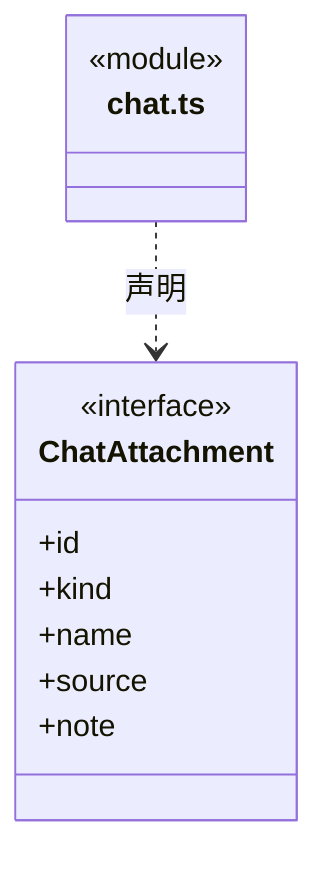
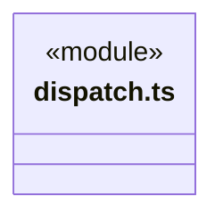
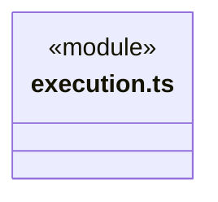
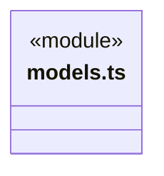
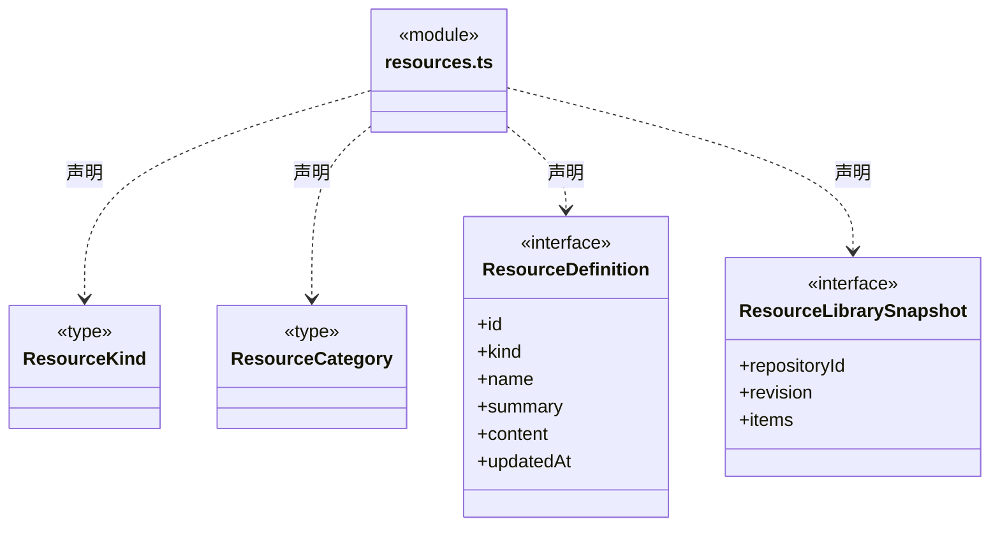
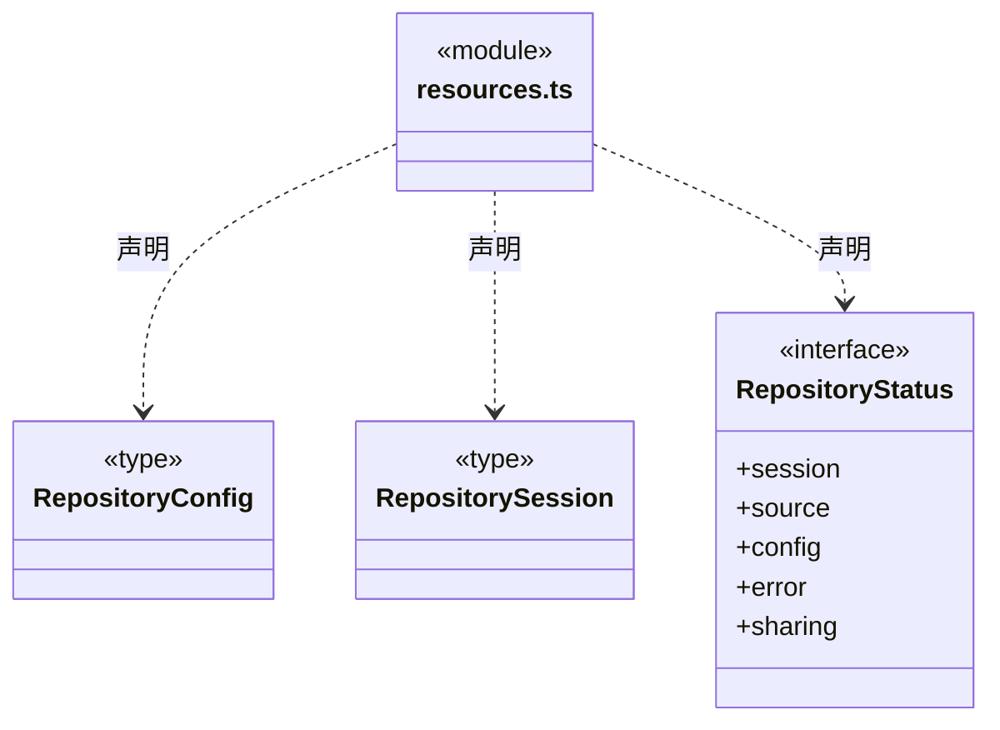
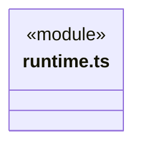
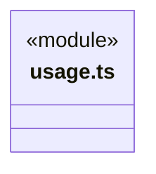
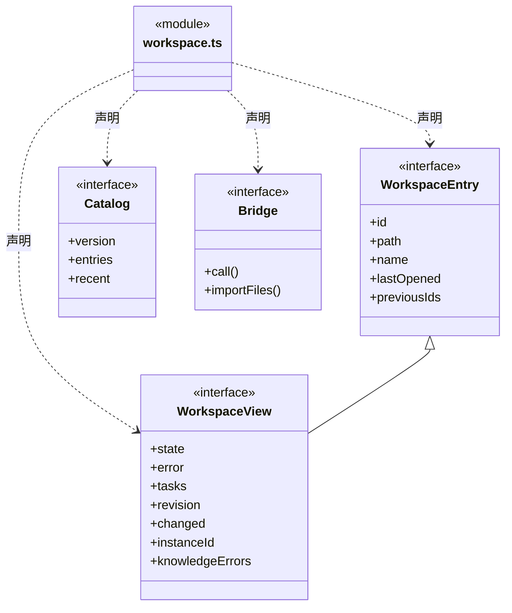
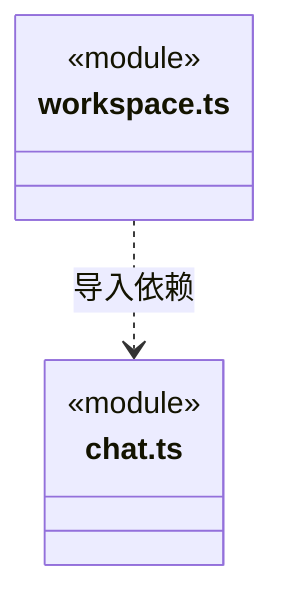

# src/bridge/contracts 架构

## 目录定位

可序列化的 IPC 数据与公开展示契约。可以重导出 Core 类型及纯格式化函数，不暴露密钥或平台存储实现。

本文描述当前实现。通过分析目录边界后维护的 [源码架构脚本](../../../scripts/source-architecture.mjs) 同步清单和声明；代码变更时仍须核对职责、关键成员与关系。

## 代码清单

| 文件 | 当前职责 |
| --- | --- |
| [chat.ts](chat.ts) | 对话附件、执行权限和待审批请求的跨进程契约。 |
| [dispatch.ts](dispatch.ts) | 向桌面消费者公开成员派发命令回执及主会话图 Snapshot/Delta。 |
| [execution.ts](execution.ts) | 对话、运行和排队在 IPC 中传递的可序列化类型。 |
| [models.ts](models.ts) | 模型配置界面消费的公开模型信息与停止原因格式化。 |
| [resources.ts](resources.ts) | 资源种类、仓库快照、登录占位及仓库状态的共享类型。 |
| [runtime.ts](runtime.ts) | 公开应用级成员、任务负载和运行用量的可序列化观察契约。 |
| [usage.ts](usage.ts) | 向界面公开 Core 的纯执行计量函数及单轮用量类型。 |
| [workspace.ts](workspace.ts) | 跨进程工作区、知识事务与 IPC 数据契约。 |

## 架构类图

### chat.ts



直接依赖：[../../backend/core/brain/types.ts](../../backend/core/brain/types.ts)。

### dispatch.ts


直接依赖：[../../backend/core/tasks/graph-types.ts](../../backend/core/tasks/graph-types.ts)、[../../backend/core/tasks/dispatch-commands.ts](../../backend/core/tasks/dispatch-commands.ts)。

### execution.ts


直接依赖：[../../backend/core/brain/types.ts](../../backend/core/brain/types.ts)、[../../backend/core/tasks/types.ts](../../backend/core/tasks/types.ts)、[../../backend/core/tasks/queue.ts](../../backend/core/tasks/queue.ts)、[../../backend/core/tools/questions.ts](../../backend/core/tools/questions.ts)。

### models.ts


直接依赖：[../../backend/core/brain/llm/config.ts](../../backend/core/brain/llm/config.ts)、[../../backend/core/brain/llm/catalog.ts](../../backend/core/brain/llm/catalog.ts)、[../../backend/core/brain/model-errors.ts](../../backend/core/brain/model-errors.ts)。

### resources.ts






### runtime.ts


直接依赖：[../../backend/core/runtime/types.ts](../../backend/core/runtime/types.ts)。

### usage.ts


直接依赖：[../../backend/core/brain/usage.ts](../../backend/core/brain/usage.ts)。

### workspace.ts



直接依赖：[../../backend/core/knowledge/types.ts](../../backend/core/knowledge/types.ts)、[chat.ts](chat.ts)。

### 本目录调用边界




## 子目录导航

无子目录。

[返回上层](../ARCHITECTURE.md)。

每次修改本目录代码，同步维护文件头、关键契约说明及本图。未实现的治理、证据验收和自动编排能力不列入当前类图。

## 设计契约 v1 与落地范围

以下内容区分已接通能力与后续设计；以各节的实现状态为准，不将目标图当作现状图。维护源：[CONTRACT.md](CONTRACT.md)；生成类图时同步附加，勿直接修改本附录。

### 任务派发图公开契约

已通过 `dispatch.ts` 导出真实节点/增量及命令回执类型；Application IPC 已接 `dispatch.open / dispatch.memberCreate / dispatch.task / dispatch.graphSnapshot / dispatch.graphDelta`。当前可以创建成员、可靠派发并读取图，尚未做界面图渲染、模型派发工具或图订阅推送。以下订阅与结果处理仍为后续契约。

Bridge 只公开可序列化的图快照与增量数据。节点约束、角色实例和任务状态由 Core 定义，调度产生真实事实；前端不得根据助手回复文字推断“已派发”或直接写图状态。

### 稳定身份与节点范围

```ts
interface GraphIdentity {
  workspaceId: string;
  rootSessionId: string;
}

interface GraphCursor extends GraphIdentity {
  streamId: string;
  seq: number;
}

interface GraphSnapshot {
  version: 1;
  identity: GraphIdentity;
  cursor: GraphCursor;
  root: SessionRootNode;
  tasks: TaskNode[];
  edges: GraphEdge[];
  agents: AgentGraphView[];
}
```

根节点 `SessionRootNode` 表示主 Agent 的当前 Session，图内普通任务节点表达执行 Agent、涉及模块列表、任务目标、状态和结果引用。节点、边与成员投影的完整领域结构以 Core 契约为准，本层只重导出公开类型，不引用具体执行器或存储实现。

`rootSessionId` 是最初主 Agent 的会话范围；被派发成员拥有自己的 `agentSessionId`。`taskId` 是图节点身份，`runId` 是执行尝试身份，不能用现有 `loop.taskId` 同时代替这三类标识。

任务改派、重试和重规划遵循领域版本规则。完成和取消节点保留以供追溯；当前协议不提供物理删除节点事件。返回结果更新对应节点和等待状态，不增加反向返回边。

### 原子增量批次

```ts
type GraphChange =
  | { type: 'root.upserted'; root: SessionRootNode }
  | { type: 'task.upserted'; task: TaskNode }
  | { type: 'edge.upserted'; edge: GraphEdge }
  | { type: 'agent.upserted'; agent: AgentGraphView };

interface GraphEventBatch {
  version: 1;
  identity: GraphIdentity;
  streamId: string;
  seq: number;
  eventId: string;
  commandId: string;
  cause: GraphCause;
  committedAt: string;
  changes: GraphChange[];
}

type GraphDelta =
  | { mode: 'noop'; cursor: GraphCursor }
  | {
      mode: 'delta';
      from: GraphCursor; cursor: GraphCursor;
      batches: GraphEventBatch[]; hasMore: boolean;
    }
  | {
      mode: 'reset';
      reason: 'initial' | 'stream_changed' | 'history_compacted' | 'cursor_ahead';
      snapshot: GraphSnapshot; cursor: GraphCursor;
    };
```

- `seq` 按原子提交批次递增，从 1 开始，跨正常重启保持连续。0 仅代表内部空前缀；graph.created 在 seq=1 原子提交根，公开快照始终有根。一次命令造成多个对象变化时，必须在同一个批次中发布。
- `changes` 只包含有变化对象，但每个对象都是完整新快照；使用稳定 ID 替换旧对象，不把局部字段缺省错误地理解为“保留旧值”。
- `committedAt` 为 UTC ISO 8601 时间；顺序以 `seq` 为准。`cause` 是 Core 定义的 `GraphCause` 事实枚举，由后端根据真实提交填写，不接受模型自报的发送者。可信发送者等审计信息保存在内部命令记录；公开批次不包含私有推理、密钥或原始凭据。
- `delta.from` 必须等于客户端提交的游标；`cursor` 表示本次响应已经返回到的最后提交位置，不直接跳到尚未返回的服务端头部。
- `batches` 内序号必须连续；一次响应不拆开批次。`hasMore` 为 true 时，客户端使用返回的 `cursor` 继续读取。
- `noop` 不带对象列表或正文，前端保留已有引用与布局。`reset` 的快照整体替换相同图身份的本地投影，不能与旧流对象混合。
- 每种响应均由 `cursor` 携带明确图身份；`reset.cursor` 必须与 `reset.snapshot.cursor` 完全一致，且快照的 `identity` 与游标身份一致。

### IPC 与后续订阅入口

```ts
// 当前 IPC action 为 dispatch.graphSnapshot / dispatch.graphDelta。
interface DispatchGraphApi {
  graphSnapshot(input: { identity: GraphIdentity }): Promise<GraphSnapshot>;
  graphDelta(input: {
    identity: GraphIdentity; cursor?: GraphCursor; limit?: number;
  }): Promise<GraphDelta>;
}
```

`limit` 按完整批次计数，建议默认 100、允许 1～500，由后端严格校验。首次未提供游标时返回 `mode:'reset', reason:'initial'`；图尚不存在时返回 `GRAPH_NOT_FOUND`，读取不能暗中创建执行任务。

后续订阅使用相同 `GraphEventBatch`，不另造 UI 专用状态协议。订阅断线不影响任务执行；客户端以最后成功应用的游标调用增量接口补读。初始快照与订阅之间发生的变更也通过游标补读消除缺口。

任何调用与返回都核验 `workspaceId + rootSessionId`。当工作区或会话切换时，前端取消旧订阅并丢弃不匹配的迟到响应；不能只比较 `seq` 或 `taskId`。IPC 调用者的权限由主进程核验，图身份不是授权凭据。

### 消费与错误处理

前端只有完整验证并原子应用一个批次后才推进游标。重复收到已经应用的批次时按 `streamId + seq` 去重；相同序号却具有不同 `eventId` 应视为协议不一致并重新获取快照。序号断档不直接跳过，应补读；补读不可用时再接收后端 reset。

| 情况 | 返回与处理 |
| --- | --- |
| 请求身份与游标身份不同、或者订阅越过已授权图范围 | `GRAPH_IDENTITY_MISMATCH`，拒绝；不能 reset 到另一张图 |
| 当前图没有新提交 | `noop`，不替换节点或重复回读全图 |
| 同图合法游标属于旧流 | `reset / stream_changed` |
| 游标早于保留历史区间 | `reset / history_compacted` |
| 游标序号超出当前持久化头部 | `reset / cursor_ahead`；不假装已经同步 |
| 参数非法或 limit 越界 | `GRAPH_INPUT_INVALID` |
| 协议版本无法识别 | `GRAPH_VERSION_UNSUPPORTED`，停止应用，提示升级或重新加载 |
| 工作区未运行或正在关闭 | 返回明确生命周期错误，保留本地最后已确认投影并标记暂不可更新 |

读取接口不包含写权限、命令输入或模型参数。后续任务命令与图增量查询分别定义：命令需要 `commandId` 和预期对象版本，重复命令返回原回执；前端不能通过发送 `GraphChange` 绕过调度创建任务。

### 当前会话与团队全局状态

此图只显示当前主 Agent Session 发起的任务及其递归派发。`agents` 的状态及任务引用均为本图局部事实投影；一个成员可能在本图 waiting、在另一张图 working。本图 idle 不意味着全局空闲。工作区组织图的全局成员状态以后走独立授权接口，不在此协议中隐式夹带其他会话内容。

图中的 `result_ready` 表示待交接候选，与执行完成、消息确认及业务验收分别表达。公开图不允许前端或模型把“收到返回消息”“进程结束”“有成功工具回执”自动转换成业务验收通过。
