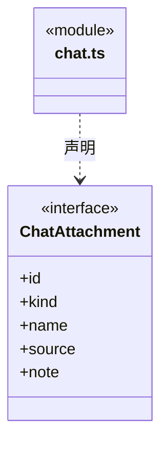
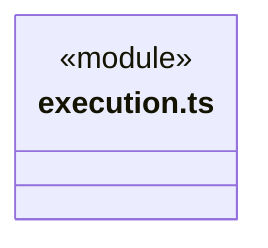
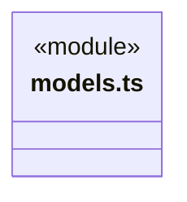
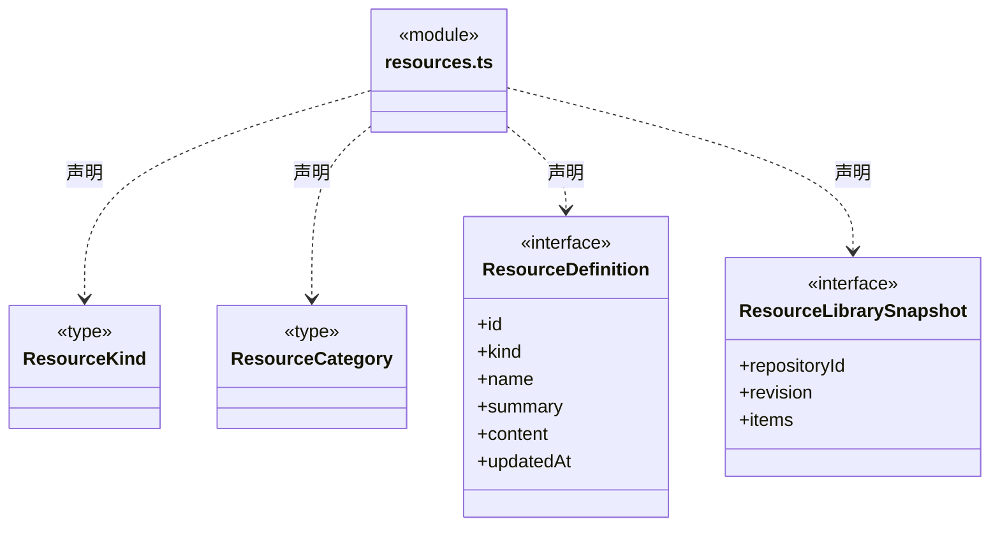
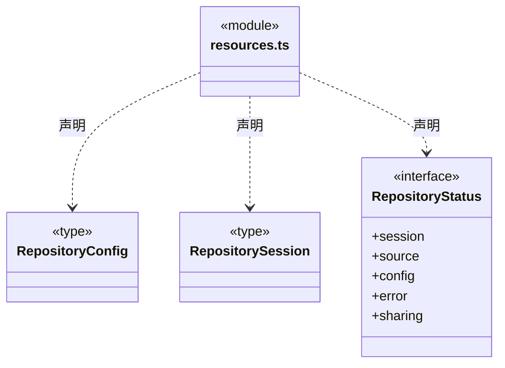
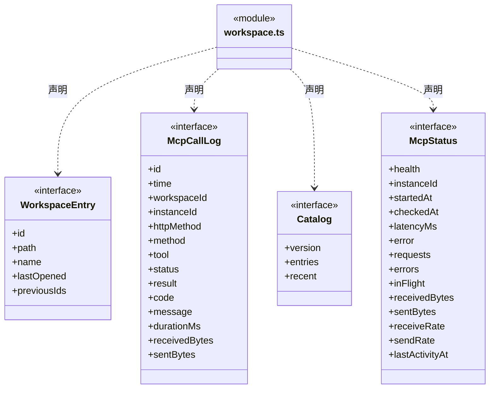
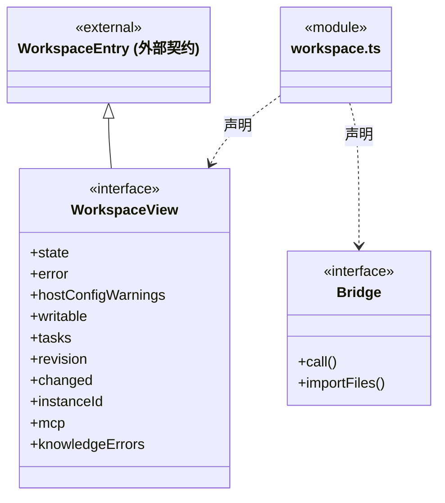
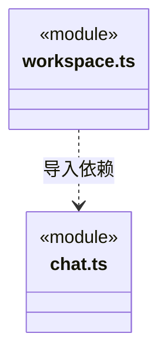

# src/bridge/contracts 架构

## 目录定位

可序列化的 IPC 数据与公开展示契约。可以重导出 Core 类型及纯格式化函数，不暴露密钥或平台存储实现。

本文描述当前实现。通过分析目录边界后维护的 [源码架构脚本](../../../scripts/source-architecture.mjs) 同步清单和声明；代码变更时仍须核对职责、关键成员与关系。

## 代码清单

| 文件 | 当前职责 |
| --- | --- |
| [chat.ts](chat.ts) | 对话附件、执行权限和待审批请求的跨进程契约。 |
| [execution.ts](execution.ts) | 对话、运行和排队在 IPC 中传递的可序列化类型。 |
| [models.ts](models.ts) | 模型配置界面消费的公开模型信息与停止原因格式化。 |
| [resources.ts](resources.ts) | 资源种类、仓库快照、登录占位及仓库状态的共享类型。 |
| [workspace.ts](workspace.ts) | 跨进程工作区、知识事务、MCP 与 IPC 数据契约。 |

## 架构类图

### chat.ts

直接依赖：[../../backend/core/brain/types.ts](../../backend/core/brain/types.ts)。

### execution.ts

直接依赖：[../../backend/core/brain/types.ts](../../backend/core/brain/types.ts)、[../../backend/core/tasks/types.ts](../../backend/core/tasks/types.ts)、[../../backend/core/tasks/queue.ts](../../backend/core/tasks/queue.ts)、[../../backend/core/tools/questions.ts](../../backend/core/tools/questions.ts)。

### models.ts

直接依赖：[../../backend/core/brain/llm/config.ts](../../backend/core/brain/llm/config.ts)、[../../backend/core/brain/llm/catalog.ts](../../backend/core/brain/llm/catalog.ts)、[../../backend/core/brain/model-errors.ts](../../backend/core/brain/model-errors.ts)。

### resources.ts

### workspace.ts

直接依赖：[../../backend/core/knowledge/types.ts](../../backend/core/knowledge/types.ts)、[chat.ts](chat.ts)。

### 本目录调用边界

## 子目录导航

无子目录。

[返回上层](../ARCHITECTURE.md)。

每次修改本目录代码，同步维护文件头、关键契约说明及本图。未实现的治理、证据验收和自动编排能力不列入当前类图。
