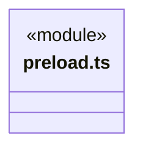

# src/bridge/preload 架构

## 目录定位

固定 Electron IPC 桥；不向页面暴露 Node、凭据或任意磁盘 API。

本文描述当前实现。通过分析目录边界后维护的 [源码架构脚本](../../../scripts/source-architecture.mjs) 同步清单和声明；代码变更时仍须核对职责、关键成员与关系。

## 代码清单

| 文件 | 当前职责 |
| --- | --- |
| [preload.ts](preload.ts) | 前后端通信边界的 Electron 安全桥，仅向 window.cbim 暴露固定 call 与系统 File 导入，通过 cbim:call IPC 请求本机后端。 |

## 架构类图

### preload.ts

直接依赖：[../contracts/workspace.ts](../contracts/workspace.ts)。

## 子目录导航

无子目录。

[返回上层](../ARCHITECTURE.md)。

每次修改本目录代码，同步维护文件头、关键契约说明及本图。未实现的治理、证据验收和自动编排能力不列入当前类图。

## 设计契约 v1 与落地范围

以下内容区分已接通能力与后续设计；以各节的实现状态为准，不将目标图当作现状图。维护源：[CONTRACT.md](CONTRACT.md)；生成类图时同步附加，勿直接修改本附录。

### 有类型的公开桥

暴露对象按 Bridge 检查，渲染层通过固定动作目录调用；传输仍只有原 cbim:call/cbim:drop 通道。请求类型不作为授权，Main 的发送窗口和主 Frame 检查保持；错误仍转为原 code/message，不向页面开放 Node 或 Electron。
