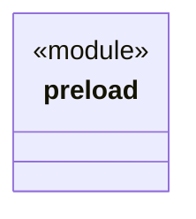

# src/bridge/preload 架构

## 设计意图

在 Electron 的隔离上下文中提供最小页面调用桥，让界面只使用声明过的操作和文件导入能力。

`preload.ts` 通过 contextBridge 暴露固定的 `window.cbim` 接口，调用沿 `cbim:call` 信封转交主进程；文件导入使用 Electron 提供的真实 File 路径转换。桥本身不持有业务状态、不重试操作，可信来源与主 Frame 校验仍由服务端执行。

## 主要组成

| 组成 | 定位 |
| --- | --- |
| [preload](preload.ts) | 前后端通信边界的 Electron 安全桥，仅向 window.cbim 暴露固定 call 与系统 File 导入，通过 cbim:call IPC 请求本机后端。 |

<!-- architecture:generated:start -->

## 架构关系

[上层设计](../ARCHITECTURE.md)

<!-- architecture:generated:end -->
