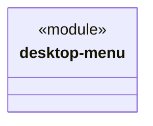

# src/bridge/preload 架构

## 设计意图

向当前页面提供受限桌面菜单能力。业务请求经当前桌面通信入口传递，不公开任意 Node API。

## 主要组成

| 组成 | 定位 |
| --- | --- |
| [desktop-menu](desktop-menu.ts) | 安装当前桌面菜单桥接。 |

<!-- architecture:generated:start -->

## 架构关系

[上层设计](../ARCHITECTURE.md)

<!-- architecture:generated:end -->
