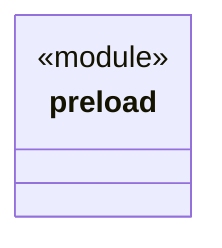

# src/bridge/preload 架构

## 设计意图

固定 Electron IPC 桥；不向页面暴露 Node、凭据或任意磁盘 API。 实现关联调用签名并沿原信封转发，不重试错误或改变主Frame授权。

## 主要组成

| 组成 | 定位 |
| --- | --- |
| [preload](preload.ts) | 前后端通信边界的 Electron 安全桥，仅向 window.cbim 暴露固定 call 与系统 File 导入，通过 cbim:call IPC 请求本机后端。 |

<!-- architecture:generated:start -->

## 架构关系

[上层设计](../ARCHITECTURE.md)

<!-- architecture:generated:end -->
