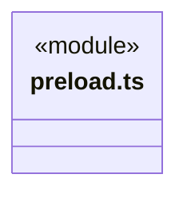

# src/bridge/preload 架构

本目录只维护这一份说明。设计与契约直接编辑本文；文件清单、类图和导航由 [架构脚本](../../../scripts/source-architecture.mjs) 更新，生成区域之外的人工说明会保留。

## 封装意图

固定 Electron IPC 桥；不向页面暴露 Node、凭据或任意磁盘 API。 实现关联调用签名并沿原信封转发，不重试错误或改变主Frame授权。

## 类与模块的设计意图

下表依据源码声明及文件头说明定位封装。字段表示该实例持有的状态或协作引用，不表示它拥有被引用服务的生命周期；实际资源责任和调用限制见下文契约及源码注释。

| 类／模块 | 实现形式与实例字段 | 封装依据 |
| --- | --- | --- |
| [preload.ts](preload.ts) | 函数／契约模块 | 只开放固定 IPC 调用桥，渲染页面不获得 Node 或任意 Electron API。 |

## 接口设计契约

##### 有类型的公开桥

暴露对象按 Bridge 检查，渲染层通过固定动作目录调用；传输仍只有原 cbim:call/cbim:drop 通道。请求类型不作为授权，Main 的发送窗口和主 Frame 检查保持；错误仍转为原 code/message，不向页面开放 Node 或 Electron。

##### 精确请求与传输实现

Bridge.call 的关联元组也拒绝泛型推导产生的多余顶层字段；Electron 传输函数内部接收原始 action/args，主进程继续按完整 Schema 校验。错误信封、单次调用与不自动重试的约定保持。

## 开闭边界

本目录的职责及允许协作由[封装意图](#封装意图)限定，输入输出、状态与失败语义以[接口设计契约](#接口设计契约)为准。扩展从已有公开入口及实际装配位置进入；没有明确可替换契约的部分按真实影响修改和验证，不预建未使用的基类或插件入口。

<!-- architecture:generated:start -->

## 文件清单

| 文件 | 形式 | 当前职责 |
| --- | --- | --- |
| [ARCHITECTURE.md](ARCHITECTURE.md) | 说明文档 | 本目录的文件清单、真实声明、依赖与子封装导航。 |
| [preload.ts](preload.ts) | 源码模块 | 前后端通信边界的 Electron 安全桥，仅向 window.cbim 暴露固定 call 与系统 File 导入，通过 cbim:call IPC 请求本机后端。 |

## 架构类图

成员标记：`+` 公开、`-` 私有、`#` 受保护、`$` 静态；构造函数单独列出。文档和资源仅在文件清单中导航，不作为代码节点。

### preload.ts

直接依赖：[../contracts/workspace.ts](../contracts/workspace.ts)。

## 子目录导航

无子目录。

[返回上层](../ARCHITECTURE.md)。

每次修改本目录代码，同步维护文件头、关键契约说明及本图。未实现的治理、证据验收和自动编排能力不列入当前类图。

<!-- architecture:generated:end -->
