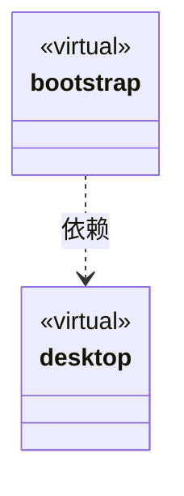

# src/bridge/server 架构

## 设计意图

提供当前桌面进程的可信通信和平台边界。业务实例由 logic-new/application 创建，Electron 能力由 desktop 注入；旧 IPC、命令行与应用装配入口已退役。

## 主要组成

本层为容器：bootstrap 启动桌面，desktop 适配平台、通信与 Office 工具。

<!-- architecture:generated:start -->

## 架构关系

标注为 `virtual` 的节点是直接子模块的虚拟类封装；内部设计沿下方入口阅读。

## 子模块

| 虚拟封装 | 整体职责 |
| --- | --- |
| [bootstrap](bootstrap/ARCHITECTURE.md) | 在业务访问用户数据前选择可信运行资源，并隔离资源切换、失败恢复与正式应用启动。 |
| [desktop](desktop/ARCHITECTURE.md) | 装配新版应用，协调窗口与桌面进程的生命周期。 |

[上层设计](../ARCHITECTURE.md)

<!-- architecture:generated:end -->
