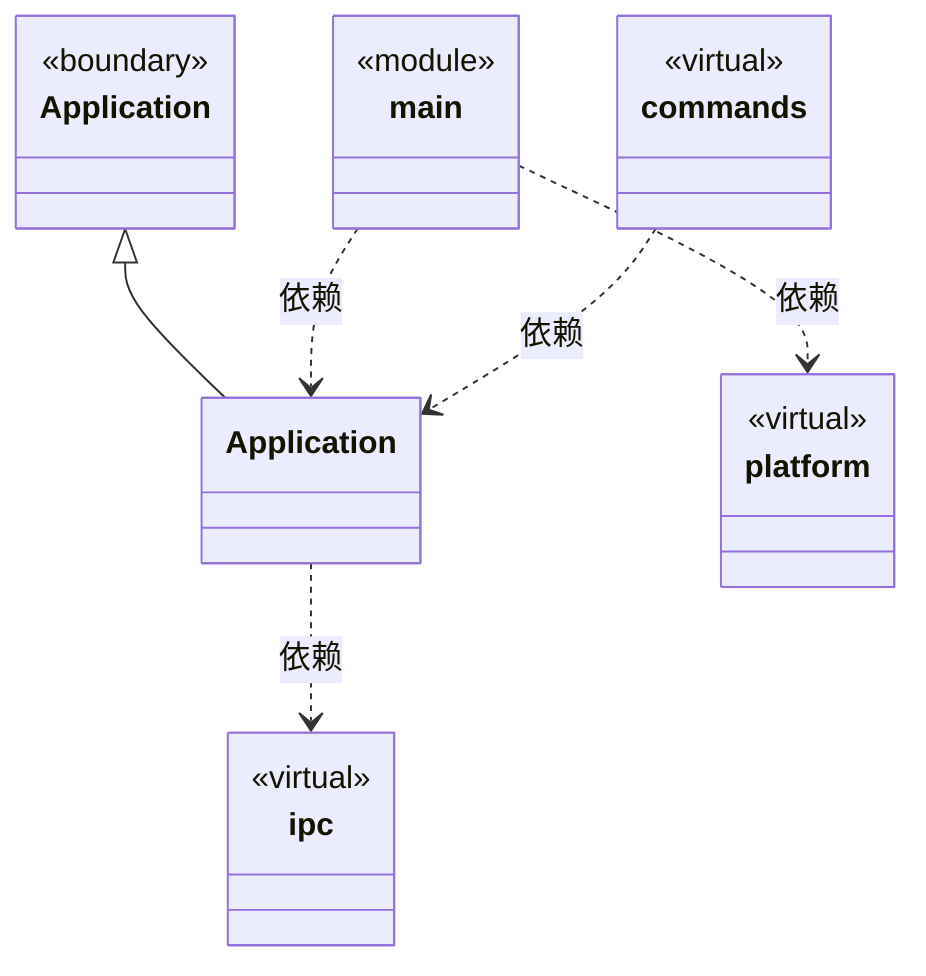
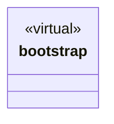

# src/bridge/server 架构

## 设计意图

将 Electron 和 CLI 的外部请求接入 Logic/Application。Application 适配类负责委托，main 负责宿主装配，启动、通信和平台传输各自封装；业务生命周期仍由 Logic 持有。

## 主要组成

| 组成 | 定位 |
| --- | --- |
| [Application](application.ts) | 继承 Logic/Application 并补充通信委托，不复制业务状态。 |
| [main](main.ts) | 本机后端的 Electron 装配入口，区分开发与打包品牌资源路径，管理窗口、固定 IPC、原生文件选择、附件预览与打包验证；前端只通过 bridge/preload 请求服务。 |

<!-- architecture:generated:start -->

## 架构关系

标注为 `virtual` 的节点是直接子模块的虚拟类封装；内部设计沿下方入口阅读。

### 关系组 1

### 关系组 2

### 跨图协作

- [bootstrap](bootstrap/ARCHITECTURE.md)（图 2）→ [main](main.ts)（图 1）：依赖。

外部继承／实现边界：[Application](../../logic/application/application.ts)。

## 子模块

| 虚拟封装 | 整体职责 |
| --- | --- |
| [bootstrap](bootstrap/ARCHITECTURE.md) | 桌面冷启动封装：在业务应用访问用户数据前选择并核实运行资源，持有更新和引擎缓存，再向业务入口注入窄端口。资源选择与业务启动分开，保留失败恢复边界。 |
| [commands](commands/ARCHITECTURE.md) | CLI 入口，复用应用和调度，不拥有第二套领域规则。 |
| [ipc](ipc/ARCHITECTURE.md) | 把已接入的桌面操作分派到应用服务。统一入口负责请求解析和路由，业务处理器按领域分组；这里传递身份和返回事实，不拥有业务规则或第二套状态。 |
| [platform](platform/ARCHITECTURE.md) | Electron utility 文件传输和子进程入口；处理可信私有协议，业务文件规则与 Win32 实现归 Logic。 |

[上层设计](../ARCHITECTURE.md)

<!-- architecture:generated:end -->
