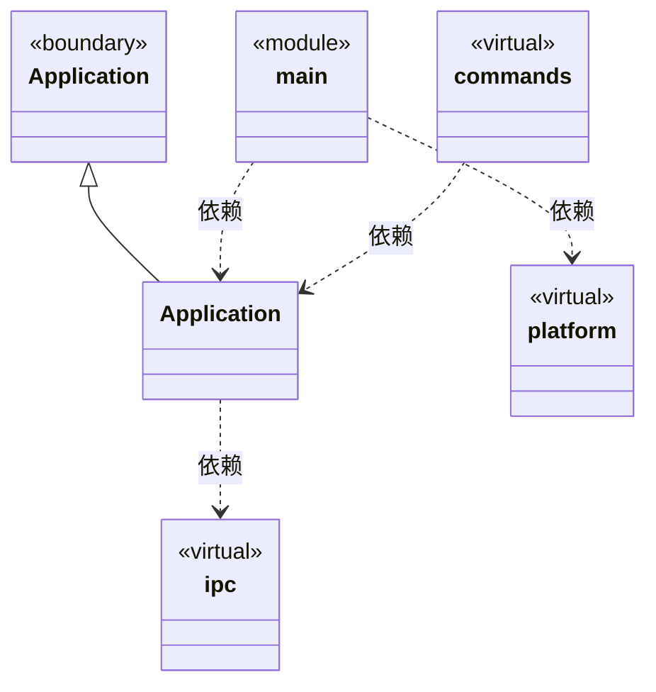
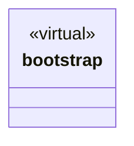

# src/bridge/server 架构

## 设计意图

承接 Electron 与 CLI 的可信入口，把外部操作连接到唯一业务应用，并管理桌面窗口与宿主资源。

本层 `Application` 是 Logic 应用的通信适配，`main` 创建桌面窗口、接入 IPC 并注入平台端口。子模块 `bootstrap` 在业务启动前选择运行资源，`ipc` 分派操作，`platform` 提供进程传输，`commands` 提供 CLI。业务关闭委托 Logic；窗口、IPC 和文件工人的宿主收束仍在 Bridge。

## 主要组成

| 组成 | 定位 |
| --- | --- |
| [Application](application.ts) | 继承 Logic/Application 并补充通信委托，不复制业务状态。 |
| [main](main.ts) | Electron 运行资源入口，装配窗口、IPC、文件选择及平台端口，向冷壳报告真实启动阶段。 |

## 现状与目标边界

当前是混合目录。[main.ts](main.ts) 是 [桌面构建登记](../../../desktop-builds.ts) 中的运行资源入口，冷壳依赖固定 `main.js` 与 `startDesktop` 导出；它现在仍包含窗口和 IPC 装配，不是纯转接。[application.ts](application.ts) 通过真实继承提供通信委托。目标是保持这些兼容入口最小，把宿主装配与适配实现归入明确子封装；迁移时须同步构建、冷壳加载和 CLI 消费者，不能改变启动确认或业务关闭语义。

<!-- architecture:generated:start -->

## 架构关系

标注为 `virtual` 的节点是直接子模块的虚拟类封装；内部设计沿下方入口阅读。

### 关系组 1：Application

### 关系组 2：bootstrap

### 跨图协作

按引用方归并目标，保留全部跨图关系；分图只用于阅读，不表示新增模块或依赖边界。

| 引用方 | 关系 | 目标 |
| --- | --- | --- |
| [bootstrap](bootstrap/ARCHITECTURE.md)（图 2） | 依赖 | [main](main.ts)（图 1） |

外部继承／实现边界：[Application](../../logic/application/application.ts)。

## 子模块

| 虚拟封装 | 整体职责 |
| --- | --- |
| [bootstrap](bootstrap/ARCHITECTURE.md) | 在业务访问用户数据前选择可信运行资源，并隔离资源切换、失败恢复与正式应用启动。 |
| [commands](commands/ARCHITECTURE.md) | 提供面向开发与诊断的命令行执行入口，复用业务应用的初始化、运行与关闭流程。 |
| [ipc](ipc/ARCHITECTURE.md) | 将已接入的桌面操作解析并分派到对应业务服务，保持传输路由与领域决策分离。 |
| [platform](platform/ARCHITECTURE.md) | 以 Electron utility 子进程承载受控文件的可信传输，将宿主进程管理与业务文件规则分开。 |

[上层设计](../ARCHITECTURE.md)

<!-- architecture:generated:end -->
