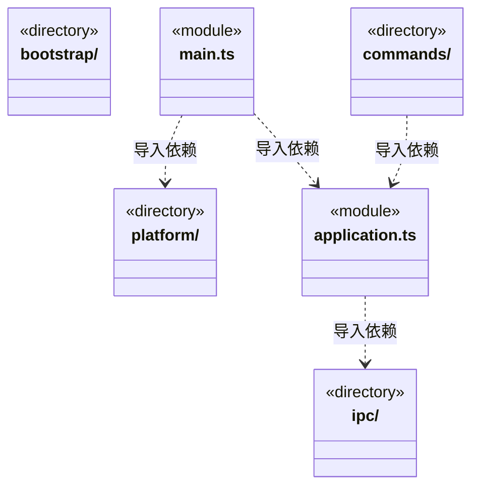
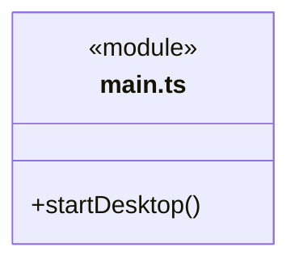

# src/bridge/server 架构

## 目录定位

可信宿主桥接：桌面/CLI 入口、IPC 处理和业务 Application 的通信适配；业务状态与生命周期归 Logic。

本文描述当前实现。通过分析目录边界后维护的 [源码架构脚本](../../../scripts/source-architecture.mjs) 同步清单和声明；代码变更时仍须核对职责、关键成员与关系。

## 代码清单

| 文件 | 当前职责 |
| --- | --- |
| [application.ts](application.ts) | 为业务 Application 增加类型化 IPC 分发入口。 |
| [main.ts](main.ts) | 本机后端的 Electron 装配入口，管理窗口、固定 IPC、原生文件选择、附件预览与打包验证；前端只通过 bridge/preload 请求服务。 |

## 架构类图

各图中的同名节点表示同一目录边界；跨组及完整直接依赖如下（无边不代表继承）：

- `application.ts` → `ipc`：导入。
- `commands` → `application.ts`：导入。
- `main.ts` → `platform`：导入。
- `main.ts` → `application.ts`：导入。

### main.ts 公开入口

## 子目录导航

- [bootstrap/](bootstrap/ARCHITECTURE.md)：固定冷壳入口：先验证同 C 的签名资源集合，再放行候选访问原 profile；独立选择日志、单实例、失败恢复及按需引擎下载由冷壳持有。计算式 main.js 装载保留可审计的源码依赖边。
- [commands/](commands/ARCHITECTURE.md)：CLI 入口，复用应用和调度，不拥有第二套领域规则。
- [ipc/](ipc/ARCHITECTURE.md)：应用 action 路由；等待资料独立导入/目录/取消入口不启动模型，受理只读保存快照。队列插入传递原expectedRunId，由调度拒绝缺失、过期及停止。公开准入游标读取和版本化设置，不开放许可领取/撤销。报告、核实和业务重规划保持独立；启动额度不足明确未受理，桌面发送方在 Electron 接入处核验。 人工提交参数不接受 actor，保存不启动模型；查询保留历史身份。 161项应用操作按业务组装配，request统一保留关闭/受理前错误码后解析，实际处理器受响应映射约束。 dispatch.ownerInspect 只读核原任务并返回当前观察；正式派发必须显式绑定主周期。 dispatch.commandReport 固定原工作区、主根、运行和调用，桌面与模型共用同一只读服务。 五项影响观察／处置／原回执／历史／关联入口相互分开，查询不启动新任务；保存只接受本机显式决定。 四个文件报告/补偿入口固定原调用或原命令；actor 由桌面入口注入，查询不启动文件操作，补偿不得改变目标路径或内容。
- [platform/](platform/ARCHITECTURE.md)：Electron utility 文件传输和子进程入口；处理可信私有协议，业务文件规则与 Win32 实现归 Logic。

[返回上层](../ARCHITECTURE.md)。

每次修改本目录代码，同步维护文件头、关键契约说明及本图。未实现的治理、证据验收和自动编排能力不列入当前类图。
