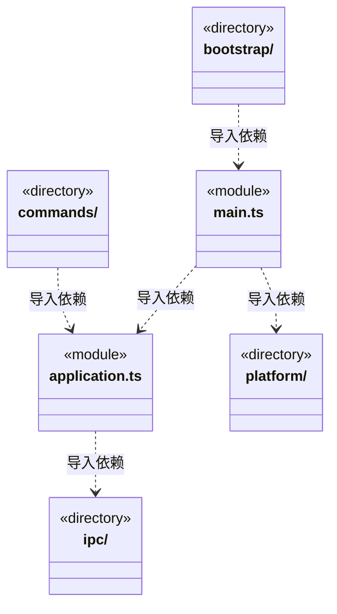
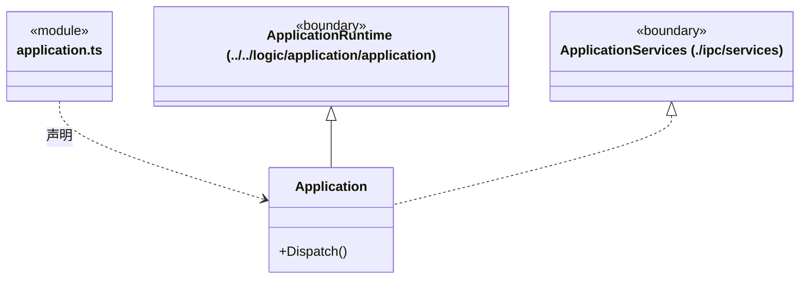
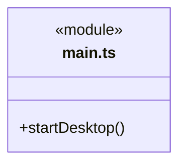

# src/bridge/server 架构

本目录只维护这一份说明。设计与契约直接编辑本文；文件清单、类图和导航由 [架构脚本](../../../scripts/source-architecture.mjs) 更新，生成区域之外的人工说明会保留。

## 封装意图

可信宿主桥接：桌面/CLI 入口、IPC 处理和业务 Application 的通信适配；业务状态与生命周期归 Logic。

## 类与模块的设计意图

下表依据源码声明及文件头说明定位封装。字段表示该实例持有的状态或协作引用，不表示它拥有被引用服务的生命周期；实际资源责任和调用限制见下文契约及源码注释。

| 类／模块 | 实现形式与实例字段 | 封装依据 |
| --- | --- | --- |
| [Application](application.ts) | 实例类；无实例字段声明 | 可替换业务实例的桥接适配，仅将消息委托给独立路由。 |
| [main.ts](main.ts) | 函数／契约模块 | 把 Electron 窗口与 IPC 留在唯一桌面入口，服务层可以脱离窗口验证；模型凭据加密通过系统 safeStorage 注入；手动终端固定工作区目录，退出时释放子进程。 |

## 接口设计契约

### 桌面宿主与业务应用适配

#### Application 的设计意图

[application.ts](application.ts) 中的 `Application` 是 Logic Application 的实例适配子类，只增加 `Dispatch`，沿用父类的全部业务状态、构造和关闭行为。继承用于让桌面调用方继续持有同一个应用对象，不通过重载生命周期建立第二份服务集合。

三个连续声明分别是已知操作的配对响应签名、动态字符串的 unknown 响应签名和实际分派实现。全部请求委托 [IPC 分派器](ipc/dispatch.ts) 做解析及业务路由；解析或业务异常原样传播，适配器不授予额外权限。新增操作修改通信契约及对应处理器，普通业务服务不依赖本子类。

#### 桌面引擎管理入口

主 Frame 的 desktop.engines.status 返回无路径目录；desktop.engines.prepare 仅接受严格枚举 engine，不能指定下载地址或命令。安装应用期间拒绝准备；用户点击准备后不启动模型、不选择引擎。Codex 准备同时保证其 Pi 原生工具依赖，失败保留各自真实状态。旧宿主缺端口明确拒绝，开发态标记 bundled。

桌面 Main 将冷壳 engineArtifacts 窄端口交给 Application；冷壳不再承担引擎活动选择，正式主/成员由 Application 的包管理服务固定版本。

#### 内置运行资源边界

桌面 Application 读取当前 R 的 assets，开发态读取仓库 assets；不再从 design 注入运行规则。

## 开闭边界

本目录的职责及允许协作由[封装意图](#封装意图)限定，输入输出、状态与失败语义以[接口设计契约](#接口设计契约)为准。扩展从已有公开入口及实际装配位置进入；没有明确可替换契约的部分按真实影响修改和验证，不预建未使用的基类或插件入口。

<!-- architecture:generated:start -->

## 文件清单

| 文件 | 形式 | 当前职责 |
| --- | --- | --- |
| [ARCHITECTURE.md](ARCHITECTURE.md) | 说明文档 | 本目录的文件清单、真实声明、依赖与子封装导航。 |
| [application.ts](application.ts) | 源码模块 | 为业务 Application 增加类型化 IPC 分发入口。 |
| [main.ts](main.ts) | 源码模块 | 本机后端的 Electron 装配入口，区分开发与打包品牌资源路径，管理窗口、固定 IPC、原生文件选择、附件预览与打包验证；前端只通过 bridge/preload 请求服务。 |

## 架构类图

成员标记：`+` 公开、`-` 私有、`#` 受保护、`$` 静态；`function` 为函数值成员，`get`／`set` 为访问器。调用／构造／索引签名按匿名签名列出，不虚构方法名；`global.` 表示全局声明补充，非运行时嵌套类。构造函数单独列出，运行时私有字段保留 `#`。文档和资源仅在文件清单中导航，不作为代码节点。

各图中的同名节点表示同一目录边界；跨组及完整直接依赖如下（无边不代表继承）：

- `application.ts` → `ipc`：导入。
- `bootstrap` → `main.ts`：导入。
- `commands` → `application.ts`：导入。
- `main.ts` → `application.ts`：导入。
- `main.ts` → `platform`：导入。

### application.ts

[查看源码](application.ts)。

继承／实现来源：`ApplicationRuntime` → [../../logic/application/application.ts](../../logic/application/application.ts)（声明 `Application`）。
继承／实现来源：`ApplicationServices` → [ipc/services.ts](ipc/services.ts)（声明 `ApplicationServices`）。
直接依赖：[../contracts/ipc-call.ts](../contracts/ipc-call.ts)、[ipc/dispatch.ts](ipc/dispatch.ts)、[ipc/services.ts](ipc/services.ts)、[../../logic/application/application.ts](../../logic/application/application.ts)。

### main.ts

[查看源码](main.ts)。

直接依赖：[../contracts/ipc-call.ts](../contracts/ipc-call.ts)、[application.ts](application.ts)、[platform/controlled-file-transport.ts](platform/controlled-file-transport.ts)、[../../core/platform/electron/secrets.ts](../../core/platform/electron/secrets.ts)、[../../core/platform/electron/web-reader.ts](../../core/platform/electron/web-reader.ts)、[../../core/platform/node/serialization.ts](../../core/platform/node/serialization.ts)、[../../logic/materials/service/chat-inputs.ts](../../logic/materials/service/chat-inputs.ts)、[../../logic/terminal/service/terminal.ts](../../logic/terminal/service/terminal.ts)、[../../logic/tools/runtime/knowledge-tools.ts](../../logic/tools/runtime/knowledge-tools.ts)、[../../logic/updates/service/desktop-releases.ts](../../logic/updates/service/desktop-releases.ts)、[../../logic/updates/service/desktop-updates.ts](../../logic/updates/service/desktop-updates.ts)、[../../logic/updates/service/nsis-updater.ts](../../logic/updates/service/nsis-updater.ts)、[../../logic/updates/service/restart-profile.ts](../../logic/updates/service/restart-profile.ts)、[../../logic/updates/service/runtime-host.ts](../../logic/updates/service/runtime-host.ts)、[../../logic/workspace/service/paths.ts](../../logic/workspace/service/paths.ts)。

## 子目录导航

- [bootstrap/](bootstrap/ARCHITECTURE.md)：固定冷壳入口：先验证同 C 的签名资源集合，再放行候选访问原 profile；独立选择日志、单实例、失败恢复及按需引擎下载由冷壳持有。计算式 main.js 装载保留可审计的源码依赖边。
- [commands/](commands/ARCHITECTURE.md)：CLI 入口，复用应用和调度，不拥有第二套领域规则。
- [ipc/](ipc/ARCHITECTURE.md)：应用 action 路由；等待资料独立导入/目录/取消入口不启动模型，受理只读保存快照。队列插入传递原expectedRunId，由调度拒绝缺失、过期及停止。公开准入游标读取和版本化设置，不开放许可领取/撤销。报告、核实和业务重规划保持独立；启动额度不足明确未受理，桌面发送方在 Electron 接入处核验。 人工提交参数不接受 actor，保存不启动模型；查询保留历史身份。 161项应用操作按业务组装配，request统一保留关闭/受理前错误码后解析，实际处理器受响应映射约束。 dispatch.ownerInspect 只读核原任务并返回当前观察；正式派发必须显式绑定主周期。 dispatch.commandReport 固定原工作区、主根、运行和调用，桌面与模型共用同一只读服务。 五项影响观察／处置／原回执／历史／关联入口相互分开，查询不启动新任务；保存只接受本机显式决定。 四个文件报告/补偿入口固定原调用或原命令；actor 由桌面入口注入，查询不启动文件操作，补偿不得改变目标路径或内容。
- [platform/](platform/ARCHITECTURE.md)：Electron utility 文件传输和子进程入口；处理可信私有协议，业务文件规则与 Win32 实现归 Logic。

[返回上层](../ARCHITECTURE.md)。

每次修改本目录代码，同步维护文件头、关键契约说明及本图。未实现的治理、证据验收和自动编排能力不列入当前类图。

<!-- architecture:generated:end -->
