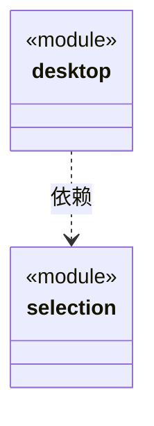

# src/bridge/server/bootstrap 架构

## 设计意图

桌面冷启动封装：在业务应用访问用户数据前选择并核实运行资源，持有更新和引擎缓存，再向业务入口注入窄端口。资源选择与业务启动分开，保留失败恢复边界。

## 主要组成

| 组成 | 定位 |
| --- | --- |
| [desktop](desktop.ts) | 固定冷壳的桌面启动入口，选择已签名资源、持有更新与引擎缓存，并把窄端口交给业务入口。 |
| [selection](selection.ts) | Electron 打开原 profile 前，同步核实当前或已授权候选资源，并决定是否进入恢复。 |

开发态和正式资源均调用业务模块的 `startDesktop` 导出；加载结果的类型直接引用 `main.ts`，避免手写声明掩盖入口名称漂移。该引用仅用于类型校验，业务代码仍在资源选择完成后从固定的 `main.js` 路径加载。

<!-- architecture:generated:start -->

## 架构关系

[上层设计](../ARCHITECTURE.md)

<!-- architecture:generated:end -->
