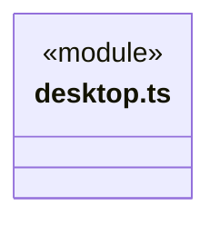
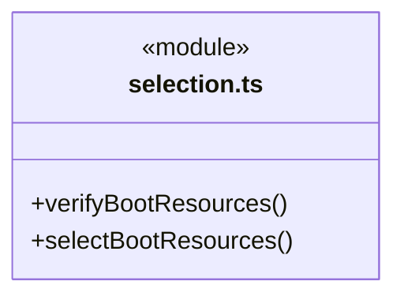
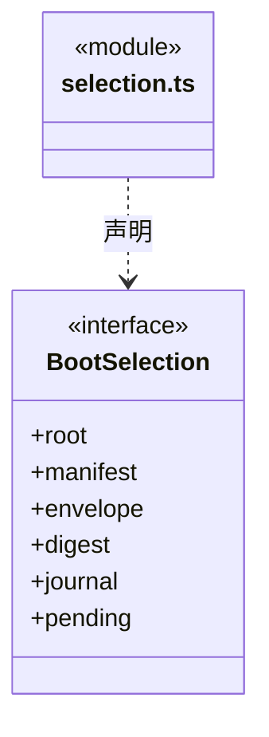
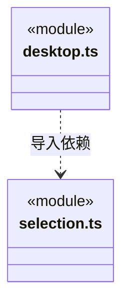

# src/bridge/server/bootstrap 架构

本目录只维护这一份说明。设计与契约直接编辑本文；文件清单、类图和导航由 [架构脚本](../../../../scripts/source-architecture.mjs) 更新，生成区域之外的人工说明会保留。

## 封装意图

固定冷壳入口：先验证同 C 的签名资源集合，再放行候选访问原 profile；独立选择日志、单实例、失败恢复及按需引擎下载由冷壳持有。计算式 main.js 装载保留可审计的源码依赖边。

## 类与模块的设计意图

下表依据源码声明及文件头说明定位封装。字段表示该实例持有的状态或协作引用，不表示它拥有被引用服务的生命周期；实际资源责任和调用限制见下文契约及源码注释。

| 类／模块 | 实现形式与实例字段 | 封装依据 |
| --- | --- | --- |
| [desktop.ts](desktop.ts) | 函数／契约模块 | 日常 TS / UI 更新不替换 Electron 或冷壳；启动失败先保留原数据，恢复界面不加载失败的业务代码。 |
| [selection.ts](selection.ts) | 函数／契约模块 | 启动期只校验较小的 R，不等待引擎下载；未接触数据时允许回退，访问标记一旦存在就拒绝自动降级。 |

## 接口设计契约

#### 对话中的引擎管理端口

冷壳提供 EngineArtifacts 验签与准备端口，安装选择和进度由 Application 的 EnginePackages 持有。对话菜单经 Main 读取同一账本或显式准备，不另建活动选择；开发态显示随应用提供。

### 固定桌面冷壳

本目录随 C 发布。入口只验证资源、选择版本、持有 OS 单实例锁、提供更新/引擎端口和恢复界面；不持有任务、模型密钥或知识事务。业务入口由 `startDesktop(runtime)` 接收窄宿主端口。计算式装载 `loadApplication(entry)` 在依赖检查器中映射到真实 Main 源码边，不能据动态加载隐藏循环。

开发态直接装载相邻 main.js；所有打包版必须有 app.asar 内的 runtime-cold.json，缺失不能退回旧业务代码。冷配置固定 C、公钥、Windows x64 与能力指纹。R 的 main、preload、renderer、worker 和程序内置资源属于同一个目录。

原 profile 的 OS 单实例锁、冷壳自己的选择日志读取发生在业务验证前；此时没有窗口/session，也没有导入候选。资源验证全部同步完成后，候选访问原数据前必须先持久记录 data-access。原 profile 包括 localStorage 和配置，不仅是知识文件。

下载缓存位于 appData/CBIM-runtime/<安装及用户身份>/<C>；激活日志位于原 userRoot/desktop-runtime/<身份>/<C>，不随缓存清理消失。启动只校验小型 R（展开合计上限 256 MiB，单文件 64 MiB），不哈希/下载大型 E。读取已确认本地包不要求签名清单仍在远端有效期内，但始终核验签名、版本与完整文件集合。

候选尚未访问数据时验证失败，隔离该摘要并选择原确认 R。已访问数据、日志损坏或已确认资源缺失时，进入独立恢复 profile；只允许显式重试同一候选或退出，不自动降级。重试保留 dataAccessed 事实，不能因阶段重置再次获得自动回退资格。文件 flush、改名、回读不声称覆盖所有硬件断电/文件系统损坏模型。

窗口 loadFile/loadURL 成功与 React 挂载后的目录请求成功都发生后，才确认 R。窗口显示之后启动原工作区恢复策略；关闭仍等待正在打开及运行的工作区真实排空。

E 由 R 的 EnginePackages 按需准备。冷宿主只提供 engineArtifacts 验签/查询/准确摘要准备端口；版本发现不激活。准备进度和错误继续用于侧栏状态；退出/安装排空前取消准备。独立 E 索引与已接纳初始 R 签名证明保存在身份状态区，跨 C 保留，清缓存不丢发布序号或旧版本来源。冷壳不选择具体引擎、依赖或 SDK。

##### 通用 E 缓存宿主

0.1.19 冷宿主固定 0.1.15–0.1.18 的既有公钥，仅传给 EngineArtifacts 重验本地历史来源；其 SPKI DER SHA-256 为 `378c827bf38efb6724466bbb39d3e39ee4ef2dc1de2576fa1fde760443145c49`，已核对公开 0.1.18/R2 清单签名。当前资源启动、资源下载和远程 E 索引不使用这个兼容名单。旧私钥不可用不代表已泄露；若撤销旧身份，须另行设计已安装 E 的重新授权，不扩大此兼容范围。

E 使用安装/用户身份下独立 engines 内容缓存，不再放进 codeVersion 目录。迁移查找同身份下版本号命名的旧 C 缓存，只复用已验证的相同包；C/R 更新仍用原资源缓存和恢复日志。R 预下载不再隐式更换 E，已运行包不受资源候选影响。冷宿主准备回执包含已验证适配器入口，不引用具体 SDK 或支持名单。

## 开闭边界

本目录的职责及允许协作由[封装意图](#封装意图)限定，输入输出、状态与失败语义以[接口设计契约](#接口设计契约)为准。扩展从已有公开入口及实际装配位置进入；没有明确可替换契约的部分按真实影响修改和验证，不预建未使用的基类或插件入口。

<!-- architecture:generated:start -->

## 文件清单

| 文件 | 形式 | 当前职责 |
| --- | --- | --- |
| [ARCHITECTURE.md](ARCHITECTURE.md) | 说明文档 | 本目录的文件清单、真实声明、依赖与子封装导航。 |
| [desktop.ts](desktop.ts) | 源码模块 | 固定冷壳的桌面启动入口，选择已签名资源、持有更新与引擎缓存，并把窄端口交给业务入口。 |
| [selection.ts](selection.ts) | 源码模块 | Electron 打开原 profile 前，同步核实当前或已授权候选资源，并决定是否进入恢复。 |

## 架构类图

成员标记：`+` 公开、`-` 私有、`#` 受保护、`$` 静态；`function` 为函数值成员，`get`／`set` 为访问器。调用／构造／索引签名按匿名签名列出，不虚构方法名；`global.` 表示全局声明补充，非运行时嵌套类。构造函数单独列出，运行时私有字段保留 `#`。文档和资源仅在文件清单中导航，不作为代码节点。

### desktop.ts

[查看源码](desktop.ts)。

直接依赖：[selection.ts](selection.ts)、[../main.ts](../main.ts)、[../../../logic/updates/service/desktop-updates.ts](../../../logic/updates/service/desktop-updates.ts)、[../../../logic/updates/service/engine-artifacts.ts](../../../logic/updates/service/engine-artifacts.ts)、[../../../logic/updates/service/nsis-updater.ts](../../../logic/updates/service/nsis-updater.ts)、[../../../logic/updates/service/restart-profile.ts](../../../logic/updates/service/restart-profile.ts)、[../../../logic/updates/service/runtime-host.ts](../../../logic/updates/service/runtime-host.ts)、[../../../logic/updates/service/runtime-journal.ts](../../../logic/updates/service/runtime-journal.ts)、[../../../logic/updates/service/runtime-manifest.ts](../../../logic/updates/service/runtime-manifest.ts)、[../../../logic/updates/service/runtime-store.ts](../../../logic/updates/service/runtime-store.ts)、[../../../logic/updates/service/runtime-updates.ts](../../../logic/updates/service/runtime-updates.ts)。

### selection.ts

[查看源码](selection.ts)。

直接依赖：[../../../logic/updates/service/runtime-journal.ts](../../../logic/updates/service/runtime-journal.ts)、[../../../logic/updates/service/runtime-manifest.ts](../../../logic/updates/service/runtime-manifest.ts)。

### 本目录调用边界

## 子目录导航

无子目录。

[返回上层](../ARCHITECTURE.md)。

每次修改本目录代码，同步维护文件头、关键契约说明及本图。未实现的治理、证据验收和自动编排能力不列入当前类图。

<!-- architecture:generated:end -->
