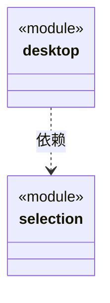

# src/bridge/server/bootstrap 架构

## 设计意图

在业务访问用户数据前选择可信运行资源，并隔离资源切换、失败恢复与正式应用启动。

`selection` 同步核实当前或已授权候选资源，`desktop` 持有冷壳更新及引擎缓存，把窄端口交给选定业务入口。准备候选与批准切换是不同事实；恢复依据原激活记录，不因为候选存在就启动它。开发态和正式资源均调用 `main.ts` 导出的 `startDesktop`，加载类型直接引用该模块；实际代码在选择完成后从固定 `main.js` 路径加载。

## 主要组成

| 组成 | 定位 |
| --- | --- |
| [desktop](desktop.ts) | 固定冷壳的桌面启动入口，选择已签名资源、持有更新与引擎缓存，并把窄端口交给业务入口。 |
| [selection](selection.ts) | Electron 打开原 profile 前，同步核实当前或已授权候选资源，并决定是否进入恢复。 |

<!-- architecture:generated:start -->

## 架构关系

[上层设计](../ARCHITECTURE.md)

<!-- architecture:generated:end -->
