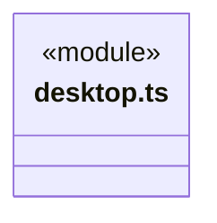
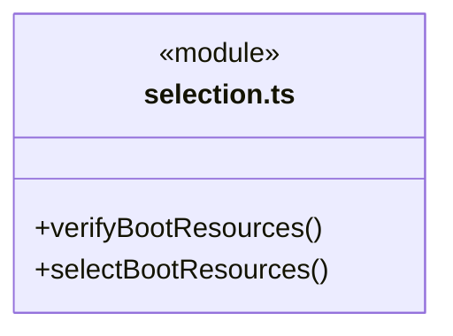
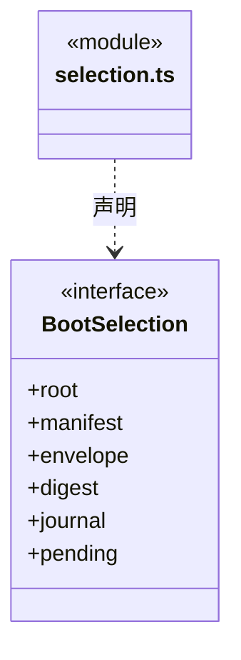
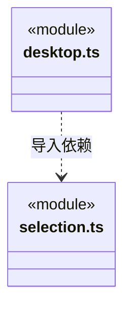

# src/bridge/server/bootstrap 架构

## 目录定位

固定冷壳入口：先验证同 C 的签名资源集合，再放行候选访问原 profile；独立选择日志、单实例、失败恢复及按需引擎下载由冷壳持有。计算式 main.js 装载保留可审计的源码依赖边。

本文描述当前实现。通过分析目录边界后维护的 [源码架构脚本](../../../../scripts/source-architecture.mjs) 同步清单和声明；代码变更时仍须核对职责、关键成员与关系。

## 代码清单

| 文件 | 当前职责 |
| --- | --- |
| [desktop.ts](desktop.ts) | 固定冷壳的桌面启动入口，选择已签名资源、持有更新与引擎缓存，并把窄端口交给业务入口。 |
| [selection.ts](selection.ts) | Electron 打开原 profile 前，同步核实当前或已授权候选资源，并决定是否进入恢复。 |

## 架构类图

### desktop.ts

直接依赖：[selection.ts](selection.ts)、[../../../logic/updates/service/runtime-journal.ts](../../../logic/updates/service/runtime-journal.ts)、[../../../logic/updates/service/runtime-manifest.ts](../../../logic/updates/service/runtime-manifest.ts)、[../../../logic/updates/service/engine-artifacts.ts](../../../logic/updates/service/engine-artifacts.ts)、[../../../logic/updates/service/runtime-store.ts](../../../logic/updates/service/runtime-store.ts)、[../../../logic/updates/service/runtime-updates.ts](../../../logic/updates/service/runtime-updates.ts)、[../../../logic/updates/service/desktop-updates.ts](../../../logic/updates/service/desktop-updates.ts)、[../../../logic/updates/service/nsis-updater.ts](../../../logic/updates/service/nsis-updater.ts)、[../../../logic/updates/service/restart-profile.ts](../../../logic/updates/service/restart-profile.ts)、[../../../logic/updates/service/runtime-host.ts](../../../logic/updates/service/runtime-host.ts)。

### selection.ts

直接依赖：[../../../logic/updates/service/runtime-journal.ts](../../../logic/updates/service/runtime-journal.ts)、[../../../logic/updates/service/runtime-manifest.ts](../../../logic/updates/service/runtime-manifest.ts)。

### 本目录调用边界

## 子目录导航

无子目录。

[返回上层](../ARCHITECTURE.md)。

每次修改本目录代码，同步维护文件头、关键契约说明及本图。未实现的治理、证据验收和自动编排能力不列入当前类图。

## 设计契约 v1 与落地范围

以下内容区分已接通能力与后续设计；以各节的实现状态为准，不将目标图当作现状图。维护源：[CONTRACT.md](CONTRACT.md)；生成类图时同步附加，勿直接修改本附录。

# 固定桌面冷壳

本目录随 C 发布。入口只验证资源、选择版本、持有 OS 单实例锁、提供更新/引擎端口和恢复界面；不持有任务、模型密钥或知识事务。业务入口由 `startDesktop(runtime)` 接收窄宿主端口。计算式装载 `loadApplication(entry)` 在依赖检查器中映射到真实 Main 源码边，不能据动态加载隐藏循环。

开发态直接装载相邻 main.js；所有打包版必须有 app.asar 内的 runtime-cold.json，缺失不能退回旧业务代码。冷配置固定 C、公钥、Windows x64 与能力指纹。R 的 main、preload、renderer、worker 和程序内置资源属于同一个目录。

原 profile 的 OS 单实例锁、冷壳自己的选择日志读取发生在业务验证前；此时没有窗口/session，也没有导入候选。资源验证全部同步完成后，候选访问原数据前必须先持久记录 data-access。原 profile 包括 localStorage 和配置，不仅是知识文件。

下载缓存位于 appData/CBIM-runtime/<安装及用户身份>/<C>；激活日志位于原 userRoot/desktop-runtime/<身份>/<C>，不随缓存清理消失。启动只校验小型 R（展开合计上限 256 MiB，单文件 64 MiB），不哈希/下载大型 E。读取已确认本地包不要求签名清单仍在远端有效期内，但始终核验签名、版本与完整文件集合。

候选尚未访问数据时验证失败，隔离该摘要并选择原确认 R。已访问数据、日志损坏或已确认资源缺失时，进入独立恢复 profile；只允许显式重试同一候选或退出，不自动降级。重试保留 dataAccessed 事实，不能因阶段重置再次获得自动回退资格。文件 flush、改名、回读不声称覆盖所有硬件断电/文件系统损坏模型。

窗口 loadFile/loadURL 成功与 React 挂载后的目录请求成功都发生后，才确认 R。窗口显示之后启动原工作区恢复策略；关闭仍等待正在打开及运行的工作区真实排空。

E 由 R 的 EnginePackages 按需准备。冷宿主只提供 engineArtifacts 验签/查询/准确摘要准备端口；版本发现不激活。准备进度和错误继续用于侧栏状态；退出/安装排空前取消准备。独立 E 索引与已接纳初始 R 签名证明保存在身份状态区，跨 C 保留，清缓存不丢发布序号或旧版本来源。冷壳不选择具体引擎、依赖或 SDK。

### 通用 E 缓存宿主

E 使用安装/用户身份下独立 engines 内容缓存，不再放进 codeVersion 目录。迁移查找同身份下版本号命名的旧 C 缓存，只复用已验证的相同包；C/R 更新仍用原资源缓存和恢复日志。R 预下载不再隐式更换 E，已运行包不受资源候选影响。冷宿主准备回执包含已验证适配器入口，不引用具体 SDK 或支持名单。
