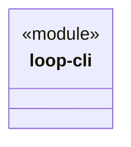

# src/bridge/server/commands 架构

## 设计意图

CLI 入口，复用应用和调度，不拥有第二套领域规则。

## 主要组成

| 组成 | 定位 |
| --- | --- |
| [loop-cli](loop-cli.ts) | 主进程命令入口：Pi Loop 开发 CLI：创建任务、显式恢复、中断和输出执行事件。 |

<!-- architecture:generated:start -->

## 架构关系

[上层设计](../ARCHITECTURE.md)

<!-- architecture:generated:end -->
