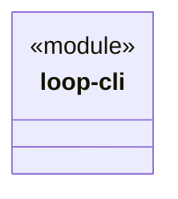

# src/bridge/server/commands 架构

## 设计意图

提供面向开发与诊断的命令行执行入口，复用业务应用的初始化、运行与关闭流程。

`loop-cli` 解析命令后创建应用、打开工作区并调用既有执行能力，把运行事件输出到终端。它不拥有另一份任务状态机；显式恢复和中断仍受原运行身份及业务规则约束。CLI 生命周期与桌面窗口生命周期彼此独立。

## 主要组成

| 组成 | 定位 |
| --- | --- |
| [loop-cli](loop-cli.ts) | 开发 CLI 的参数、应用生命周期和运行事件输出入口。 |

<!-- architecture:generated:start -->

## 架构关系

[上层设计](../ARCHITECTURE.md)

<!-- architecture:generated:end -->
