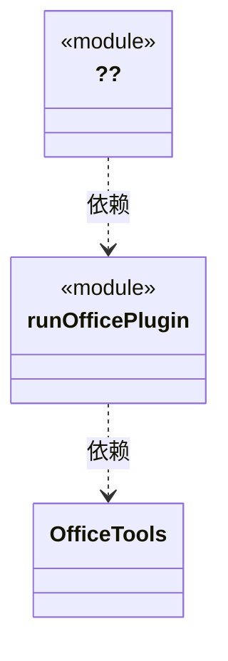

# 桌面宿主

## 设计意图

装配新版应用，协调窗口与桌面进程的生命周期。

office-plugin 将 Office 的 `ReadPermission` 传入受管引擎，启用已有文件与命令工具，并注册 Office 查询、派发工具。OfficeTools 复用既有工具分类、知识目录保护和 read/ask/execute 门禁：只读拒绝写入、命令和派发；ask 经桌面原生确认框逐次审批；execute 仍检查工作区路径与知识目录。文件路径检查包含符号链接和新文件的父目录。命令在宿主账号下执行，这些检查不是操作系统沙箱。

派发必须消费同一调用 ID 与参数的审批，权限变化或重复调用不能沿用旧授权。停止时取消待审批和子运行；工作记录保存工具输入、结果或拒绝原因。Office 只提供当前真实工具，浏览器验收尚未接入。

## 主要组成

project:organization 在受信桌面窗口内转接组织查询与新增/修改/删除；命令经严格 Schema 校验，不接受任意文件路径或能力覆盖。写入门禁与版本冲突由 OrganizationDirectory 负责，IPC 不复制组织业务规则。

project:business 接收登记项目 ID 与可选的严格业务修改命令，转接 BusinessDirectory 的查询和 CRUD；不接受文件执行或任意路径写入。office:insert 接收当前会话补充，转接 ProjectOffices.Insert，使用原轮模型和权限。

主与成员运行都按角色 connectorIds 经既有受管包服务取得会话：校验包、固定版本、组合工具目录，结束时释放会话和版本引用。未选择的连接器不注册工具；连接器副作用由实际会话描述，read 禁止写，ask 原生逐次确认，execute 执行。调用 ID、原始参数与当前权限绑定，禁止重放；Skill 不授予工具权限。独占连接器的获取等待最多 15 秒，超时取消，避免父子运行等待同一资源而永久挂起。

agent:settings / agent:members 转接项目配置服务；agent:connectors 只列出宿主目录和可用状态，不向页面传递产品入口或凭据。新桌面复用旧受管连接器装配的窄入口；logic-new 不反向依赖旧逻辑。

| ?? | ?? |
| --- | --- |
| [??](main.ts) | main.ts 打开新版首页，并在页面就绪后确认启动。 |
| [OfficeTools](office-tools.ts) | 适配原生工具授权和 Office 调用，持有本轮内部调用授权。 |
| [runOfficePlugin](office-plugin.ts) | 装配受管引擎、工具目录、取消和工作记录。 |

`project:data-architecture` 使用受信窗口校验及严格命令 Schema，转接 Application 持有的 DataArchitecture；只接受项目 ID、资料与预期版本，不接受文件路径、SQL 或数据库凭据。预加载的 DataArchitecture 方法仅返回可序列化目录快照。

office-plugin 将主任务的 OfficeInputs 接到已存在的原生 steer；缺少原生插入能力时，工具执行前发现新输入则拒绝本次旧调用并返回追加上下文，工具完成后发现新输入则随结果返回。已开始的工具不被追溯撤销。生成结束仍有未交付输入时，由 ProjectOffices 在同一主任务内续跑。原生交付不确定会记录告警，不谎称模型已执行或自动重发；成员不消费主队列。

<!-- architecture:generated:start -->

## 架构关系

[上层设计](../ARCHITECTURE.md)

<!-- architecture:generated:end -->

### Office 指令排队

office:queue 通过严格动作契约接收、读取、重排、编辑、移除和插入指令；消费由 Application.officeQueue 驱动，office:progress 广播执行进度。office:stop 同时暂停待执行队列，避免停止后自动启动下一条。

### 项目与对话导航

menu:navigation 暴露严格校验的导航读写；project:reveal 仅接受已登记项目 ID，由宿主查找真实路径后打开系统文件管理器，渲染层不能传任意路径。
