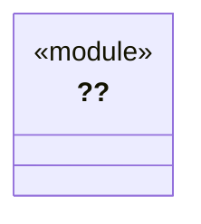

# 桌面宿主

## 设计意图

装配新版应用，协调窗口与桌面进程的生命周期。

## 主要组成

| ?? | ?? |
| --- | --- |
| [??](main.ts) | main.ts 打开新版首页，并在页面就绪后确认启动。 |

<!-- architecture:generated:start -->

## 架构关系

[上层设计](../ARCHITECTURE.md)

<!-- architecture:generated:end -->
